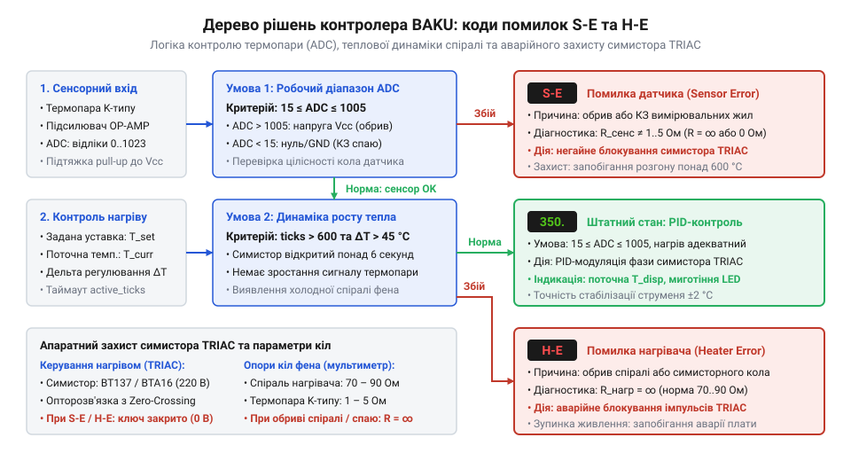
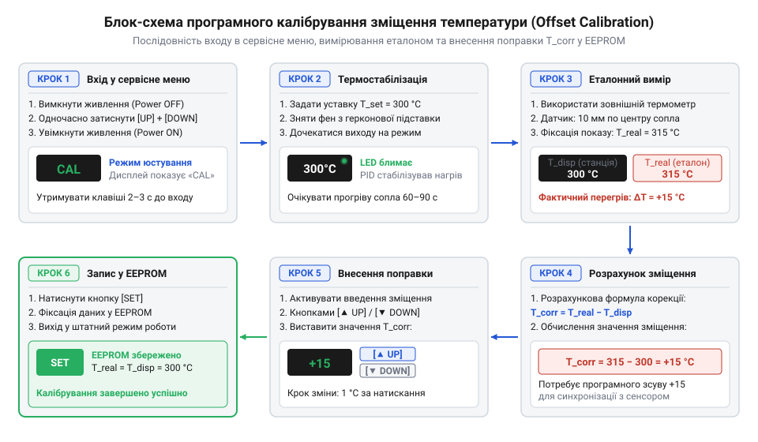

# Довідник режимів індикації, кодів помилок та калібрування цифрових станцій BAKU

<preknowlist>
- [Термофен BAKU BK-8033](root:cat-hw-instruments/hot-air-station-baku) — Загальна будова паяльної станції, принцип роботи термофена, нагрівального елемента та герконової підставки.
- [Антистатичний захист (ESD) при паянні чутливих компонентів](root:cat-hw-instruments/esd-safe-soldering-practices) — Правила безпеки при роботі з заземленими приладами та захист електронних модулів станції від статичного розряду.
</preknowlist>

## Ризики неінтерпретованих збоїв термостабілізації

Робота з цифровою паяльною станцією або термофеном вимагає від оператора постійного контролю за станом нагрівального елемента та джерела гарячого повітря. Раптове зникнення нагріву або поява незрозумілих символів на цифровому індикаторі під час паяльних робіт часто викликає у недосвідченого майстра прагнення негайно перезапустити живлення приладу тумблером. Проте неінтерпретована реакція контролера на збій системи термостабілізації приховує значні ризики як для самого обладнання, так і для електронного модуля, що ремонтується.

Коли цифровий мікроконтролер станції фіксує відхилення в колі зворотного зв'язку, він активує захисний алгоритм зупинки нагріву. Якщо оператор ігнорує аварійне повідомлення або не розуміє фізичної причини відключення, виникає небезпека термічного розгону. У разі пошкодження термопари без відповідного захисту прошивки симисторний ключ залишався б у повністю відкритому стані. Це призводить до розігріву керамічного сердечника термофена понад 600 °C за кілька секунд, що спричиняє плавлення ніхромової спіралі, деформацію пластикового корпусу рукоятки та навіть ризик виникнення пожежі в робочій зоні.

Не менш небезпечним є неправильне поводження з приладом під час штатних режимів зниження температури. Спроба вимкнути живлення станції загальним вимикачем у момент, коли нагрівальний елемент термофена ще розжарений до 400 °C, зупиняє турбіну подачі повітря. За відсутності примусового потоку залишкове тепло керамічного ядра миттєво перегріває внутрішній ізолятор рукоятки. Це викликає термічний шок нагрівального елемента та скорочує ресурс його роботи в рази.

Невірне сприйняття відображуваних даних позначається і на якості монтажу. Відсутність розуміння того, що індикована значення на дисплеї відхиляється від реальної температури повітряного потоку, призводить до використання перегрітого або недогрітого припою. Завищена температура викликає відшарування мідних доріжок друкованої плати та термічну деструкцію активних флюсів, тоді як занижена створює дефекти «холодної спайки».

Використання таких пристроїв, як [термофена BAKU BK-8033](root:cat-hw-instruments/hot-air-station-baku), вимагає від майстра чіткого розуміння захисних блокувань прошивки. Під час маніпуляцій з чутливими компонентними модулями важливо дотримуватися вимог [антистатичного захисту ESD](root:cat-hw-instruments/esd-safe-soldering-practices), щоб уникнути електричного пробою чутливих кіл приладу через заземлення. Крім того, правильний вибір температурних профілів є критичним при нанесенні сучасних [паяльних флюсів та паст](root:cat-hw-instruments/smd-soldering-fluxes-and-pastes). Таким чином, систематичний розбір кодів помилок, алгоритмів автоматичного охолодження та методів програмного калібрування є необхідною умовою безпечної та довговічної експлуатації станції.

## Структура індикації та коди помилок

Візуалізація робочих параметрів цифрових станцій BAKU здійснюється за допомогою 7-сегментних @@en|LED@@ (від англ. *light-emitting diode* — світлодіод) або рідкокристалічних @@en|LCD@@ (від англ. *liquid-crystal display* — рідкокристалічний дисплей) індикаторів. Вбудований мікроконтролер постійно виконує цикл зчитування напруги з аналогових датчиків та порівнює їх із заданою користувачем уставкою. Для перетворення аналогового сигналу термопари у цифровий код використовується модуль @@en|ADC@@ (від англ. *analog-to-digital converter* — аналого-цифровий перетворювач). При виникненні апаратних відхилень прошивка станції блокує вихідні імпульси керування та виводить на екран літерно-цифрові коди помилок `S-E` та `H-E`.

Код `S-E` (від англ. *Sensor Error* — помилка датчика) вказує на дефект у колі вимірювання температури. Схемотехнічно термопара K-типу підключена до вимірювального підсилювача, вихід якого подається на вхід @@en|ADC@@ мікроконтролера. Для виявлення фізичного обриву провідників термопари у схему вводиться підтягувальний резистор великого опору до лінії живлення. У разі механічного обриву термопари або від'єднання роз'єму напруга на вході @@en|ADC@@ зростає до верхнього рівня живлення, що відповідає значенню коду понад максимально допустиме. Якщо ж у колі виникає коротке замикання вимірювальних жил між собою або на спільний дріт, напруга падає до нульового значення. В обох випадках мікроконтролер розпізнає вихід сигналу за межі робочого діапазону, фіксує `S-E` та негайно закриває силовий ключ @@en|TRIAC@@ (від англ. *triode for alternating current* — симетричний тріодний тиристор), щоб відключити живлення нагрівача.

Код `H-E` (від англ. *Heater Error* — помилка нагрівача) сигналізує про відсутність теплової віддачі від керамічного елемента при подачі силового живлення. Мікроконтролер аналізує динаміку зміни температури: якщо протягом визначеного часу після відкриття симистора значення напруги від термопари не зростає, прошивка фіксує відсутність струму в колі нагріву. Причинами виникнення `H-E` є фізичний перегорання ніхромової спіралі керамічного нагрівача, вихід з ладу запобіжника, обрив силового провідника у кабелі або відсутність керуючих імпульсів від кола виявлення нуля @@en|Zero-Crossing Detect@@.


*Схема прийняття рішень контролером станції BAKU при розпізнаванні аварійних режимів датчика та нагрівального елемента.*

У сучасних відкритих системах керування, таких як пристрої під управлінням [відкритої прошивки IronOS](root:cat-hw-instruments/ironos-open-firmware-soldering), аналогічні захисні алгоритми реалізовані через програмні переривання. У станціях BAKU логіка діагностики працює на рівні базового циклу мікроконтролера.

Нижче наведено приклад реалізації діагностичного модуля контролера для аналізу вхідних параметрів та формування кодів помилок:

:::tabs
:::code api-baku-station-firmware-error-codes/c/evaluate-station-safety.c
:::code api-baku-station-firmware-error-codes/cpp/stationstatus.cpp
:::

## Алгоритм автоохолодження та індикація нагріву

Автоматичне охолодження термофена є штатним алгоритмом безпечної зупинки, який захищає нагрівальний елемент від перегріву при завершенні маніпуляцій. Усередині рукоятки термофена встановлено герконовий датчик (магнітокерований контакт), а в тримачі (підставці) станції розміщено постійний магніт. Поки оператор тримає фен у руці, геркон розімкнений, і станція працює в робочому режимі.

Коли рукоятка встановлюється на підставку, магнітне поле замикає контакти геркона. Мікроконтролер розпізнає зміну логічного рівня на цифровому вході та переводить пристрій у режим очікування @@en|Sleep Mode@@ та режим автоохолодження @@en|Cooling Mode@@. При цьому керуюча програма виконує наступні кроки:
1. Повністю знімається напруга з симисторного ключа @@en|TRIAC@@, зупиняючи подачу енергії на керамічний нагрівач. 2. Вентилятор (турбіна) підтримує максимальний або високий потік повітря для інтенсивного виведення залишкового тепла з каналу рукоятки. 3. На дисплеї відображається поточна температура, що поступово знижується, або символи `SLP` / `OFF`, які чергуються з реальними показами. 4. Продувка триває доти, доки температура за даними термопари не опуститься нижче безпечної позначки у 100 °C.

Щойно поріг 100 °C досягнуто, мікроконтролер вимикає живлення турбіни та переводить дисплей у режим глибокого сну з відображенням трьох рисок (`---`) або напису `OFF`. Спроба зняти фен з підставки до завершення продувки негайно скасовує режим автоохолодження, після чого прошивка відновлює роботу турбіни та симистора для швидкого виходу на задану уставку.

Для візуального контролю роботи симисторного ключа на передній панелі використовується пульсуюча децимальна крапка на 7-сегментному індикаторі або окремий світлодіод індикації нагріву. Логіка його світіння безпосередньо відображає роботу алгоритму @@en|PID@@ (від англ. *proportional-integral-derivative* — пропорційно-інтегрально-диференціальний) регулятора:
- Безперервне світіння індикатора вказує на подачу 100% потужності на нагрівач (первинний розігрів від кімнатної температури до уставки). - Ритмічне миготіння свідчить про вихід на режим термостабілізації. Мікроконтролер подає пачки імпульсів на симистор через оптично розв'язаний драйвер, підтримуючи задану температуру з точністю до кількох градусів. - Відсутність світіння означає повністю відключений нагрів (під час автоохолодження або при досягненні уставки без потреби корекції).

Дотримання циклу автоохолодження є необхідним при виконанні робіт з ізоляційними матеріалами, зокрема під час усадки елементів [термоусадкової трубки в наборах](root:cat-hw-instruments/heat-shrink-tubing), де часті паузи в роботі вимагають регулярного повернення фена на підставку.

## Програмне калібрування зміщення температури

Тривала експлуатація паяльної станції, заміна керамічного нагрівача або знос термопари спричиняють появу систематичної похибки між фактичною температурою повітряного потоку та значенням на дисплеї. Для усунення цієї розбіжності без фізичного втручання в схему вимірювального підсилювача у прошивці BAKU передбачено режим програмного калібрування зміщення @@en|Offset Calibration@@ (від англ. *offset* — зміщення, та *calibration* — калібрування).

Вхід у сервісне меню калібрування здійснюється за допомогою комбінації клавіш під час подачі живлення:
1. Вимкнути станцію тумблером живлення. 2. Затиснути та утримувати кнопки регулювання температури (найчастіше комбінацію `UP` + `DOWN` або кнопку `SET`). 3. Увімкнути тумблер живлення, не відпускаючи кнопки, доки на дисплеї не з'явиться служебне повідомлення `CAL` або поточне значення коефіцієнта зміщення.

Після переходу в сервісний режим виконується алгоритм юстування показань:
1. Задається контрольна уставка температури, наприклад `T_set = 300 °C`. 2. Очікується повна термостабілізація приладу (індикатор нагріву переходить у режим рівномірного миготіння). 3. Зовнішній вимірювальний термопарний датчик або калібрований термометр позиціонується на відстані 10 мм від зрізу сопла термофена по центру потоку. 4. Фіксується реальне значення температури `T_real`. 5. Обчислюється величина зміщення `T_corr`:

```
T_corr = T_real - T_disp
= 315 - 300              [віднімання індикованого значення від реального]
= +15                    [необхідне зміщення у градусах Цельсія]
```

Отриманий коефіцієнт вноситься через меню калібрування за допомогою кнопок зміщення. Після підтвердження кнопкою `SET` значення записується в енергонезалежну пам'ять @@en|EEPROM@@ (від англ. *electrically erasable programmable read-only memory* — електрично стираний програмований постійний запам'ятовувальний пристрій) мікроконтролера, і станція повертається до штатного режиму роботи.


*Алгоритм юстування показань температури станцій BAKU за допомогою зовнішнього контрольного термометра.*

Точність утримання температури після калібрування стає вирішальною при виконанні відповідальних робіт, таких як монтаж виводних компонентів за допомогою [техніки монтажу в отвори](root:cat-hw-instruments/through-hole-soldering-techniques), де перегрів може пошкодити внутрішні структури напівпровідників.

## Інструментальна діагностика кіл та датчиків

Якщо програмне калібрування не дозволяє усунути похибку або на дисплеї постійно відображаються коди помилок `S-E` чи `H-E`, виконується інструментальна перевірка електричних кіл. Основні вимірювання проводяться за допомогою цифрового мультиметра @@en|Multimeter@@ (від англ. *multimeter* — багатофункціональний вимірювальний прилад) у режимах вимірювання опору та прозвонки на контактах роз'єму рукоятки фена.

При відключеному від мережі приладі вимірюються опорні параметри на контактах авіаційного роз'єму рукоятки:
- **Коло нагрівального елемента**: Опір виводів спіралі керамічного нагрівача (для станцій з живленням 220 В) має становити від `70 Ом` до `90 Ом`. Опір `OL` (нескінченність) свідчить про внутрішній обрив ніхромової нитки або спрацьовування термозапобіжника. Опір менше `10 Ом` вказує на міжвиткове коротке замикання. - **Коло термопари**: Опір термопари K-типу у холодному стані становить від `1 Ом` до `5 Ом`. Опір понад `20 Ом` говорить про деградацію контактів, а `OL` — про фізичний обрив вимірювальних жил у кабелі. Додатково при підключенні мультиметра у режимі вимірювання мілівольт постійного струму та нагріванні сопла запальничкою напруга повинна плавно зростати від 0 до 15 мВ. - **Коло герконового датчика**: У вільному стані рукоятки контакти розімкнені (опір `OL`). При піднесенні магніту опір падає до `0 Ом`. - **Коло двигуна турбіни**: Опір обмотки постійного струму становить від `10 Ом` до `30 Ом`.

На силовій платі керування перевірці підлягає симисторний ключ (наприклад, BTA16) та оптосимистор розв'язки. При вимкненому живленні опір між силовими виводами симистора MT1 та MT2 повинен бути понад `1 МОм`. Пробій симистора (опір близький до `0 Ом`) призводить до неконтрольованого постійного нагріву фена одразу після ввімкнення тумблера мережі, що створює критичну аварійну ситуацію.

У разі виявлення пошкоджень у з'єднувальному кабелі відновлення провідності здійснюється шляхом заміни пошкоджених ділянок із використанням [обтискних кліщів Dupont](root:cat-hw-instruments/crimp-tool) та якісних [накінечників та клем опресування](root:cat-hw-instruments/wire-terminals-and-crimp-connectors), що забезпечує мінімальний перехідний опір у силових та вимірювальних колах.