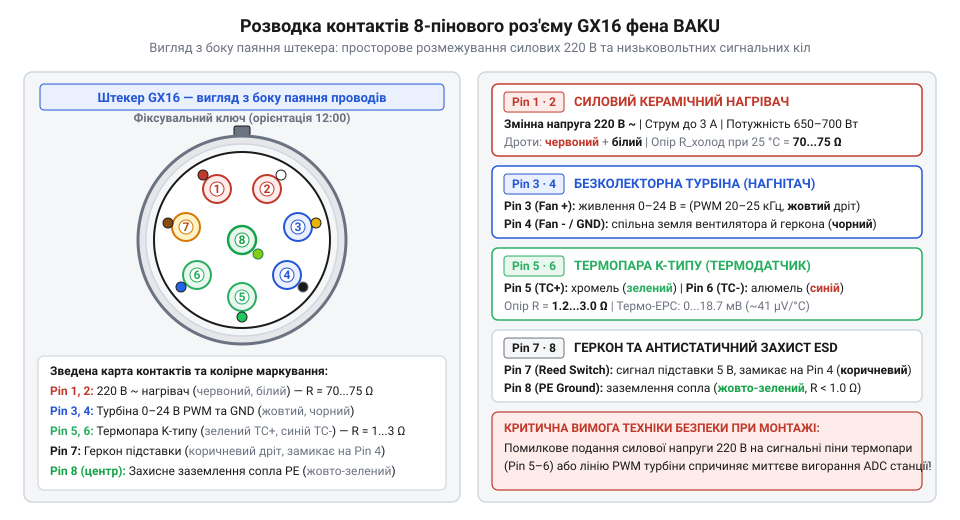
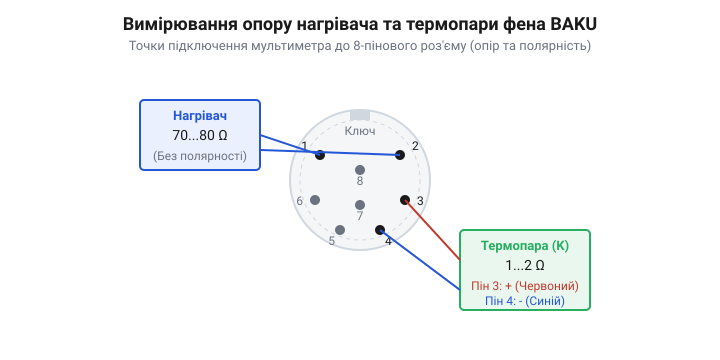

# Апаратний довідник розводки та електричних параметрів роз'єму фена BAKU

<preknowlist>
- [Термофен BAKU BK-8033](root:cat-hw-instruments/hot-air-station-baku) — Загальна конструкція термоповітряної паяльної станції та підключення знімного фена.
- [Антистатичний захист (ESD) при паянні чутливих компонентів](root:cat-hw-instruments/esd-safe-soldering-practices) — Базові принципи вирівнювання потенціалів та заземлення вимірювального й паяльного обладнання.
</preknowlist>

## Небезпека помилкової комутації силових ліній

Коли виникає потреба замінити пошкоджений джгут, перепаяти з'єднувальний штекер або підключити знімний фен термоповітряної паяльної станції до іншого блоку керування, майстер має справу з компактним кабелем, всередині якого щільно поєднані провідники з кардинально різними електричними потенціалами та призначенням. У з'єднувальному рукаві паяльного інструмента поруч проходять силові лінії змінної мережевої напруги 220 В для нагрівального елемента, кола постійного струму живлення турбіни, слабострумові вимірювальні провідники термопари K-типу з сигналом у мільйони часток вольта та цифрова лінія герконового датчика положення.

Якщо при перепаянні або заміні роз'єму допустити помилку та переплутати місцями силові й сигнальні контакти, наслідки для станції стануть катастрофічними й безповоротними. Подання змінної напруги 220 В замість силового нагрівача на чутливий аналоговий вхід диференційного підсилювача чи вимірювального @@en|ADC@@ (від англ. @@en|analog-to-digital converter@@ — аналогово-цифровий перетворювач, грец. @@el|analogos@@) мікроконтролера викликає миттєвий електричний пробій напівпровідникового кристала. Оскільки аналоговий вхід обробки сигналу термопари розрахований на напругу від 0 до 30 мВ, потенціал 220 В перевищує гранично допустиму норму більш ніж у 7000 разів. Це призводить до вибухового вигорання вхідних операційних підсилювачів, пробою внутрішніх захисних діодів і повного руйнування головного контролера станції.

Аналогічно, переполюсовка або помилкова комутація мережевих ліній на кола постійного струму (0–24 В) електродвигуна турбіни спричиняє вигорання ключового @@en|MOSFET@@-транзистора або схем @@en|PWM@@-керування обертами, а також термічне руйнування обмоток самого безколекторного вентилятора. При підключенні [термоповітряного фена BAKU](root:cat-hw-instruments/hot-air-station-baku) будь-яка плутанина в комутації перетворює ремонтний інструмент на джерело короткого замикання та пожежної небезпеки.

Саме тому володіння чіткою схемотехнічною картою розводки, розуміння електричних параметрів кожного провідника та обов'язкова інструментальна перевірка кіл мультиметром перед першим увімкненням є жорсткою вимогою технологічної безпеки під час відновлення паяльного обладнання.

## Схема призначення виводів роз'єму GX16

Для швидкого й надійного підключення рукава фена до блоку паяльної станції застосовується 8-піновий авіаційний роз'єм (англ. @@en|aviation connector@@) серії GX16 (або його великогабаритний аналог GX20). Цей роз'єм має металевий циліндричний корпус із різьбовою фіксацією накидної гайки, що запобігає випадковому висмикуванню кабелю під час роботи. На ізоляційній вставці штекера розташовано 8 контактних пінів, кожен із яких має чітке схемотехнічне призначення.

Нумерація контактів стандартизована й нанесена рельєфними цифрами безпосередньо на керамічний або термопластиковий ізолятор з боку паяльного хвостовика (де припаюються жили кабелю). Якщо дивитися на контактну групу з боку паяння штекера при орієнтації фіксувального паза (ключа) догори, піни розташовані по колу із центральним виводом.


*Схема розташування та призначення контактів 8-пінового штекера GX16 з боку паяння.*

Призначення кожного з 8 контактів з'єднувального роз'єму виглядає наступним чином:

* **Pin 1 — @@en|Heater@@ L1**: Перший силовий вивід керамічного нагрівального елемента (змінна напруга 220 В). * **Pin 2 — @@en|Heater@@ L2**: Другий силовий вивід керамічного нагрівального елемента (змінна напруга 220 В). * **Pin 3 — @@en|Fan@@ +**: Позитивний вивід живлення безколекторного двигуна турбіни (постійна напруга 0–24 В з @@en|PWM@@-регулюванням). * **Pin 4 — @@en|Fan@@ - / @@en|GND@@**: Спільний мінусовий вивід (земля) для кола турбіни та герконового датчика. * **Pin 5 — @@en|Thermocouple@@ TC+**: Позитивний вивід термопари K-типу (плюсовий аналоговий сигнал температури). * **Pin 6 — @@en|Thermocouple@@ TC-**: Негативний вивід термопари K-типу (мінусовий аналоговий сигнал температури). * **Pin 7 — @@en|Reed Switch@@**: Сигнальний контакт герконового вимикача (датчик автоохолодження й режиму @@en|Standby@@). * **Pin 8 — @@en|PE Ground@@**: Лінія захисного заземлення металевого сопла для забезпечення @@en|ESD@@-безпеки.

Під час монтажу проводів у циліндричні паяльні чашки роз'єму необхідно використовувати відповідний [припій з флюсом](root:cat-hw-instruments/solder-tin) та ретельно ізолювати кожен контакт термоусадковими гільзами, щоб виключити будь-яку можливість короткого замикання між сусідніми пінами.

## Електричні параметри та колірне маркування

Кожна з восьми жил усередині кабельного джгута фена BAKU розрахована під конкретні робочі напруги, струми та тип сигналу. Розуміння електричних характеристик і колірної ідентифікації провідників дозволяє швидко зорієнтуватися під час розбирання джгута чи заміни пошкодженого кабелю.

Силові лінії нагрівального елемента (**Pin 1** та **Pin 2**) транспортують змінний струм мережевої напруги (220 В, 50 Гц) з піковою потужністю до 650–700 Вт. У момент первинного розігріву струм споживання досягає 3 А. Для зменшення втрат і запобігання перегріву ізоляції ці жили мають збільшений переріз мідного провідника (AWG 20–22) та щільну силіконову або фторопластову термостійку ізоляцію. Стандартно в оригінальних джгутах BAKU вони маркуються **червоним** та **білим** (або двома товстими червоними) кольорами.

Кола живлення повітряного вентилятора (**Pin 3** та **Pin 4**) працюють під постійною напругою 0–24 В при максимальному струмі споживання до 0.4 А. Оберти безколекторної турбіни регулюються за допомогою імпульсно-широтної модуляції (@@en|PWM@@, від англ. @@en|pulse-width modulation@@) із частотою близько 20–25 кГц. Провідник **Pin 3** (плюс турбіни) зазвичай має **жовту** ізоляцію, а **Pin 4** (мінус/GND) — **чорну** або **синю**.

Сигнальні провідники термопари K-типу (**Pin 5** та **Pin 6**) передають аналоговий термо-е.д.с. потенціал. Матеріал провідників термопари — хромель (плюс) та алюмель (мінус). При зміні температури від 25 °C до 480 °C напруга на виводі змінюється від 0 мВ до приблизно 18.7 мВ (зі стандартною чутливістю близько 41 мкВ/°C за рахунок ефекту Зеєбека, нім. @@de|Seebeck-Effekt@@). Через низький рівень сигналу ці жили виконані у вигляді тонкої витої пари (маркуються **зеленим** для TC+ та **червоним/синім** для TC-).

Сигнал герконового датчика (**Pin 7**) підключений до слабострумового кола 5 В із підтягувальним резистором на платі станції. При встановленні фена на підставку внутрішній геркон (англ. @@en|reed switch@@, від англ. @@en|reed@@ — очерет) під дією постійного магніту замикає **Pin 7** на спільний мінус **Pin 4** (GND), сигналізуючи мікроконтролеру про перехід у режим підготовки до вимкнення й охолодження. Цей провідник найчастіше має **коричневу** або **сіру** ізоляцію.

Лінія заземлення сопла (**Pin 8**) виконана у вигляді провідника з **жовто-зеленою** ізоляцією або захисного екранувального оплетення.

Для швидкого й акуратного оброблення жил кабелю перед монтажем використовується [автоматичний знімач ізоляції](root:cat-hw-instruments/wire-stripper), а для надійної захисної ізоляції місць паяння застосовуються [термоусадкові трубки](root:cat-hw-instruments/heat-shrink-tubing).

## Діагностика кіл та вимірювання опору

Перед підключенням реконструйованого або відремонтованого джгута фена до станції обов'язково проводиться інструментальна діагностика всіх кіл за допомогою цифрового мультиметра при кімнатній температурі (25 °C). Це дозволяє надійно відрізнити справні вузли від обриву або внутрішнього короткого замикання.


*Схема підключення мультиметра для вимірювання опорних опорів та полярності датчиків.*

Процедура діагностики здійснюється покроково за такою методикою:

**1. Перевірка керамічного нагрівача (Pin 1 – Pin 2):**
Переводють мультиметр у режим вимірювання опору (діапазон 200 Ом) і підключають щупи до контактів 1 та 2. Для справного керамічного елемента BAKU потужністю 650–700 Вт значення опору при 25 °C має перебувати в межах від 70 Ом до 75 Ом. Розрахунок номінальної теплової потужності за виміряним опором виконується за формулою:

```
R_cold = 78.5            [опір керамічного нагрівача при 25 °C, Ом]
P_nominal = U^2 / R_cold
          = (230)^2 / 78.5  [підстановка мережевої напруги 230 В]
          = 52900 / 78.5    [обчислення квадрату напруги]
          = 673.8 W         [номінальна теплова потужність нагрівача]
```

Якщо мультиметр показує нескінченність (позначка `OL` або `1`), у колі нагрівача є обрив провідника або руйнування ніхромової/керамічної спіралі. Якщо опір менше 10 Ом — має місце міжвиткове коротке замикання.

**2. Вимірювання та перевірка полярності термопари (Pin 5 – Pin 6):**
Опір холодної термопари K-типу між контактами 5 та 6 є дуже малим і становить 1.2–3.0 Ом. Якщо опір дорівнює нескінченності, датчик температури зламано або обірвано дріт.

Для перевірки полярності підключення мультиметр переводють у режим вимірювання постійної напруги (діапазон 200 мВ). Червоний (плюсовий) щуп підключають до **Pin 5**, а чорний (мінусовий) — до **Pin 6**. Злегка підігрівають сопло фена теплом долоні або паяльником. При правильному підключенні напруга на дисплеї має зростати в плюсову сторону (наприклад, +0.5... +2.0 мВ). Якщо на дисплеї з'являється від'ємне значення (-mV), полярність термопари переплутана (TC+ та TC- потрібно поміняти місцями).

**3. Перевірка герконового датчика (Pin 7 – Pin 4):**
Щупи приєднують до контактів 7 та 4 у режимі прозвонки. Коли фен знаходиться в повітрі, геркон розімкнений (опір нескінченний). При наближенні корпусу фена до магніту на підставці геркон має чітко замикатися з звуковим сигналом (опір менше 1 Ом).

Під час проведення ремонтних робіт та перепайки контактів рекомендується використовувати [якісний безвідмивний флюс](root:cat-hw-instruments/flux-fvs7) для забезпечення високої механічної та електричної надійності спайних з'єднань.

## Захисне заземлення та антистатична безпека

Вивід **Pin 8** роз'єму GX16 відіграє критичну роль у забезпеченні електростатичної безпеки (англ. @@en|ESD@@, від @@en|electrostatic discharge@@ — електростатичний розряд) під час роботи з чутливою електронною компонентною базою (SMD-мікросхеми, польові транзистори, CMOS-процесори).

Повітряний потік, що з високою швидкістю продувається турбіною через внутрішні керамічні ізолятори та металеве сопло фена, викликає трибоелектричний ефект — тертя повітря об поверхні призводить до накопичення на металевому кожусі фена значного стаціонарного електричного заряду. Потенціал на незаземленому соплі може досягати кількох тисяч вольт. Якщо таким соплом торкнутися виводів плати з чутливими елементами, відбудеться миттєвий пробій тонких діелектричних шарів кремнію, що повністю виведе компонент з ладу.

Для запобігання цьому явищу металеве сопло й захисний кожух фена BAKU жорстко з'єднані з внутрішнім провідником заземлення, який виведений на **Pin 8** роз'єму GX16. Усередині паяльної станції цей пін напряму підключений до контуру захисного заземлення (PE, від англ. @@en|Protective Earth@@) мережевого кабелю живлення.

Механізм захисту полягає у безперервному стіканні статичного заряду з сопла фена в шину заземлення будівлі, завдяки чому потенціал сопла завжди дорівнює нулю.

Перед початком паяння чутливих плат необхідно обов'язково перевірити цілісність кола заземлення: опір між металевим соплом фена та контактом **Pin 8** штекера (або заземлювальним контактом вилки станції) повинен бути менше **1.0 Ом**. Якщо опір перевищує цю норму, лінію заземлення необхідно відновити, використавши [накінечники для опресування провідників](root:cat-hw-instruments/wire-terminals-and-crimp-connectors) та перевіривши якість монтажу відповідно до правил [антистатичного захисту ESD](root:cat-hw-instruments/esd-safe-soldering-practices).