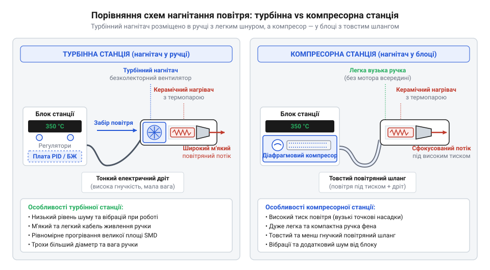
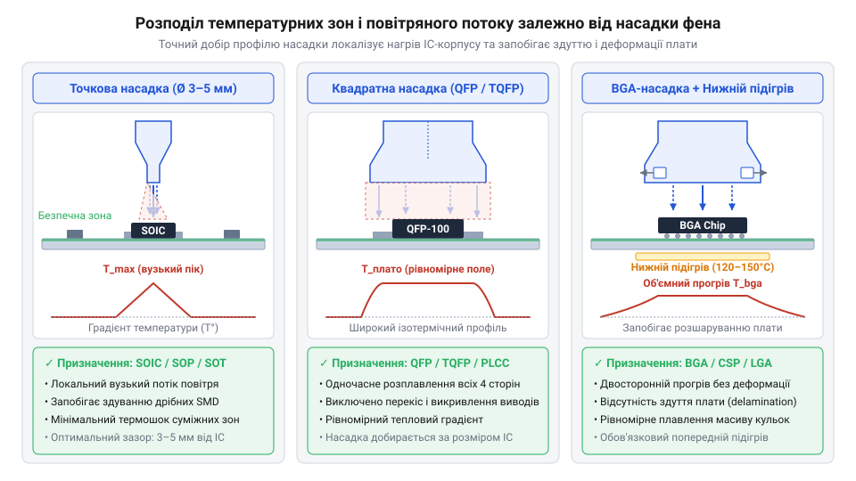
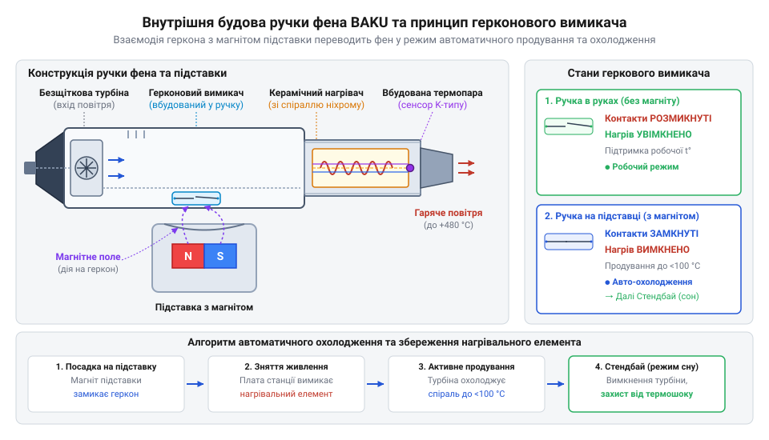

# Термоповітряні паяльні станції та фени BAKU

<preknowlist>
- [Паяльні флюси та пасти для монтажу гарячим повітрям](root:cat-hw-instruments/smd-soldering-fluxes-and-pastes) — поведінку паяльних паст і флюсів при конвективному нагріві гарячим повітрям та температури їхньої активації
- [Властивості та термопрофілі трубчастих припоїв і припайних паст](root:cat-hw-instruments/solder-paste-and-lead-free-alloys-properties) — температури плавлення свинець-вмісних і безсвинцевих сплавів та фази термопрофілювання
- [Антистатичний захист (ESD) при паянні чутливих компонентів](root:cat-hw-instruments/esd-safe-soldering-practices) — правила заземлення та антистатичного захисту при роботі з чутливими SMD-мікросхемами
</preknowlist>

## Перегрів та здерті площадки при паянні

Кожен сервісний майстер або інженер-розробник при спробі демонтувати багатовивідну мікросхему в корпусі @@en|QFP@@ (від @@en|Quad Flat Package@@ — квадратний плоский корпус) або великий планарний @@en|SMD@@ (від @@en|Surface Mount Device@@ — пристрій для поверхневого монтажу) компонент за допомогою звичайного контактного паяльника стикається з фізичною неподоланою перешкодою. Традиційне жало паяльника здатне передавати теплову енергію лише через прямий механічний контакт, охоплюючи одночасно не більше одного або двох виводів. Коли майстер намагається почергово прогрівати контактні площадки по периметру мікросхеми, припій на перших виводах встигає повністю застигнути до того моменту, як жало торкнеться протилежного боку корпусу. Намагання примусово відокремити мікросхему в умовах, коли частина її контактів залишається в твердій фазі, неминуче призводить до відриву мідних струмопровідних доріжок разом із контактними площадками від текстолітової основи.

Фізична причина цієї проблеми полягає в принциповій обмеженості контактного теплопередавання. Друкована плата на основі склотекстоліту @@en|FR-4@@ розрахована на локальні термічні навантаження, проте тримання гарячого жала на одній точці тривалий час викликає місцеве перегрівання понад 260 °C. Це призводить до термодеструкції епоксидного сполучного матеріалу, розшарування шарів плати та незворотного пошкодження внутрішньої кремнієвої структури самої мікросхеми через високий температурний градієнт між її виводами. Спроба розплавити припій шляхом додавання великої краплі сплаву по всьому ряду виводів створює масивні перемички та вимагає подальшого застосування [мідного плетіння для видалення](root:cat-hw-instruments/solder-wick) припаю, що знову ж таки створює високий ризик механічного пошкодження маски та контактних площадок.

Виходом із цього технологічного тупика є перехід від контактного теплопередавання до безконтактного конвективного нагріву. Гарячий повітряний струмінь омиває увесь корпус компонента та його контактні площадки одночасно, рівномірно прогріваючи виводи по всьому периметру. Оскільки середовищем-теплоносієм виступає форсоване повітря, кожен контакт досягає точки рідкої фази припою в один і той самий момент часу. Це дозволяє зняти компонент з друкованої плати без найменшого механічного зусилля та без загрози здирання доріжок. Для забезпечення ефективного теплообміну та запобігання окисленню контактів під час суцільного нагріву обов'язково застосовують спеціалізований [паяльними флюсами та пастами](root:cat-hw-instruments/smd-soldering-fluxes-and-pastes) рідкий або гелеподібний склад, який знижує поверхневий натяг припою та покращує плинність сплаву. Докладний огляд класифікації, термостійкості та поведінки гелеподібних матеріалів при безконтактному конвекційному нагріві дивіться у матеріалі про [паяльні флюси та пасти для монтажу гарячим повітрям](root:cat-hw-instruments/smd-soldering-fluxes-and-pastes).

Історія винайдення термоповітряного паяння сягає 1980-х років із масовою появою перших корпусованих @@en|SMD@@ та @@en|QFP@@ елементів, коли класичний контактний паяльник переставав забезпечувати одночасний прогрів десятків виводів. Перші громіздкі компресорні станції на кшталт @@en|Hakko 850@@ дали поштовх безконтактному демонтажу, але були важкими та шумними. Згодом еволюція китайських станцій сімейства @@en|BAKU@@ (зокрема популярних моделей @@en|BK-878L@@, @@en|BK-858L@@ та @@en|BK-601D@@) привела до поява компактних турбінних фенів із нагнітачем прямо в ручці. Стандартизація дешевих аналогових і цифрових плат керування на базі мікроконтролерів серії @@en|8051@@ та @@en|STM8@@ разом із симисторними (від симетричний тріодний тиристор) ключами перетворила термоповітряний демонтаж на масовий інструмент кожної сервісної майстерні. Водночас еволюціонували й засоби безпеки: від простих механічних вимикачів живлення інженерійно перейшли до впровадження @@en|герконових@@ (від @@en|hermetically sealed contact@@ — герметичний контакт) датчиків автоохолодження для запобігання термічному деформуванню та обриву нагрівальної спіралі.

Отже, безконтактний конвективний нагрів стає єдиним безпечним способом маніпулювання багатовивідними компонентами. Докладно покрокові алгоритми налаштування температурних режимів та позиціонування насадок під час монтажу складних корпусів викладено у [практикумі з термоповітряного демонтажу](root:cat-hw-instruments/baku-hot-air-stations-family/proj-qfp-bga-hot-air-rework.md).

## Турбінні та компресорні станції BAKU

Зрозумівши необхідність застосування форсованого гарячого повітря для демонтажу планарних компонентів, майстер опиняється перед вибором конкретної конструктивної схеми нагнітання повітряного потоку. У лінійці обладнання бренду @@en|BAKU@@ представлені два принципово різних типи термоповітряних станцій: турбінні, де нагнітач вбудовано безпосередньо в ручку фена, та компресорні (мембранні), де джерело стиснутого повітря розміщене всередині основного блоку управління.

*Порівняльна конструкційна схема турбінного та компресорного нагнітання повітря у термоповітряних станціях BAKU.*

Турбінна схема використовує компактний безщітковий електродвигун із крильчаткою (турбіну), розташований у задній частині ручки фена. Повітряний забір проводиться безпосередньо з приміщення через бічні ґрати ручки, після чого потік проганяється крізь керамічний нагрівальний елемент і виходить через насадку. Головною перевагою турбінних станцій, таких як популярна [станція BAKU BK-8033](root:cat-hw-instruments/hot-air-station-baku) або модель @@en|BK-878L@@, є висока мобільність і ергономічність з'єднувального шланга. Оскільки від базового блоку до фена йдуть лише електричні дроти живлення та сигналів термопари, кабель виходить тонким, надзвичайно гнучким і не сковує рухів майстра. Крім того, турбіна здатна забезпечувати великий максимальний об'єм повітряного потоку (до 120 літрів на хвилину), що створює м'який, широкий конвекційний струмінь, ідеальний для прогріву великих ділянок друкованої плати.

Однак турбінна конструкція має свої обмеження. Наявність двигуна всередині ручки трохи збільшує її вагу та діаметр, а сам повітряний потік має турбулентну структуру з помітним віяловим розсіюванням. У випадках, коли необхідно випаяти мікроскопічний SMD-резистор розміру 0402 або 0201 під [оптичним мікроскопом для паяння](root:cat-hw-instruments/optical-microscope-soldering), широкий і потужний струмінь турбінного фена може легко здути сусідні елементи з плати.

Компресорна (мембранна) схема вирішує цю проблему інакше. Всередині металевого корпусу базової станції (наприклад, @@en|BK-702B@@) встановлено потужний електромагнітний мембранний компресор. Він генерує стиснуте повітря, яке подається у фен крізь товстий силіконовий шланг підвищеної жорсткості. У цій схемі ручка фена виходить максимально легкою та тонкою, оскільки всередині неї розміщено лише нагрівальну спіраль. Повітряний потік компресорних станцій характеризується високим статичним тиском і ламінарністю (впорядкованістю напрямку руху струменів). Це дозволяє фокусувати гаряче повітря у надвузьку точку без розсіювання по боках.

*Розподіл температурного плями та повітряного потоку при використанні різних типів насадок фена BAKU.*

Форма та діаметр змінних металевих насадок (сопел) грають вирішальну роль у формуванні температурного поля. Вузькі круглі сопла діаметром 2–5 мм створюють високий гідравлічний опір. Компресорні станції легко долають цей опір, зберігаючи стабільну швидкість виходу повітря, тоді як турбінні вентилятори при надто вузьких насадках можуть знижувати продуктивність та перегрівати внутрішню спіраль. Широкі круглі та квадратні сопла з направляючими перегородками розраховані на рівномірне охоплення периметра корпусів @@en|QFP@@ та @@en|BGA@@ (від @@en|Ball Grid Array@@ — масив кулькових виводів), забезпечуючи однаковий підвід тепла до всіх виводів.

Для зручності вибору та порівняння параметрів двох типів нагнітачів їхні ключові технічні та експлуатаційні характеристики зведено у таблицю:

| Характеристика | Турбінна станція (нагнітач у ручці) | Компресорна станція (мембранний насос у блоці) |
| :--- | :--- | :--- |
| **Розміщення нагнітача** | Усередині ручки фена | У базовому блоці станції |
| **Характер повітряного потоку** | Турбулентний, широкий, м'який | Ламінарний, сфокусований, високий тиск |
| **Максимальна продуктивність** | До 100–120 л/хв | До 24–28 л/хв |
| **Гнучкість кабелю/шланга** | Висока (тонкий електричний кабель) | Низька (товстий силіконовий повітряний шланг) |
| **Рівень шуму та вібрацій** | Дуже низький шум, відсутність вібрацій | Відчутна вібрація блоку, гудіння компресора |
| **Ергономіка ручки** | Трохи ширша та важча | Дуже тонка та легка |
| **Оптимальне застосування** | Мобільний ремонт, прогрів великих площ, BGA | Прецизійний демонтаж дрібних SMD під мікроскопом |

Таким чином, вибір між турбінною та компресорною станцією @@en|BAKU@@ визначається специфікою ремонтних завдань: для універсальних робіт із мобільною електронікою краще підходить турбінна конструкція, а для прецизійного демонтажу дрібних планарних компонентів — компресорна.

## Термостабілізація, нагрівач та автоматичне охолодження

Стабільність температури гарячого повітря є головною умовою безпечного паяння. Якщо температура струменя коливається хоча б на 15–20 °C від заданого профілю, виникає ризик або недогріву припою, або термічного пошкодження компонента. Внутрішній устрій нагрівального вузла фена @@en|BAKU@@ розроблено так, щоб забезпечити миттєву передачу тепла повітряному потоку та точний зворотний зв'язок за температурою.

*Будова нагрівального вузла термоповітряного фена BAKU з розрізом керамічного елемента та розташуванням геркону.*

Основою нагрівача є високоміцний циліндричний керамічний сердечник із поздовжньою канавкою, на яку намотана спіраль із високоелектричним опором з @@en|нихром@@у (від англійського @@en|nichrome@@ — сплав нікелю та хрому) або фехралю (від літер елементів Fe, Cr, Al). Повітря, що подається нагнітачем, проходить крізь внутрішні й зовнішні канали керамічного циліндра, безпосередньо омиваючи розжарену спіраль. У самому кінці керамічного сердечника — безпосередньо в зоні виходу повітря в металеву трубку — вмонтовано хромель-алюмелеву термопару (K-типу). Таке розташування термодатчика дозволяє вимірювати температуру безпосередньо на виході з нагрівального елемента з мінімальною тепловою інерцією.

Електричний сигнал термопари (мілівольтне значення напруги, пропорційне температурі) через з'єднувальний кабель надходить до цифрового контролера станції. Електронна плата здійснює безперервне @@en|PID-регулювання@@ (від @@en|Proportional-Integral-Derivative@@ — пропорційно-інтегрально-диференціальний регулятор) потужності нагріву. Контролер порівнює поточну температуру із заданим користувачем значенням і формує керуючі імпульси для симисторного ключа (типу @@en|BT137@@ або @@en|BTA16@@), який комутує змінну напругу 220 В на спіраль. При зміні швидкості повітряного потоку PID-алгоритм миттєво корегує кут відкриття симистора, підтримуючи температуру струменя з точністю до ±2 °C. Детальний математичний апарат конвективного теплообміну та формулювання PID-алгоритмів описано у статті про [термодинамічний розрахунок повітряного потоку та PID](root:cat-hw-instruments/baku-hot-air-stations-family/math-hot-air-thermodynamics-and-pid.md).

Найважливішим вузлом, що відповідає за довговічність нагрівача та пожежну безпеку, є система автоматичного охолодження. Усередині ручки фена розміщено герметизований магнітокерований контакт — @@en|геркон@@, а в пластиковий тримач (підставку) на корпусі станції вбудовано постійний магніт. Коли майстер закінчує роботу та кладе фен на підставку, магнітне поле підставки замикає контакти геркону. 

Отримавши сигнал від геркону, мікроконтролер станції негайно реалізує регламентний алгоритм безпечного вимкнення:
1. Електронний ключ повністю вимикає подачу напруги на нагрівальну спіраль (симистор закривається). 2. Нагнітач повітря (турбіна або компресор) продовжує працювати на підвищених обертах, продуваючи холодне повітря крізь гарячий керамічний сердечник. 3. Продування триває доти, доки температура за показаннями термопари не знизиться до безпечного порогу 100 °C (у деяких прошивках 70 °C). 4. Лише після досягнення безпечної температури контролер повністю зупиняє двигун нагнітача та переводить станцію в режим очікування з індикацією @@en|OFF@@ або @@en|SLP@@ (від @@en|Sleep@@ — режим сну).

Цей процес є критично важливим. Якщо вимкнути живлення станції вимикачем на задній панелі під час роботи нагрівача на температурі 350 °C, зупинка повітряного потоку призведе до того, що накопичена теплова енергія масивного керамічного сердечника не зможе відводитися конвекцією. Протягом кількох секунд температура всередині ручки зросте, що викличе оплавлення пластикового корпусу, деформацію ніхромової спіралі та її подальше замикання або обрив.

Для підключення фена до базового блоку використовується надійний 8-піновий авіаційний роз'єм @@en|GX16@@. Електричні параметри та розводку його контактів (лінії живлення спіралі, сигнальні дроти термопари, кола геркону та заземлення металевого сопла для забезпечення [антистатичного захисту (ESD)](root:cat-hw-instruments/esd-safe-soldering-practices)) систематизовано у [довіднику розводки роз'єму фена](root:cat-hw-instruments/baku-hot-air-stations-family/api-baku-wand-connector-pinout.md). Для детального вивчення систем заземлення обладнання та правил захисту напівпровідникових компонентів від статичної електрики перегляньте статтю про [антистатичний захист паяльного обладнання](root:cat-hw-instruments/esd-safe-soldering-practices).

У разі виникнення несправностей (наприклад, обриву кола термопари або пробою спіралі) цифровий контролер видає відповідні сервісні повідомлення, опис яких наведено у [довіднику режимів та кодів помилок](root:cat-hw-instruments/baku-hot-air-stations-family/api-baku-station-firmware-error-codes.md). Для практичного відновлення працездатності обладнання та самостійної заміни пошкодженого нагрівача слід керуватися [практикумом з діагностики та заміни нагрівача](root:cat-hw-instruments/baku-hot-air-stations-family/proj-baku-heater-diagnostics-and-replacement.md).

## Термоповітряні профілі та вибір насадок

Налаштування паяльної станції @@en|BAKU@@ вимагає узгодження трьох фізичних величин: температури вихідного струменя, об'ємної швидкості повітряного потоку та діаметра звужувального сопла. Спроба випаяти багатовивідний корпус гарячим повітрям без попереднього підбору насадки призводить до двох типових аварійних сценаріїв. Якщо потік повітря надто вузький та локалізований, внутрішні шари склотекстоліту @@en|FR-4@@ (від англійського @@en|Flame Retardant 4@@ — вогнестійкий склотекстоліт) зазнають критичного локального розширення, що спричиняє @@la|ламінат@@не (від латинського @@la|lamina@@ — пластина) розшарування плати та розрив внутрішніх перехідних отворів. Натомість надмірно широкий струмінь із високою швидкістю здуває сусідню пасивну обв'язку в корпусах 0402 та створює небажані містки з припою під суміжними компонентами.

Вибір геометрії насадки визначає спосіб передачі тепла через @@la|конвекцію@@ (від латинського @@la|convectio@@ — перенесення). Для дрібних пасивних елементів та поодиноких транзисторів застосовують круглі насадки діаметром 3–5 мм, які фокусують теплову енергію на обмеженій площі. При роботі з великими мікросхемами в корпусах @@en|QFP@@ (від англійського @@en|Quad Flat Package@@ — плоский чотиристоронній корпус) або @@en|SMD@@ (від англійського @@en|Surface-Mount Device@@ — пристрій поверхневого монтажу) обирають сопла діаметром 8–12 мм або спеціалізовані квадратні насадки з периметральним спрямуванням повітря безпосередньо на контактні площадки. Для [математичного розрахунку конвективного теплообміну](root:cat-hw-instruments/baku-hot-air-stations-family/math-hot-air-thermodynamics-and-pid.md) між повітряним струменем і друкованою платою потрібно враховувати коефіцієнт передачі тепла, який зростає пропорційно швидкості потоку. Проте у турбінних та компресорних станціях @@en|BAKU@@ швидкість повітря обмежують на рівні 30–50% від максимуму, щоб уникнути здування розплавлених пасивних компонентів та охолодження самого нагрівального елемента.

*Вплив геометричної форми та діаметра насадки на зону теплового охоплення та рівномірність нагріву SMD-виводів.*

Для запобігання термошоку крихких кремнієвих кристалів та багаторазових шарів меді друкованої плати обов'язково застосовують попередній підігрів. Якщо плата залишається холодною (20 °C), гаряче повітря з фена (350 °C) створює градієнт температури понад 300 °C на відстані кількох міліметрів. Масивний мідний шар заземлення миттєво відводить тепло від контактних площадок, змушуючи майстра необдумано підвищувати температуру станції до небезпечних 420–450 °C, що спалює @@la|флюс@@ (від латинського @@la|fluxus@@ — потік) та окислює припій. Попереднє прогрівання усієї плати до 100–120 °C знижує необхідну температуру повітряного струменя до безпечних 280–320 °C. Оптимальний рівномірний прогрів масивних плат досягається шляхом [використання нижніх підігрівачів](root:cat-hw-instruments/bga-rework-bottom-heaters-and-infrared-stations), що знижує необхідну температуру фену та усуває викривлення текстоліту.

Формування безпечного температурно-повітряного профілю складається з чотирьох послідовних фаз, виконання яких контролюється внутрішньою системою станції, де @@en|PID-регулятор@@ (від англійського @@en|Proportional-Integral-Derivative@@ — пропорційно-інтегрально-диференціальний контролер) підтримує стабільність нагріву. Побудова термопрофілю підпорядковується вимогам [стандартів термопрофілювання плати](root:cat-hw-instruments/thermal-profiling-reflow-soldering-optimization), які задають швидкість нагріву та часові інтервали для запобігання деградації напівпровідників:
1. Попередній прогрів (Preheat): плавний підйом температури зі швидкістю 1–3 °C/с до позначки 150 °C для видалення вологи та летких розчинників. 2. Стабілізація (Soak): витримування температури 150–180 °C протягом 60–90 секунд для хімічної активації флюсу та вирівнювання тепла між корпусом мікросхеми та виводами. Очищення та нанесення [паяльних флюсів і паст](root:cat-hw-instruments/smd-soldering-fluxes-and-pastes) запобігає окисленню контактів під час цього етапу. 3. Оплавлення (Reflow): короткочасне підвищення температури до точки плавлення припою (217–245 °C для безсвинцевих сплавів або 183–210 °C для класичного Sn63Pb37) протягом 30–40 секунд. Різниця між сплавами описана в огляді [властивостей безсвинцевих сплавів](root:cat-hw-instruments/solder-paste-and-lead-free-alloys-properties), де вказано межі активації. 4. Охолодження (Cooling): контрольоване зниження температури зі швидкістю не більше 4 °C/с для формування дрібнокристалічної міцної структури з'єднання.

При паянні елементів у корпусах @@en|BGA@@ (від англійського @@en|Ball Grid Array@@ — масив кулькових виводів) або виводів micro-@@en|QFP@@ фен утримують суворо перпендикулярно до поверхні плати на відстані 10–15 мм, здійснюючи колові рухи соплом уздовж периметра корпусу. Детальні покрокові алгоритми монтажу наведено у матеріалах [практикуму термоповітряного демонтажу](root:cat-hw-instruments/baku-hot-air-stations-family/proj-qfp-bga-hot-air-rework.md) складних корпусів.

## Діагностика несправностей та заміна нагрівача

Тривала експлуатація паяльних станцій @@en|BAKU@@ у режимах максимальної потужності неминуче призводить до зносу керамічного нагрівального елемента. Внутрішня спіральна обмотка з @@en|ніхром@@у (від англійського @@en|nichrome@@ — сплав нікелю та хрому) або @@en|фехраль@@ю (від сполучення елементів @@en|Fe-Cr-Al@@ — залізо, хром, алюміній) зазнає постійного циклічного розширення й стискання, що провокує витончення та обрив провідника. Іншою поширеною причиною поломки є деградація або обрив дротів, які утворюють спай датчика температури — @@el|термопара@@ (від грецького @@el|thermos@@ — теплий та латинського @@la|par@@ — пара). Окрім природного зносу, критичним чинником є порушення регламенту вимкнення: якщо оператор знеструмлює станцію тумблером живлення до того, як відпрацює автоматична система охолодження через @@en|геркон@@ (від герметичний контакт) на підставці, залишкове тепло всередині ручки розтріскує керамічний каркас і спалює спіраль за лічені секунди.

При виникненні аварійних режимів цифровий контролер станції блокує подачу напруги на нагрівач через силовий @@el|симистор@@ (від симетричний тріодний тиристор) та виводить коди помилок на дисплей. Повний перелік цифрових повідомлень міститься у довіднику [індикації режимів помилок](root:cat-hw-instruments/baku-hot-air-stations-family/api-baku-station-firmware-error-codes.md) прошивки станції. Для визначення несправного вузла використовують @@el|мультиметр@@ (від латинського @@la|multus@@ — багатий/багато та грецького @@el|metron@@ — міра) в режимі вимірювання опору. Надійна робота [станцій серії BAKU](root:cat-hw-instruments/hot-air-station-baku) залежить від правильності вимкнення та справності електричних кіл. Діагностику здійснюють за наступною методикою:
- Вимірювання опору спіралі нагрівача: підключають щупи мультиметра до відповідних виводів силової обмотки. Для справного керамічного елемента 220 В опір становить 60–90 Ом. Значення нескінченності свідчить про перегорання спіралі. - Діагностика датчика температури: перевіряють опір між контактами K-типу @@el|термопара@@ми. У нормі він становить від 1 до 5 Ом. Якщо @@el|мультиметр@@ показує обрив або коротке замикання на металевий корпус гільзи, @@el|термопара@@ замінюється разом із керамічним сердечником.

*Методика діагностики обриву спіралі та несправності датчика температури за допомогою мультиметра.*

Для виконання ремонтних робіт необхідно розібрати ручку фена. Розбирання ручки виконують із дотриманням [правил антистатичного захисту](root:cat-hw-instruments/esd-safe-soldering-practices) для збереження сенсорів. Спочатку знімають металеву насадку, відкручують пластикову затискну гайку на основі сопла та обережно зсувають термостійкий кожух разом зі слюдяною (від праслов'янського *sluda — шар) захисною трубкою. Електричні параметри та призначення контактів описано у специфікації [розводки авіаційного роз'єму](root:cat-hw-instruments/baku-hot-air-stations-family/api-baku-wand-connector-pinout.md) фена @@en|BAKU@@.

Процес заміни керамічного сердечника вимагає дотримання полярності @@el|термопара@@ та надійного відпаювання або відтискання з'єднувальних провідників. Покрокову послідовність дій наведено в керівництві [практикуму заміни нагрівального елемента](root:cat-hw-instruments/baku-hot-air-stations-family/proj-baku-heater-diagnostics-and-replacement.md) та відновлення інструменту. При встановленні нового керамічного елемента стежать за тим, щоб @@la|слюда@@на трубчаста прокладка повністю закривала @@en|ніхром@@ові виводи, запобігаючи короткому замиканню на заземлений металевий корпус фена. Після складання ручки станцію вмикають у тестовому режимі, перевіряючи плавність виходу на задану температуру та відсутність коливань на цифровому індикаторі, що підтверджує коректне зчитування сигналу з нової @@el|термопара@@.