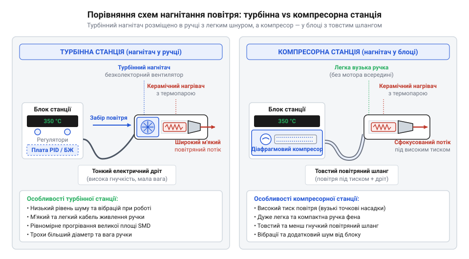
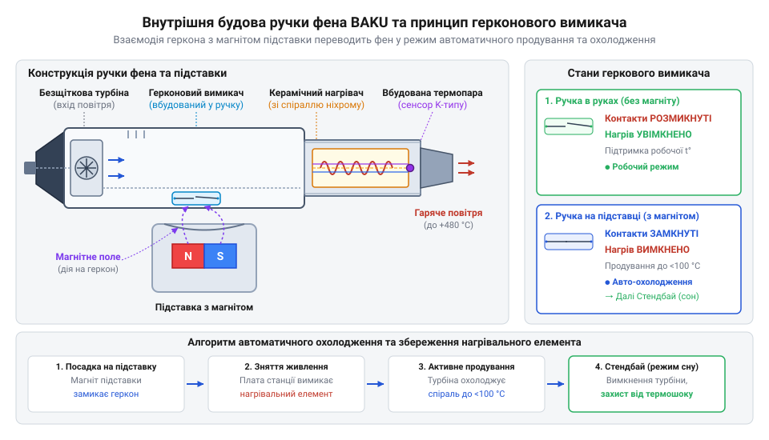
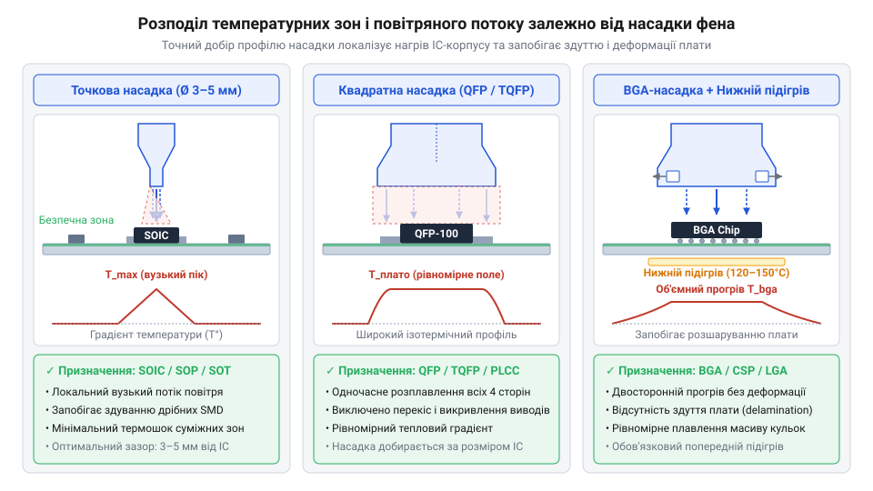

# Термоповітряні паяльні станції та фени BAKU

<preknowlist>
- [Паяльні флюси та пасти для монтажу гарячим повітрям](root:cat-hw-instruments/smd-soldering-fluxes-and-pastes) — поведінку паяльних паст і флюсів при конвективному нагріві гарячим повітрям та температури їхньої активації
- [Властивості та термопрофілі трубчастих припоїв і припайних паст](root:cat-hw-instruments/solder-paste-and-lead-free-alloys-properties) — температури плавлення свинець-вмісних і безсвинцевих сплавів та фази термопрофілювання
- [Антистатичний захист (ESD) при паянні чутливих компонентів](root:cat-hw-instruments/esd-safe-soldering-practices) — правила заземлення та антистатичного захисту при роботі з чутливими SMD-мікросхемами
</preknowlist>

## Перегрів та здерті площадки при паянні

Демонтаж багатовивідних корпусів @@en|QFP@@ (від англ. *quad flat package*) та елементів @@en|SMD@@ (від англ. *surface-mount device*) контактним паяльником обмежений почерговим прогріванням виводів. Доки припій плавиться з одного боку мікросхеми, протилежні контакти залишаються твердими. Спроба підважити корпус відриває мідні площадки від плати, а тривале утримання гарячого жала викликає термічну деструкцію склотекстоліту @@en|FR-4@@ (від англ. *flame retardant 4*), спричиняючи його розшарування та обвуглювання.

Розв'язанням є безконтактний конвективний нагрів гарячим повітрям. Спрямований потік газу одночасно передає тепло всім виводам і синхронно розплавляє припій, дозволяючи зняти мікросхему без зусилля. Для видалення залишків припою після демонтажу використовують [мідне плетіння для видалення](root:cat-hw-instruments/solder-wick).

*Формування однорідного конвективного поля навколо виводів мікросхеми при використанні термоповітряного фена.*

## Турбінні та компресорні станції BAKU

Термоповітряні станції BAKU поділяють за типом нагнітача на компресорні @@en|Compressor@@ та турбінні @@en|Turbine@@. У компресорних станціях діафрагмовий насос розміщено в блоці: він створює високий статичний тиск і подає повітря через шланг. Ламінарний вузькоспрямований потік ідеальний для точних насадок при демонтажі дрібних @@en|SMD@@-компонентів на щільних платах, але жорсткий шланг обмежує маневреність рукоятки.

У турбінних станціях, як-от [термофен BAKU BK-8033](root:cat-hw-instruments/hot-air-station-baku), безколекторний електродвигун вбудовано в рукоятку, тож замість шланга підведено гнучкий кабель. Турбіна створює об'ємний турбулентний потік для рівномірного прогріву площ, що критично при паянні корпусів @@en|BGA@@ та великих @@en|QFP@@-мікросхем.

*Вплив розміщення нагнітача на характер повітряного струменя.*

## Термостабілізація, нагрівач та автоматичне охолодження

Усередині сопла рукоятки розташовано керамічний нагрівальний елемент @@en|Ceramic Heater@@ з ніхромовою спіраллю та термопарою K-типу @@en|Thermocouple@@. За сигналами термопари мікроконтролер через @@en|PID@@-регулятор імпульсно керує симистором @@en|TRIAC@@, змінюючи потужність нагріву для підтримки заданої температури.

Коли фен ставлять на підставку, магніт замикає геркон @@en|Reed Switch@@ у рукоятці. Станція вимикає симистор @@en|TRIAC@@ та активує автоматичне охолодження @@en|Auto-Cooling@@: турбіна видуває залишкове тепло до температури нижче 100 °C. Це захищає керамічне ядро від термошоку та продовжує термін його служби. Точний терморежим важливий під час нанесення [паяльних флюсів та паст](root:cat-hw-instruments/smd-soldering-fluxes-and-pastes).

*Компоновка керамічного сердечника, термопари та герконового вимикача в корпусі рукоятки.*

## Термоповітряні профілі та вибір насадок

Безпечний монтаж вимагає дотримання фаз термопрофілю: підігрів @@en|Preheat@@ й витримка @@en|Soak@@ (150–180 °C) знижують градієнт температур і короблення плати. На етапі оплавлення @@en|Reflow@@ короткочасно подають 230–260 °C (враховуючи [властивості та термопрофілі припоїв](root:cat-hw-instruments/solder-paste-and-lead-free-alloys-properties)).

Сопло добирають за розміром компонента. Круглі насадки (3–5 мм) точково гріють виводи при помірному обдуві, щоб не здути обв'язку. Квадратні сопла з дефлекторами спрямовують потік на периметр @@en|QFP@@.

*Форма теплової зони залежно від геометрії круглого та профільних сопел.*

## Діагностика несправностей та заміна нагрівача

Причиною відсутності нагріву є перегорання спіралі або деградація спаю термопари через удари чи пропуск автоохолодження. Стан вузлів перевіряють вимірюванням опору на контактах роз'єму мультиметром @@en|Multimeter@@: норма для спіралі — 70–90 Ом, для термопари — 1–5 Ом. Нескінченність або нуль свідчать про обрив чи коротке замикання.

Для заміни розбирають рукоятку, відпаюють старий елемент і монтують новий сердечник з урахуванням полярності термопари та [антистатичного захисту ESD](root:cat-hw-instruments/esd-safe-soldering-practices).

*Точки підключення щупів мультиметра до контактів роз'єму для діагностики спіралі та термодатчика.*