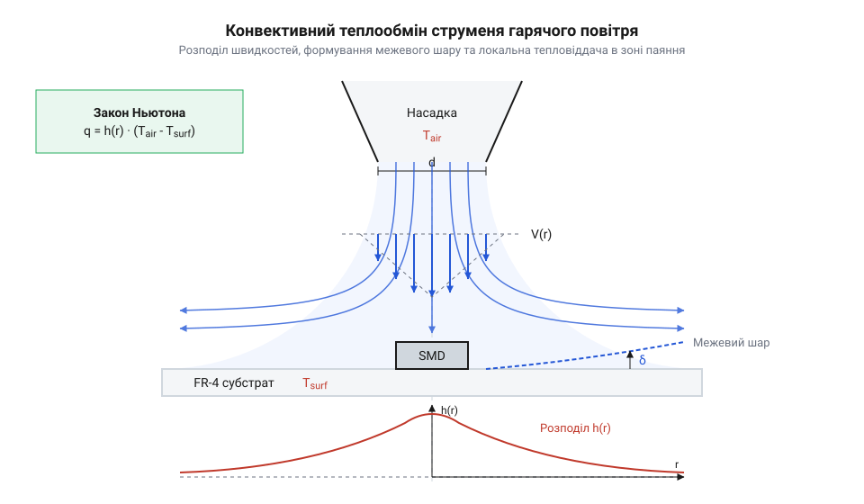
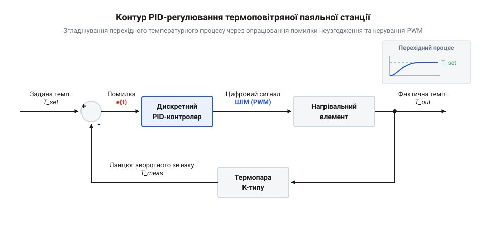

# Термодинамічний розрахунок повітряного потоку та PID-регулювання нагріву паяльної станції

<preknowlist>
- [Термофен BAKU BK-8033](root:cat-hw-instruments/hot-air-station-baku) — конструкція нагрівального елемента, вбудованого нагнітача та діапазони вихідних температур і витрати повітря.
- [Властивості та термопрофілі трубчастих припоїв і припайних паст](root:cat-hw-instruments/solder-paste-and-lead-free-alloys-properties) — фазові переходи, критичні температури плавлення припоїв та допустима швидкість наростання температури термопрофілю.
- [Паяльні флюси та пасти для монтажу гарячим повітрям](root:cat-hw-instruments/smd-soldering-fluxes-and-pastes) — температурні інтервали активації флюсу та вплив обдуву на випаровування летких компонентів.
- [Антистатичний захист (ESD) при паянні чутливих компонентів](root:cat-hw-instruments/esd-safe-soldering-practices) — вимоги до заземлення корпусу та сопла термофена для запобігання накопиченню статичного заряду у повітряному потоці.
</preknowlist>

## Теплові ризики паяння гарячим повітрям

Монтаж або демонтаж мікроелектронного компонента типу @@en|SMD@@ (від англ. @@en|Surface-Mount Device@@ — пристрій для поверхневого монтажу) чи @@en|BGA@@ (від англ. @@en|Ball Grid Array@@ — масив кулькових виводів) за допомогою [термоповітряного паяльного інструмента](root:cat-hw-instruments/hot-air-station-baku) здається простою операцією лише до першої зіпсованої плати. Неконтрольоване підведення тепла гарячим струменем призводить до термічного розшарування субстрату, здуття мідних доріжок або розтріскування кремнієвих кристалів усередині корпусів. Розуміння фізичних причин цих дефектів вимагає аналізу механічних напружень у структурі матеріалу під час нерівномірного нагріву.

Основою більшості сучасних друкованих плат є композитний матеріал @@en|FR-4@@ (від англ. @@en|Flame Retardant 4@@ — вогнестійкий матеріал класу 4), який складається з кількох шарів склотканини, просочених епоксидною смолою та армованих мідною фольгою. Головна пастка полягає у термомеханічній анізотропії цього сендвіча. Скловолокно та мідь мають відносно низький коефіцієнт теплового розширення (@@en|CTE@@, від англ. @@en|Coefficient of Thermal Expansion@@ — коефіцієнт теплового розширення), який становить приблизно `16 - 17 · 10⁻⁶ K⁻¹`. Натомість епоксидна смола при нагріванні вище температури склування (`T_g ≈ 130 - 170 °C`) різко змінює свої фізичні властивості: її @@en|CTE@@ уздовж осі Z (по товщині плати) зростає від `50 - 70 · 10⁻⁶ K⁻¹` до `250 - 300 · 10⁻⁶ K⁻¹`.

Коли локальний струмінь повітря швидко прогріває верхній шар плати, у товщині склотекстоліту виникає жорсткий температурний градієнт `dT/dz`. Верхній шар епоксидної смоли намагається розширитися вздовж осі Z у 4–5 разів сильніше, ніж внутрішні холодні шари. Виникає внутрішнє зсувне напруження `σ_z`, яке перевищує адгезійну міцність між скляною сіткою та полімером. Якщо в товщині субстрату була залишкова волога, при `T > 100 °C` вона миттєво перетворюється на пару з високим тиском. Поєднання розширюваної пари та зсувного напруження викликає @@en|delamination@@ (від англ. @@en|delamination@@ — розшарування субстрату) — внутрішнє розшарування текстоліту та утворення локальних пухирів під контактними площадками.

Другим критичним ризиком є термічний шок електронних компонентів. Корпус мікросхеми складається з кремнієвого кристала, металевої рамки виводів та компаунда. При швидкості наростання температури понад `2 - 4 °C/s` через різницю @@en|CTE@@ між кремнієм (`2.6 · 10⁻⁶ K⁻¹`) та пластиком (`15 · 10⁻⁶ K⁻¹`) всередині корпуса виникає механічний згин. Це призводить до мікротріщин у кристалі або відриву розварювальних золотих провідників від контактних площадок. Відповідно до специфікацій на [властивості безсвинцевих припоїв](root:cat-hw-instruments/solder-paste-and-lead-free-alloys-properties), максимальний температурний градієнт під час попереднього прогріву строго обмежений.

Третій ризик пов'язаний із динамікою нагрівального елемента паяльної станції. При увімкненні або зміні витрати повітря в контурі керування виникає температурне перерегулювання (від англ. @@en|overshoot@@ — перерегулювання). Запізнення сигналу від термопари призводить до того, що температура повітря на виході сопла на 30–50 °C перевищує задану уставку. Повітря з температурою 380 °C миттєво спалює леткі компоненти, порушуючи [температурні режими активації](root:cat-hw-instruments/smd-soldering-fluxes-and-pastes) безвідмивного флюсу. Флюс втрачає відновні властивості ще до плавлення припою, що призводить до окиснення контактів та утворення кульок припою.

Окрему небезпеку становить швидкісний потік сухого гарячого повітря через неекрановану насадку. Тертя сухого газу об внутрішні стінки сопла викликає трибоелектричний ефект, викликаючи [накопичення статичного заряду](root:cat-hw-instruments/esd-safe-soldering-practices) потенціалом у сотні вольт, що здатне пробити товщину польових затворів чутливих @@en|SMD@@-структур.

Щоб уникнути цих деструктивних явищ, не можна діяти наосліп. Потрібно точно розрахувати газодинаміку повітряного струменя, обчислити коефіцієнт конвективного теплообміну та побудувати замкнений контур @@en|PID@@-регулювання (від англ. @@en|Proportional-Integral-Derivative@@ — пропорційно-інтегрально-диференціальний), який утримує термічний профіль у безпечних межах.

## Газодинаміка та витрата повітряного струменя

Передача тепла від паяльної станції до друкованого вузла здійснюється за допомогою рухомого повітряного струменя. Головними керованими параметрами є об'ємна витрата газу `Q` та геометрія звужувальної насадки (сопла). Зміна діаметра насадки кардинально змінює кінематику потоку, визначаючи не лише швидкість нагріву, а й механічну силу, що діє на деталі.

Потік газу через канальну систему термофена підпорядковується закону збереження маси. Для нестисливого газу при швидкостях витікання, що значно менші за швидкість звуку (число Маха `M < 0.3`), об'ємна витрата `Q` у будь-якому поперечному перерізі каналу залишається сталою. Рівняння нерозривності потоку пов'язує площу перерізу сопла `A_jet` та лінійну швидкість витікання повітря `v_jet`:

```
Q = A_jet × v_jet
```

Площа кругового отвору насадки діаметром `d` обчислюється як:

```
A_jet = (π × d²) / 4
```

Шляхом алгебраїчних перетворень виводимо залежність лінійної швидкості витікання струменя від об'ємної витрати та діаметра сопла:

```
v_jet = Q / A_jet
= Q / ((π × d²) / 4)      [підстановка площі кругового перерізу]
= (4 × Q) / (π × d²)      [зведення триповерхового дробу]
```

З отриманої формули видно ключову фізичну залежність: лінійна швидкість витікання `v_jet` пропорційна об'ємній витраті `Q`, але обернено пропорційна квадрату діаметра сопла `d²`. Якщо зменшити діаметр насадки вдвічі при незмінній витраті повітря з нагнітача, швидкість витікання струменя зросте в чотири рази.

Коли високошвидкісний струмінь потрапляє на поверхню @@en|SMD@@-компонента, відбувається повне або часткове гальмування потоку, у результаті чого кінетична енергія газу перетворюється на динамічний тиск `q_dyn`. Величина динамічного тиску розраховується за формулою Бернуллі:

```
q_dyn = (ρ_air × v_jet²) / 2
```

де `ρ_air` — густина повітря при робочій температурі `T_air`. Оскільки повітря є ідеальним газом, його густина зменшується зі зростанням температури за законом Шарля:

```
ρ_air(T) = ρ₀ × (T₀ / T_air)
```

де `ρ₀ ≈ 1.293 kg/m³` — густина повітря за нормальних умов (`T₀ = 273.15 K`), а `T_air` виражена у кельвінах (`K`). Наприклад, при температурі 300 °C (`573.15 K`) густина повітря падає до `ρ_air ≈ 0.616 kg/m³`.

Динамічний тиск створює лобове механічне зусилля `F_drag`, яке діє паралельно або під кутом до поверхні друкованої плати:

```
F_drag = C_d × q_dyn × A_comp
```

де `C_d` — аеродинамічний коефіцієнт лобового опору корпуса компонента, а `A_comp` — площа проекції компонента на площину, перпендикулярну до потоку. При монтажі дрібних чип-компонентів розміру 0402 або 0603 у момент плавлення припою сила `F_drag` протидіє силам поверхневого натягу рідкого припою та в'язкого зсуву флюсу. Якщо `F_drag` перевищує утримуючу силу поверхневого натягу, виникає здування компонента з контактних площадок або утворення коротких замикань між сусідніми виводами. Тоді для [видалення залишків припою](root:cat-hw-instruments/solder-wick) доводиться застосовувати мідне плетіння та проводити додатковий [оптичний контроль паяння](root:cat-hw-instruments/optical-microscope-soldering) під мікроскопом.

Розглянемо чисельний приклад розрахунку газодинамічних параметрів для стандартизованого паяльного сопла.

**Обчислення швидкості потоку та динамічного тиску для насадки 4 мм**
Умова: Об'ємна витрата повітря паяльної станції `Q = 20 L/min`, діаметр круглого сопла `d = 4 mm = 0.004 m`, температура повітряного струменя `T_air = 300 °C` (`573.15 K`), густина газу `ρ_air = 0.616 kg/m³`.

```
Q = (20 × 10⁻³) / 60
= 3.333 × 10⁻⁴ m³/s      [переведення витрати з L/min у m³/s]

A_jet = (3.1416 × (0.004)²) / 4
= (3.1416 × 1.6 × 10⁻⁵) / 4
= 1.257 × 10⁻⁵ m²        [розрахунок площі зрізу сопла]

v_jet = (3.333 × 10⁻⁴) / (1.257 × 10⁻⁵)
= 26.52 m/s              [розрахунок лінійної швидкості потоку]

q_dyn = (0.616 × (26.52)²) / 2
= (0.616 × 703.31) / 2
= 216.62 Pa              [розрахунок динамічного тиску]
```

Розрахунок показує, що при звуженні сопла до 4 мм лінійна швидкість повітря сягає 26.5 м/s, а динамічний тиск на поверхню становить понад 216 Па. Для запобігання здуванню легких @@en|SMD@@-компонентів необхідно збільшувати діаметр сопла, зменшуючи швидкість `v_jet` при збереженні необхідної об'ємної витрати тепла.

## Конвективний теплообмін за законом Ньютона

Газодинамічний потік гарячого повітря слугує теплоносієм, який передає енергію контактній зоні друкованого вузла. Основним фізичним механізмом передачі тепла в термоповітряних паяльних станціях є вимушена конвекція. Математичний опис цього процесу базується на законі охолодження (нагріву) Ньютона, який визначає теплову потужність `Q_dot`, що передається поверхні:

```
Q_dot = h × A_surf × (T_air - T_surf)
```

де `h` — коефіцієнт конвективної тепловіддачі (вимірюється в W/(m²·K)), `A_surf` — ефективна площа теплообміну компонента чи плати, `T_air` — температура гарячого повітряного струменя на виході із сопла, `T_surf` — поточна температура поверхні об'єкта паяння.

Коефіцієнт тепловіддачі `h` не є фізичною константою повітря — він залежить від швидкості потоку `v_jet`, геометричних параметрів насадки, відстані `H` від зрізу сопла до плати та термодинамічних властивостей газу. Для визначення `h` використовують апарат теорії подібності та безрозмірні критерії гідрогазодинаміки.


*Схема витікання гарячого повітряного струменя з сопла діаметром d та розподіл коефіцієнта конвективної тепловіддачі вздовж поверхні SMD-елемента і субстрату FR-4.*

Першим фундаментальним параметром є число Рейнольдса (@@en|Re@@, від прізвища британського інженера @@en|Osborne Reynolds@@), яке характеризує співвідношення інерційних сил та сил в'язкого тертя у повітряному струмені:

```
Re = (v_jet × d) / ν_air
```

де `ν_air` — кінематична в'язкість повітря при робочій температурі (при `T_air = 350 °C` кінематична в'язкість становить `ν_air ≈ 5.2 × 10⁻⁵ m²/s`).

Другим є число Прандтля (@@en|Pr@@, від прізвища німецького фізика @@en|Ludwig Prandtl@@), яке описує співвідношення між імпульсним та тепловим переносом у газі. Для повітря у діапазоні температур 200–400 °C число Прандтля можна вважати майже сталим: `Pr ≈ 0.68 - 0.70`.

Третім є число Нуссельта (@@en|Nu@@, від прізвища німецького фізика @@en|Wilhelm Nusselt@@), яке показує співвідношення між конвективним теплообміном та чистою теплопровідністю нерухомого шару газу товщиною `d`:

```
Nu = (h × d) / k_air
```

де `k_air` — коефіцієнт теплопровідності повітря (при 350 °C `k_air ≈ 0.047 W/(m·K)`).

Для кругового струменя, що падає перпендикулярно на плоску поверхню (зону точки гальмування потоку), узагальнена емпірична критеріальна залежність має вигляд:

```
Nu = 0.76 × (Re)⁰·⁵ × (Pr)⁰·⁴
```

Виразивши коефіцієнт тепловіддачі `h` через число Нуссельта, отримуємо:

```
h = (Nu × k_air) / d
= (0.76 × (Re)⁰·⁵ × (Pr)⁰·⁴ × k_air) / d      [підстановка критерію Нуссельта]
```

Підставивши у формулу вираз для числа Рейнольдса `Re = (v_jet × d) / ν_air`, проаналізуємо фізичну залежність тепловіддачі від швидкості та діаметра:

```
h = 0.76 × ((v_jet × d) / ν_air)⁰·⁵ × (Pr)⁰·⁴ × (k_air / d)
= 0.76 × (v_jet)⁰·⁵ × (ν_air)⁻⁰·⁵ × (Pr)⁰·⁴ × k_air × d⁻⁰·⁵      [спрощення степенів діаметра d]
```

Отже, коефіцієнт конвективної тепловіддачі `h` зростає пропорційно квадратному кореню зі швидкості витікання потоку `(v_jet)⁰·⁵` та обернено пропорційно квадратному кореню з діаметра сопла `d⁻⁰·⁵`. Це означає, що точкова насадка малого діаметра забезпечує високу локальну тепловіддачу, але створює вузьку зону нагріву з високим температурним градієнтом по краях.

Зміна температури об'єкта під час нагріву описується диференціальним рівнянням теплового балансу. Якщо знехтувати втратами тепла на випромінювання та кондуктивне відведення у внутрішні шари плат на початковому етапі, теплова потужність витрачається на зміну внутрішньої енергії компонента масою `m` з питомою теплоємністю `c_p`:

```
m × c_p × (dT_surf / dt) = h × A_surf × (T_air - T_surf)
```

Розв'язок цього диференціального рівняння визначає часову експоненціальну залежність температури поверхні від часу `t`:

```
T_surf(t) = T_air - (T_air - T_initial) × exp(-t / τ_th)
```

де `τ_th` — термічна стала часу нагріву об'єкта, яка обчислюється за формулою:

```
τ_th = (m × c_p) / (h × A_surf)
```

Масивні планарні компоненти або внутрішні мідні шари заземлення мають велику масу `m` та високу теплоємність, що збільшує сталу часу `τ_th`. При використанні [паяльних флюсів і паст](root:cat-hw-instruments/soldering-fluxes-and-solders) на таких ділянках потрібен триваліший попередній прогрів. Нехтування термічною сталою часу призводить до того, що оператор підвищує температуру `T_air` до критичних позначок, намагаючись прискорити процес, що викликає вигоряння [складу безвідмивних флюсів](root:cat-hw-instruments/no-clean-fluxes-chemistry-and-classification) та термічний шок субстрату @@en|FR-4@@.

Проведемо чисельний розрахунок тепловіддачі та переданої потужності на практичному прикладі.

**Обчислення коефіцієнта тепловіддачі та переданої теплової потужності**
Умова: Звужувальне сопло `d = 6 mm = 0.006 m`, швидкість струменя `v_jet = 15 m/s`, температура повітря `T_air = 350 °C`, початкова температура компонента `T_surf = 50 °C`, площа поверхні компонента `A_surf = 10 mm × 10 mm = 1 × 10⁻⁴ m²`. Фізичні параметри повітря при 350 °C: `k_air = 0.047 W/(m·K)`, `ν_air = 5.2 × 10⁻⁵ m²/s`, `Pr = 0.68`.

```
Re = (15 × 0.006) / (5.2 × 10⁻⁵)
= 0.09 / (5.2 × 10⁻⁵)
= 1730.77                [розрахунок числа Рейнольдса]

Nu = 0.76 × (1730.77)⁰·⁵ × (0.68)⁰·⁴
= 0.76 × 41.603 × 0.856
= 27.07                  [розрахунок числа Нуссельта]

h = (27.07 × 0.047) / 0.006
= 1.2723 / 0.006
= 212.05 W/(m²·K)        [розрахунок коефіцієнта тепловіддачі]

Q_dot = 212.05 × (1 × 10⁻⁴) × (350 - 50)
= 212.05 × 1 × 10⁻⁴ × 300
= 6.36 W                 [розрахунок теплової потужності]
```

Отримане значення `Q_dot = 6.36 W` показує чисту конвективну потужність, яка передається контактній зоні площадкою `1 cm²`. Математичний розрахунок доводить: для підвищення теплового потоку без ризику механічного здування деталей доцільно збільшувати температуру струменя `T_air` у допустимих межах або використовувати нижній підігрів плати для зменшення термічної різниці `(T_air - T_surf)`.

## Теплова динаміка нагріву плати текстоліту

Під час роботи з соплом [термоповітряних паяльних станцій](root:cat-hw-instruments/hot-air-station-baku) надмірне або занадто стрімке нагрівання створює руйнівне термічне напруження всередині друкованої плати. Субстрат плати, виготовлений із матеріалу @@en|FR-4@@ (від англ. @@en|Flame Retardant 4@@, склотекстоліт), приймає теплову енергію від гарячого струменя повітря через конвекцію, однак сам матеріал має обмежену теплопровідність. Якщо різниця температур між верхніми та внутрішніми шарами плати перевищує допустиму межу, анізотропне теплове розширення (характеризоване через @@en|CTE@@, від англ. @@en|Coefficient of Thermal Expansion@@, коефіцієнт теплового розширення) викликає зсувні деформації між шарами. Це призводить до термічного розшарування — @@en|delamination@@ (від англ. @@en|delamination@@, розшарування субстрату). Щоб розрахувати безпечний часовий інтервал впливу гарячого повітря на @@en|SMD@@-компонент (від англ. @@en|Surface-Mount Device@@, поверхнево-монтована деталь) та контактний майданчик, необхідно побудувати диференціальну модель теплового балансу.

Розглянемо локальну ділянку нагріву з масою `m` (кг), питомою теплоємністю матеріалу `c_p` (Дж/(кг · K)) та ефективною площею обдуву `A` (м²). Конвективний тепловий потік `q_conv` від повітря з температурою `T_air` до поверхні з температурою `T(t)` визначається законом охолодження Ньютона через коефіцієнт тепловіддачі `h` (Вт/(м² · K)):

```
q_conv = h · A · (T_air - T(t))
```

Ця теплова потужність витрачається на зміну внутрішньої енергії контактної зони масою `m`, викликаючи зростання температури зі швидкістю `dT(t) / dt`. Прирівнюючи конвективний приплив тепла до швидкості зміни ентальпії, отримуємо базове диференціальне рівняння теплового балансу:

```
m · c_p · (dT(t) / dt) = h · A · (T_air - T(t))
```

Для знаходження часової залежності температури `T(t)` розділимо змінні та інтегруємо рівняння від початкового моменту `t = 0` (де початкова температура дорівнює кімнатній `T(0) = T_0`) до довільного моменту `t`:

```
dT(t) / (T_air - T(t)) = (h · A / (m · c_p)) · dt                  [відокремлення змінних]
-ln(T_air - T(t)) + ln(T_air - T_0) = (h · A / (m · c_p)) · t       [інтегрування лівої та правої частин]
ln((T_air - T_0) / (T_air - T(t))) = (h · A / (m · c_p)) · t         [застосування властивостей логарифма]
(T_air - T(t)) / (T_air - T_0) = exp(-(h · A / (m · c_p)) · t)       [потенціювання обох частин]
T(t) = T_air - (T_air - T_0) · exp(-t / τ_th)                         [остаточний вираз для T(t)]
```

Величина `τ_th = (m · c_p) / (h · A)` є термічною сталою часу контактної зони (у секундах). Вона визначає інерційність нагріву: за час `t = 1 · τ_th` температурний розрив між повітряним потоком та платою зменшується в `e ≈ 2.718` раза (досягається приблизно 63.2% від максимального перепаду).

З виведеної залежності `T(t)` виражаємо граничний час `t_heat`, необхідний для досягнення цільової температури `T_target` (наприклад, температури активації [флюсів для поверхневого монтажу](root:cat-hw-instruments/smd-soldering-fluxes-and-pastes)):

```
t_heat = τ_th · ln((T_air - T_0) / (T_air - T_target))
```

Похідна від функції температури за часом дає миттєву швидкість нагріву `dT / dt`:

```
dT / dt = ((T_air - T_0) / τ_th) · exp(-t / τ_th) = (T_air - T(t)) / τ_th
```

Максимальна швидкість наростання температури спостерігається в початковий момент `t = 0`:

```
(dT / dt)_max = (T_air - T_0) / τ_th
```

Згідно зі стандартами, якими описуються [температурні профілі припоїв](root:cat-hw-instruments/solder-paste-and-lead-free-alloys-properties), швидкість наростання температури `dT / dt` не повинна перевищувати `2..3 °C/с`. Якщо температурна дельта `(T_air - T_0)` занадто велика або маса деталі незначна (`τ_th` мале), початкова швидкість нагріву може сягати `10..15 °C/с`. Це призводить до вибухоподібного випаровування летких компонентів флюсу, виникнення мікротріщин у керамічних конденсаторах та @@en|delamination@@ текстоліту. Тому технологічний процес паяння поділяють на фази: попередній підігрів (зменшення `(T_air - T_0)`), стабілізація та піковий оплав.

**Приклад обчислення часового інтервалу:**

**Умова:** Необхідно визначити час нагріву @@en|SMD@@-компонента та контактного майданчика плати @@en|FR-4@@ від початкової температури `T_0 = 25 °C` до температури плавлення припою `T_target = 180 °C`. Температура повітряного струменя з насадки `T_air = 270 °C`. Маса нагрівальної зони `m = 0.35 г = 0.35 × 10⁻³ кг`, питома теплоємність `c_p = 1100 Дж/(кг · K)`, площа обдуву `A = 70 мм² = 7 × 10⁻⁵ м²`, коефіцієнт тепловіддачі `h = 240 Вт/(м² · K)`.

```
τ_th = (0.35 × 10⁻³ × 1100) / (240 × 7 × 10⁻⁵)      [підстановка параметрів у формулу τ_th]
     = 0.385 / 0.0168                              [обчислення чисельника й знаменника]
     = 22.92 с                                     [значення термічної сталої часу]

t_heat = 22.92 · ln((270 - 25) / (270 - 180))       [підстановка в формулу часу нагріву]
       = 22.92 · ln(245 / 90)                       [обчислення різниці температур]
       = 22.92 · ln(2.7222)                         [відношення температурних дельт]
       = 22.92 · 1.0014                             [значення натурального логарифма]
       ≈ 22.95 с                                    [розрахований час нагріву]
```

Визначимо початкову швидкість нагріву:

```
(dT / dt)_max = (270 - 25) / 22.92 = 245 / 22.92 ≈ 10.69 °C/с
```

Оскільки `10.69 °C/с` перевищує допустиму межу `3 °C/с`, прямого обдуву струменем `270 °C` з кімнатної температури застосовувати не можна. Необхідно попередньо підігріти плату знизу до `100..120 °C`, що зменшить `(T_air - T_0)` та знизить швидкість нагріву до безпечного рівня.

## PID-регулювання та опрацювання термопари K-типу

При зміні об'ємної витрати повітря або відстані сопла до плати інтенсивність відведення тепла динамічно змінюється. Без автоматичного вирівнювання це спричиняє падіння температури повітряного потоку або, навпаки, небезпечне проскочування температури — @@en|overshoot@@ (від англ. @@en|overshoot@@, перерегулювання). Для утримання заданої температури нагрівального елемента застосовують @@en|PID@@-регулятор (від англ. @@en|Proportional-Integral-Derivative controller@@, пропорційно-інтегрально-диференціальний регулятор), що отримує сигнал зворотного зв'язку від термопари K-типу.

Термопара K-типу складається з двох різнорідних провідників — хромелю (@@en|Chromel@@) та алюмелю (@@en|Alumel@@). Внаслідок термоелектричного ефекту Зеєбека (@@en|Seebeck effect@@) на гарячому спаї в соплі виникає термо-РСД `V_th`, пропорційна різниці температур між гарячим спаєм `T_hot` та холодним спаєм `T_cold` на платі управління:

```
V_th = S_k · (T_hot - T_cold)
```

де `S_k ≈ 41 мкВ/°C` — коефіцієнт чутливості термопари K-типу. Оскільки термо-РСД становить одиниці мілівольт, сигнал підсилюється інструментальним підсилювачем та подається на аналогово-цифровий перетворювач (@@en|ADC@@, від англ. @@en|Analog-to-Digital Converter@@). Для точного визначення `T_hot` виконується програмна компенсація холодного спаю шляхом додавання температури `T_cold`, виміряної локальним датчиком:

```
T_hot = (V_th / S_k) + T_cold
```

Через турбулентність повітря та наведення завад сировий сигнал `T_raw[k]` містить високочастотний шум. Для його згладжування застосовують дискретний експоненційний фільтр з коефіцієнтом `α ∈ (0, 1]`:

```
T_filt[k] = α · T_raw[k] + (1 - α) · T_filt[k-1]
```

Похибка регулювання `e[k]` на кроці дискретизації `k` обчислюється як різниця між заданою температурою `T_set` та відфільтрованим значенням `T_filt[k]`:

```
e[k] = T_set - T_filt[k]
```

Дискретне рівняння @@en|PID@@-регулятора формує вихідну потужність нагрівача `u[k]` (у відсотках заповнення широтно-імпульсної модуляції, @@en|PWM@@):

```
P[k] = K_p · e[k]                                             [пропорційна складова]
I[k] = I[k-1] + K_i · e[k] · Δt                                [інтегральна складова]
D[k] = -K_d · (T_filt[k] - T_filt[k-1]) / Δt                   [диференціальна складова за вимірюванням]
u[k] = P[k] + I[k] + D[k]                                      [сумарний вихідний сигнал]
```

Пропорційна складова `P[k]` відповідає за швидкість реакції на поточну похибку. Інтегральна складова `I[k]` накопичує минулі похибки, повністю усуваючи статичну похибку в усталеному режимі. Диференціальна складова `D[k]` демпфує коливання, оцінюючи швидкість зміни температури. Щоб уникнути сплесків виходу при зміні уставки `T_set`, диференціювання виконують за зміною виміряної температури `T_filt[k]`, а не похибки `e[k]`.

Під час початкового розігріву велика похибка `e[k]` призводить до швидкого зростання накопичувача `I[k]`. Якщо вихід `u[k]` досягає фізичного максимуму 100%, інтегратор продовжує накопичувати значення. Це явище називають інтегральним насиченням — @@en|integral windup@@ (від англ. @@en|integral windup@@ — інтегральне насичення). Після досягнення `T_set` накопичений інтеграл викликає тривалий @@en|overshoot@@. Для його усунення в алгоритм вбудовують захист @@en|anti-windup@@: оновлення `I[k]` блокується, коли вихідний сигнал `u[k]` перебуває в стані насичення.

Також схема вимірювання повинна мати належний [захисту від статичного струму](root:cat-hw-instruments/esd-safe-soldering-practices), щоб накупи накопиченого заряду в повітряному потоці не спотворювали роботу аналогового тракту.


*Структурна схема замкненого контуру PID-регулювання паяльної станції з аналогово-цифровим перетворенням сигналу термопари K-типу та широтно-імпульсним керуванням нагрівачем.*

Нижче наведено програмну реалізацію дискретного @@en|PID@@-регулятора нагріву з експоненційною фільтрацією та обмеженням @@en|anti-windup@@:

:::tabs
@tab C
:::code math-hot-air-thermodynamics-and-pid/c/microcontroller/pid-init.c
@tab C++
:::code math-hot-air-thermodynamics-and-pid/cpp/microcontroller/pidcontroller.cpp
:::