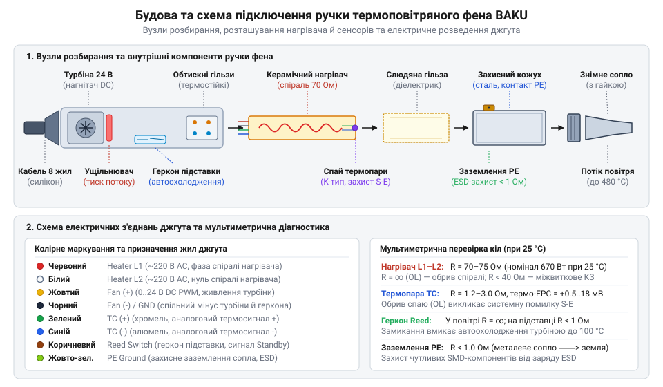
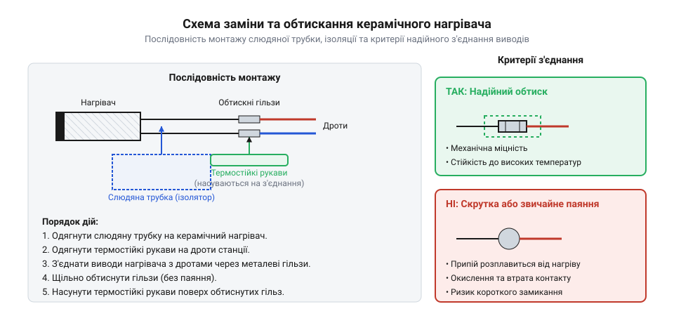

# Практикум: діагностика та заміна нагрівального елемента й термопари в фені BAKU

<preknowlist>
- [Термофен BAKU BK-8033](root:cat-hw-instruments/hot-air-station-baku) — будову, принципи роботи та органи керування паяльної станції BAKU.
- [Обтискні кліщі (Dupont/JST)](root:cat-hw-instruments/crimp-tool) — техніку опресування та вибір матриць для надійної фіксації контактних виводів.
- [Накінечники та клеми для опресування провідників](root:cat-hw-instruments/wire-terminals-and-crimp-connectors) — типи обтискних клем та гільз для високотемпературних проводів.
- [Термоусадкова трубка (набір)](root:cat-hw-instruments/heat-shrink-tubing) — методи розрахунку усадки та монтажу ізоляційних трубок для захисту з'єднань.
- [Антистатичний захист (ESD) при паянні чутливих компонентів](root:cat-hw-instruments/esd-safe-soldering-practices) — вимоги до антистатичного заземлення та безпеки під час ремонту електричного обладнання.
</preknowlist>

## Симптоми несправностей ручки фена BAKU

Під час інтенсивного демонтування багатовивідних SMD-компонентів робота раптово зупиняється: термоповітряний фен перестає ґенерувати гаряче повітря, починає видувати холодний потік або виводить на цифровий дисплей аварійний код @@en|S-E@@. Спроба продовжити роботу з несправним інструментом загрожує не лише розплавленням пластикового корпусу, а й виходом з ладу всієї паяльної станції. Збої у роботі ручки виникають через порушення цілісності електричних і термічних кіл, які забезпечують нагрів та зворотний зв'язок з керувальною платою.

Система керування, якою оснащена [паяльна станція BAKU](root:cat-hw-instruments/hot-air-station-baku), безперервно відстежує температуру нагнітального вузла за допомогою вимірювального датчика. Електрична схема ручки містить два незалежні контури: високовольтне коло живлення нагрівальної спіралі та низьковольтне коло зворотного зв'язку, до якого підключена @@uk|термопара@@ (від грец. thermos — теплий та латин. par — пара) та @@uk|геркон@@ (від рос. @@ru|герметичный контакт@@ — герметизований магнітокерований контакт).

Помилка @@en|S-E@@ (від @@en|Sensor Error@@ — помилка датчика) означає повну втрату сигналу від термодатчика. Мікроконтролер станції фіксує нескінченний опір або відсутність напруги у вимірювальному колі, що свідчить про обрив провідників @@uk|термопара@@ у силіконовому кабелі, руйнування спаю всередині керамічного елемента або пошкодження контакту в роз'ємі. З міркувань термічного захисту керувальний алгоритм негайно вимикає подачу напруги на нагрівач, запобігаючи неконтрольованому розгону температури.

Ситуація, коли фен продовжує видувати холодне повітря без відображення помилки @@en|S-E@@, вказує на дефект силового контуру. На дисплеї відображається поточна кімнатна температура, а станція подає імпульси на силовий @@uk|симістор@@ (від симетричний тиристор), проте нагрів відсутній. Причиною є фізичний обрив нагрівальної спіралі, виконаної з витків дроту, для якого використано @@uk|ніхром@@ (від нікель та хром) або @@uk|фехраль@@ (від ферум, хром, алюміній). Через високе теплове навантаження дріт перегорає або стоншується й ламається у точках кріплення до контактних стійок.

Найнебезпечнішим симптомом є неконтрольований перегрів, коли сопло фена розжарюється до червоного світіння незалежно від налаштувань. Цей дефект виникає у двох випадках: через пробій силового @@uk|симістор@@ на платі станції або через @@uk|міжвиткове замикання@@ спіралі. Коли витки спіралі спекаються між собою, робочий опір елемента різко падає. За постійної напруги мережі це призводить до стрибка споживаного струму й екстремального виділення теплової енергії. Подальша експлуатація у такому стані спричиняє деформацію пластикового захисту, згорання крильчатки турбіни та порушує [ефективний антистатичний захист](root:cat-hw-instruments/esd-safe-soldering-practices) через можливий пробій напруги на металеве сопло.

## Будова ручки та безпечне розбирання

Щоб усунути локалізований дефект, необхідно дістатися до внутрішніх елементів ручки, не пошкодивши при цьому тендітні керамічні деталі та дротяний джгут. Ручка фена @@en|BAKU@@ являє собою збірний модуль, у якому пластиковий корпус захищає термічно навантажений керамічний сердечник, турбіну нагнітача та плату узгодження сигналів.

Усередині пластикового роз'ємного корпусу розміщено металеву гільзу-кожух, у якій зафіксовано трубчастий керамічний нагрівальний елемент. Усередині керамічної основи прокладено спіраль із @@uk|ніхром@@ або @@uk|фехраль@@, а в її головній частині розміщено спай датчика @@uk|термопара@@ @@en|K-type@@. Для запобігання короткому замиканню на металевий корпус між керамікою та зовнішньою гільзою встановлено трубку, для якої використана термостійка @@uk|слюда@@.

Електричне з'єднання з базовим блоком забезпечує гнучкий багатожильний силіконовий кабель. Кабель містить силові провідники живлення спіралі, сигнальні жили датчика @@uk|термопара@@, провідники датчика @@uk|геркон@@ та окрему жилу заземлення, приєднану до металевого сопла для забезпечення вимог @@en|ESD@@ (від @@en|Electrostatic Discharge@@ — електростатичний розряд). Внутрішній датчик @@uk|геркон@@ розміщений у бічній частині корпусу. Коли ручка встановлюється на тримач станції, внутрішній магніт тримача замикає контакти датчика @@uk|геркон@@, посилаючи мікроконтролеру сигнал про перехід у режим автоматичного охолодження та сну.


*Детальна будова ручки термоповітряного фена, розташування керамічного нагрівального елемента й маркування проводів.*

Демонтаж корпусу виконують у суворій послідовності за вимкненого живлення станції та після повного охолодження сопла:

1. Знімають встановлену обтискну насадку та відкручують переднє затискне металеве кільце, яке фіксує сопло на гільзі. 2. За допомогою викрутки викручують кріпильні гвинти по периметру пластикової ручки й обережно розділяють корпус на дві половини. 3. Послаблюють гвинтовий затискач еластичного хвостовика силіконового кабелю, щоб уникнути натягу внутрішніх проводів. 4. Зсувають металевий захисний кожух та термостійкий ізолятор, для якого застосована @@uk|слюда@@. Знімати керамічний елемент слід виключно вздовж поздовжньої осі: будь-які бічні перекоси призводять до розтріскування керамічного циліндра. 5. Зачищають контактні площадки або роз'єднують клемний блок. Якщо провідники припаяні, ізоляцію зрізають, використовуючи [автоматичний знімач ізоляції](root:cat-hw-instruments/wire-stripper), а для фіксації контактних виводів готують [надійні обтискні кліщі](root:cat-hw-instruments/crimp-tool).

## Мультиметрична діагностика нагрівача та термопари

Після забезпечення доступу до контактних виводів ручки виконують електричні вимірювання, щоб точно визначити несправний вузол. Основним діагностичним приладом є цифровий @@uk|мультиметр@@ (від латин. multus — численний та грец. metron — міра), увімкнений у режимах вимірювання опору, постійної напруги у мілівольтах та тестового продзвонювання кіл.

Діагностика нагрівального елемента полягає у вимірюванні опору спіралі `R_h`. Виводи нагрівача від'єднують від плати ручки й вимірюють опір на межі 200 Ом. Для штатного керамічного нагрівача станції @@en|BAKU@@ потужністю близько 650–700 Вт при робочій напрузі мережі `U = 220` В очікуване значення опору розраховують через співвідношення потужності `P` та напруги `U`.

Для визначення номінального опору використовують формулу залежності електричної потужності від напруги та опору:

```
P = U² / R
= 220² / 70
= 48400 / 70
≈ 691.4 W                [розрахунок потужності нагрівача]
```

З одержаного виразу видно, що справний нагрівальний елемент має демонструвати опір у діапазоні від 65 Ом до 75 Ом при кімнатній температурі. Значення опору, що прямує до нескінченності (позначка OL на екрані @@uk|мультиметр@@), свідчить про физичний обрив спіралі. Опір нижче 40 Ом вказує на @@uk|міжвиткове замикання@@, що робить подальшу експлуатацію елемента неможливою.

Діагностика кола, де встановлена @@uk|термопара@@, базується на перевірці цілісності її спаю та перевірці ґенерації напруги. Внутрішній датчик працює за принципом термоелектричного ефекту, який описує @@uk|ефект Зеєбека@@ (від прізвища фізика Томаса Зеєбека, @@de|Thomas Seebeck@@). Під час нагрівання спаю двох різнорідних металів виникає @@uk|термоелекторушійна сила@@ (ТЕРС), пропорційна різниці температур між гарячим спаєм у кераміці та холодними кінцями.

Перевірку вимірювального кола @@uk|термопара@@ виконують у два кроки:

1. Вимірюють власний опір датчика @@uk|термопара@@ при кімнатній температурі. У справного датчика @@en|K-type@@ опір становить 1–5 Ом. Значення OL фіксує обрив внутрішнього спаю або вихідних провідників, що є безпосередньою причиною помилки @@en|S-E@@. 2. Переводять @@uk|мультиметр@@ у режим вимірювання постійної напруги мВ. Підключають щупи до виводів датчика @@uk|термопара@@ і злегка прогрівають керамічний кінчик зовнішнім джерелом тепла. У справного датчика @@uk|термопара@@ значення напруги плавно зростає від 0 мВ до 10–15 мВ. Відсутність зміни напруги свідчить про коротке замикання виводів біля основи кераміки.

Наостанок перевіряють датчик @@uk|геркон@@ та силіконовий кабель. Щупи @@uk|мультиметр@@ у режимі продзвонювання підключають до контактів датчика @@uk|геркон@@ і підносять до нього постійний магніт. Замикання та розмикання контактів має відбуватися чітко, без затримок. Цілісність кожної жили силіконового кабелю перевіряють вимірюванням опору від плати ручки до роз'єма на блоці станції, а для відновлення пошкоджених проводів готують [високотемпературні обтискні гільзи](root:cat-hw-instruments/wire-terminals-and-crimp-connectors) та [набір термоусадкових трубок](root:cat-hw-instruments/heat-shrink-tubing).

## Технологія заміни керамічного нагрівального елемента

Коли вимірювання мультиметра фіксують обрив ніхромової спіралі або деградацію термопари, керамічний нагрівальний елемент підлягає повній заміні. Проте просте приєднання нового елемента звичайною паяльною станцією призводить до швидкого повторного виходу обладнання з ладу. Звичайний м'який припій на основі олова та свинцю плавиться при температурі 183–217 °C. Оскільки температура повітряного потоку всередині металевого сопла термофена @@en|BAKU@@ під час роботи досягає 450–500 °C, звичайний паяний шов тане за лічені секунди, утворюючи коротке замикання або повний обрив кола живлення.

Для створення надійного контактного з'єднання, стійкого до циклічного термічного розширення та екстремальних температур, застосовують метод механічного опресування никельованими або мідними гільзами. Перед початком монтажу новий керамічний елемент перевіряють на відсутність тріщин та вимірюють опір обох кіл: виводи нагрівача мають показувати розрахункові 65–75 Ом, а виводи термопари K-типу — близько 1–2 Ом. Для опресування провідників використовують [обтискні гільзи](root:cat-hw-instruments/wire-terminals-and-crimp-connectors) відповідного діаметра, які стискають за допомогою [обтискних кліщів](root:cat-hw-instruments/crimp-tool) із точковим або шестигранним профілем матриці.

Знімання ізоляції з вихідних силіконових дротів ручки виконують ретельно, використовуючи [автоматичний знімач ізоляції](root:cat-hw-instruments/wire-stripper), щоб не пошкодити гнучкі багатожильні провідники. Залишок довжини виводів нагрівального елемента та термопари підрізають за допомогою [гострих бокорізів](root:cat-hw-instruments/side-cutters). У разі відсутності обтискних гільз допустимо виконувати з'єднання виводів термопари та нагрівача за допомогою спеціального високотемпературного твердого припою з вмістом срібла, проте таке паяння вимагає використання пальника або потужного обладнання, де [високотемпературний припій](root:cat-hw-instruments/solder-tin) формує стійку до випалу структуру.


*Схема правильного обтискання та ізоляції виводів керамічного нагрівального елемента термостійкими рукавами.*

Особливу увагу приділяють електричній ізоляції контактних вузлів. Кожне опресоване з'єднання обов'язково захищають термостійким скловолоконним або слюдяним рукавом (підсиленою кембриковою ізоляцією). Звичайна [термоусадкова трубка](root:cat-hw-instruments/heat-shrink-tubing) із поліолефіну тут не підходить, оскільки вона обвуглюється та руйнується вже при температурі понад 125 °C. Скловолоконна ізоляція має вільно насуватися на контактну гільзу із заходом на термостійке покриття дротів не менше ніж на 10–15 мм. Зверху на весь керамічний стержень надягають зовнішній слюдяний (від рос. @@ru|слюда@@ — термостійкий мінерал) циліндр. Слюдяна трубка виступає бар'єром між нагрівальним елементом та внутрішньою поверхнею металевого сопла фена, запобігаючи короткому замиканню на заземлений корпус пристрою. Потім зібрану конструкцію обережно вставляють у внутрішній пластиковий фіксатор ручки, контролюючи відсутність натягу чи перетискання провідників живлення.

## Перевірка геркона, кабелю та збирання

Після відновлення нагрівального вузла перед остаточним закриттям корпусу необхідно перевірити допоміжні елементи автоматики та лінії живлення. У термоповітряних паяльних станціях @@en|BAKU@@ безпека експлуатації базується на роботі @@uk|геркона@@ (від рос. @@ru|герметичный контакт@@ — герметизований магнітокерований контакт). Цей датчик розташований у передній частині ручки та реагує на постійне магнітне поле підставки. Коли термофен кладуть на тримач, внутрішній магніт підставки замикає контакти геркона. Мікроконтролер станції фіксує цей сигнал, негайно вимикає подачу напруги на керамічний нагрівач і вмикає режим максимального продування турбіни для безпечного охолодження сопла до 100 °C.

Перевірку геркона виконують у режимі прозвонки мультиметра. Вимірювальні щупи підключають до контактних площадок геркона на внутрішній платі ручки та підносять до корпусу в зоні розміщення датчика зовнішній магніт. Справний геркон має миттєво змінювати свій стан від нескінченного опору (розімкнутий стан) до значення менше ніж 1 Ом (замкнутий стан). Якщо опір не змінюється або залишається високим (понад 10 Ом), геркон підлягає заміні.

Гнучкий силіконовий кабель живлення піддається постійному механічному вигинанню під час роботи. Найчастіше злами багатожильних мідних провідників виникають біля захисного гумового хвостовика на вході в ручку. Перевірку кабелю здійснюють шляхом вимірювання опору кожної жили з одночасним інтенсивним згинанням кабелю в місцях найбільшого навантаження. Зміна опору чи періодичне зникнення контакту свідчить про прихований обрив мідних жил всередині силіконової оболонки.

Під час збирання корпусу ручки обов'язково контролюють цілісність ущільнювальних кілець. Силіконове ущільнювальне кільце між пластиковим фланцем нагнітача та керамічною трубою забезпечує герметичність повітряного каналу. У разі його пошкодження частина повітряного потоку витікає всередину ручки, викликаючи перегрів пластикових деталей та зниження тиску повітря на виході сопла.

Перед загвинчуванням саморізів корпусу дотримуються вимог [антистатичного захисту ESD](root:cat-hw-instruments/esd-safe-soldering-practices), перевіряючи заземлення металевого кожуха. Збирання половинок ручки виконують без надмірних зусиль, стежачи, щоб дріт заземлення та сигнали термопари не потрапили під пластикові стійки кріплення. Після затягування гвинтів вимірюють опір між металевим соплом та штекером заземлення вилки живлення — він не повинен перевищувати 2 Ом.

## Калібрування температури після проведення ремонту

Навіть при використанні оригінального керамічного елемента @@en|BAKU@@ новий нагрівач та термопара K-типу мають індивідуальні технологічні допуски опору та термо-ЕРС (термоелектрорушійної сили). У результаті температура повітряного потоку на зрізі сопла може відрізнятися від показань на цифровому дисплеї паяльної станції [термофен BAKU BK-8033](root:cat-hw-instruments/hot-air-station-baku) на 15–40 °C. Для усунення цієї похибки та забезпечення точних термопрофілів під час монтажу чутливих @@en|SMD@@-компонентів виконують процедуру калібрування (від фр. @@fr|calibrer@@ — вимірювати калібр).

Для проведення юстування використовують зовнішній цифровий термометр із виносним термопарним датчиком, розрахованим на вимірювання температури до 600 °C. На ручку фена встановлюють стандартне сопло діаметром 5 мм, після чого вмикають станцію та задають середню швидкість повітряного потоку (повітряний потік на рівні 4–5 умовних одиниць).

Процедуру вимірювання виконують за покроковим алгоритмом:
1. Задають на станції контрольне значення температури `T_display = 300 °C` та чекають на вихід пристрою в стаціонарний режим (близько 3 хвилин). 2. Занурюють спай термопари зовнішнього термометра безпосередньо в центр повітряного струменя на відстані 2–3 мм від зрізу сопла. 3. Фіксують усталені показання зовнішнього вимірювача `T_real`. 4. Розраховують величину температурного відхилення `ΔT`:

```
ΔT = T_real - T_display
```
[де T_real — реальна температура повітря з зовнішнього вимірювача, T_display — значення на дисплеї станції]

У станціях із аналоговим або комбінованим керуванням корекцію здійснюють за допомогою підстроювального потенціометра (тримера @@en|CAL@@ або @@en|VR2@@), розташованого на платі керування або під захисною заглушкою на передній панелі. Обертанням шліца викрутки досягають збігу показань дисплея та реального вимірювача. У повністю цифрових станціях підлаштування виконують у сервісному меню шляхом затискання комбінації клавіш регулювання температури при включенні живлення, вносячи обчислену поправку `ΔT` у пам'ять мікроконтролера.

Для перевірки лінійності вимірювального тракту контрольні вимірювання повторюють при температурах 200 °C та 400 °C. Якщо відхилення не перевищує ±5 °C, калібрування вважається успішним, а термофен — повністю готовим до безпечної практичної експлуатації.