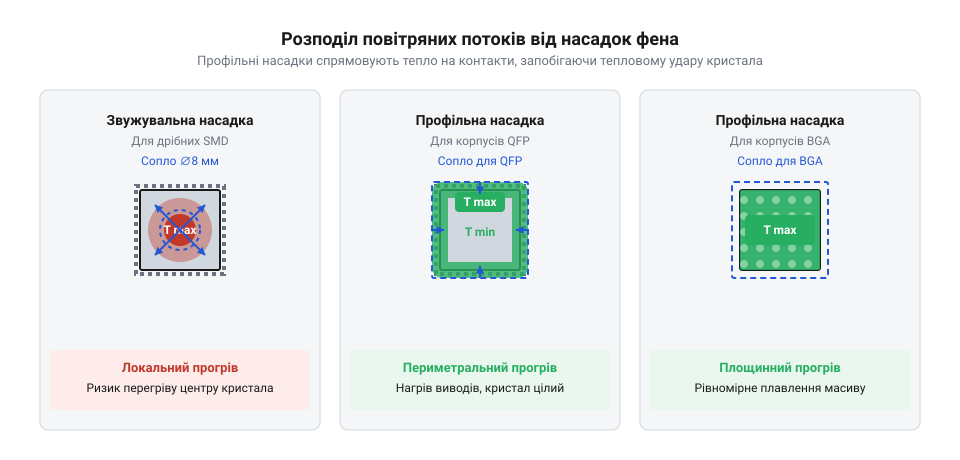
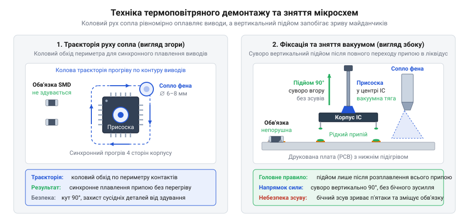

# Практикум: термоповітряний демонтаж та монтаж мікросхем у корпусах QFP й BGA за допомогою станції BAKU

<preknowlist>
- [Термофен BAKU BK-8033](root:cat-hw-instruments/hot-air-station-baku) — будову, органи керування та режим автоматичного охолодження паяльної станції.
- [Властивості та термопрофілі трубчастих припоїв і припайних паст](root:cat-hw-instruments/solder-paste-and-lead-free-alloys-properties) — температури плавлення свинцевих і безсвинцевих сплавів та структуру фаз термопрофілю.
- [Паяльні флюси та пасти для монтажу гарячим повітрям](root:cat-hw-instruments/smd-soldering-fluxes-and-pastes) — вибір гелевих флюсів із відповідною активністю для монтажу компонентів гарячим повітрям.
- [Мідне плетіння для видалення припаю](root:cat-hw-instruments/solder-wick) — техніку збирання залишків припаю з друкованих контактів за допомогою ґноту.
- [Антистатичний захист (ESD) при паянні чутливих компонентів](root:cat-hw-instruments/esd-safe-soldering-practices) — методи заземлення та захисту чутливих мікросхем від статичної електрики.
</preknowlist>

## Проблема демонтажу багатовивідних SMD компонентів

Демонтаж багатовивідних планарних компонентів, таких як мікросхеми в корпусах @@en|QFP@@ (англ. *Quad Flat Package* — чотиристоронній плаский корпус) та @@en|BGA@@ (англ. *Ball Grid Array* — масив кулькових виводів), висуває жорсткі вимоги до рівномірності теплового поля. Спроба зняти таку мікросхему за допомогою [класичного паяльного інструмента](root:cat-hw-instruments/usb-soldering-iron) із суцільним мідним або керамічним наконечником неминуче призводить до фізичного руйнування друкованого вузла. Причина криється в принциповому обмеженні контактного нагріву: жало паяльника здатне передавати тепло лише на один-два сусідні виводи одночасно.

Коли оператор намагається почергово розплавити припай на виводах з одного боку корпусу @@en|QFP@@, протилежні виводи залишаються твердо зафіксованими в охолодженому сплаві. Багатошарова друкована плата на основі склотекстоліту @@en|FR-4@@ (англ. *Flame Retardant 4* — вогнестійкий склотекстоліт) містить внутрішні мідні шар-полігони живлення та заземлення, які працюють як потужні тепловідводи. Щоб компенсувати відтік тепла крізь вузьку точку контакту жала, доводиться підвищувати температуру інструмента до 380–400 °C. Це викликає локальний @@uk|термоградієнт@@ (лат. *gradientis* — той, що крокує) — різкий перепад температур між сусідніми ділянками виводів та підкладки, який досягає понад 150 °C на ділянці в кілька міліметрів.

Локальний перегрів створює відразу три руйнівні чинники:
1. **Механічний підрив майданчиків**: при спробі підважити корпус під час часткового плавлення припаю виникає важільний ефект. Мідна фольга @@uk|контактних майданчиків@@ завтовшки 18–35 мкм відшаровується від епоксидної сполучної основи плати, оскільки її адгезійна міцність стрімко падає при температурах понад 200 °C. 2. **Термічний шок кристала**: стрімка передача тепла крізь металевий вивід до виводної рамки спричиняє нерівномірне розширення кремнієвого кристала та пластикового корпусу. Це призводить до мікротріщин у герметизуючому компаунді та відриву внутрішніх золотих або мідних мікропровідників від контактних п'ятаків кристала. 3. **Недоступність прихованих контактів**: у корпусах @@en|BGA@@ масив виводів у вигляді припайних кульок розташований безпосередньо під корпусом мікросхеми. Контактний інструмент фізично не може дістатися до внутрішніх рядів матриці без повного прогріву всієї площі корпусу.

Для збереження цілісності друкованого вузла демонтаж компонентів @@en|SMD@@ (англ. *Surface Mount Device* — пристрій для поверхневого монтажу) вимагає одночасного безконтактного переведення в рідкий стан усіх з'єднань за допомогою керованого потоку нагрітого газу. Окрім того, при роботі з чутливими цифровими мікросхемами слід суворо дотримуватися [правил антистатичного захисту](root:cat-hw-instruments/esd-safe-soldering-practices), оскільки сухе гаряче повітря та незаземлене сопло можуть створювати електростатичний потенціал, здатний пробити тонюсінькі діелектричні затвори польових транзисторів.

## Налаштування термоповітряної станції та насадок

Безпечний термоповітряний демонтаж вимагає точного узгодження двох параметрів паяльної станції: температури повітряного потоку та його об'ємної швидкості. Сучасне обладнання серії @@en|BAKU@@ поділяється на два конструктивні типи за способом генерації потоку — компресорні та турбінні. У компресорних станціях діафрагмовий насос розташований у корпусі основного блоку й подає повітря крізь гнучкий гумовий шланг під високим статичним тиском. У турбінних станціях безколекторний електродвигун із крильчаткою вбудований безпосередньо у руків'я фена, забезпечуючи м'якший, але ширший та об'ємніший потік.

Вибір насадки визначає геометричний розподіл тепла. Звужувальні круглі сопла діаметром від 3 до 8 мм створюють точковий струмінь. Вони універсальні, але вимагають від оператора неперервного колового маніпулювання феном уздовж периметра корпусу. Якщо зупинити таке сопло в одній точці, локальна ділянка плати перегріється до розшарування, тоді як протилежний кут @@en|QFP@@ залишатиметься холодним. Для великих корпусів та матриць @@en|BGA@@ застосовують профільні квадратні сопла зі спеціальними внутрішніми дефлекторами. Вони спрямовують гаряче повітря безпосередньо на периметр виводів або рівномірно по всій площі матриці, захищаючи центральну частину корпусу від прямого продуву.

*Порівняння розподілу повітряного потоку: круглі звужувальні сопла вимагають колового обходу периметра, тоді як профільні насадки BAKU забезпечують одночасний прогрів усіх контактних майданчиків без ризику локального перегріву.*

Калібрування температурного режиму залежить від типу сплаву, встановленого на платі. При використанні традиційних свинцевих припаїв (наприклад, Sn63/Pb37 із температурою плавлення 183 °C) температура на виході фена [паяльної станції BAKU](root:cat-hw-instruments/hot-air-station-baku) виставляється в діапазоні 280–310 °C. Для сучасних безсвинцевих сплавів (SAC305, Sn96.5Ag3.0Cu0.5 із температурою плавлення 217–221 °C), що відповідають вимогам екологічних стандартів, температуру фена підвищують до 330–360 °C. Значна різниця між установкою станції та температурою плавлення пояснюється розсіюванням тепла в навколишньому повітрі на відстані 5–10 мм від зрізу сопла.

Швидкість повітряного потоку регулюється залежно від щільності довколишнього монтажу. Надто висока швидкість створює аеродинамічний тиск, здатний здути сусідні дрібні @@en|SMD@@-компоненти (пасивні елементи типорозмірів 0402 чи 0603) з розплавлених посадкових місць. Недостатній потік уповільнює теплопередачу, через що оператор змушений довше утримувати фен над мікросхемою, піддаючи її кристал тривалу тепловому впливу. Знання [різних температурних профілів](root:cat-hw-instruments/solder-paste-and-lead-free-alloys-properties) дозволяє підібрати експозицію нагріву так, щоб тривалість перебування припаю в рідкій фазі не перевищувала 30–40 секунд.

## Попередній підігрів та флюсування плати

Прикладання гарячого повітря безпосередньо до холодної друкованої плати спричиняє небезпечне явище — вертикальний та горизонтальний термоградієнт. Оскільки склотекстоліт @@en|FR-4@@ має низький коефіцієнт теплопровідності (приблизно 0.3–0.8 Вт/(м·К)), верхній шар плати розширюється значно швидше за нижній. Це викликає механічне вигинання плати та внутрішнє розшарування між текстолітовими шарами з утворенням здуттів.

Для усунення теплового удару та вирівнювання температурного поля застосовують нижній підігрівач. Він поступово нагріває весь друкований вузол знизу до базової температури: 100–120 °C для свинцевої технології або 130–150 °C для безсвинцевої. Завдяки цьому верхній фен термоповітряної станції @@en|BAKU@@ додає лише необхідну дельту тепла (ΔT ≈ 100–120 °C), що дозволяє знизити температуру верхнього потоку й запобігти термодеструкції матеріалів.

Невід'ємною ланкою підготовки є застосування спеціалізованих гелевих флюсів. На відміну від рідких спиртових розчинів, які миттєво випаровуються під струменем гарячого повітря, в'язкий гелевий флюс залишається в зоні паяння протягом усього циклу нагріву. Правила [вибору гелевих флюсів](root:cat-hw-instruments/smd-soldering-fluxes-and-pastes) вимагають використання термостійких складів з помірною або високою активністю. Флюс вирішує три критичні завдання:
- Інтенсивно руйнує оксидну плівку на мідних майданчиках та виводах мікросхеми. - Забезпечує високу теплопровідність у проміжку між соплом та припайними з'єднаннями. - Завдяки поверхневому натягу запобігає утворенню припайних містків (коротких замикань) між близько розташованими виводами @@en|QFP@@ (крок виводів 0.4–0.65 мм) та кульками @@en|BGA@@.

Орієнтуючись за [класифікацією безвідмивних складів](root:cat-hw-instruments/no-clean-fluxes-chemistry-and-classification), оператор наносить флюс суцільною смужкою вздовж периметра виводів @@en|QFP@@ або продавлює його під корпус @@en|BGA@@ за допомогою голки-дозатора.

*Траєкторія руху сопла термофена та позиціонування вакуумного пінцета: коловий або прямокутний обхід забезпечує рівномірне плавлення припаю, після чого вакуумний пінцет безпечно знімає мікросхему строго вертикально.*

Під час безпосереднього нагріву фен утримують під кутом 90° до поверхні плати на відстані 10–15 мм, виконуючи плавні колові або прямокутні рухи вздовж виводів. Ознакою повного плавлення припаю є візуальний блиск рідкої фази та легке самопозиціонування корпусу на поверхневому натягу. Зняття мікросхеми здійснюють вакуумним пінцетом, який прикладають до центру корпусу. Звичайний металевий пінцет при неакуратному стисканні може зсунути мікросхему вбік до повного розплавлення всіх виводів, відірвавши напіврозплавлені контактні майданчики. Після демонтажу відкриті майданчики плати підганяють під наступний монтаж шляхом [видалення залишків припаю](root:cat-hw-instruments/solder-wick) мідним плетінням, змоченим у флюсі.

## Техніка термоповітряного демонтажу QFP та BGA

Спроба зняти багатовивідну мікросхему з друкованої плати до повного розплавлення всього припаю неминуче призводить до відриву мідних контактних майданчиків від текстолітового шарніра. Коли сотня виводів планарного корпусу @@en|QFP@@ (англ. @@en|Quad Flat Package@@ — плоский корпус із чотиристороннім виводом) або масив кульок під корпусом @@en|BGA@@ (англ. @@en|Ball Grid Array@@ — масив кулькових виводів) утримуються твердим сплавом, навіть мінімальне механічне зусилля пінцета руйнує друкований монтаж. Для безпечного відокремлення компонента необхідно створити локальну зону нагріву, у якій усі контактні з'єднання одночасно переходять у рідкий стан без перегріву навколишніх деталей та основи плати з @@en|FR-4@@.

Для цього використовують [термоповітряну станцію BAKU](root:cat-hw-instruments/hot-air-station-baku) з попередньо відкаліброваним потоком повітря та відповідною насадкою. Перед початком нагріву на периметр виводів QFP або під корпус BGA вносять шар [гелевих флюсів для SMD](root:cat-hw-instruments/smd-soldering-fluxes-and-pastes). Флюс розчиняє поверхневу оксидну плівку та покращує теплопередачу від гарячого повітря до металу. Сопло термофена утримують суворо перпендикулярно до площини плати на відстані 5–10 мм. Основне правило термоповітряного демонтажу — постійний коловий рух сопла вздовж периметра корпусу. Зупинка сопла в одній точці створює локальний температурний пік, що призводить до обвуглювання маски та розшарування склотекстоліту.

*Колове переміщення сопла запобігає локальному перегріву текстоліту та забезпечує одночасне розплавлення всіх виводів.*

Під час прогріву стежать за станом припаю. Момент переходу металу в рідку фазу (стан @@en|liquidus@@) визначають за зміною дзеркального блиску галтелей та легким зсувом компонента під дією поверхневого натягу. Для корпусів BGA, де контакти приховані під тілом мікросхеми, орієнтуються на розплавлення контрольних відкритих кульок або тестових SMD-компонентів, розташованих поруч на тій самій зоні підігріву.

Знімання мікросхеми виконують суворо вертикально вгору. Для цього застосовують вакуумний маніпулятор із силіконовою присоскою або антистатичний пінцет, що відповідає вимогам [вимог антистатичного захисту](root:cat-hw-instruments/esd-safe-soldering-practices) (наприклад, @@en|ESD@@-захищені інструменти). Якщо мікросхема не піднімається легко без опору, нагрів продовжують ще 3–5 секунд. Категорично заборонено підважувати корпус викруткою чи силовим пінцетом: це зрізає гарячі контактні площадки разом з олов'яними містками.

## Підготовка контактних майданчиків до монтажу

Після зняття мікросхеми на друкованій платі залишаються нерівномірні напливи окисленого припаю різної висоти. Спроба встановити новий компонент на такі куполи призведе до перекосу корпусу, відсутності контакту на окремих виводах або замкнення сусідніх провідників. Для якісного повторного монтажу контактні майданчики необхідно повністю очистити від залишків старого сплаву та повернути їм плоску геометрію.

Очищення здійснюють методом капілярного всмоктування за допомогою [мідного плетіння для видалення](root:cat-hw-instruments/solder-wick) (англ. @@en|solder wick@@). На покриту припаєм зону рясно наносять гелевий флюс. Край мідного плетіння прикладають до контактних площадок і зверху притискають пласким зрізом накінечника [класичного контактного паяльника](root:cat-hw-instruments/usb-soldering-iron). Температуру скошеного лудженого жала встановлюють у межах 320–340 °C. Під дією тепла флюс очищує мідні нитки плетіння від оксидів, і рідкий припай завдяки високій змочуваності та капілярному ефекту миттєво всотується у внутрішню структуру плетіння.

*Капілярне всмоктування розплавленого припаю мідним плетінням відновлює плоску геометрію контактних майданчиків.*

Під час плавного переміщення плетіння по платі важливо уникати поздовжнього протягування стрічки із зусиллям. Якщо припій у якійсь точці вистигне, плетіння примерзне до площадки, і механічний ривок відірве мідний п'ятак від текстоліту. Паяльник разом із плетінням пересувають легко, без натиску, доки майданчики не стануть абсолютно пласкими.

Після видалення надлишків металу поверхню плати охолоджують до кімнатної температури та очищують від обвугленого флюсу за допомогою ізопропілового спирту (@@en|isopropanol@@) чи спеціального змивача. Очищену зону оглядають під збільшенням. Поверхня всіх площадок має бути рівною, блискучою, без містків та залишків ворсу плетіння. Збереження висотної рівномірності — так званої копланарності (англ. @@en|coplanarity@@) — є критичною умовою для розстановки BGA-кульок та позиціонування дрібнокрокових QFP.

## Повторний монтаж, контроль та промивка

Установлення нової мікросхеми на підготовлені контактні майданчики вимагає суворого дотримання температурного режиму та точності суміщення виводів. Найменша зсувна помилка під час паяння QFP призведе до перекриття виводом проміжку між площадками, а для BGA-корпусу неузгодженість елементів унеможливить утворення правильних сферичних галтелей.

На очищені майданчики наносять тонкий, прозорий шар гелевого флюсу. Надлишок флюсу неприпустимий: під час нагрівання він закипає і вспливаючий газ зміщує корпус із позиції. Нову мікросхему орієнтують за ключем (першою ніжкою) та суміщають виводи з шовкографічною рамкою плати. Термофен налаштовують відповідно до складу припаю, обираючи цільові [термопрофілі припайних паст](root:cat-hw-instruments/solder-paste-and-lead-free-alloys-properties). Прогрів починають із загальної зони навколо компонента для зменшення градієнта температур, після чого сопло наближають і плавно рухають по колу.

Під час досягнення температури плавлення спостерігається ефект самовирівнювання (англ. @@en|self-alignment effect@@). Сила поверхневого натягу рідкого припаю тягне контакти мікросхеми до відповідних мідних майданчиків, самостійно виправляючи невеликий початковий зсув. У цей момент нагрів припиняють, даючи вузлу природно охолонути протягом 30–60 секунд. Будь-які вібрації столу чи струс плати до кристалізації металу створять внутрішні тріщини у з'єднаннях.

Після охолодження проводять діагностику якості паяння. Для QFP перевіряють відсутність містків між сусідніми ніжками та форму бічних галтелей, застосовуючи [використання оптичного мікроскопа](root:cat-hw-instruments/optical-microscope-soldering). Для BGA оглядають бічний зазор під корпусом: усі олов'яні кульки повинні мати однакову висоту висадки та рівномірне округлення.

Завершальний етап — ретельне промивання плати. Залишки флюсу, навіть маркованого як безвідмивний (наприклад, із серії [безвідмивного флюсу FVS-7](root:cat-hw-instruments/flux-fvs7)), у високочастотних або високоомних кола з часом накопичують вологу та зумовлюють струми витоку. Вузол промивають ізопропіловим спиртом або ультразвуковим розчином за допомогою антистатичної щіточки, після чого сушать теплим повітрям.