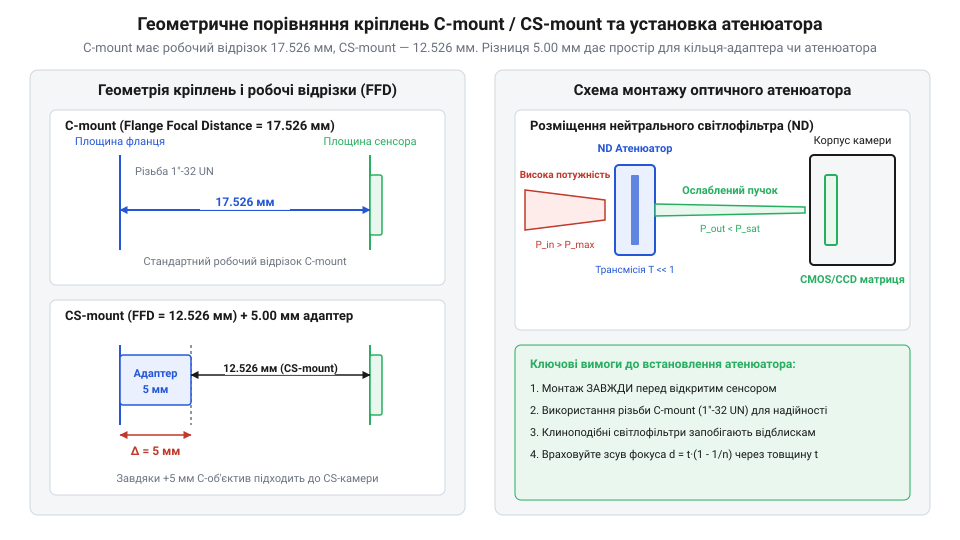
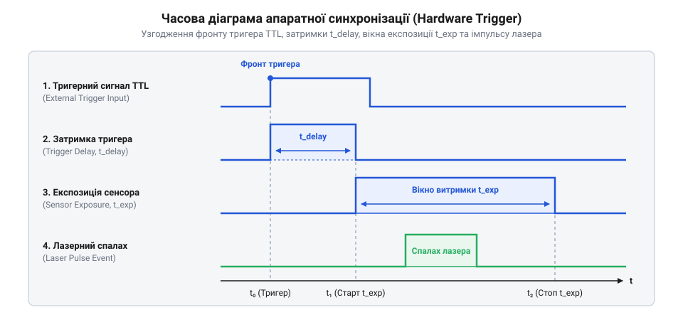

# Апаратний інтерфейс: оптичні кріплення, тригерні лінії та інтерфейси зв'язку

## Ризики помилок фізичного та електричного підключення

Лазерний профілометр є високоточним оптико-електронним приладом, призначеним для вимірювання просторового розподілу інтенсивності лазерного випромінювання. Його основними чутливими елементами є напівпровідникові матричні сенсори @@en|CCD@@ (англ. *Charge-Coupled Device*) або @@en|CMOS@@ (англ. *Complementary Metal-Oxide-Semiconductor*). Пряме спрямування лазерного пучка навіть низької потужності (понад декілька міліват) безпосередньо на відкриту матрицю призводить до локального перевищення порогу руйнування @@en|laser damage threshold@@ (латин. *damnum* — шкода, втрата). Оптичне перевантаження викликає швидке перегрівання та незворотне термічне випалювання фотодіодів пікселів, руйнуючи прилад.

Другою критичною пасткою під час експлуатації є вимірювання параметрів імпульсних лазерів. Коли матриця камери працює у режимі вільного накопичення кадрів @@en|free-running mode@@ (англ. *free-running mode* — режим вільного ходу), короткий лазерний спалах тривалістю у декілька наносекунд припадає на довільний момент часу. Якщо експозиція кадру не узгоджена в часі з генерацією імпульсу, зображення пучка на виході виходить частково зрізаним, містить смуги зчитування або зовсім відсутнє.

Третій ризик полягає у недотриманні вимог до електричного підключення та ліній зв'язку. Профілометр передає нестиснені двовимірні масиви даних високої роздільної здатності. Нестабільна напруга живлення з високим рівнем високочастотних завад або використання несертифікованих пасивних кабелів призводить до збоїв комунікаційного інтерфейсу, викривлення піксельних даних та систематичного скидання кадрів під час вимірювального сеансу.

Окрім катастрофічного випалювання, виникає прихований механізм пошкодження сенсора під час тривалого випромінювання із щільністю потужності, нижчою за поріг руйнування. Постійне локальне нагрівання напівпровідникового кристала лазерним пучком прискорює термогенерацію носіїв заряду та формує дефекти в кремнієвій кристалічній ґратці. Це збільшує темновий струм витоку в окремих фотодіодах, створюючи стаціонарні «гарячі пікселі» @@en|hot pixels@@ (англ. *hot pixels* — гарячі пікселі), які випромінюють максимальний сигнал незалежно від реального освітлення. Такі апаратні дефекти спотворюють математичний розрахунок центру мас та ефективного діаметра пучка, вимагаючи регулярного перекалібрування фону або коштовної заміни сенсора.

## Оптичні кріплення C-mount, CS-mount та атенюатори

Для надійного механічного та оптичного стикування профілометра з оптичною системою застосовують стандартизовані різьбові з'єднання. Основними промисловими стандартами кріплення об'єктивів та світлофільтрів є @@en|C-mount@@ та @@en|CS-mount@@. Обидва варіанти мають однакову дюймову різьбу діаметром `25.4 мм` (`1 дюйм`) із кроком `32 нитки на дюйм` (`1-32 UN-2A`).

Головна відмінність між цими стандартами полягає у величині робочого відрізка @@en|flange focal distance@@ (англ. *flange* — фланець, *focal* — фокусний; робочий відрізок), який визначає відстань від опорної площини фланця до чутливої поверхні сенсора.

*Порівняння робочих відрізків C-mount (17.526 мм) і CS-mount (12.526 мм) та порядок встановлення атенюаторів перед сенсором*

Для стандарту @@en|C-mount@@ робочий відрізок становить рівно `17.526 мм`, а для @@en|CS-mount@@ — `12.526 мм`. Різниця у відстані між фланцем і сенсором становить точно `5.00 мм`. Якщо профілометр має кріплення @@en|CS-mount@@, а оптична насадка розрахована під @@en|C-mount@@, між ними необхідно встановити кільцевий різьбовий адаптер товщиною `5.00 мм`. Якщо ж встановити об'єктив @@en|CS-mount@@ на камеру з кріпленням @@en|C-mount@@, фокальна площина опиниться всередині корпусу, і фокусування буде неможливим.

Щоб зменшити інтенсивність лазерного пучка до безпечного рівня, на різьбове кріплення камери послідовно накручують апаратний @@en|attenuator@@ (латин. *attenuare* — потоншувати, ослаблювати). Сфера застосування атенюаторів чітко розмежована за фізичним принципом дії та допустимим оптичним навантаженням. Для низької середньої потужності (до декількох сотень міліват) застосовують поглинальні світлофільтри @@en|neutral density filter@@ (англ. *neutral density filter* — фільтр нейтральної оптичної щільності), у яких надлишкова енергія перетворюється на тепло всередині скла; однак при високій потужності поглинальні фільтри зазнають термічного лінзування або розтріскування. Для високих енергій та потужностей (від одиниць ват до кіловат) обов'язково використовують відбивальні клинкові дільники пучка @@en|beam sampler@@ (англ. *beam sampler* — дільник пучка), у яких понад `90–99%` потужності безперешкодно проходить крізь оптичний клин на поглинач, а на сенсор профілометра відбивається лише безпечна частка від першої передньої грані (зазвичай `1–4%`), що виключає термічну деформацію хвильового фронту.

Оптична щільність `D` нейтрального фільтра пов'язана з коефіцієнтом пропускання `T` співвідношенням:

D = -log₁₀(T)

Фільтр із позначенням `ND 3.0` має коефіцієнт пропускання `T = 0.001`, що зменшує інтенсивність лазерного пучка в `1000` разів. Для високої потужності комбінують декілька фільтрів, причому першим у напрямку ходу променя завжди встановлюють відбивальний атенюатор для скидання основної частки енергії без термічного деформування оптичних елементів.

## Тригерні лінії BNC/SMB та імпульсна синхронізація

Для синхронізації моменту реєстрації кадру з короткотривалими лазерними спалахами застосовують апаратні тригерні лінії. Підключення зовнішніх сигналів синхронізації здійснюється через коаксіальні роз'єми @@en|BNC@@ (англ. *Bayonet Neill–Concelman*) або компактні кутові роз'єми @@en|SMB@@ (англ. *SubMiniature version B*). Центральний контакт роз'єму передає цифровий сигнал тригера, а зовнішній екранувальний циліндр з'єднаний із заземленням @@en|GND@@ (англ. *ground* — спільний провід).

Електричні рівні тригерних входів узгоджуються зі стандартами @@en|TTL@@ (англ. *Transistor-Transistor Logic*) з амплітудою сигналів `0…5 В` або логікою `3.3 В`. Вхідний опір тригерного каскаду приладу може перемикатися між високоімпедансним режимом (`1 кОм` або `10 кОм`) та узгодженим навантаженням `50 Ом`. Навантаження `50 Ом` є обов'язковим при роботі з короткими тригерними імпульсами наносекундного діапазону для запобігання відбиттю електричного сигналу від кінця лінії.

Часова схема апаратного запуску враховує внутрішню затримку спрацьовування затвора @@en|shutter delay@@ (англ. *shutter* — затвор, *delay* — затримка) та динамічні характеристики захисних вхідних кіл. Для гальванічного розв'язання вимірювальної камери від високовольтних завад лазерного обладнання вхідні лінії оснащують оптичними розв'язувачами (оптопарами). Смуга пропускання внутрішньої оптопари обмежує мінімально допустиму тривалість вхідного тригерного імпульсу. Якщо тривалість зовнішнього сигналу є коротшою за час вмикання світлодіода та фотоприймача оптопари (зазвичай менше `50–100 нс`), тригерний каскад не встигає сформувати логічний рівень для внутрішньої схеми, що призводить до пропуску кадрів та нестабільного затвора.

*Часовий взаємозв'язок між вхідним фронтом тригера, внутрішньою затримкою затвора та вікном експозиції матриці*

Після надходження активного фронту сигналу на вхід @@en|Input Trigger@@ (англ. *Input Trigger* — вхідний тригер) минає фіксована затримка @@en|shutter delay@@, після чого матриця відкриває вікно накопичення заряду. У режимі вихідної синхронізації @@en|Output Strobe@@ (англ. *Output Strobe* — вихідний імпульс) профілометр сам формує імпульс на зовнішньому роз'ємі в момент початку експозиції, запускаючи лазерне джерело.

## Інтерфейси живлення та шини даних USB/GigE

Передача сирих двовимірних масивів пікселів від профілометра до ПК вимагає високошвидкісних цифрових шин. Основними стандартами зв'язку у сучасних профілометрах є @@en|USB 3.0 SuperSpeed@@ (англ. *SuperSpeed* — надвисока швидкість) та @@en|GigE Vision@@ (англ. *Gigabit Ethernet Vision*).

Шина @@en|USB 3.0 SuperSpeed@@ забезпечує пропускну здатність до `5 Гбіт/с` (реальна швидкість передачі даних досягає `350–400 МБ/с`). Це дозволяє передавати повнокадрове відео високої роздільної здатності без втрат у режимі реального часу. Живлення приладу реалізоване безпосередньо від комунікаційної шини @@en|Bus Power@@ (англ. *Bus Power* — живлення від шини) з напругою `5 В` та струмом споживання до `900 мА`. Максимальна довжина пасивного кабелю USB 3.0 обмежена відстанню `3 метри`. Для більших відстаней використовують активні оптичні кабелі @@en|Active Optical Cable@@.

Шина @@en|GigE Vision@@ працює через стандартний інтерфейс Gigabit Ethernet зі швидкістю `1 Гбіт/с` (пропускна здатність даних до `115 МБ/с`). Головною перевагою GigE Vision є можливість віддалення вимірювальної камери від комп'ютера на відстань до `100 метрів` по стандартному кабелю Cat 6.

Живлення приладів GigE Vision здійснюється за технологією @@en|Power over Ethernet@@ (англ. *Power over Ethernet*, PoE) за стандартом `IEEE 802.3af/at` (напруга `48 В`) через той самий кабель даних, або від зовнішнього джерела живлення постійного струму `12…24 В` через промисловий багатоконтактний роз'єм (наприклад, Hirose 12-pin). Для ознайомлення з алгоритмами цифрової обробки сформованих кадрів та розрахунку параметрів за стандартом ISO 11146 зверніться до статті [Алгоритми обробки зображень та розрахунок параметрів пучка ISO 11146](root:cat-hw-instruments/beam-profiler/math-laser-beam-propagation-and-iso11146-moments.md).

Для забезпечення стабільної передачі вимірювальних масивів через шину @@en|GigE Vision@@ необхідне налаштування мережевого адаптера ПК на підтримку збільшених кадрів @@en|Jumbo Frames@@ (англ. *Jumbo Frames* — велетенські мережеві кадри). Оскільки протокол потокового ведення даних @@en|GigE Vision Streaming Protocol@@ (GVSP) працює поверх мережевого протоколу @@en|UDP@@ (англ. *User Datagram Protocol*), стандартний розмір кадру Ethernet у `1500 байт` викликає високе навантаження на процесор через обробку мільйонів переривань на секунду. Збільшення розміру @@en|MTU@@ (англ. *Maximum Transmission Unit* — максимальний розмір блоку передачі) в налаштуваннях драйвера мережевої карти до `9000 байт` скорочує накладні витрати заголовків пакетів і навантаження на мережевий стек у шість разів, гарантуючи повне виключення втрати UDP-пакетів та збоїв синхронізації кадрів під час вимірювань.
