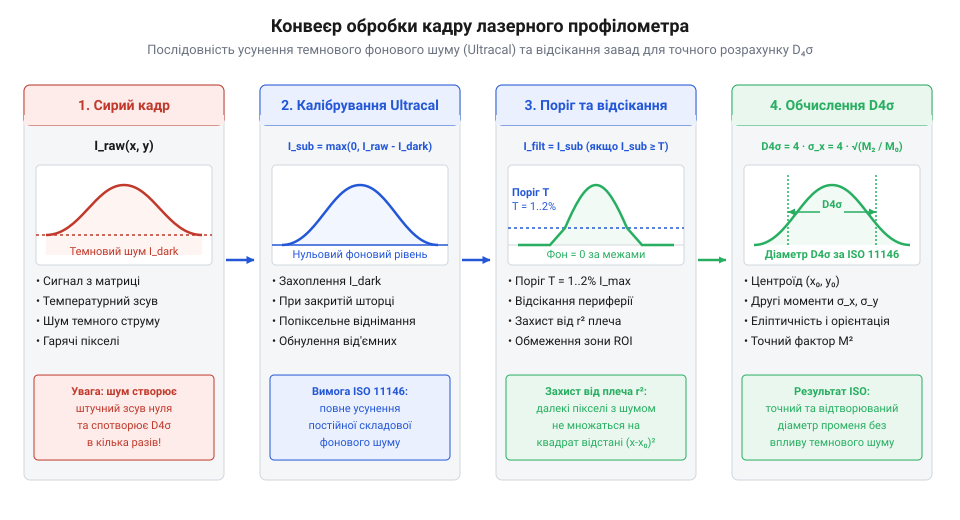

# Програмний інтерфейс: SDK, виклики функцій обробки кадрів та команди SCPI/VISA

## Проблема фонового шуму та захоплення кадру

Пряме зчитування двовимірного масиву інтенсивності з фоточутливої матриці без попереднього налаштування вимірювального тракту призводить до суттєвих спотворень розрахованого профілю випромінювання. Кожен оптичний профілометр (від грецького *grapho* — «пишу» та *metron* — «вимірювач») `@@en|beam profiler@@` містить матричний сенсор (від латинського *sensus* — «відчуття») `@@en|sensor@@` на основі `@@en|CCD@@` або `@@en|CMOS@@` структури. У реальних умовах кожен піксель сенсора генерує темновий струм `@@en|dark current@@`, оскільки термодинамічне коливання кремнієвої ґратки викликає спонтанну генерацію електронно-діркових пар у потенціальних ямах `@@en|potential well@@` фотодіодів через дефекти Шоклі — Ріда — Голла. Зі зростанням температури кристала всього на 6–8 °C швидкість теплової генерації електронів подвоюється, через що в потенціальних ямах накопичується паразитний заряд ще до моменту потрапляння фотонів. Додатково на матрицю накладається паразитне фонове освітлення, а аналогово-цифровий перетворювач додає власні шуми квантування й постійну електричну напругу зсуву нуля `@@en|zero offset@@`. Якщо обчислювати геометричні параметри лазерного пучка по сирому кадру, периферійні пікселі з цим паразитно накопиченим зарядом створили б штучний «хвіст» розподілу, що завищує реальний діаметр на 20–50%.

Для забезпечення відтворюваності вимірювань розробник взаємодіє з аналізатором через програмну бібліотеку `@@en|SDK@@` (від англійського *Software Development Kit*). Перед захопленням зображення необхідно відкрити програмну сесію, встановити час експозиції (від латинського *expositio* — «показ, виклад») `@@en|exposure@@` та коефіцієнт підсилення `@@en|gain@@`, щоб запобігти насиченню `@@en|saturation@@` пікселів у піку інтенсивності. На відміну від контактного вимірювання розмірів, де використовується [штангенциркуль](root:cat-hw-instruments/vernier-caliper), оптичний аналіз потребує строгого контролю динамічного діапазону матриці. Для безперервних лазерів захоплення здійснюється програмним запуском, проте при аналізі імпульсного випромінювання довільне зчитування кадрів призводить до пропуску коротких спалахів або розсинхронізації. У таких вимірювальних сценаріях в `@@en|SDK@@` налаштовують режим апаратної синхронізації (від англійського *trigger* — «спуск, засув») `@@en|hardware triggering@@` за зовнішнім тригерним сигналом `@@en|external trigger@@`. Програма перемикає джерело запуску на зовнішній електричний імпульс стандартного рівня `@@en|TTL@@`, що надходить на `@@en|BNC@@`-роз'єм камери від затвора лазера або комірки Поккельса. Через `@@en|SDK@@` задається фронт спрацьовування (вивисний або спадний), затримка запуску експозиції `@@en|trigger delay@@` для компенсації часу прольоту фотонів чи затримки кабелю, а також часовий поріг очікування тригера, що гарантує підрядове збереження та точну прив'язку кадру до моменту лазерного спалаху.

:::tabs
@tab C/C++
:::code api-beam-profiler-sdk-and-command-interface/cpp/main.cpp
@tab Python
```python
import beam_profiler_sdk as bp

# Ініціалізація сесії аналізатора пучка
profiler = bp.BeamProfiler()
try:
    profiler.connect(device_index=0)
    # Налаштування витримки у мікросекундах та коефіцієнта підсилення
    profiler.set_exposure_us(1500.0)
    profiler.set_gain(1.0)
    print("Сесію аналізатора ініціалізовано успішно.")
except bp.ProfilerException as err:
    print(f"Помилка підключення до давача: {err}")
finally:
    profiler.disconnect()
```
:::

## Процедура віднімання темного кадру Ultracal

Основним інструментом усунення постійної складової шуму та дрейфу нуля є процедура калібрування (від арабського *qālib* — «форма») `@@en|calibration@@` шляхом віднімання темного кадру `@@en|dark frame subtraction@@`, відома в промислових приладах під назвою `@@en|Ultracal@@`. Математична суть алгоритму, регламентованого міжнародним стандартом `@@en|ISO 11146@@`, полягає у попередньому накопиченні й усередненні серії кадрів за відсутності лазерного випромінювання. Сформована двовимірна карта фонового шуму запам'ятовується у внутрішній пам'яті як матриця відліків темнового сигналу.


*Послідовність обробки кадру від сирого матричного масиву сенсора через калібрування Ultracal та пороговий фільтр до підрахунку вторинних моментів D4σ.*

Під час робочого захоплення з кожного покадрового масиву інтенсивності елемент за елементом віднімається опорний темновий кадр. Проте звичайного віднімання середнього значення темнового сигналу недостатньо, оскільки дискретна квантова природа світла й носіїв заряду породжує дробовий шум `@@en|shot noise@@`, який підпорядковується статистиці пуассонівського розподілу `@@en|Poisson distribution@@`. Флуктуації дробового шуму з середньоквадратичним відхиленням σ_shot викликають як додатні, так і від'ємні випадкові викиди навколо нуля. Щоб усунути статистичний шум периферійних пікселів і запобігти появі хибних від'ємних значень інтенсивності, базовий поріг відсікання T `@@en|baseline threshold@@` обирають на рівні 3σ–4σ від сумарного шумового розкиду темнової матриці. Проте навіть правильно побудована калібрувальна матриця втрачає точність у часі через температурний зсув нуля (від англійського *drift* — «зсув, знесення») `@@en|thermal drift@@`. Оскільки теплова генерація носіїв заряду в кремнії експоненціально зростає, нагрів кристала матриці під час тривалої роботи змінює рівень темнового струму. Для контролю цього ефекту `@@en|SDK@@` здійснює постійний моніторинг внутрішньокорпусного термодавача або зовнішнього термометра, такого як [пірометр MESTEK IR01B](root:cat-hw-instruments/pyrometer-mestek-ir01b). Якщо відхилення температури кристала перевищує допустимий критичний поріг ΔT (зазвичай 1–2 °C), драйвер автоматично виконує анулювання чинності (від латинського *invalidus* — «недійсний, слабкий») `@@en|invalidation@@` поточного темного каду `@@en|Ultracal@@` і вимагає повторного закриття апертури для перекалібрування. Після віднімання актуалізованого темного каду застосовується математична порогова відсіч нульового рівня:

```
I(x, y) = max(0, R(x, y) - B(x, y) - T)      [віднімання темного кадру B(x,y) та шумової межі T від сирого кадру R(x,y)]
```

де `R(x, y)` — сира інтенсивність пікселя, `B(x, y)` — значення темнової матриці, a `T` — базовий поріг шумового відсікання. Програмний виклик функції `@@en|Ultracal@@` виконується щоразу при зміні часу експозиції, підсилення або температури навколишнього середовища, яку за потреби перевіряють приладами на зразок [пірометра MESTEK IR01B](root:cat-hw-instruments/pyrometer-mestek-ir01b).

:::tabs
@tab C/C++
```cpp
// Перекриття оптичного входу та запуск процедури Ultracal
bp_status_t status = BeamProfiler_TriggerUltracal(profiler);
if (status == BP_SUCCESS) {
    printf("Калібрування темного кадру Ultracal виконано успішно.\n");
} else {
    printf("Помилка виконання калібрування: %d\n", status);
}
```
@tab Python
```python
# Виклик процедури віднімання темного кадру Ultracal
if profiler.calibrate_ultracal():
    print("Темновий кадр зафіксовано. Зсув нуля усунуто.")
else:
    print("Не вдалося виконати калібрування Ultracal.")
```
:::

## Захоплення зображення та зчитування параметрів D4σ

Після усунення фонового шуму програмний комплекс здійснює захоплення відкоригованого двовимірного масиву інтенсивності та проводити розрахунок просторових характеристик пучка. Для визначення геометрії випромінювання стандарт `@@en|ISO 11146@@` визначає метод вторинних моментів `@@en|D4σ@@`. Першим кроком обчислюються координати центроїда (від латинського *centrum* — «центр» та грецького *eidos* — «вид») `@@en|centroid@@` пучка, які являють собою центр маси розподілу інтенсивності:

```
x_bar = (∑ x · I(x, y)) ÷ (∑ I(x, y))      [координата X центроїда плями]
y_bar = (∑ y · I(x, y)) ÷ (∑ I(x, y))      [координата Y центроїда плями]
```

На основі знайденого центроїда обчислюються дисперсії та вторинні центральні моменти розподілу по осях X та Y. У випадку анізотропного або еліптичного пучка його головні осі орієнтовані під довільним азимутальним кутом θ `@@en|azimuth angle@@` до декартової сітки матричного сенсора. Для врахування астигматизму `@@en|astigmatism@@` та розрахунку еліптичності стандарт `@@en|ISO 11146@@` вимагає додаткового обчислення змішаного центрального моменту вторинного порядку σ_xy:

```
σ_xy = (∑ (x - x_bar) · (y - y_bar) · I(x, y)) ÷ (∑ I(x, y))      [змішаний вторинний момент розподілу]
```

За допомогою значень σ_x², σ_y² та σ_xy обчислюється кут орієнтації головної осі еліпса θ:

```
θ = 0.5 · arctan((2 · σ_xy) ÷ (σ_x² - σ_y²))      [кут орієнтації головної осі пучка]
```

Поворот системи координат на кут θ дозволяє діагоналізувати матрицю моментів і визначити дійсні пучкові діаметри D4σ_major та D4σ_minor уздовж головних осей астигматичного профілю випромінювання. Безпосередні формули розрахунку моментів по осях X та Y мають вигляд:

```
σ_x² = (∑ (x - x_bar)² · I(x, y)) ÷ (∑ I(x, y))      [дисперсія розподілу вздовж осі X]
σ_y² = (∑ (y - y_bar)² · I(x, y)) ÷ (∑ I(x, y))      [дисперсія розподілу вздовж осі Y]
```

Вимірний діаметр пучка `@@en|D4σ@@` відповідає чотирикратному середньоквадратичному відхиленню (4σ):

```
D4σ_x = 4 · σ_x      [діаметр пучка вздовж осі X за методом D4σ]
D4σ_y = 4 · σ_y      [діаметр пучка вздовж осі Y за методом D4σ]
```

Бібліотечні виклики `@@en|SDK@@` дозволяють отримати як готовий матричний растр інтенсивностей, так і підраховані математичні значення у зручній структурі. Проте підрахунок підсумовувань для вторинних моментів по повнокадровому матричному масиву великої роздільності вимагає значних обчислювальних ресурсів і додає шумовий внесок далеких периферійних пікселів у значення центральних моментів `σ_x²` та `σ_y²`. Для оптимізації швидкодії та відповідності вимогам `@@en|ISO 11146@@` в `@@en|SDK@@` реалізовано алгоритм автоматичного вибору ділянки зацікавленості (від англійського *region of interest* — «ділянка зацікавленості») `@@en|ROI@@`. На основі первинної оцінки центроїда програма динамічно обмежує прямокутне вікно розрахунку навколо плями пучка розміром від `3·D4σ` до `4·D4σ`. Виклик функцій налаштування `@@en|ROI@@` звужує підсумкові цикли обробки в пам'яті до меж цього підмасиву, що знижує обчислювальну складність, підвищує частоту обробки кадрів у 5–10 разів і відсікає зашумлену периферію матриці від математичного інтегрування моментів.

:::tabs
@tab C/C++
```cpp
bp_beam_params_t params;
// Отримання розрахованих параметрів пучка з поточного кадру
status = BeamProfiler_GetBeamParameters(profiler, &params);
if (status == BP_SUCCESS) {
    printf("Центроїд: X = %.2f мкм, Y = %.2f мкм\n", params.centroid_x, params.centroid_y);
    printf("Діаметр D4σ: Dx = %.2f мкм, Dy = %.2f мкм\n", params.d4sigma_x, params.d4sigma_y);
    printf("Пікова інтенсивність: %u ADC\n", params.peak_intensity);
}
```
@tab Python
```python
# Отримання обчислених параметрів лазерного пучка
params = profiler.get_beam_parameters()
print(f"Центроїд пучка: X = {params.centroid_x:.2f} мкм, Y = {params.centroid_y:.2f} мкм")
print(f"Діаметр D4σ: Dx = {params.d4sigma_x:.2f} мкм, Dy = {params.d4sigma_y:.2f} мкм")
print(f"Пікова інтенсивність: {params.peak_intensity} ADC")
```
:::

## Керування позиціонером за протоколом SCPI та VISA

Повний якісний аналіз лазерного випромінювання вимагає визначення фактора якості пучка `@@en|M²@@` та параметрів перетяжки (каустики). Для цього профілометр встановлюють на автоматизований лінійний актуатор (від латинського *actuatus* — «приведений у дію») `@@en|actuator@@`, який переміщує вимірювальну головку вздовж оптичної осі Z. Програмне керування актуатором здійснюється через уніфіковану віртуальну приладну архітектуру `@@en|VISA@@` (від англійського *Virtual Instrument Software Architecture*) за допомогою стандартних команд для програмованих приладів `@@en|SCPI@@` (від англійського *Standard Commands for Programmable Instruments*).

Керувальний комп'ютер надсилає текстові команди через послідовний порт `@@en|RS-232@@`, `@@en|USB@@` або `@@en|Ethernet/LAN@@`. Синтаксис `@@en|SCPI@@` використовує ієрархічні текстові команди для опитування стану приладу та виконання переміщень. Проте під час фізичного руху каретки можливе механічне заклинювання актуатора або досягнення кінцевого вимикача, через що контролер позиціонера припиняє відповідати або оновлювати прапорець готовності `READY`. Якщо програма виконує блоки зчитування без обмеження часу, сесія `@@en|VISA@@` блокує виконання основного потоку. Для запобігання асинхронним зависанням у контексті `@@en|VISA@@`-сесії обов'язково налаштовують атрибут таймауту `VI_ATTR_TMO_VALUE` (наприклад, 5000 мс). Якщо актуатор заклинює і час очікування вичерпується, шина повертає специфічний код помилки `VI_ERROR_TMO` (від англійського *timeout* — «вичерпання відведеного часу»). При перехопленні цього винятку або помилки зв'язку алгоритм сканування перериває цикл опитування `POSITION:STATE?`, надсилає діагностичну SCPI-команду `SYSTEM:ERROR?` для зчитування внутрішньої черги апаратних помилок контролера, виконує скидання стану командою `*CLS` і зупиняє подальший рух для захисту вимірювального обладнання.

Зібраний масив виміряних діаметрів `D4σ(z)` у різних перерізах вздовж осі сканування використовується для підрахунку параметрів каустики випромінювання. Відповідно до вимог стандарту `@@en|ISO 11146@@`, програма здійснює гіперболічну апроксимацію (від англійського *fitting* — «підгонка, апроксимація») `@@en|hyperbolic fitting@@` за методом найменших квадратів `@@en|least squares method@@`. Теоретична залежність описується виразом `D4σ(z) = √(d0² + ((4 · λ · M²) ÷ (π · d0))² · (z - z0)²)`, де `d0` — мінімальний діаметр у перетяжці в координаті `z0`, a `λ` — довжина хвилі випромінювання. Знайдені коефіцієнти апроксимації дозволяють автоматично обчислити положення перетяжки `z0`, її розмір `d0`, довжину Рейлі `@@en|Rayleigh length@@` `z_R` та безрозмірний фактор якості пучка (від латинського *factor* — «робник, чинник») `@@en|beam propagation factor@@` `@@en|M²@@`. Значення `M² = 1` відповідає ідеальному фундаментальному гаусовому пучку `@@en|TEM00@@`, а відхилення `M² > 1` характеризує ступінь багатомодовості та кутову розбіжність реальної лазерної системи.

- `*IDN?` — запит ідентифікації приладу та версії прошивки;
- `POSition:MOVe:ABSolute <значення_мм>` — команда переміщення каретки актуатора в абсолютну координату вздовж осі Z;
- `POSition:STATe?` — опитування стану руху позиціонера (повертає `READY` або `MOVING`).

:::tabs
@tab Python|pyvisa
:::code api-beam-profiler-sdk-and-command-interface/py/snippet-2.py
@tab C++|visa
:::code api-beam-profiler-sdk-and-command-interface/cpp/main-2.cpp
:::
