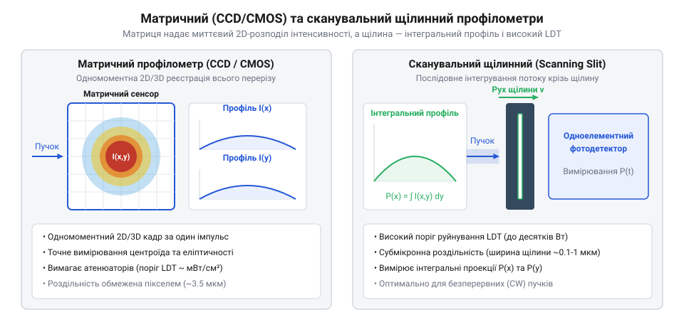
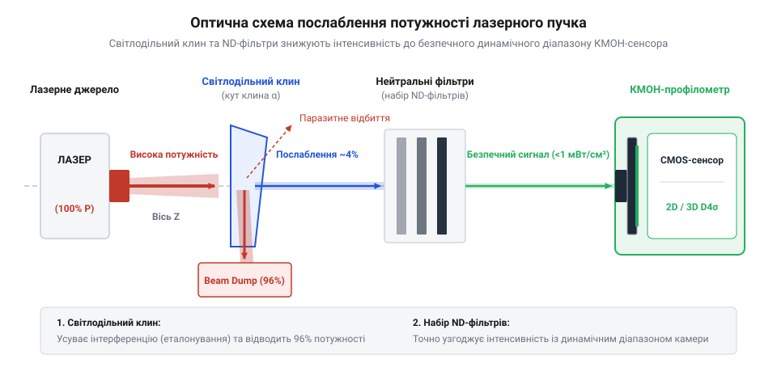
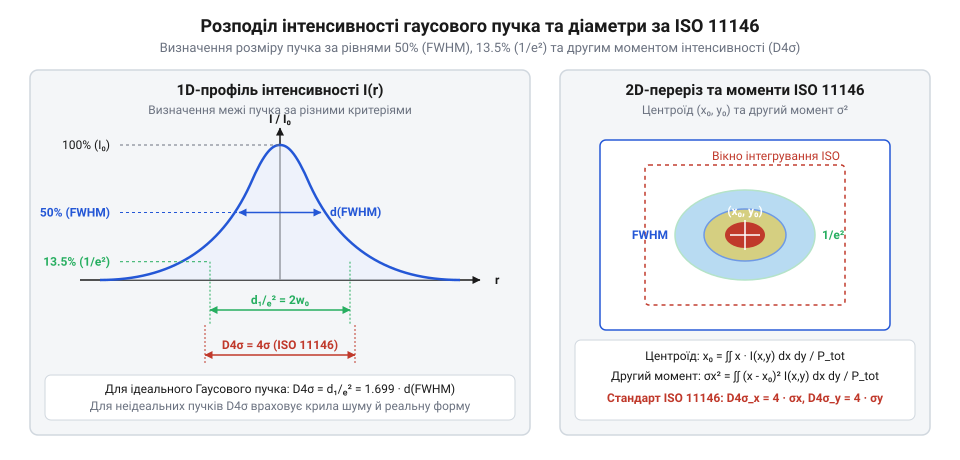

# Профілометр лазерного пучка

## Невидима деградація та спотворення лазерного пучка

У промислових технологіях лазерного зварювання, прецизійного різання та мікрообробки часто виникає ситуація, коли технологічний процес раптово втрачає стабільність. Лазерний промінь починає залишати нерівні краї, пропалювати матеріал або втрачати глибину проникнення, хоча вимірювальні пристрої інтегральної потужності — такі як термоелектричні чи фотодіодні [вимірювачі потужності](root:hw-sensing/laser-power-and-energy-meters) — показують повністю нормоване й стабільне значення. Спроба розв'язати проблему просто збільшенням потужності лазера зазвичай призводить до прискореного пропалювання оптичних елементів або деформації деталі.

Витоком цього парадоксу є те, що вимірювачі сумарного світлового потоку повністю сліпі до просторової структури випромінювання. Процес взаємодії світла з речовиною визначається не загальною потужністю у ватах, а локальною густиною потужності — випроміненістю (англ. @@en|irradiance@@), що вимірюється у ватах на квадратний сантиметр. Якщо світловий потік розподілений по площі перерізу нерівномірно, виникають локальні піки інтенсивності — так звані гарячі плями (від англ. @@en|hot spot@@). Навіть при ідеально стабільній інтегральній потужності поява таких піків здатна зумовити локальний вибуховий перегрів матеріалу, тоді як периферійні ділянки пучка залишатимуться нижче порогу плавлення.

Окрім локальних піків інтенсивності, геометричний профіль лазерного пучка схильний до складних просторових спотворень. Через термооптичні деформації оптичних елементів і резонатора виникає астигматизм (від грецького α- — без та stigma — точка, англ. @@en|astigmatism@@), за якого перетяжка пучка по горизонтальній та вертикальній осях фокусується в різних площинах уздовж оптичної осі. Пучок втрачає кругову симетрію, набуваючи еліптичності, а його дифракційна розбіжність зростає.

На практиці еліптичність та астигматизм критично впливають на процес глибокого лазерного зварювання металів із зануренням парогазового каналу (англ. @@en|keyhole welding@@). Якщо перетяжка пучка по осі X розташована на поверхні деталі, а по осі Y через астигматизм зміщена на кілька міліметрів углиб матеріалу, зварювальна пляма набуває витягнутої овальної форми. Під час руху лазерної голівки уздовж лінії стику це спричиняє асиметрію: при зварюванні впоперек довгої осі еліпса ванна розплаву (англ. @@en|melt pool@@) виходить широкою й неглибокою, а при зварюванні вздовж осі — вузькою та глибокою. Порушення симетрії світлового тиску в парогазовому каналі зумовлює періодичний колапс його стінок, утворення внутрішньої пористості (англ. @@en|porosity@@) та нестабільність глибини проплавлення.

```
I(x, y) = P_total / A_eff
[локальна випроміненість залежить від ефективної площі плями A_eff]
```

Традиційні методи контролю геометричної форми пучка за допомогою термічних відбитків на папері, оргсклі (акрилі) або анодованій пластині надають лише грубу якісну оцінку. Вони руйнують вимірювальний матеріал, забруднюють випарами оптику чистої кімнати та принципово не здатні відобразити динаміку пучка в реальному часі чи виміряти параметри поодиноких коротких імпульсів.

Для неруйнівного цифрового вимірювання 2D та 3D просторового розподілу інтенсивності (англ. @@en|spatial intensity profile@@) застосовують профілометр лазерного пучка (від англ. @@en|beam profiler@@). Цей прилад фіксує точну геометрію світлової плями в кожній точці перерізу, дозволяючи завчасно виявити деградацію резонатора та спотворення оптичного тракту. Детальний [історичний розвиток методів](root:cat-hw-instruments/beam-profiler/hist-laser-beam-profiling-evolution.md) вимірювання профілю висвітлює еволюцію від випалювання паперу до цифрових матричних систем.

Цифровий аналіз профілю перетворює просторовий розподіл фотонів у матричний масив даних, що дозволяє обчислювати координатну позицію центроїда (від латинського centrum — центр, англ. @@en|centroid@@), просторову симетрію та енергетичний центр пучка. Неперервна фіксація цих параметрів дає змогу оперативно компенсувати дрейф оптичної осі через теплове розширення лінз та розфокусування системи ще до появи шлюбу в обробці. Для безпечного введення випромінювання на вимірювальний сенсор застосовують [оптичні атенюатори та дільники](root:hw-sensing/optical-attenuators-and-beam-splitters), що знижують випроміненість до прийнятного порогу.

## Матричні та сканувальні технології профілометрів

Для побудови просторового профілю лазерного випромінювання використовують два принципово відмінних фізичних підходи: матричну відеофільтрацію (англ. @@en|camera-based profiler@@) та механічне сканування пучка (англ. @@en|scanning profiler@@).

Матричні профілометри побудовані на базі двовимірних напівпровідникових або теплових фотоприймальних матриць. Лазерне випромінювання падає на плоский масив пікселів, де кожен елемент вимірює локальну інтенсивність світла одночасно з іншими.

1. **Кремнієві матриці ПЗЗ (англ. @@en|CCD@@) та КМОН (англ. @@en|CMOS@@):** призначені для видимої та ближньої інфрачервоної областей спектра (від 350 нм до 1100 нм). Вони забезпечують високу просторову роздільну здатність завдяки малому розміру пікселя (зазвичай від 3.45 мкм до 5.5 мкм) і дозволяють реєструвати одноразові лазерні імпульси тривалістю аж до пікосекунд.
2. **Матриці на основі арсеніду галію-індію (англ. @@en|InGaAs@@):** застосовуються в короткохвильовому інфрачервоному діапазоні (від 900 нм до 1700 нм), що є критичним для телекомунікаційних та очно-безпечних лазерів на довжині хвилі 1.55 мкм.
3. **Піроелектричні матриці (англ. @@en|pyroelectric array@@) та мікроболометри (англ. @@en|microbolometer@@):** використовують тепловий ефект поглинання випромінювання і працюють у середньому та далекому ІЧ-діапазонах (аж до 10.6 мкм лазерів на вуглекислому газі CO₂), а також у ультрафіолетовому спектрі.


*Структура двовимірного кадрового КМОН-сенсора та механічної сканувальної щілини з інтегрувальним фотодіодом.*

На відміну від матричних систем, механічні сканувальні профілометри використовують один фотодіод великої площі, перед яким механічно переміщується оптична перешкода.
- **Щілинні профілометри (англ. @@en|Scanning Slit@@):** вузька прецизійна щілина (шириною 1–25 мкм) прорізає пучок уздовж осей X та Y. Фотодіод позаду щілини інтегрує світловий потік, падаючий крізь щілину. Шляхом точного вимірювання положення щілини прилад відновлює точні одновимірні профілі перерізу.
- **Ножові профілометри (англ. @@en|Scanning Knife-Edge@@):** замість щілини пучок перетинає гострий непрозорий ніж. Виміряна фотодіодом потужність є інтегралом функції інтенсивності, а математичне диференціювання отриманого сигналу по координаті переміщення ножа дає локальний профіль інтенсивності.

Головною перевагою сканувальних систем є надвисока просторова роздільна здатність (аж до часток мікрометра) та високий поріг оптичного руйнування (англ. @@en|Laser Damage Threshold@@, LDT), що дозволяє вимірювати сфокусовані лазерні пучки високої потужності без використання складних систем послаблення. Проте сканувальні пристрої принципово не здатні вимірювати поодинокі короткі імпульси, оскільки механічне сканування є відносно повільним часовим процесом з частотою оновлення профілю порядку 2–10 Гц. Час проходження щілини крізь переріз пучка становить від кількох мілісекунд до десятків мілісекунд, тому випромінювання лазера має бути суворо безперервним та амплітудно-стабільним. Якщо потужність лазера флуктує під час переміщення щілини, часові коливання світлового потоку накладаються на просторову координату, що спричиняє значну вимірювальну похибку та створює хибні просторові піки й асиметрію відновленого профілю.

## Оптичне послаблення та захист сенсора

Головною схемотехнічною та оптичною проблемою під час застосування матричних профілометрів є крайня чутливість напівпровідникових сенсорів. КМОН- чи ПЗЗ-матриця насичується (англ. @@en|blooming@@) вже при густинах енергії близько 1–10 мкДж/см² або потужностях порядку сотень мікроват на квадратний сантиметр. Натомість робочі промислові та наукові лазери мають потужність від міліватів до кіловатів. Пряме падіння такого пучка на матрицю неминуче призведе до фізичного випалювання напівпровідникової структури.

Щоб зменшити інтенсивність пучка в 10³–10¹⁰ разів без спотворення його двовимірного просторового профілю, будують спеціалізовані оптичні тракти послаблення (англ. @@en|attenuation@@).

Застосування звичайних абсорбційних нейтральних світлофільтрів (англ. @@en|ND filter@@, Neutral Density) для первинного зняття високої потужності є припустимою помилкою. Абсорбційні фільтри поглинають світлову енергію всередині об'єму скла й локально нагріваються пропорційно інтенсивності пучка. Через градієнт температури виникає термооптичний ефект: коефіцієнт заломлення скла змінюється в центрі пучка сильніше, ніж на периферії. Вхідне скло перетворюється на теплову сочевицю (англ. @@en|thermal lensing@@), викривляючи реальний профіль і штучно збільшуючи розбіжність пучка.

```
P_reflected = P_incident × R_surface
[первинний відбиток від поверхні некопченого оптичного клина]
```

Для первинного послаблення високопотужних пучків використовують поверхнево-відбивальні елементи — оптичні клиноподібні пластини (англ. @@en|optical wedge@@) та призми Френеля (англ. @@en|Fresnel reflector@@).


*Оптичний тракт із клиноподібним дільником для зняття первинного відбитку та нейтральними фільтрами для фінального узгодження інтенсивності.*

Оптичний клин виготовляють із високочистого кварцового скла без просвітлювального покриття. Його передня поверхня відбиває лише близько 4% падаючого випромінювання (згідно з формулами Френеля для кута падіння близько 45°), а решта 96% потужності проходить крізь клин і спрямовується у водяну пастку випромінювання. Оскільки світло відбивається від самої межі розділу середовищ повітря-скло без поглинання у масиві матеріалу, тепловий сочевичний ефект повністю відсутній. Невелика клиноподібність пластини (зазвичай 0.5°–3°) гарантує, що відбиток від задньої грані відхиляється на інший кут і не накладається на основний вимірювальний пучок, усуваючи паразитну інтерференцію.

Для детального ознайомлення з оптичними елементами відбору випромінювання слід переглянути [оптичні дільники та атенюатори](root:hw-sensing/optical-attenuators-and-beam-splitters). Для підключення системи до вимірювальної камери використовуються механічні стандарти, описані у розділі [апаратні з'єднання та кріплення](root:cat-hw-instruments/beam-profiler/api-beam-profiler-hardware-interfaces-and-mounting.md).

Після первинного відбитку від оптичного клина світловий потік вже послаблено у десятки разів, що дозволяє безпечно застосовувати вторинні відбивальні або відкалібровані нейтральні ND-фільтри для остаточного підгону інтенсивності під динамічний діапазон матриці. Сумарна оптична густина масиву фільтрів обчислюється як сума оптичних густин окремих елементів `OD_total = OD₁ + OD₂`, що відповідає коефіцієнту послаблення `10ⁿ` (де `n = OD_total`). Щоб запобігти виникненню викривлювальних інтерференційних візерунків — так званих оптичних духів (англ. @@en|ghosting@@) та еталонування (англ. @@en|etaloning@@) через перевідбиття світла між пласкопаралельними поверхнями скла, кожен ND-фільтр у стеку встановлюють із невеликим взаємним нахилом під кутом 1°–3° відносно оптичної осі. Це відхиляє паразитні перевідбиті промені за межі активної площі чутливої матриці.

## Параметри пучка та стандарт ISO 11146

Після того як цифровий кадровий сенсор зафіксував масив двовимірного розподілу інтенсивності, вимірювальна система проводити цифрове калібрування кадру. Першим критичним кроком обробки зображення є віднімання фонового шуму (англ. @@en|baseline subtraction@@) та процедура темного калібрування (англ. @@en|Ultracal@@). Камера зчитує шум матриці у темряві без лазерного випромінювання й віднімає його від кожного пікселя виміряного кадру. Якщо зсув нуля не відняти, фонові шуми периферійних пікселів під час чисельного інтегрування створять колосальну викривлювальну похибку, штучно роздмухуючи виміряні розміри пучка.

Після корекції нуля визначають просторові розміри плями за трьома основними критеріями:

1. **Ширина на піввисоті (англ. @@en|FWHM@@, Full Width at Half Maximum):** вимірює ширину профілю на рівні 50% від максимальної пікової інтенсивності. Критерій простий у розрахунку, але не враховує периферійні крила пучка та бічні дифракційні максимуми.
2. **Рівень зрізу 1/e² (англ. @@en|1/e2 diameter@@):** визначає діаметр профілю на рівні відносної інтенсивності 1/e² ≈ 13.53% від піка. Це канонічний критерій для ідеального фундаментального гаусового пучка TEM₀₀.
3. **Діаметр другого моменту інтенсивності D4σ (англ. @@en|second moment diameter@@, @@en|D4sigma@@):** стандартизований міжнародним нормативом ISO 11146 як офіційне визначення розміру пучка для реальних лазерів.

```
d_σx = 4 × σ_x
[визначення діаметра пучка D4σ через середньоквадратичне відхилення σ_x]
```

Значення σ_x² розраховується як статистичний момент другого порядку розподілу інтенсивності по координаті x відносно центроїда плями. Оскільки цей метод враховує весь просторовий розподіл енергії, він безпомилково описує реальні негаусові пучки, астигматизм та реальну енергетичну ширину.

Проте точність математичного обчислення моменту `D4σ` висуває суворі вимоги до вибору розміру розрахункового вікна інтегрування (англ. @@en|Region of Interest@@, ROI або програмна @@en|aperture@@). Якщо межі вікна занадто великі, залишковий темновий шум периферійних пікселів помножується на квадрат відстані `(x - x̄)²` від центроїда, що призводить до квадратичного зростання похибки та штучного роздмухування обчисленого діаметра пучка. Натомість якщо апертуру занадто звузити, відсікаються периферійні крила пучка, внаслідок чого обчислене значення виходить заниженим. Для розв'язання цієї суперечності стандарт ISO 11146 приписує застосовувати ітераційний алгоритм автоматичного вибору апертури розміром рівно `3 × D4σ`, що забезпечує оптимальний баланс між повнотою охоплення енергії пучка та відсіканням фонового шуму.


*Розподіл інтенсивності гаусового лазерного пучка та визначення діаметрів за критеріями D4σ, FWHM і 1/e².*

На основі виміряних профілів D4σ впродовж оптичної осі Z розраховують фактор якості лазерного пучка M² (англ. @@en|M2 factor@@), який описує відхилення реального лазера від ідеального гаусового пучка:

```
M² = (π × w₀ × θ) / λ
[визначення фактора якості пучка M² через перетяжку w₀ та розбіжність θ]
```

Тут w₀ — радіус перетяжки пучка (англ. @@en|beam waist@@), θ — кут розбіжності у дальній зоні (англ. @@en|divergence angle@@), а λ — довжина хвилі лазерного випромінювання. Для ідеального гаусового пучка M² = 1.0. Для реальних промислових лазерів M² > 1.0, що свідчить про наявність вищих просторових мод та гіршу фокусованість.

Глибокий [математичний апарат аналізу профілю](root:cat-hw-instruments/beam-profiler/math-laser-beam-propagation-and-iso11146-moments.md) розкриває покрокові моментні формули та матричні перетворення ISO 11146. Програмні засоби зчитування цих параметрів описані в документі [програмний інтерфейс та SDK](root:cat-hw-instruments/beam-profiler/api-beam-profiler-sdk-and-command-interface.md).

Точне визначення фактора M² та просторової довжини Релея (від прізвища британського фізика Lord Rayleigh, англ. @@en|Rayleigh length@@) дозволяє обчислити мінімально досяжний діаметр плями у фокальній площині об'єктива та розрахувати пікову випроміненість. Поєднання цих геометричних метрик із даними від [вимірювачів потужності та енергії](root:hw-sensing/laser-power-and-energy-meters) забезпечує повний контроль над енергетичним балансом лазерного променя та дозволяє спрогнозувати технологічний режим обробки матеріалів.

## Критерії вибору та юстування оптичного тракту

Вибір типу профілометра визначається трьома ключовими вимірювальними факторами: режимом генерації лазера, довжиною хвилі та густиною потужності.

1. **Режим генерації (безперервний CW чи імпульсний):** для імпульсних лазерів (особливо з низькою частотою повторення або з модуляцією добротності, англ. @@en|Q-switched@@) єдиним можливим вибором є матричні ПЗЗ/КМОН або піроелектричні профілометри. Вони здатні схопити просторовий розподіл енергії поодинокого імпульсу тривалістю у наносекунди чи фемтосекунди. Сканувальні щілинні системи для таких лазерів непридатні, оскільки вони потребують постійного світлового потоку під час механічного руху.
2. **Довжина хвилі:** кремнієві КМОН-сенсори покривають діапазон 350–1100 нм. Для короткохвильового ІЧ-діапазону (1.55 мкм) вибирають сенсори InGaAs, а для CO₂ лазерів (10.6 мкм) — піроелектричні матриці або сканувальні щілини з інфрачервоним фотодіодом.
3. **Густина потужності та розмір фокальної плями:** якщо потрібно виміряти жорстко сфокусований пучок діаметром менше 20 мкм без застосування складної мікроскопної оптики послаблення, сканувальні щілинні чи ножові профілометри мають перевагу завдяки високій просторовій роздільній здатності (до 0.1 мкм).

Під час юстування вимірювального стенда критично дотримуватися коаксіальності: оптична вісь сенсора повинна бути суворо перпендикулярна напрямку поширення лазерного пучка Z. Найменший перекіс сенсора штучно розтягує виміряний переріз, створюючи хибну еліптичність та астигматизм. Щоб гарантувати точність падіння під прямим кутом, перед увімкненням основного лазера виконують попереднє зведення осей за допомогою додаткового пилотного лазера видимого діапазону та контрольного екранчика (англ. @@en|alignment target@@) або оптичного рефлектометра. Через дві послідовні юстувальні діафрагми на трасі пучок вирівнюють уздовж механічної осі кріплення профілометра, досягаючи нормального падіння з точністю краще ніж 0.1°, після чого вимірювальну камеру фіксують на оптичній лаві.

Окрім того, відбиті від поверхні оптичних клинів або фільтрів промені не повинні повертатися назад у резонатор лазера. Для цього послаблювальні клини встановлюють під невеликим кутом відносно осі, а відхилений відбиток спрямовують у водяну або керамічну пастку випромінювання (англ. @@en|beam dump@@).

Практичний опис складання та калібрування вимірювальної траси подано у проєкті [розгортання вимірювального стенда](root:cat-hw-instruments/beam-profiler/proj-camera-beam-profiler-setup-and-m2-measurement.md).
