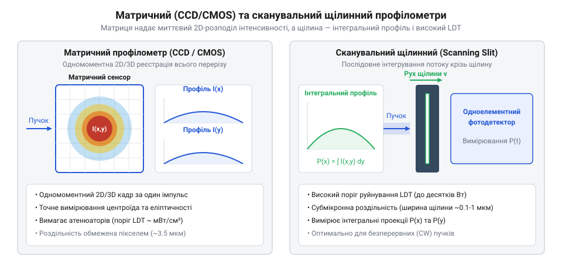
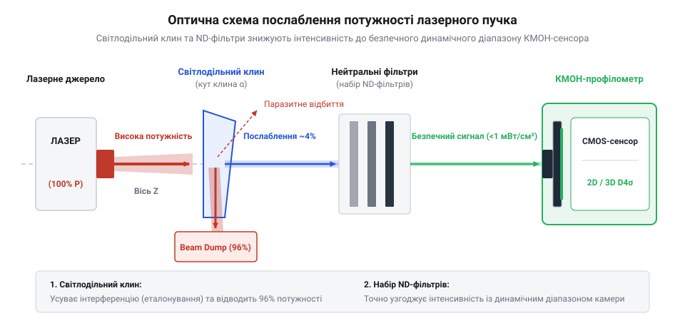

# Профілометр лазерного пучка

## Невидимі спотворення лазерного пучка

У лазерній обробці металів часто виникає ситуація, коли прилад вимірювання сумарного світлового потоку показує нормальне значення, але процес втрачає стабільність. Витоком цього є те, що вимірювачі інтегральної потужності сліпі до просторової структури випромінювання. Взаємодія світла з речовиною визначається не загальною потужністю, а локальною густиною потужності — випроміненістю (від латинського @@en|irradiare@@ — випромінювати, англ. @@en|irradiance@@), що вимірюється у ватах на квадратний сантиметр. Нерівномірний розподіл світла створює локальні піки інтенсивності — так звані гарячі плями (англ. @@en|hot spot@@), які спричиняють вибуховий перегрів матеріалу.

Через термооптичні деформації оптичних елементів виникає астигматизм (від грецького α- — без та στίγμα — точка, англ. @@en|astigmatism@@), за якого перетяжка пучка по осях фокусується в різних площинах. Це створює еліптичність та асиметрію світлового тиску в парогазовому каналі під час зварювання. Для неруйнівного вимірювання просторового розподілу інтенсивності застосовують профілометр лазерного пучка (від англ. @@en|beam profiler@@).

```
I(x, y) = P_total / A_eff      [локальна випроміненість залежить від ефективної площі плями]
```

## Матричні та сканувальні профілометри

Для побудови просторового профілю використовують два фізичні підходи: матричну відеореєстрацію (англ. @@en|camera-based profiler@@) та механічне сканування пучка (англ. @@en|scanning profiler@@).

Матричні прилади містять плоский масив пікселів, що фіксує 2D-кадр одномоментно. Кремнієві камери ПЗЗ (англ. @@en|CCD@@) та КМОН (англ. @@en|CMOS@@) працюють у діапазоні 350–1100 нм і реєструють одноразові короткі імпульси. Для інфрачервоного спектра 900–1700 нм використовують матриці @@en|InGaAs@@, а для довгохвильового ІЧ-діапазону — піроелектричні матриці (англ. @@en|pyroelectric array@@) та мікроболометри (англ. @@en|microbolometer@@).


*Будова кадрового КМОН-сенсора та механічної сканувальної щілини.*

Механічні щільові профілометри (англ. @@en|Scanning Slit@@) прорізають пучок вузькою щілиною перед фотодіодом. Вони мають надвисоку роздільну здатність і високий поріг оптичного руйнування (англ. @@en|Laser Damage Threshold@@, LDT), але вимагають суворо безперервного лазерного випромінювання.

## Оптичне послаблення та захист сенсора

Напівпровідникові сенсори насичуються (англ. @@en|blooming@@) вже при потужності сотень мікроват на квадратний сантиметр. Для зниження інтенсивності в 10³–10¹⁰ разів будують оптичні тракти послаблення (англ. @@en|attenuation@@).

Застосування звичайних поглинальних світлофільтрів (англ. @@en|ND filter@@) для первинного зняття потужності призводить до локального нагріву скла. Через градієнт температури виникає теплова сочевиця (англ. @@en|thermal lensing@@), яка викривляє профіль.


*Оптичний тракт із клиноподібним дільником для первинного відбитку та ND-фільтрами.*

Для первинного послаблення застосовують оптичний клин (англ. @@en|optical wedge@@). Його передня поверхня відбиває близько 4% світла без поглинання в об'ємі. Клиновидність у 0.5°–3° відхиляє відбиток від задньої грані, запобігаючи еталонуванню (англ. @@en|etaloning@@). Відкалібровані фільтри @@en|ND filter@@ встановлюють із нахилом 1°–3° для усунення перевідбитків.

## Параметри пучка за стандартом ISO

Після зчитування кадру виконують віднімання фонового шуму (англ. @@en|baseline subtraction@@) за процедурою темного калібрування (англ. @@en|Ultracal@@).

Розміри плями вимірюють за трьома критеріями: шириною на піввисоті (англ. @@en|FWHM@@), рівнем зрізу 1/e² (13.53% піка) та стандартизованим діаметром другого моменту інтенсивності D4σ (англ. @@en|D4sigma@@).

```
d_σx = 4 × σ_x      [діаметр D4σ через середньоквадратичне відхилення]
```

Для обчислення діаметра D4σ стандарт ISO 11146 приписує обирати розрахункову апертуру розміром `3 × D4σ`. На основі вимірів уздовж осі Z обчислюють фактор якості пучка M² (англ. @@en|M2 factor@@):

```
M² = (π × w₀ × θ) / λ      [фактор M² через перетяжку w₀ та розбіжність θ]
```

Значення M² = 1.0 відповідає ідеальному гаусовому пучку, а M² > 1.0 вказує на наявність вищих просторових мод та гіршу фокусованість.
