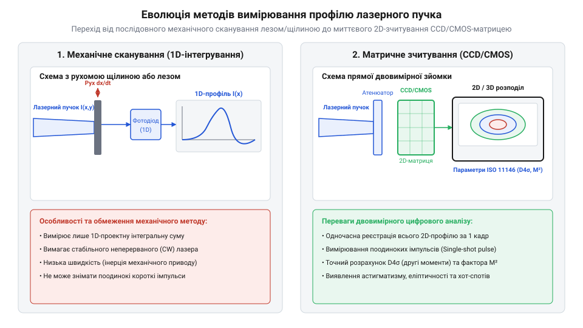

# Еволюція методів та інструментів вимірювання профілю лазерного пучка

## Негаразда суб'єктивних плям і відпечаток

Історія аналізу випромінювання розпочалася одразу після створення першого робочого рубінового лазера (від англ. @@en|LASER@@, @@en|Light Amplification by Stimulated Emission of Radiation@@) Теодором Мейманом у 1960 році. Перші дослідники та інженери зіткнулися з фундаментальною проблемою: стандартні приймачі випромінювання та калориметри (від лат. @@la|calor@@ — тепло та грец. @@el|μέτρον@@ — міра) показували лише загальну інтегральну потужність пучка. Проте однакова потужність могла відповідати як ідеально сфокусованому променю, так і спотвореній плямі з локальними перегрітими зонами, що спричиняло брак під час обробки матеріалів чи пошкодження оптичних елементів.

Для оцінки просторової форми пучка в 1960–1970-х роках застосовували примітивні якісні методи — випалювання відпечаток на тепловому папері, дерев'яних брусках, оргсклі або фотопластинах. Такий підхід давав лише приблизне уявлення про розміри плями, оскільки межа обвуглювання чи плавлення матеріалу залежить від часу експозиції, теплопровідності субстрату й нелінійності його відгуку. Суб'єктивне візуальне оцінювання не дозволяло розрахувати інтенсивність (від лат. @@la|intensio@@ — напруження, посилення) у конкретній точці та виявити приховані модові аберації, що робило неминучим створення об'єктивних вимірювальних приладів — профілометрів (від італ. @@it|profilo@@ — обрис та грец. @@el|μέτρον@@ — міра).

Особливо виразно фізичні обмеження відпечаток проявлялися під час випалювання профілю потужних лазерів на органічному склі (поліметилметакрилаті). Під дією високоінтенсивного випромінювання поверхневий шар матеріалу не лише випаровувався, а й зазнавав нерівномірного локального теплового розширення, створюючи об'ємні термомеханічні напруження. Гази, що виділялися при термічній деструкції полімеру, утворювали мікробульбашки й випуклі кратери вздовж периферії випаленої зони. Це локальне спучування та теплова деформація штучно розширювали видимі межі світлової плями на кілька міліметрів, викривляючи реальний розрахований діаметр пучка та приховуючи справжній розподіл енергії у його центрі.

## Механічне сканування: лезо, щілина та піноль

У 1970-х роках з'явилися перші автоматизовані профілометри, що ґрунтувалися на механічному скануванні поперечного перерізу пучка. Інженери застосували три базові геометрії сканувальних елементів: непрозоре лезо (від англ. @@en|Knife-Edge@@), вузьку прямокутну щілину (від англ. @@en|Slit@@) та точкову діафрагму (від грец. @@el|διάφραγμα@@ — перегородка, англ. @@en|Pinhole@@). Під час руху сканувального елемента крізь промінь точковий фотодіод (від грец. @@el|φῶς@@ — світло та англ. @@en|diode@@) реєстрував зміну світлового потоку, вихідний сигнал якого оброблявся електронною схемою.

*Принципова різниця між одновимірним механічним скануванням та двовимірною матричною реєстрацією профілю лазерного пучка.*

Сканування лезом перекриває пучок від повністю відкритого до перекритого стану, інтегруючи інтенсивність по одній координаті, тому вихідний профіль отримують шляхом математичного диференціювання зареєстрованого сигналу. Метод із вузькою щілиною одразу видає одновимірне усереднене значення інтенсивності вздовж лінії, а діафрагма малої площі дозволяє послідовно знімати двовимірну сітку точок. Механічні сканери на базі барабанів або струн із дисками виявилися стійкими до високих щільностей потужності без використання оптичного атенюатора (від лат. @@la|attenuare@@ — ослаблювати). Проте їхнім головним обмеженням була неможливість вимірювання поодиноких імпульсів у реальному часі через тривалість механічного проходу сканера.

Точність просторової роздільності барабанного сканера визначається математичною залежністю між коловою швидкістю руху леза та смугою пропускання підсилювача фотодіода. При лінійній швидкості сканування `v = 2π · f_rot · R` (де `f_rot` — частота обертання барабана радіусом `R`), час проходження леза крізь пучок діаметром `d` становить `Δt = d / v`. Для забезпечення просторового кроку дискретизації `Δx` аналогово-цифровий перетворювач та вимірювальний підсилювач мусять мати частоту вибірки `f_s ≥ v / Δx`. Наприклад, при швидкості обертання барабана `10 Гц` (`600` об/хв) та радіусі `R = 50 мм` лінійна швидкість леза сягає `v ≈ 3.14 м/с`, що для роздільності `Δx = 1 мкм` вимагає смуги пропускання підсилювача не менше `3.14 МГц`; обмеження цієї частоти спричиняє розмиття виміряного фронту й штучне розширення пучка.

## ПЗЗ та КМОН матриці цифрової профілометрії

Технологічний прорив відбувся у 1980–1990-х роках із появою твердотільних напівпровідникових сенсорів на базі ПЗЗ (приладів із зарядовим зв'язком, від англ. @@en|CCD@@, @@en|Charge-Coupled Device@@) та КМОН (комплементарних метал-оксид-напівпровідників, від англ. @@en|CMOS@@, @@en|Complementary Metal-Oxide-Semiconductor@@). Матричні профілометри дозволили миттєво фіксувати повне двовимірне поле інтенсивності `I(x, y)` за один кадр, уможлививши дослідження швидкоплинних процесів та поодиноких імпульсів Q-переключених лазерів.

Головним інженерним викликом при переході до матриць стала проблема динамічного діапазону та захисту сенсора від оптичного руйнування. Пряме влучання навіть малопотужного променя насичує пікселі (від англ. @@en|pixel@@, скорочення від @@en|picture element@@ — елемент зображення) та пропалює напівпровідникову матрицю (від лат. @@la|matrix@@ — джерело, корінь). Для розв'язання цієї проблеми було розроблено прецизійні оптичні дільники — відбивні нейтральні фільтри, клинчасті пластини та клинові розщеплювачі на основі відбиття Френеля, що послаблюють потужність у мільйони разів без внесення фазових і хроматичних спотворень.

## Стандартизація ISO 11146 та параметр M²

Із поширенням цифрових профілометрів виникла нова проблема: відсутність єдиної методики визначення діаметра лазерного пучка. Різні виробники використовували неузгоджені критерії — спад інтенсивності до рівня `1/e²` (приблизно `13.5%` від піка), ширину на напіввисоті (від англ. @@en|FWHM@@, @@en|Full Width at Half Maximum@@) або відсікання похилістю леза `10–90%`. Для реальних неґауссових і спотворених променів ці методи давали розбіжності до `50%` та не описували реальну фокусованість випромінювання.

Фундаментальне розв'язання ввів американський фізик Ентоні Сіґман (англ. @@en|Anthony E. Siegman@@), який запропонував метод других моментів розподілу інтенсивності, затверджений у міжнародному стандарті (від англ. @@en|standard@@ — зразок, норма) ISO 11146. Згідно зі стандартом, еквівалентний діаметр пучка `D₄σ` визначається як чотири просторові середньоквадратичні відхилення:

    σₓ² = ∬ (x - x₀)² · I(x, y) dx dy / ∬ I(x, y) dx dy      [просторова дисперсія інтенсивності]
    D₄σ = 4 · σₓ                                             [визначення діаметра ISO 11146]

На основі цього методу введено фактор якості пучка `M²`:

    M² = (π · W₀ · θ) / λ                                    [коефіцієнт якості пучка Сіґмана]

де `W₀` — радіус перетяжки, `θ` — кутова розбіжність, `λ` — довжина хвилі. Для фундаментальної ґауссової моди `M² = 1.0`, а для спотворених пучків `M² > 1.0`. Завдяки стандартизації ISO 11146 було розвінчано поширений міф про достатність вимірювання лише потужності лазера, закріпивши параметр `M²` як головний паспортний критерій якості оптичного випромінювання. Детальний математичний апарат обчислення D₄σ та експериментальні методики розглянуто у статті про [фактор якості лазерного пучка M² та методологію ISO 11146](root:cat-hw-instruments/beam-profiler/math-laser-beam-propagation-and-iso11146-moments.md).
