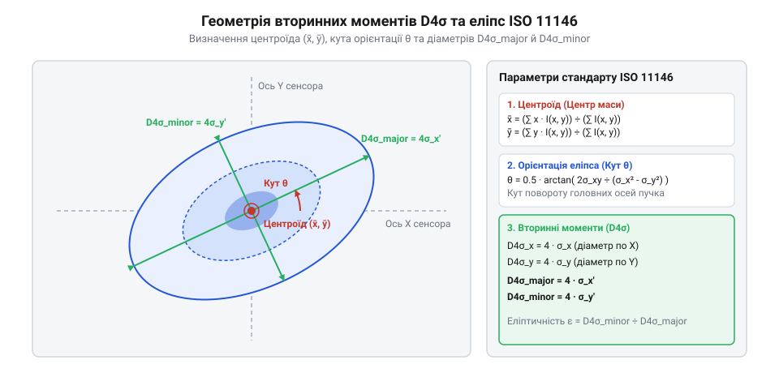
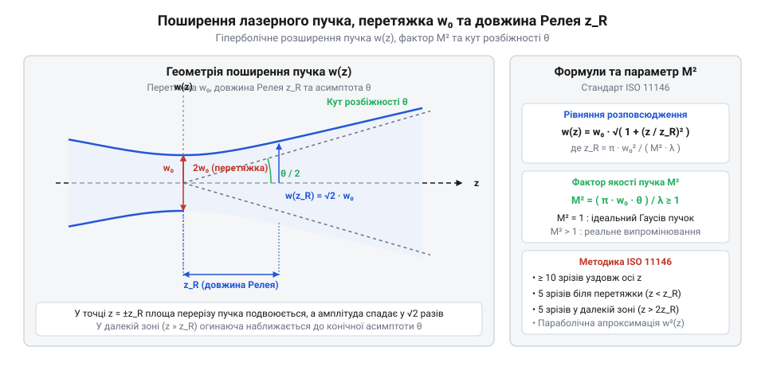

# Математичний апарат аналізу профілю лазерного пучка та стандарту ISO 11146

## Чому порогові межі викривляють геометрію

При вимірюванні геометрії лазерного випромінювання на матричному давачі приладу @@en|beam profiler@@ найпростішим підходом здається визначення меж променя за довільним порогом інтенсивності. Наприклад, ширина на піввисоті макушки розподілу — @@en|full width at half maximum@@ (позначувана як @@en|FWHM@@) — або відсікання на рівні `1/e²` (приблизно 13.5% від пікового значення) чудово працюють для ідеального аналітичного гаусового пучка. Проте реальний лазерний промінь майже ніколи не є ідеальною математичною функцією. Він містить просторовий @@en|astigmatism@@ (лат. *astigmatismus* — відсутність фокусної точки), вищі трансверсальні моди, бокові дифракційні кільця та інтерференційні шуми від оптичних елементів тракту. Математичний механізм викривлення @@en|FWHM@@ для мультимодових полів полягає у скануванні перерізу шукачами точок перетину з рівнем `0.5 · I_max`: при когеренційній суперпозиції вищих трансверсальних модових пелюсток інтерференційний спекл-пік створює аномально високий локальний максимум `I_max`, що завищує пороговий рівень 50% і відсікає значну частину міжмодових огинаючих, або ж міжмодовий вузловий провал падає нижче `0.5 · I_max`, через що алгоритм помилково сприймає внутрішній мінімум за зовнішню межу пучка. Одночасно інтерференційні морові візерунки та паразитні відбиття від захисного скла сенсора створюють локальні флуктуації, які довільно зміщують розраховані точки рівня 50% чи 13.5%, роблячи порогові оцінки @@en|FWHM@@ та `1/e²` нестійкими та залежними від випадкових завад.

Якщо обчислювати розмір неідеального пучка за порогом @@en|FWHM@@, вимірювач враховує лише верхівку енергетичного піку і повністю ігнорує широкі периферійні «крила» розподілу. У результаті два лазерні промені з однаковою шириною на піввисоті можуть мати фундаментально різну повну потужність та кутову розбіжність при поширенні у просторі. Натомість спроба підігнати реальний несиметричний профіль під формулу гаусової кривої методом найменших квадратів дає довільні результати, які залежать від вибору початкових параметрів алгоритму апроксимації.

Для об'єктивної оцінки реального випромінювання необхідний фізично обґрунтований критерій, який враховує весь просторовий розподіл енергії незалежно від його складної форми. Такий метод опису базується на виваженому статистичному інтегруванні інтенсивності поля й зафіксований у міжнародному стандарті @@en|ISO 11146@@. Інваріантним параметром геометрії стають @@en|second-order intensity moments@@, які визначають ефективний моментний діаметр @@en|D4σ@@.

## Центроїд та просторові моменти другого порядку

Щоб отримати математично точний опис двовимірної плями випромінювання, матричний давач розглядає розподіл інтенсивності `I(x, y)` як двовимірну функцію щільності ймовірності. Такий підхід дозволяє сформувати коваріаційну матрицю (англ. @@en|covariance matrix@@) просторових моментів другого порядку. У матричній форматизації стандарту @@en|ISO 11146@@ ця двовимірна матриця виступає просторовим блоком чотиривимірного тензора (англ. @@en|tensor@@, від лат. *tensus* — натягнутий) моментів випромінювання у фазовому просторі, де компоненти просторових моментів пов'язані з тензором кутових моментів (який характеризує кутову розбіжність променя) та змішаними просторово-кутовими коваріаціями через закони трансформування променя оптичною системою. Геометричний зміст власного вектора (англ. @@en|eigenvector@@, від нім. *eigen* — власний) цієї коваріаційної матриці полягає у фіксації просторового напрямку головних осей еліпса: ортогональні власні вектори вказують азимутальні напрямки `U` та `V` максимального й мінімального розтягу плями, а відповідні їм власні значення задають квадрати середньоквадратичних напівширин пучка. Повна оптична потужність променя, яка відповідає нулевому моменту розподілу, визначається чисельним інтегруванням інтенсивності по поверхні фотоприймача:

P = ∫∫ I(x, y) dx dy

Координати оптичного центра променя — @@en|centroid@@ (англ. *centroid* — центр маси) — відповідають нормалізованим моментам першого порядку. Вони задають математичне сподівання просторового положення пучка в площині вимірювання:

x̄ = (1 ÷ P) · ∫∫ x · I(x, y) dx dy
ȳ = (1 ÷ P) · ∫∫ y · I(x, y) dx dy

Просторова ширина та форма пучка описуються центральними моментами другого порядку. Вони обчислюються як інтеграли від квадратів відстаней від центроїда `(x̄, ȳ)`, зважених за локальною інтенсивністю `I(x, y)`:

σ_x² = (1 ÷ P) · ∫∫ (x - x̄)² · I(x, y) dx dy      [момент другого порядку по осі X]
σ_y² = (1 ÷ P) · ∫∫ (y - ȳ)² · I(x, y) dx dy      [момент другого порядку по осі Y]
σ_xy = (1 ÷ P) · ∫∫ (x - x̄)·(y - ȳ) · I(x, y) dx dy [змішаний коваріаційний момент]

Для одновимірного гаусового розподілу радіус променя на рівні `1/e²` дорівнює двократному середньоквадратичному відхиленню `w = 2σ`, а діаметр відповідно складає `D = 4σ`. Стандарт @@en|ISO 11146@@ узагальнює це співвідношення на довільні двовимірні промені складного профілю, визначаючи моментний діаметр як @@en|D4σ@@.

Якщо промінь має просторову @@en|ellipticity@@ (грец. *elleipsis* — нестача, еліптична форма), його головні осі утворюють кут азимута `φ` відносно лабораторної системи координат `(X, Y)`:

tan(2φ) = (2 · σ_xy) ÷ (σ_x² - σ_y²)               [кут орієнтації головних осей]

Головні середньоквадратичні розміри `σ_u²` та `σ_v²` уздовж повернених осей `U` та `V` обчислюються через власні значення тензора моментів другого порядку:

σ_u² = 0.5 · (σ_x² + σ_y² + γ · √((σ_x² - σ_y²)² + 4 · σ_xy²))
σ_v² = 0.5 · (σ_x² + σ_y² - γ · √((σ_x² - σ_y²)² + 4 · σ_xy²))

де дискримінантний знак `γ = sgn(σ_x² - σ_y²)`. Відповідно, великий та малий моментні діаметри еліптичного пучка дорівнюють `d_u = 4σ_u` та `d_v = 4σ_v`.

_*Двовимірний профіль інтенсивності лазерного пучка з позначенням центроїда, головних осей еліпса та еквівалентного діаметра D4σ.*_

## Вплив шуму та статистична корекція нуля

Математичний апарат моментів другого порядку володіє високою чутливістю до фонового шуму давача. Член `(x - x̄)²` у формулі моменту зростає квадратично з віддаленням від центроїда `x̄`. При цьому різні типи шумів спотворюють результат за принципово різними механізмами: квантувальний шум АЦП (англ. @@en|quantization noise@@, від лат. *quantitas* — кількість) має нульове математичне сподівання і додає лише флуктуаційну дисперсію, яка при інтегруванні по багатьох пікселях частково усереднюється і не викликає одностороннього зсуву моментів. Натомість температурний @@en|dark current@@ (темновий струм сенсора) або постійне фонове засвічення створюють систематичний ненульовий зсув базисного рівня. Його множення на квадрат відстані `(x - x̄)²` на периферії матриці створює розбіжний інтеграл. Двовимірна геометрія області обмеження інтеграла також критично впливає на стабільність: прямокутне вікно містить кутові зони, де відстань до центроїда на `√2` більша за осьові розміри, через що залишковий шум у кутах прямокутника завищує моменти, тоді як орієнтоване еліптичне вікно точно повторює ізофоти променя й відсікає кутовий шум, забезпечуючи вищу математичну стабільність та швидшу збіжність інтегрування. При обчисленні по всій площі матричного давача це призводить до того, що розрахований діаметр @@en|D4σ@@ прямує до нескінченності незалежно від реального розміру променя.

Для усунення цієї похибки застосовують процедуру @@en|baseline subtraction@@ (віднімання фонового рівня). Спочатку вимірюють фонову матрицю `I_bg(x, y)` за відсутності лазерного випромінювання та віднімають її від кожного кадру. Однак флуктуації випадкового шуму після віднімання середнього значення утворюють від'ємні значення інтенсивності. Щоб запобігти викривленню моменту `P`, застосовують інтегрування у замкненій зоні — @@en|region of interest@@ (позначуваній як @@en|ROI@@).

Стандарт @@en|ISO 11146@@ задає ітераційний алгоритм узгодження зони інтегрування:

1. На першому кроці обчислюють початкові координати центроїда `(x̄, ȳ)` та розміри `σ_x, σ_y` по всьому полю давача.
2. Обмежують область інтегрування @@en|ROI@@ прямокутним або еліптичним вікном із розмірами, що дорівнюють трьом або чотирьом розрахованим діаметрам `3D4σ`...`4D4σ` навколо центроїда.
3. Повторно перераховують моменти `P`, `x̄`, `ȳ`, `σ_x²`, `σ_y²` та `σ_xy` виключно всередині вибраного вікна @@en|ROI@@.
4. Повторюють ітерації доти, доки відносна зміна розрахованого діаметра `D4σ` між сусідніми кроками не стане меншою за 0.1%.

Така статистична корекція гарантує математичну збіжність інтегралів моментів другого порядку та забезпечує високу відтворюваність вимірювальних приладів.

## Рівняння розповсюдження та параметр якості M²

Після обчислення моментних діаметрів променя в одній площині постає задача опису його поведінки у тривимірному просторі. Згідно з законами дифракції, параксіальне лазерне випромінювання при поширенні вздовж оптичної осі `Z` змінює свій переріз за гіперболічним законом. Проте точність практичного відновлення цієї кривої чутлива до систематичних і випадкових похибок поздовжнього позиціонування давача вздовж осі `Z`. Оскільки в регресійній (англ. @@en|regression@@, від лат. *regressio* — повернення) матриці зміщення `z` входить у квадратичному ступені, поздовжні похибки позиціонування некоректно перерозподіляють вагу експериментальних точок: малі відхилення в зоні перетяжки змінюють вільний член `A`, тоді як похибки позиціонування у далекому полі, де крутизна кривої `d_u²(z)` найбільша, викривляють коефіцієнт кривини `C` та лінійний коефіцієнт `B`. Крім того, ключову роль відіграє кількість вимірювальних площин безпосередньо в зоні перетяжки (`|z - z0| ≤ z_R`): стандарт @@en|ISO 11146@@ вимагає щонайменше 5 точок у цій області, адже за їх нестачі математична обумовленість параболічної регресії біля вершини погіршується, через що випадковий шум будь-якої однієї точки спричиняє «поворот» усієї кривої та катастрофічне спотворення розрахованих діаметра перетяжки й параметра `M²`. Стандарт @@en|ISO 11146@@ описує квадрат моментного діаметра `d_u²(z)` уздовж головної осі `U` як квадратну функцію від поздовжньої координати `z`:

d_u²(z) = d0u² + (d0u² ÷ z_Ru²) · (z - z0u)²      [гіперболічне поширення вздовж осі Z]

У цій формулі величина `d0u` є моментним діаметром у найвужчому місці — перетяжці променя (позначуваній як @@en|beam waist@@), `z0u` — координата положення цієї перетяжки, а `z_Ru` — довжина Релея (позначувана як @@en|rayleigh length@@), на якій площа перерізу пучка подвоюється.

Кутова розбіжність променя у далекому полі `θ_u` визначається як відношення діаметра перетяжки до довжини Релея:

θ_u = d0u ÷ z_Ru                                  [кутова розбіжність у далекому полі]

Для ідеального фундаментального гаусового променя `TEM₀₀` добуток діаметра перетяжки на кутову розбіжність дорівнює мінімально можливій дифракційній межі `(4λ ÷ π)`, де `λ` — довжина хвилі випромінювання. Для будь-яких реальних неідеальних лазерів цей добуток більший. Відношення реального добутку до теоретичного мінімуму називається фактором якості пучка — @@en|beam propagation factor@@ (більш відомим як @@en|M² factor@@):

M_u² = (π · d0u · θ_u) ÷ (4 · λ)                  [обчислення фактора якості M²]

Значення `M² = 1` відповідає ідеальному гаусовому випромінюванню. Значення `M² > 1` показує, наскільки швидше реальний промінь розходиться у просторі порівняно з ідеальним пучком такого ж розміру в перетяжці. Детальний аналіз фізичних законів, за якими відбувається [гіперболічне поширення гаусових лазерних пучків](root:ph-waves/gaussian-beam), наведено в окремому матеріалі.

Для практичного вимірювання `M²` за стандартом @@en|ISO 11146@@ проводиться серія вимірювань моментного діаметра `D4σ(z)` щонайменше у 10 площинах уздовж осі `Z` (п'ять вимірів у зоні перетяжки та п'ять у далекому полі). Отримані експериментальні точки апроксимуються поліномом другого порядку:

d_u²(z) = A + B · z + C · z²                       [квадратична регресія моментів]

з коефіцієнтів якого `A`, `B` та `C` розраховують шукані геометричні й хвильові параметри:

d0u = √(A - (B² ÷ (4 · C)))                       [діаметр перетяжки пучка]
z0u = -B ÷ (2 · C)                                 [координата перетяжки вздовж осі Z]
θ_u = 2 · √C                                      [повний кут розбіжності]
M_u² = (π ÷ (2 · λ)) · √(4 · A · C - B²)          [фактор якості випромінювання]

_*Гіперболічна огинаюча розповсюдження лазерного пучка вздовж осі z з позначенням перетяжки, довжини Релея та кута розбіжності.*_

## Співвідношення між геометричними критеріями розміру

Оскільки у технічній документації на лазерне обладнання часто зустрічаються різні визначення діаметра, виникає потреба перерахунку виміряних величин між математичним стандартом @@en|D4σ@@ та традиційними пороговими критеріями. Для променів із крутими фронтами — супергаусових (англ. @@en|super-Gaussian profile@@, від лат. *super* — понад) профілів високих порядків `N` із розподілом `I(r) = I₀ · exp(-2 · (r / w)^(2N))` — цей перерахунок суттєво залежить від показника степеня. Зі зростанням порядку `N` профіль трансформується від класичного гаусового (`N = 1`) до П-подібного, а коефіцієнт відношення моментного діаметра `D4σ` до ширини @@en|FWHM@@ монотонно зменшується від `1.699` до граничного значення `(2 ÷ √3) ≈ 1.155`, оскільки круті спади на периферії зменшують відносну вагу далеких крил у моментних інтегралах.

Для ідеального гаусового променя `TEM₀₀` з середньоквадратичним відхиленням `σ` моментний діаметр `D4σ = 4σ` точно збігається з класичним діаметром за рівнем спаду інтенсивності `1/e²`:

D4σ = d_(1/e²) = 2 · w                              [збіжність для ідеального гаусового пучка]

Зв'язок між моментним діаметром `D4σ` та шириною променя на піввисоті @@en|FWHM@@ для чистого гаусового розподілу виводиться з аналітичної функції інтенсивності:

FWHM = 2 · w · √(ln 2 ÷ 2) ≈ 1.177 · w

Звідси отримують коефіцієнт перерахунку між @@en|FWHM@@ та моментним розміром @@en|D4σ@@:

D4σ = (2 ÷ √(2 · ln 2)) · FWHM ≈ 1.699 · FWHM

Для променів з негаусовою формою профілю ці співвідношення змінюються. Наприклад, для плоского П-подібного променя з прямокутним профілем інтенсивності шириною `D_top` моментний діаметр складає:

D4σ = (2 ÷ √3) · D_top ≈ 1.155 · D_top

У випадках складних астигматичних лазерних систем спостерігається просторовий @@en|astigmatism@@. Якщо перетяжки променя по осях `U` та `V` рознесені вздовж осі `Z` (`z0u ≠ z0v`), промінь називається простим астигматичним. Якщо ж при поширенні додатково повертаються головні осі еліпса (`φ = φ(z)`), лазерне поле володіє загальним астигматизмом, що вимагає аналізу повного 10-компонентного тензора моментів другого порядку за стандартом @@en|ISO 11146@@.
