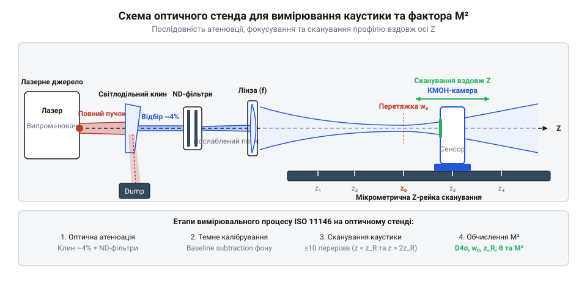

# Побудова вимірювального стенда профілометра та вимірювання M² фактора лазера

## Проблема вимірювання лазерного пучка та атенюація

Вимірювання просторового розподілу інтенсивності лазерного випромінювання натрапляє на проблему високої локальної густини потужності. Пряме попадання лазерного пучка навіть невеликої потужності на напівпровідникову КМОН-матрицю спричиняє насичення (англ. @@en|blooming@@) або фізичне вигорання фоточутливих пікселів, оскільки поріг насичення кремнію становить сотні мікроват на квадратний сантиметр. Для безпечного вимірювання застосовують оптичну атенюацію (від латинського @@en|attenuare@@ — витончувати, послаблювати, англ. @@en|attenuation@@), яка зменшує інтенсивність у 10³–10¹⁰ разів.

Використання звичайних поглинальних світлофільтрів для первинного послаблення потужних пучків неможливе: поглинання енергії в об'ємі скла викликає нерівномірний нагрів. Через температурний градієнт виникає теплова сочевиця (англ. @@en|thermal lensing@@), яка викривляє хвильовий фронт і спотворює профіль пучка.

Первинне зняття потужності виконують незахищеним оптичним клином (від грецького ὄπσις — зір, англ. @@en|optical wedge@@). Передні грані клина відбивають близько 4% інтенсивності за рахунок френелівського відбиття без об'ємного поглинання. Клиновидність під кутом 0.5°–3° відхиляє паразитна відбиття від задньої грані, запобігаючи виникненню інтерференційних смуг — еталонуванню (англ. @@en|etaloning@@). Вторинне послаблення здійснюють відкаліброваними нейтральними світлофільтрами (англ. @@en|ND filter@@), які встановлюють під кутом 1°–3° для запобігання перевідбиттям назад у лазерний резонатор.

Для розрахунку сумарного коефіцієнта оптичного послаблення `K_total` використовують добуток коефіцієнтів передачі окремих елементів тракту. Первинний оптичний клин забезпечує коефіцієнт послаблення `K_wedge = 1 / R_1 ≈ 25` (де френелівське відбиття `R_1 ≈ 0.04`), а нейтральні світлофільтри характеризуються оптичною плотністю (англ. @@en|optical density@@, `OD`), де коефіцієнт послаблення дорівнює `K_ND = 10^OD`. Оскільки загальна оптична плотність послідовно встановлених фільтрів аддитивна `OD_total = OD_1 + OD_2 + ... + OD_n`, підсумкове послаблення обчислюють за формулою `K_total = K_wedge · 10^(OD_total)`. Наприклад, для вимірювання лазера потужністю `P_in = 1 Вт` (1000 мВт) каскад із клина (`K_wedge = 25`) та двох ND-фільтрів із `OD_1 = 2.0` і `OD_2 = 1.0` дає `K_total = 25 · 10^(3.0) = 25 000`, що знижує потужність пучка на сенсорі до безпечного рівня `P_sensor = 40 мкВт` без ризику насичення матриці чи термооптичного спотворення.

Для розрахунку сумарного коефіцієнта оптичного послаблення `K_total` використовують добуток коефіцієнтів передачі окремих елементів тракту. Первинний оптичний клин забезпечує коефіцієнт послаблення `K_wedge = 1 / R_1 ≈ 25` (де френелівське відбиття `R_1 ≈ 0.04`), а нейтральні світлофільтри характеризуються оптичною плотністю (англ. @@en|optical density@@, `OD`), де коефіцієнт послаблення дорівнює `K_ND = 10^OD`. Оскільки загальна оптична плотність послідовно встановлених фільтрів адитивна `OD_total = OD_1 + OD_2 + ... + OD_n`, підсумкове послаблення обчислюють за формулою `K_total = K_wedge · 10^(OD_total)`. Наприклад, для вимірювання лазера потужністю `P_in = 1 Вт` (1000 мВт) каскад із клина (`K_wedge = 25`) та двох ND-фільтрів із `OD_1 = 2.0` і `OD_2 = 1.0` дає `K_total = 25 · 10^(3.0) = 25 000`, що знижує потужність пучка на сенсорі до безпечного рівня `P_sensor = 40 мкВт` без ризику насичення матриці чи термооптичного спотворення.

## Збирання стенда та юстування оптичної осі

Для проведення вимірювань компоненти оптичного тракту монтують на жорсткій оптичній рейці, розташованій уздовж осі поширення пучка Z. Стенд містить лазерне джерело, оптичний клин, набір ND-фільтрів, фокусувальну лінзу та КМОН-камеру, закріплену на високоточному лінійному трансляторі.

*Схема побудови оптичного стенда з компенсаційним послабленням та механічним юстуванням камери уздовж осі Z.*

Ключовим етапом побудови стенда є юстування (від німецького @@en|justieren@@ — вирівнювати, точно підганяти) оптичної осі. Лазерний промінь має проходити суворо паралельно механічній направляючій Z-рейки. Найменший кутовий перекос призводить до того, що під час переміщення камери уздовж осі Z центроїд пучка зсувається по матриці, а виміряна траєкторія каустики викривляється. Контроль паралельності виконують за допомогою двох апертурних діафрагм або механічних вимірювальних інструментів, таких як [Штангенциркуль](root:cat-hw-instruments/vernier-caliper).

Для реалізації двоточкового юстування на Z-рейку послідовно встановлюють дві ірисні діафрагми (англ. @@en|iris diaphragm@@): першу у ближній позиції `Z_1` поруч із джерелом, а другу — у дальній позиції `Z_2` на протилежному кінці рейки. На першому кроці апертуру діафрагми `Z_1` звужують до мінімального отвору та юстувальними гвинтами лінійного зсуву лазера добиваються проходження пучка суворо через її центр. На другому кроці відкривають діафрагму `Z_1`, звужують дальню діафрагму `Z_2` та гвинтами кутового нахилу (англ. @@en|kinematic mount@@) спрямовують промінь у центр другої апертури. Процедуру повторюють ітераційно 2–3 рази для усунення взаємозв'язку між кутовим і просторовим зсувом. Після вирівнювання пучок безперешкодно проходить крізь обидві діафрагми, що гарантує паралельність оптичної осі механічній траєкторії камери з точністю до часток мілірадіана.

## Темне калібрування та знімання 2D і 3D профілів

Напівпровідникові КМОН-сенсори мають власний темноий струм та температурний зсув рівнів АЦП, що створює постійну фонову засвітку. Для усунення цього шуму перед початком вимірювань виконують процедуру темного калібрування (англ. @@en|Ultracal@@ / @@en|baseline subtraction@@). При закритому апертурному затворі камери зчитують темний кадр `I_dark(x, y)` та віднімають його від сигнального зображення `I_raw(x, y)`:

I_corrected(x, y) = max(0, I_raw(x, y) - I_dark(x, y) - I_thresh)      [віднімання темного кадру та порогова фільтрація]

Для обчислення діаметрів пучка за стандартом ISO 11146 використовують метод другого моменту інтенсивності D4σ (англ. @@en|D4sigma@@). Спочатку знаходять координати центроїда (перші моменти `x₀`, `y₀`), після чого обчислюють другі центральні моменти інтенсивності:

σ_x² = ∑ (x - x₀)² · I_corrected(x, y) / ∑ I_corrected(x, y)      [дисперсія розподілу по осі X]

Діаметр пучка визначено як `d_σx = 4 · σ_x`. Поріг відсікання `I_thresh` (зазвичай 1–1.5% від пікової інтенсивності) усуває вплив шуму периферійних пікселів, який міг би суттєво завищити значення других моментів.

Для візуального аналізу просторового розподілу випромінювання будують 2D та 3D профілі інтенсивності. Двовимірна псевдокольорова карта (англ. @@en|heatmap@@ / @@en|contour plot@@) з ізоконтурними лініями рівного рівня інтенсивності дозволяє оцінити симетрію плями, азимутальний кут орієнтації головних осей еліпса та виявити астигматизм. Тривимірна діаграма поверхні (англ. @@en|3D profile plot@@), де висота рельєфу відповідає локальній інтенсивності `I(x, y)`, є незамінною для виявлення локальних піків випромінювання — гарячих плям (англ. @@en|hot spot@@), а також деформацій трансверсальних мод та дифракційних кілець від пилинок чи оптичних дефектів, які важко помітити на двовимірних проєкціях.

Нижче наведено реалізацію віднімання темнового кадру та обчислення моментів D4σ мовою Python:

:::code proj-camera-beam-profiler-setup-and-m2-measurement/py/beam_profiler.py 15-27
:::code proj-camera-beam-profiler-setup-and-m2-measurement/py/beam_profiler.py 29-75

Для високонавантажених обчислень у реальному часі алгоритм реалізують мовою C або C++:

:::tabs
@c
:::code proj-camera-beam-profiler-setup-and-m2-measurement/c/beam_profiler.c 9-35
@cpp
:::code proj-camera-beam-profiler-setup-and-m2-measurement/cpp/src/beam_profiler.cpp 19-63
:::

## Вимірювання каустики та розрахунок фактора M²

Фактор якості лазерного пучка M² (англ. @@en|M2 factor@@) характеризує ступінь відхилення реального випромінювання від ідеального гаусового пучка `TEM₀₀`. Згідно зі стандартом ISO 11146, для визначення M² фокусувальну лінзу встановлюють у пучок, створюючи штучну перетяжку (каустику), та вимірюють діаметри D4σ(z) щонайменше у 10 площинах уздовж осі Z (не менше 5 у зоні перетяжки та не менше 5 за межами довжини Рейлі).

Виміряні квадрати діаметрів апроксимують поліномом другого порядку:

d²(z) = A + B · z + C · z²      [гіперболічна модель каустики ISO 11146]

З коефіцієнтів регресії визначають позицію перетяжки `z₀ = -B / (2C)`, мінімальний діаметр `d₀ = √(A - B² / (4C))` та кут розбіжності пучка в далекій зоні `θ = √C`. Фактор якості обчислюють за формулою:

M² = (π · d₀ · θ) / (4 · λ)      [фактор M² через діаметр перетяжки d₀ та кут розбіжності θ]

де `λ` — довжина хвилі лазерного випромінювання. Для ідеального гаусового пучка `M² = 1.0`, а значення `M² > 1.0` свідчить про наявність вищих просторових мод.

Точність обчислення фактора `M²` вимагає суворого контролю системних похибок позиціонування та фонового шуму. Похибка механічного транслятора `δz` уздовж осі Z у зоні фокальної перетяжки викривляє коефіцієнт параболічної кривини `C`, що призводить до завищення розрахованого кута розбіжності `θ = √C`. Водночас залишковий темновий шум сенсора на периферії матриці справляє визначальний вплив на моментні діаметри: оскільки у другій дисперсії `σ_x²` відхилення пікселів від центроїда зважуються у квадраті `(x - x₀)²`, навіть незначна невідфільтрована засвітка на краях кадру різко збільшує виміряний діаметр `D4σ`. Це штучно завищує значення `M²`, тому стандарт ISO 11146 приписує поєднувати процедуру темного калібрування з обмеженням розрахункової апертури розміром `3 · D4σ`.

Алгоритм апроксимації каустики та розрахунку M² наведено в модулі Python:

:::code proj-camera-beam-profiler-setup-and-m2-measurement/py/m2_fit.py 15-64
:::code proj-camera-beam-profiler-setup-and-m2-measurement/py/main.py 35-70
