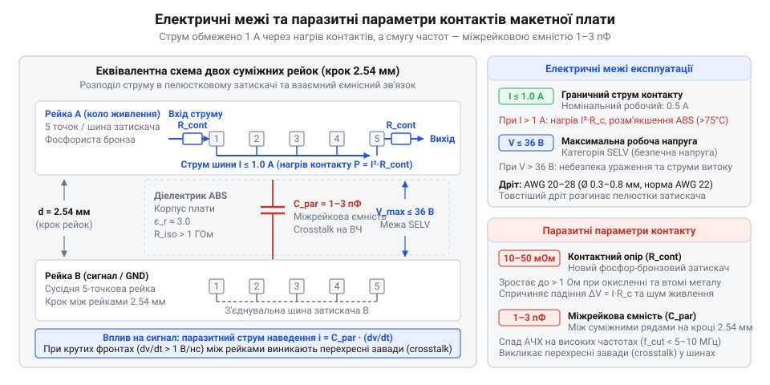

# Залізні специфікації та топологія з'єднань безпаяльної макетної плати

<preknowlist>
- [Безпайкові макетні плати (Breadboard)](root:cat-hw-instruments/solderless-breadboard-prototyping) — загальну концепцію безпайкового макетування, призначення плати для швидкого складання електронних схем та її зовнішній вигляд
</preknowlist>

## Непередбачувані замикання та відмови макетної плати

Складання першого робочого макета на перфорованій пластиковій панелі часто супроводжується несподіваними апаратними збоями: щойно підключений мікроконтролер надмірно нагрівається, логічні рівні на входах цифрових мікросхем довільно хаотизуються, а світлодіоди або сенсори взагалі не реагують на подачу живлення. Інженер-початківець сприймає лицьову панель як масив ізольованих отворів, у які можна довільно вставляти виводи електронних компонентів та з'єднувальні провідники. Таке уявлення створює хибне відчуття безпеки: здається, що відстань між отворами у 2.54 мм гарантує відсутність електричного зв'язку між сусідніми деталями.

У реальності під перфорованою пластиковою оболонкою сховані суцільні металеві провідні рейки, які об'єднують отвори у строго визначені групи. Коли розробник вставляє обома виводами звичайний резистор або двохвиводний конденсатор у два сусідні отвори однієї вертикальної групи, він мимовільно закорочує компонент сам на себе. Ще критичнішою стає ситуація при монтажі багатьохвивідних мікросхем: встановлення корпусу уздовж однієї контактної лінії призводить до тотального короткого замикання всіх його ніжок між собою. Спроба подати живлення на таку схему спричиняє миттєве протікання надмірних струмів, вихід з ладу вихідних каскадів мікроконтролера та термічне пошкодження пластикової основи.

Окрім прямих коротких замикань, відсутність розуміння внутрішнього устрою викликає плаваючі відмови. Завдяки механічному прогину пелюсток при неправильному виборі товщини дроту виникають ненадійні контактні точки. Схема може працювати кілька хвилин, після чого найменша вібрація столу або легкий доторк до провідника розриває коло чи створює паразитне падіння напруги. Щоб уникнути спонтанних апаратних аварій, тривалих пошуків неіснуючих помилок у коді програмного забезпечення та передчасної деградації компонентів, необхідно глибоко розібратися у геолокації внутрішніх металевих рейок, конструкції затискачів та геометрії електричних зв'язків, які надає [безпайкове макетування електронних схем](root:cat-hw-instruments/solderless-breadboard-prototyping).

## Топологія комутаційних рейок і затискачів

Внутрішня архітектура безпайкової макетної плати (англ. @@en|solderless breadboard@@, від англ. *bread* — хліб та *board* — дошка, оскільки перші макети збирали на дерев'яних дошках для кулінарії) побудована на матричній сітці з фіксованим кроком 2.54 мм (0.1 дюйма). Цей розмір відповідає стандартному кроку виводів більшості вивідних електронних компонентів та дискретних напівпровідників. Поверхня плати розділена на дві основні функціональні зони: центральне сигнальне поле та бічні поздовжні шини живлення.

Центральне поле складається з двох паралельних секцій, розділених поздовжнім жолобом завширшки 7.62 мм (0.3 дюйма). Цей розплітальний жолоб призначений для встановлення мікросхем у корпусах з дворядним розташуванням виводів (англ. @@en|DIP@@, скорочення від @@en|Dual In-line Package@@, від лат. *dualis* — подвійний). Жолоб фізично перериває металеві рейки, забезпечуючи електричну ізоляцію між протилежними виводами мікросхеми. З обох боків від жолоба розташовані вертикальні 5-точкові термінальні групи (рейки). Кожні п'ять отворів, розташованих в один вертикальний стовпчик, знизу об'єднані єдиною суцільною металевою пластиною. Таким чином, вставлення виводу компонента в будь-який із п'яти отворів однієї рейки електрично з'єднує його з усіма іншими чотирма отворами цього ж стовпчика.


*Внутрішня топологія комутації макетної плати, центральний жолоб та конструкція пелюсткового затискача.*

Уздовж зовнішніх країв плати розташовані поздовжні шини живлення. На відміну від 5-точкових сигнальних рейок, шини живлення орієнтовані горизонтально і об'єднують довгі лінії контактів (зазвичай по 25 або 50 отворів). У багатьох конструкціях, таких як [стандартна макетна плата великого габариту](root:cat-hw-instruments/breadboard-large), поздовжня шина має розрив посередині плати, розділяючи лінію живлення на два незалежні сегменти, тоді як [компактна макетна плата мініатюрного розміру](root:cat-hw-instruments/breadboard-mini) може взагалі не мати окремих шин живлення задля економії площі.

Основою кожного контактного вузла є пружинний пелюстковий затискач (англ. @@en|spring clip@@). Затискач виготовляється штампуванням із фосфористої бронзи (англ. @@en|phosphor bronze@@, від грец. *phosphoros* — світлоносний) або пружної мідно-нікелевої латуні з покриттям тонким шаром нікелю чи олова. Пелюстки мають двосторонню вигнуту форму, яка нагадує літеру U або V. При вставленні виводу деталі пелюстки розсуваються, створюючи механічне зусилля стиснення, яке забезпечує щільне прилягання металу до провідника по всій довжині контактної зони.

## Електричні специфікації та механічні границі

Електрична та механічна надійність макетного інтерфейсу визначається паспортними межами пружинних затискачів та діелектричними властивостями пластикового корпусу з акрилонітрилбутадієнстиролу (АБС-пластику). Гранично припустимий постійний струм через один пелюстковий контакт становить 1.0 А. Перевищення цього значення спричиняє інтенсивне омічне нагрівання контактної групи за законом Джоуля — Ленца. Гранична робоча напруга обмежена рівнем 36 В постійного струму (або 42 В пікового змінного струму), що обумовлено безпекою користувача та ризиком поверхневого пробою між сусідніми рейками при підвищеній вологості.

Механічні межі інтерфейсу визначаються діаметром провідників, що вставляються у затискач. Стандартний пружинний затискач розрахований на роботу з одножильними дротами калібру від AWG 20 до AWG 28 (англ. @@en|AWG@@, скорочення від @@en|American Wire Gauge@@). Це відповідає фізичному діаметру жил від 0.32 мм (AWG 28) до 0.81 мм (AWG 20). Оптимальним є діапазон AWG 22–24 (діаметр 0.51–0.64 мм), при якому забезпечується максимальне механічне зусилля утримання без пластикової деформації пружинних пелюсток.

Електричні параметри контакту характеризуються трьома основними величинами:
1. Контактний опір (англ. @@en|contact resistance@@, від лат. *contactus* — доторк) свіжого затискача становить від 10 мОм до 50 мОм. 2. Опір ізоляції (англ. @@en|insulation resistance@@, від лат. *insula* — острів) між суміжними ізольованими рейками становить понад 10⁹ Ом (1 ГОм) при вимірювальній напрузі 500 В постійного струму. 3. Міжрейкова паразитна ємність (англ. @@en|parasitic capacitance@@, від грец. *parasitos* — утриманець) між сусідніми 5-точковими групами або паралельними шинами живлення коливається в межах 1.0–3.0 пФ.


*Електрична схема та графічне позначення межевих параметрів макетного контакту.*

Для оцінки падіння напруги та теплових втрат на одному контактному переході при граничному струмі застосовується покроковий розрахунок:

Обчислення падіння напруги та потужності втрат:
```
U_drop = I × R_contact
= 1.0 A × 0.05 Ом
= 0.05 В (50 мВ)

P_loss = I² × R_contact
= (1.0 A)² × 0.05 Ом
= 0.05 Вт (50 мВт)
```

При проходженні струму 1.0 А через ланцюг із чотирьох послідовних контактних переходів сумарне падіння напруги досягає 0.2 В, що є суттєвим для низьковольтних шин живлення 3.3 В або 1.8 В.

## Деградація контактів і частотні обмеження

Експлуатація безпайкової макетної плати на межі паспортних параметрів супроводжується незворотними деградаційними процесами. Головною причиною механічного псування є пружна втома та пластична деформація фосфор-бронзових пелюсток. Якщо в отвір силоміць вставити занадто товстий вивід (наприклад, щуп мультиметра, вивід потужного діода або випрямного моста діаметром понад 0.9–1.0 мм), механічне напруження в металі перевищує межу плинності. Пелюстки залишаються незворотно розсунутими. Надалі при вставленні у цей же отвір стандартного дроту AWG 24-26 контактний опір зростає до десятків Ом або зв'язок повністю втрачається.

Другим чинником є термічне пошкодження. При струмовому перевантаженні понад 1.0 А потужність втрат на контакті спричиняє місцеве нагрівання до температур понад 80–100 °C. Оскільки корпус плати виготовлено з термопластичного АБС-пластику, точка розм'якшення якого лежить у межах 90–105 °C, пластикові перегородки між рейками втрачають жорсткість. Затискачі зміщуються зі своїх посадкових гнізд, що призводить до коротких замикань між сусідніми стовпчиками або до розплавлення корпусу. Додатково окиснення поверхні пелюсток під дією вологи та залишок флюсу з немитих виводів деталей формують діелектричну плівку оксиду міді чи нікелю.

Частотні обмеження макетної плати зумовлені наявністю міжконтактної паразитної ємності (1–3 пФ) та індуктивності рейок (10–20 нГн). На частотах понад 10 МГц паразитна ємність між сусідніми сигнальними рейками створює низький імпеданс для високочастотних складових сигналів, викликаючи перехресні завади (англ. @@en|crosstalk@@, від англ. *cross* — перехресний та *talk* — розмова).

Обчислення ємнісного опору паразитній міжконтактній ємності на частоті 10 МГц:
```
X_C = 1 / (2 × π × f × C)
= 1 / (2 × 3.14159 × 10⁷ Гц × 3.0 × 10⁻¹² Ф)
≈ 5305 Ом (5.3 кОм)
```

Опір 5.3 кОм між сусідніми контактними рейками на частоті 10 МГц означає, що крутий фронт тактового сигналу амплітудою 5 В наводить на сусідню лінію заваду амплітудою до 0.5–1.0 В, що спричиняє хибні спрацьовування цифрових входів. З цієї причини високочастотні радіочастотні схеми та швидкісні цифрові шини з фронтами імпульсів коротшими за 5 нс неможливо макетувати на безпайкових платах. Для таких завдань використовують [перфоровані плати під пайку](root:cat-hw-instruments/perfboard-and-stripboard).

## Практичні правила надійного макетного монтажу

Для забезпечення стабільної роботи схеми та запобігання пошкодженню макетної плати необхідно дотримуватися суворого регламенту підготовки провідників і комутації компонентів. Першим кроком є правильний вибір та зачистка дроту. Слід використовувати виключно одножильний мідний дріт калібру AWG 22 або AWG 24 з якісною ПВХ-ізоляцією. Зачистку кінця дроту виконують стрипером на довжину рівно 6–8 мм. Занадто короткий зачищений кінець (менше 5 мм) не дістає до зони стиснення пелюсток, а занадто довгий (понад 10 мм) залишає голий провідник над поверхнею плати, створюючи ризик випадкового короткого замикання з сусідніми деталями.

Категорично заборонено вставляти в отвори багатожильний гнучкий дріт без попереднього опресування наконечниками або лудіння приєм. Окремі тонкі волокна багатожильного провідника при вставленні відгинаються вбік і закорочують суміжні 5-точкові рейки. Виводи дискретних компонентів великої потужності (силових транзисторів, товстих випрямних діодів, дроселів) з діаметром понад 0.8 мм перед монтажем необхідно підпаювати до коротких відрізків стандартних штирьових з'єднувачів (гребінок) або гнучких макетних перемичок.

При організації розподілу живлення дотримуються наступних системних правил:
1. Поздовжні шини живлення верхньої та нижньої частини плати об'єднують паралельно короткими перемичками на обох кінцях плати для зниження загального омічного опору. 2. Безапеляційним правилом є встановлення керамічних розв'язувальних конденсаторів ємністю 0.1 мкФ безпосередньо біля виводів живлення VCC та GND кожної мікросхеми. Це компенсує паразитну індуктивність довгих рейок макету. 3. Виводи деталей вставляють у затискачі строго перпендикулярно до поверхні плати без прикладання надмірних зусиль та без розгойдування компонента вбік.

Діагностика контактних точок виконується за допомогою цифрового мультиметра в режимі вимірювання падіння напруги постійного струму під робочим навантаженням. Якщо падіння напруги між виводом деталі та сусіднім отвором цієї ж 5-точкової рейки перевищує 10–20 мВ, контактний вузол вважається дегенеративним і потребує переміщення компонента в сусідню вільну рейку.