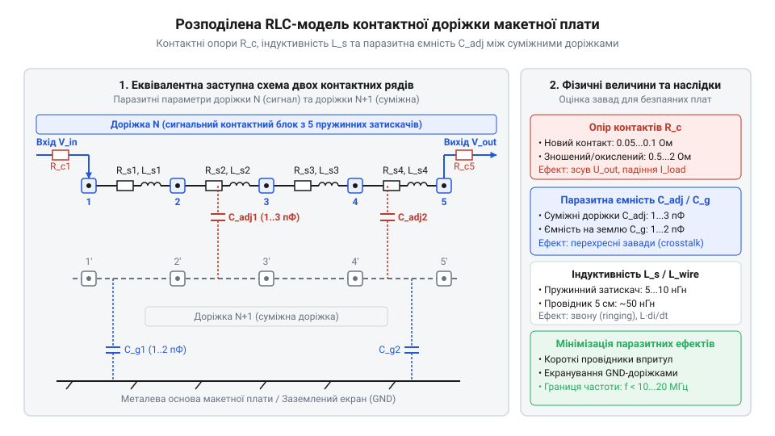
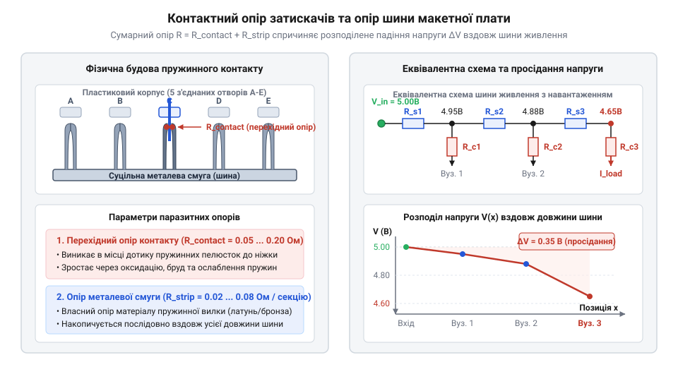
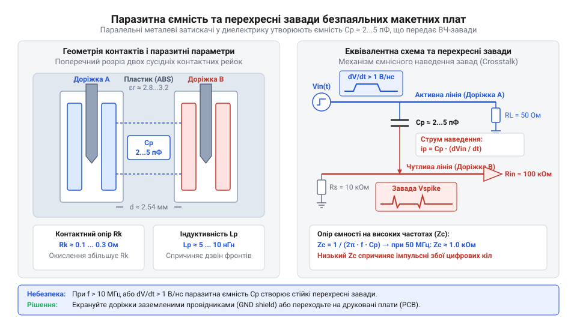
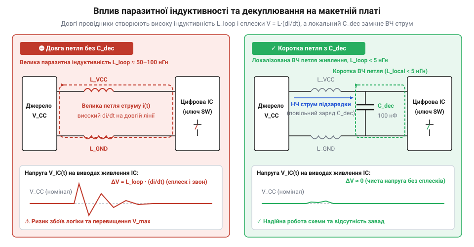
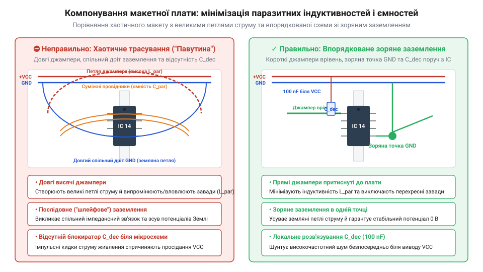

# Паразитна ємність та опір контактів безпаяльних макетних плат

<preknowlist>
- [Безпайкові макетні плати (Breadboard)](root:cat-hw-instruments/solderless-breadboard-prototyping) — розуміння базового принципу внутрішніх з'єднань контактних рейок та призначення шин живлення
- [Макетні плати під пайку (бакеліт, Stripboard)](root:cat-hw-instruments/perfboard-and-stripboard) — конструктивні відмінності паяних макетних плат та відсутність пружинних контактних затискачів
</preknowlist>

## Несподівані збої на макетній платі

Збирання електричної схеми на безпаяльній макетній платі зазвичай починається з перевіреного та розрахованого проекту. У графічному редакторі принципових схем або у програмі симуляції всі з'єднання виглядають ідеальними: логічний елемент передає чіткий прямокутний імпульс без спотворень, мікроконтролер стабільно зчитує дані з датчика, а операційний підсилювач рівномірно підсилює слабкий аналоговий сигнал. Проте після монтажу та ввімкнення живлення на фізичному макеті схема починає поводитися непередбачувано. Логічні лічильники самочинно змінюють свій стан у момент перемикання сусіднього силового реле; вихід аналогового підсилювача вкривається високочастотною завадою або впадає у паразитну автогенерацію (@@en|spurious oscillation@@); а @@en|microcontroller@@ (від англ. *micro* — малий та лат. *contrarotulus* — зустрічний список) хаотично перезавантажується під час спроби звернення до зовнішнього модуля.

Перша реакція розробника-початківця — шукати помилку у програмі, помилку в монтажі або дефектний електронний компонент. Інженер витрачає години на перевірку коду та заміну мікросхем, проте аномалії не зникають або хаотично змінюють свій характер від найменшого доторку до провідників. Причиною подібних загадкових збоїв найчастіше є фундаментальне хибне уявлення про саму макетну плату як про пасивне, електрично нейтральне середовище. У навчальних схемах отвори макетної плати сприймаються як точки ідеального провідника з нульовим опором, нульовою ємністю та нульовою індуктивністю. Насправді ж при роботі з [безпайковими макетними платами](root:cat-hw-instruments/solderless-breadboard-prototyping) утворюється складна розподілена електрична мережа, де кожен металевий затискач, кожна паралельна доріжка та кожен з'єднувальний провідник додають у коло невидимі паразитивні елементи.

Особливо гостро ця проблема проявляється у сучасній цифровій схемотехніці. Навіть якщо тактова частота мікроконтролера становить лише кілька мегагерц, час наростання та спаду фронтів цифрових сигналів (@@en|rise time@@) у сучасних мікросхемах вимірюється одиницями наносекунд. З точки зору спектрального аналізу, швидкі фронти містять високочастотні гармоніки з частотами у сотні мегагерц. На таких частотах фізична конструкція макетної плати перестає бути звичайним провідником і перетворюється на неузгоджену лінію передачі з високим рівнем паразитних зв'язків. Наприклад, паразитні ємності між сусідніми контактними доріжками викликають перехресні завади у послідовних шинах передачі даних (таких як I2C чи SPI), де наодинці прокладений сигнал тактування (@@en|clock signal@@) наводить хибні фронти на сусідню лінію даних, спричиняючи збої адресації та втрату пакетів. Довгі гнучкі провідники-джампери виступають у ролі ефективних антен, що вловлюють зовнішні електромагнітні завади (@@en|electromagnetic interference@@, EMI).

Історія безпаяного макетування сягає перших десятиліть розвитку радіотехніки, коли інженери буквально монтували радіодеталі на дерев'яних кухонних дошках для нарізання хліба (звідси й походить назва @@en|breadboard@@, від англ. *bread* — хліб та *board* — дошка), забиваючи в дерево мідні цвяхи або скріпки для з'єднання виводів. Сучасний вигляд безпаяльної макетної плати з'явився у 1971 році завдяки винаходу Рональда Ж. Португала (@@en|Ronald J. Portugal@@), який запатентував концепцію пластикового корпусу з внутрішніми бронзовими пружинними затискачами. Прагнення розробників прискорити прототипування на нових на той час інтегральних мікросхемах у корпусах @@en|DIP@@ (англ. @@en|Dual In-line Package@@, дворядний корпус із двостороннім розташуванням виводів) зафіксувало геометрію стандарту: сітку отворів із кроком 2.54 мм (0.1 дюйма) та паралельні контактні рейки. Сучасні паразитні обмеження безпаяльних макетних плат є безпосереднім наслідком компромісів цієї механічної конструкції, яку було оптимізовано у 1970-х роках виключно під низькочастотну цифрову та аналогову схемотехніку.

Фізична структура пластикового корпусу та розташованих у ньому металевих смуг формує три основні типи паразитних параметрів, які спотворюють роботу електричних кіл:


*Схема розподілених паразитних параметрів контактної доріжки показує поєднання опорів затискачів, міжконтактної ємності та індуктивності провідників у єдину електричну мережу.*

1. Перехідний контактний опір (@@en|contact resistance@@, від лат. *contactus* — дотик) між виводом компонента та внутрішньою пружинною вилкою, а також опір суцільноштампованого металевого провідника вздовж всієї контактної рейки. 2. Паразитна ємність (@@en|parasitic capacitance@@, від грецьк. *parasitos* — наліпник, той що їсть за чужим столом) між сусідніми паралельними доріжками, розділеними діелектриком пластикового корпусу, що призводить до ємнісного проникання сигналів та перехресних завад (@@en|crosstalk@@). 3. Паразитна індуктивність (@@en|parasitic inductance@@) довгих з'єднувальних джамперів та шин живлення, яка викликає сплески напруги й так звані «стрибки землі» (@@en|ground bounce@@) під час швидких змін струму споживання.

За низьких частот (до сотень кілогерц) та значних струмів сигналів ці приховані елементи майже не впливають на функціонування схеми. Але зі зростанням швидкості наростання фронтів цифрових сигналів чи чутливості аналогових каскадів розподілені параметри макетної плати стають домінуючим чинником, що спотворює амплітудно-частотні характеристики та викликає часовий джиттер (@@en|jitter@@).

Конструктивні деталі, нормативні геометричні розміри та граничні струмові навантаження затискачів детально описують [залізні специфікації макетних плат](root:cat-hw-instruments/breadboard-parasitic-effects/api-solderless-breadboard-hardware-specifications.md). Для самостійної кількісної оцінки зносу контактів і визначення паразитної ємності реальної плати в лабораторних умовах призначений [практичний вимірювальний стенд](root:cat-hw-instruments/breadboard-parasitic-effects/proj-breadboard-parasitics-measurement.md), який дає змогу наочно спостерігати спотворення прямокутних імпульсів на осцилографі.

## Механіка та опір пружинних затискачів

Внутрішня комутаційна система безпаяльної макетної плати складається з паралельних рядів металевих затискачів, захованих під термопластовою панеллю. Кожен такий затискач являє собою штамповану пружинну вилку з двох або трьох пелюсток, виготовлену з фосфористої бронзи (@@en|phosphor bronze@@) або берилієвої міді з нікелевим, олов'яним чи срібним покриттям. Коли вивід електронного компонента вставляється в отвір макетної плати, пелюстки вилки розсуваються, виникає пружна деформація металу, і за рахунок сили пружності створюється механічне зусилля притискання.

Електричний опір такого переходу (@@en|contact resistance@@) залежить від фізичної площі фактичного механічного контакту на мікрорівні та стану поверхонь. На мікроскопічному рівні поверхня металевого виводу компонента та пелюсток затискача є шорсткою; контакт відбувається лише в окремих мікроскопічних виступах (точках дотику). Відповідно до теорії електричних контактів Холма (@@en|Holm contact theory@@), опір стягування визначається силою притискання пелюсток та питомим опором матеріалу. Величина опору контактного переходу визначається чотирма основними факторами:

1. **Діаметр та геометрія виводів.** Стандартні виводи дискретних компонентів та ніжки мікросхем мають діаметр від `0.4 мм` до `0.63 мм`. Встановлення занадто товстих виводів (наприклад, силових діодів чи клемних пінів діаметром `0.8`–`1.0 мм`) викликає пластичну деформацію (@@en|plastic deformation@@) бронзових пелюсток, при якій метал виходить за межі пружної адаптації. У результаті вилка втрачає початкову форму, і при подальшому встановленні стандартних тонких виводів сила притискання різко зменшується, що спричиняє виникнення нестабільного опору або переривистого контакту (@@en|intermittent contact@@). 2. **Окислення та плівкові забруднення.** На повітрі бронза та олово покриваються тонкими діелектричними оксидними плівками (@@en|oxide film@@). На відміну від паяного з'єднання, де оксиди руйнуються хімічним флюсом та розплавленим припоєм, єдиним способом забезпечення електричного контакту на макетній платі є механічне зрізання оксиду гострими краями пелюсток під час вставляння. Якщо сила притискання ослабла або поверхня забруднена жиром із рук чи пилом, оксидна плівка створює значний послідовний опір. Більше того, цей опір часто виявляє нелінійну вольт-амперну характеристику, спотворюючи слабкі аналогові сигнали та викликаючи інтермодуляційні спотворення. 3. **Механічний знос покриття.** Багаторазове вставляння компонентів протирає тонкий захисний шар нікелю чи олова до чистої бронзи. Вплив атмосферної вологості прискорює хімічну корозію незахищеного металу, викликаючи поступову деградацію провідності з кожним новим циклом використання. 4. **Неоднорідність контактної рейки.** Довгі шини живлення (@@en|power rails@@) утворені довгими суцільними металевими смужками, що проходять уздовж усієї плати. Опір самого металевого провідника смужки додається до опору кожного пружинного затискача, утворюючи послідовний ланцюг розподілених опорів. Коли вздовж однієї шини підключено кілька мікросхем, струм споживання далеких модулів створює градієнт напруги уздовж всієї довжини плати.


*Внутрішній механічний устрій пружинної вилки та послідовний контактний опір у місці притискання виводу компонента.*

У новій макетній платі високої якості опір одного контактного переходу становить від `0.05 Ом` до `0.1 Ом`. Проте в інтенсивно використовуваних або дешевих платах з оксидованими затискачами опір одного контакту може досягати `0.5`–`2.0 Ом`, а в найгірших випадках — створювати нестабільний імпеданс (@@en|impedance@@, від лат. *impedio* — перешкоджаю), що змінюється від найменшого механічного доторку чи вібрації.

Головним наслідком підвищеного контактного опору на шинах живлення є просідання напруги під навантаженням (@@en|voltage drop@@). Коли коло споживає значний струм або створює короткочасні імпульси споживання, послідовний еквівалентний опір шини живлення (@@en|equivalent series resistance@@) перетворює ці струмові імпульси на сплески та падіння напруги безпосередньо на виводах живлення мікросхем.

Розглянемо покроковий розрахунок падіння напруги на шині живлення макетної плати при імпульсному споживанні струму. Нехай цифровий модуль у момент перемикання створює імпульс струму `I_peak = 0.35 А`, а загальний опір двох контактних затискачів та проміжної рейки живлення становить `R_total = 0.40 Ом`.

```
V_drop = I_peak × R_total
       = 0.35 × 0.40
       = 0.14 В               [падіння напруги на ділянці живлення]

V_supply_actual = V_cc - V_drop
                = 5.00 - 0.14
                = 4.86 В       [фактична напруга живлення на ніжці мікросхеми]
```

Падіння напруги на `0.14 В` на шині живлення під час швидких фронтів струму здатне викликати хибне спрацьовування систем скидання мікроконтролера за низької напруги (@@en|brown-out reset@@) або створювати імпульсні завади на лініях аналого-цифрових перетворювачів (@@en|ADC@@). Додатково, локальний нагрів оксидованого контакту імпульсним струмом викликає термо-ЕРС (@@en|Seebeck effect@@) на межі різнорідних металів, створюючи паразитні постійні напруги величиною у десятки мікровольт. Докладніше про механізми виявлення просідання живлення та налаштування блоків BOR дивіться у матеріалі про [системи скидання мікроконтролера за низької напруги](root:hw-arch/brown-out-reset-detector).

В аналоговій схемотехніці контактний опір спричиняє зсув робочих точок за постійним струмом (@@en|DC bias point@@). Наприклад, у високоточних вимірювальних схемах на операційних підсилювачах (@@en|op-amp@@, від англ. @@en|operational amplifier@@) додатковий опір у `0.5 Ом` у колі зворотного зв'язку чи заземлення вхідного каскаду при струмі `20 мА` зміщує потенціал «аналогової землі» на `10 мВ`. Для 12-бітного АЦП із опорною напругою `3.3 В` величина одного молодшого розряду (@@en|LSB@@) становить приблизно `0.8 мВ`. Отже, зсув на `10 мВ` призводить до похибки вимірювання у `12 LSB`, роблячи результати оцифрування недостовірними.

Точний аналіз паразитних кіл та їх математичні схеми заміщення висвітлюють [еквівалентні RLC-моделі паразитних ефектів](root:cat-hw-instruments/breadboard-parasitic-effects/math-breadboard-parasitics-modeling.md). Якщо специфіка розробки вимагає високої стабільності контактного опору та відсутності просідання напруги, слід переходити на паяний монтаж, використовуючи [макетні плати під пайку](root:cat-hw-instruments/perfboard-and-stripboard) або опановувати [прототипування на платах з отворами](root:cat-hw-instruments/perfboard-and-stripboard).

## Вплив міжконтактної ємності на сигнали

Кожен п'ятиконтактний затискач макетної плати виготовлено з металевої смуги фосфористої бронзи, яка запресована у термопластовий корпус з акрилонітрилбутадієнстиролу (@@en|ABS@@-пластику). Дві сусідні контактні рейки розміщені паралельно одна одній на відстані кроку 2.54 мм і розділені вузькою пластиковою перегородкою з відносною діелектричною проникністю `ε_r ≈ 2.5 – 3.0` та повітряним зазором. Така геометрія утворює конструктивний плоский конденсатор. У результаті виникає паразитна ємність (від @@en|parasitic capacitance@@, де @@en|parasite@@ походить від грецького @@el|παράσιτος@@ — утриманець), яка небажано зв'язує сусідні вузли електричної схеми.

Типове значення міжконтактної паразитної ємності `C_p` між двома суміжними п'ятиконтактними рейками становить від 2 до 5 пФ. Для довгих шин живлення, що проходять крізь усю довжину корпусу, паразитна ємність відносно сусідніх шин та землі може досягати від 10 до 25 пФ. Детальні геометричні параметри та зазори між елементами викладені у [технічних специфікаціях макетів](root:cat-hw-instruments/breadboard-parasitic-effects/api-solderless-breadboard-hardware-specifications.md).


*Геометричне розміщення двох паралельних контактних рейок у пластиковому корпусі та утворення паразитних ємностей між ними.*

Коли цифровий вихід інтегральної мікросхеми формує прямокутний імпульс, вихідний опір джерела `R_out` разом із паразитною ємністю доріжки `C_p` утворює еквівалентний ФНЧ (фільтр низьких частот). Частота зрізу `f_c` цього фільтра обмежує смугу пропускання лінії:

```
f_c = 1 ÷ (2 · π · R_out · C_p)
```

Через обмеження смуги пропускання зростає тривалість фронту наростання `t_r` (від 10% до 90% амплітуди) та спаду сигналу. Залежність часу наростання від параметрів кола описується виразом:

```
t_r = ln(9) · R_out · C_p
= 2.197 · R_out · C_p      [апроксимація логарифма]
≈ 2.2 · R_out · C_p        [округлення коефіцієнта]
```

**Обчислення тривалості фронту для цифрового сигналу з вихідним опором джерела 1 кОм та сумарною ємністю доріжки й вимірювального зонда 15 пФ:**

```
t_r = 2.2 · 1000 Ом · 15 × 10⁻¹² Ф
= 3.3 × 10⁻⁸ с              [множення величин]
= 33 нс                     [переведення у наносекунди]
```

Затримка фронту тривалістю 33 нс є критичною для високочастотних цифрових шин. Якщо період тактового сигналу шини SPI на частоті 20 МГц становить 50 нс, то імпульс тривалістю 25 нс затягується і спотворюється настільки, що напруга не встигає досягти порогового рівня логічної одиниці `V_IH`. Сигнал втрачає прямокутну форму і перетворюється на трапецієподібні або пилоподібні осциляції. Більш детальні еквівалентні схеми заміщення для аналізу фронтів проілюстровано у [моделі паразитних параметрів](root:cat-hw-instruments/breadboard-parasitic-effects/math-breadboard-parasitics-modeling.md).

У високоімпедансних аналогових колах вплив паразитної ємності виявляється у зсуві фази та втраті стабільності. У колах зворотного зв'язку операційних підсилювачів з високим опором резисторів (`R_f ≈ 100 кОм – 1 МОм`) навіть мала паразитна ємність `C_p = 3 пФ` створює додатковий полюс передавальної функції на частоті:

```
f_p = 1 ÷ (2 · π · 10⁶ Ом · 3 × 10⁻¹² Ф)
≈ 53.05 кГц                [обчислення частоти полюса]
```

Цей полюс додає від'ємний фазовий зсув `Δφ = -arctan(f / f_p)`. На частотах понад 50 кГц фазовий зсув наближається до -90°, що зменшує запас по фазі операційного підсилювача. Негативний зворотний зв'язок на високих частотах перетворюється на позитивний, викликаючи паразитну самозбуджуваність (від @@en|parasitic oscillation@@), генерацію високочастотних завад та спотворення робочої точки аналогового тракту.

Третім наслідком міжконтактної ємності є перехресні завади (від @@en|crosstalk@@ — перехресні розмови). Коли дві паралельні доріжки розміщені поруч, міжкомпонентна ємність діє як ємнісний дільник напруги між лінією-агресором та лінією-жжертвою. Швидка зміна напруги `dv/dt` на активній лінії індукує струм наведення `i_c = C_c · (dv/dt)` у сусідній провідник. Якщо опір навантаження лінії-жертви становить `R_in`, амплітуда наведеної завади досягає значення:

```
V_noise ≈ R_in · C_c · (dv/dt)
```

При перемиканні цифрового тактового сигналу з крутизною фронту `dv/dt = 3.3 В / 3 нс = 1.1 В/нс` на доріжці, суміжній із високоімпедансним входом скидання мікроконтролера (`R_in = 10 кОм`, `C_c = 3 пФ`), наведений сплеск напруги здатний перевищити поріг спрацьовування і викликати спонтанне перезавантаження системи. Практичні способи фіксації таких завад за допомогою осцилографа детально описує [методика вимірювання завад](root:cat-hw-instruments/breadboard-parasitic-effects/proj-breadboard-parasitics-measurement.md).

## Індуктивність провідників та реакція живлення

Окрім ємнісного зв'язку між доріжками, суттєвий вплив на роботу схеми справляє власна індуктивність провідників. Кожен провідник зі струмом створює навколо себе магнітне поле, що зумовлює паразитну індуктивність (від @@en|parasitic inductance@@). Для стандартного круглого мідного джампера (від @@en|jump wire@@ — перемичка) питома індуктивність становить приблизно 1 нГн на один міліметр довжини (`≈ 1 мкГн/м`).

Гнучкий з'єднувальний джампер довжиною 100 мм має власну індуктивність `L_p ≈ 100 нГн`. У поєднанні з паразитною ємністю макетної плати `C_p` та вхідною ємністю виводів мікросхем `C_in` ця індуктивність утворює послідовний або паралельний LC-коливальний контур із власною резонансною частотою `f_0`:

```
f_0 = 1 ÷ (2 · π · √(L_p · C_p))
```

Оскільки опір мідного джампера малий, добротність `Q` цього контуру виявляється високою. При кожному швидкому фронті перемикання цифрового сигналу в контурі виникає високочастотний дзвін (від @@en|ringing@@ — дзвін) — згасаючі високочастотні осциляції, що накладаються на логічні рівні напруги і призводять до хибних спрацьовувань компараторів та цифрових входів.

За законом електромагнітної індукції Фарадея, спад напруги на індуктивності провідника прямо пропорційний швидкості зміни струму `di/dt`:

```
V_L = L_p · (di/dt)
```

Коли цифровий вихід мікросхеми змінює стан або декілька буферів шини перемикаються одночасно, споживання струму від шини живлення змінюється стрибкоподібно. 

**Обчислення імпульсного спаду напруги на індуктивності джампера живлення довжиною 100 мм при зміні струму на 50 мА за 2 нс:**

```
di/dt = 0.05 А ÷ (2 × 10⁻⁹ с)
= 2.5 × 10⁷ А/с            [обчислення швидкості зміни струму]

V_L = 100 × 10⁻⁹ Гн · 2.5 × 10⁷ А/с
= 2.5 В                    [обчислення сплеску напруги]
```

Сплеск напруги амплітудою 2.5 В на індуктивності провідника живлення спричиняє два критичних ефекти: просідання напруги на шині VCC та зсув потенціалу землі (від @@en|ground bounce@@). При зсуві потенціалу землі опорна точка `GND` усередині мікросхеми короткочасно піднімається відносно істинного нульового потенціалу джерела живлення. Це призводить до збоїв у зчитуванні логічних рівнів, скидання внутрішніх регістрів мікроконтролерів та виникнення завад у чутливих аналогових блоках.


*Порівняння довгої петлі заземлення та джампера живлення з коротким з'єднанням і локальним декуплюючим конденсатором.*

Для нейтралізації індуктивних сплесків напруги та стабілізації шин живлення застосовують локальний блокувальний конденсатор (від @@en|decoupling capacitor@@). Його призначення — слугувати локальним резервуаром електричного заряду безпосередньо біля виводів живлення мікросхеми, забезпечуючи високу швидкість віддачі струму під час перехідних процесів без проходження струму через довгі джампери.

Необхідна мінімальна ємність декуплювання `C_dec` розраховується з умови забезпечення струму `I` протягом часу перемикання `Δt` при допустимому просіданні напруги `ΔV`:

```
C_dec = (I · Δt) ÷ ΔV
```

**Обчислення мінімальної ємності декуплювання для струмового імпульсу 100 мА тривалістю 5 нс при допустимому осіданні живлення 50 мВ:**

```
C_dec = (0.1 А · 5 × 10⁻⁹ с) ÷ 0.05 В
= 5 × 10⁻¹⁰ ÷ 0.05          [ділення чисельника на знаменник]
= 1 × 10⁻⁸ Ф                [результат у фарадах]
= 10 нФ                     [переведення у нанофаради]
```

На практиці використовують керамічні конденсатори ємністю 100 нФ (0.1 мкФ) з низьким значенням параметра еквівалентний послідовний опір (від @@en|equivalent series resistance@@, @@en|ESR@@). Вирішальним правилом є фізичне розміщення конденсатора: він мусить встановлюватися в ті ж самі або суміжні отвори макетної плати якомога ближче до виводів `VCC` та `GND` мікросхеми. Якщо блокувальний конденсатор віднесений на декілька сантиметрів і підключений довгими джамперами, паразитна індуктивність утвореної петлі повністю знівелює його ефективність.


*Приклад правильного та неправильного компонування схеми на макетній платі з використанням коротких джамперів, локального заземлення та розділених шин.*

Для мінімізації паразитних ефектів під час складання схем дотримуються трьох основних правил топології:
1. Використання коротких жорстких провідників, вкладених упритул до поверхні плати, замість довгих гнучких петель. 2. Організація топології зіркове заземлення (від @@en|star grounding@@), при якій силіві та аналогові шини заземлення з'єднуються лише в одній точці біля входу живлення. 3. Просторове розділення аналогових і цифрових провідників для зменшення ємнісних перехресних завад.

При розробці схем важливо вчасно оцінити межі застосовності безпаяльних макетних плат. Якщо для простих низькочастотних вузлів чудово підходить [мініатюрна макетна плата](root:cat-hw-instruments/breadboard-mini), а для середніх систем використовується [велика макетна плата](root:cat-hw-instruments/breadboard-large), то на частотах понад 10–20 МГц паразитні параметри пружинних контактів стають критичними. 

Для підвищення стійкості схем корисно застосовувати правильне [блокування завад живлення](root:cat-hw-instruments/prototype-decoupling-and-grounding). Загальна технологія, в якій описується [безпайкова макетна плата](root:cat-hw-instruments/solderless-breadboard-prototyping), забезпечує швидку перевірку ідей, але при високих вимогах до швидкодії необхідно переходити на паяні макети. Проміжним кроком є [макетні плати під пайку](root:cat-hw-instruments/perfboard-and-stripboard) або класичний [монтаж з отворами](root:cat-hw-instruments/perfboard-and-stripboard). Для високочастотних радіочастотних та швидкісних цифрових пристроїв найкращим рішенням є [техніка навесного монтажу](root:cat-hw-instruments/dead-bug-and-manhattan-wiring) на суцільному мідному шарі заземлення або виготовлення спеціалізованої друкованої плати.

## Практичні прийоми мінімізації паразитних ефектів

Мінімізація паразитних параметрів безпаяльної макетної плати починається з кардинальної зміни підходу до фізичного розташування компонентів та трасування з'єднувальних джамперів. Типова помилка початківців — збирання макету у вигляді хаотичної «павутини» із довгих гнучких провідників, що дугою піднімаються над пластиковим корпусом. Кожен такий провідник довжиною `10`–`15 см` має власну індуктивність до `150 нГн` і разом із навколишнім простором утворює об'ємну випромінюючу петлю. Струмовий контур великої площі `A` працює як рамочна антена, що легко приймає зовнішні електромагнітні завади та наводить паразитні імпульси на сусідні чутливі кола. Щоб пригнітити індуктивні наведення, трасування слід виконувати жорсткими монолітними провідниками (@@en|solid-core wire@@, від англ. *solid* — суцільний та *core* — жила), що щільно притиснуті до пластикової поверхні плати (@@en|flush-mounted wiring@@). Оптимізований провідник вигинають під прямими кутами точно за розміром між отворами, що мінімізує його довжину, зменшує площу контуру струму та знижує паразитна індуктивність до фізично досяжного мінімуму `1`–`2 нГн` на сантиметр.

Для захисту чутливих аналогових ліній та високоімпедансних цифрових входів від ємнісних перехресних завад (@@en|crosstalk@@) застосовують просторове рознесення та активне екранування. Оскільки паразитна ємність `C_p ≈ 2 – 5 пФ` між суміжними контактними рейками швидко зменшується зі збільшенням відстані, між активною цифровою лінією (наприклад, тактовим сигналом шини SPI з високою крутизною фронту `dv/dt`) та чутливим аналоговим входом слід залишати щонайменше одну-дві вільні контактні смуги. Якщо вільний простір обмежений, проміжну доріжку підключають до шини заземлення, створюючи захисну заземлену доріжку — охоронне кільце (@@en|guard ring@@, від англ. *guard* — захисний, охоронний та *ring* — кільце). Металева смуга охоронної доріжки перехоплює силові лінії електричного поля між сусідніми вузлами і скидає струм наведення `i_c = C_p · (dv/dt)` у землю, запобігаючи проникненню високовольтних сплесків на вхід підсилювача чи лінію скидання мікроконтролера. Для запобігання утворенню резонансного четвертьхвильового шлейфу на ультрависоких частотах охоронну доріжку обов'язково заземлюють з обох кінців.

Найважливішим елементом забезпечення стабільності живлення є грамотна стратегія локального декуплювання. Блокувальний конденсатор (@@en|decoupling capacitor@@) має встановлюватися безпосередньо між виводами живлення `VCC` та землі `GND` кожної інтегральної мікросхеми з мінімально можливою довжиною виводів. Застосування довгих джамперів для підключення блокувального конденсатора знецінює його роботу: еквівалентна послідовна індуктивність (@@en|equivalent series inductance@@, ESL) провідників довжиною `20 мм` додає близько `20 нГн` індуктивності, що зміщує резонансну частоту конденсатора `f_0` з десятків мегагерц у низькочастотну область. Для ефективного приглушення завад у широкому спектрі частот застосовують двобар'єрне декуплювання: керамічний конденсатор ємністю `0.1 мкФ` (з низьким індуктивним опором та малим еквівалентним послідовним опором ESR) ставлять впритул до корпусу мікросхеми, а електролітичний або танталовий конденсатор ємністю `10`–`47 мкФ` розташовують у точці входу живлення на плату для компенсації низькочастотних пульсацій струму. Математичний розрахунок ємностей та реактивного опору декуплюючих кіл надають [еквівалентні моделі паразитних ефектів](root:cat-hw-instruments/breadboard-parasitic-effects/math-breadboard-parasitics-modeling.md), а фундаментальні [правила розводки живлення](root:cat-hw-instruments/prototype-decoupling-and-grounding) висвітлюють вибір типів діелектриків.

Для усунення спільних імпедансних зв'язків та просідання напруги на шинах заземлення застосовують архітектуру зіркового заземлення (@@en|star grounding@@, від англ. *star* — зірка та *grounding* — заземлення). На макетній платі не можна послідовно з'єднувати заземлювальні виводи цифрових мікросхем, силових транзисторів та аналогових сенсорів уздовж однієї контактної рейки. Значний зворотний струм цифрових перемикань створює спад напруги `ΔV = I_digital · R_rail + L_rail · (di/dt)` на опорі та індуктивності рейки, модулюючи потенціал «землі» для аналогового каскаду. Замість цього контактну систему плати розділяють на два ізольовані контури: аналогову землю (@@en|AGND@@, від англ. *analog ground*) та цифрову землю (@@en|DGND@@, від англ. *digital ground*). Обидва контури фізично з'єднуються лише в одній точці — у точці підключення зовнішнього джерела живлення або біля виводу заземлення АЦП. Це унеможливлює виникнення земляних петель (@@en|ground loop@@) та гарантує виключення цифрового дзижчання з аналогового тракту.


*Порівняння хаотичного монтажу з високою індуктивністю петель та впорядкованої топології з мінімальними довжинами провідників і зірковим заземленням.*

На наведеній схемі виразно видно різницю між двома підходами до макетування. У лівій частині довгі гнучкі джампери утворюють значні контурні петлі, а блокувальний конденсатор віднесений від мікросхеми, що призводить до сплесків `di/dt` на шинах живлення та наведення завад. У правій частині провідники плоскі та короткі, блокувальні керамічні конденсатори підключені безпосередньо до виводів живлення, а шини заземлення розділені на окремі гілки зі з'єднанням у центральній точці. Застосування таких прийомів топологічного впорядкування є однаково критичним як під час розробки складних систем на [великих макетних платах](root:cat-hw-instruments/breadboard-large), так і при макетуванні окремих функціональних вузлів на [мініатюрних макетних платах](root:cat-hw-instruments/breadboard-mini).

## Межі застосовності та альтернативні методи

Попри можливість оптимізації топології, безпаяльна макетна плата має фундаментальні фізичні обмеження, виходити за межі яких неприпустимо через повну втрату працездатності або непередбачувану поведінку схеми. Першою критичною межею є швидкість наростання фронтів сигналів (@@en|rise time@@, `t_r`) та робоча частота. Головною помилкою є орієнтація лише на тактову частоту схеми: якщо мікроконтролер працює на частоті `1 МГц`, але його вихідні буфери виготовлені за сучасними технологічними процесами (наприклад, серії 74LVC чи ARM Cortex-M) із часом наростання фронту `t_r < 2`–`3 нс`, у лінії виникають високочастотні гармоніки аж до `300 МГц`. На таких частотах паразитна індуктивність джампера `L_p ≈ 100 нГн` разом із міжконтактною ємністю `C_p ≈ 3 пФ` створюють високодобротний резонансний контур. Результатом стає інтенсивний дзвін (@@en|ringing@@) із амплітудою сплесків, що перевищує напругу живлення, спричиняючи хибні подвійні спрацьовування цифрових входів. Фізичні особливості перерозподілу струмів на високих частотах та додаткові втрати розкрито у матеріалі про [поверхневий ефект та високочастотні втрати у провідниках макетування](root:ph-electromagnetism/skin-effect-and-high-frequency-conductors).

Практичною граничною частотою для безпаяльних макетних плат при роботі зі старими логічними серіями (де фронти становлять `10`–`15 нс`) є `10`–`15 МГц`. Для сучасних високошвидкісних цифрових шин (SPI зі швидкістю понад `10 МГц`, SDIO, RMII, паралельні шини дисплеїв) або аналогових підсилювачів із смугою понад `2`–`5 МГц` безпаяний макет стає непридатним. Кількісно оцінити спотворення та зсув фаз у конкретному макеті дозволяє [стенд вимірювання паразитних параметрів](root:cat-hw-instruments/breadboard-parasitic-effects/proj-breadboard-parasitics-measurement.md).

Другою межею є величина струму споживання та рівень напруги. Фізичні параметри пружинних затискачів із фосфористої бронзи, що висвітлюють [технічні специфікації макетів](root:cat-hw-instruments/breadboard-parasitic-effects/api-solderless-breadboard-hardware-specifications.md), обмежують максимальний постійний струм на один контакт величиною `1.5`–`2.0 А`. Проте вже при струмах понад `1 А` перехідний контактний опір `R_contact ≈ 0.2`–`0.5 Ом` спричиняє значний локальний нагрів за законом Джоуля-Ленца:

```
P_heat = I² · R_contact
       = (1.2)² · 0.4
       = 0.576 Вт              [теплова потужність на одному контакті]
```

Виділення понад `0.5 Вт` тепла у замкненому пластиковому гнізді призводить до термічної деформації та розм'якшення корпуса з ABS-пластику, незворотного ослаблення пружинних пелюсток і виникнення пожежонебезпечного стану. Крім того, у силовій електроніці (імпульсні перетворювачі, драйвери двигунів) швидкі перемикання струму `di/dt = 10 А/мкс` через індуктивність провідників `100 нГн` генерують індуктивні викиди `V = L · (di/dt) = 1 В`, що виводять із ладу чутливі затвори силових MOSFET-транзисторів. З точки зору напруги, максимальна безпечна робоча напруга безпаяних плат обмежена рівнем `36`–`50 В` постійного струму через малі міжконтактні зазори та ризик електричного пробою.

Третьою межею є прецизійність аналогових вимірювань. У високоточних колах (16–24 бітні АЦП, термопари, тензодатчики) механічний контакт піддається впливу вібрацій, термо-ЕРС (виникнення напруги `10`–`50 мкВ` на межі мідь-бронза при градієнті температур) та трибоелектричних зарядів. Для прецизійних кіл безпаяний макет створює непереборний рівень низькочастотного шуму та нестабільності нуля.

| Параметр / Характеристика | Безпаяльна плата (Breadboard) | Плата з отворами (Perfboard/Stripboard) | Монтаж на землі (Manhattan/Dead-Bug) | Друкована плата (PCB) |
| :--- | :--- | :--- | :--- | :--- |
| **Гранична частота / Фронт** | `< 10–15 МГц` (`t_r > 10 нс`) | `< 30–50 МГц` (`t_r > 3 нс`) | `< 500 МГц` (`t_r > 0.5 нс`) | `> 1–10 ГГц` (контрольований Z₀) |
| **Паразитна ємність доріжок**| `2 – 5 пФ` | `< 0.5 – 1 пФ` | `< 0.2 пФ` | Розрахункова (за геометрією) |
| **Контактний опір** | `0.05 – 0.5 Ом` (нестабільний) | `< 0.001 Ом` (паяний) | `< 0.001 Ом` (паяний) | `< 0.0005 Ом` (суцільна мідь) |
| **Максимальний струм** | `< 1.5 А` | `< 3 – 5 А` | `< 10 – 20 А` | Необмежений (за шириною міді) |
| **Механічна надійність** | Низька (тимчасовий макет) | Висока (стійка до вібрацій) | Дуже висока | Абсолютна (промислова) |

Коли фізичні параметри схеми виходять за безпечні межі безпаяльного макетування, інженер здійснює перехід до альтернативних методів прототипування:

1. **Паяні макетні плати з отворами (Perfboard та Stripboard).** Першим кроком для стабілізації схеми є перехід на паяний монтаж. Використання монтажних плат із готовими мідними п'ятачками (Perfboard) або паралельними доріжками (Stripboard) повністю усуває нестабільний контактний опір, знижуючи опір з'єднання до тисячних часток ома (`< 0.001 Ом`). Відсутність довгих паралельних бронзових смуг (у випадку Perfboard) зменшує міжконтактну паразитну ємність до рівня нижче `0.5 пФ`. Якщо необхідна надійність при помірних частотах, доцільно обрати [паяні макетні плати](root:cat-hw-instruments/perfboard-and-stripboard) або опанувати [прототипування з отворами](root:cat-hw-instruments/perfboard-and-stripboard).

2. **Навісний монтаж та техніка «Manhattan» / «Dead-Bug» на суцільній землі.** Для високочастотних аналогових кіл, ВЧ-підсилювачів та швидкодіючих цифрових вузлів на частотах від `20` до `500 МГц` ідеальним рішенням є використання суцільного шару заземлення (@@en|ground plane@@). У техніці «мертвого жука» (@@en|dead-bug wiring@@, від англ. *dead bug* — мертвий жук через схожість мікросхеми з перевернутою комахою) інтегральну мікросхему приклеюють спинкою до мідного фольгованого склотекстоліту, а її виводи заземлення припаюють безпосередньо до мідної фольги найкоротшим шляхом. У техніці «Манхеттен» (@@en|Manhattan style@@, від назви району Нью-Йорка з хмарочосами) на мідну пластину наклеюють невеликі квадратні ізольовані текстолітові острівці-опорні точки. Суцільний шар міді забезпечує практично нульову індуктивність заземлення (`L_ground ≈ 0 нГн`) та працює як ідеальний екрануючий щит від зовнішніх завад. Докладно алгоритми збирання таких ВЧ-макетів описує [монтаж на суцільній землі](root:cat-hw-instruments/dead-bug-and-manhattan-wiring).

3. **Прототипна друкована плата (PCB).** Для сучасних SMD-компонентів із дрібним кроком виводів (BGA, QFN, TSSOP), високошвидкісних інтерфейсів із контрольованим хвильовим імпедансом lines (USB, Ethernet, DDR) та багатоканальних силових систем єдиним правильним рішенням є проектирування дво- або чотиришарової друкованої плати (@@en|printed circuit board@@, PCB). Внутрішні суцільні шари заземлення та живлення забезпечують мінімальний імпеданс розводки, а контрольована геометрія трас гарантує відсутність зворотних відбиттів та перехресних наведень.

Осмислений вибір між швидким випробуванням ідеї на безпайковому макеті та своечасним переходом до паяних або друкованих конструкцій дає змогу уникнути хибної діагностики інженерних рішень та гарантує надійну роботу спроектованого пристрою. Усі базові засади початкового макетування підсумовують фундаментальні знання про [безпайкові макетні плати](root:cat-hw-instruments/solderless-breadboard-prototyping).