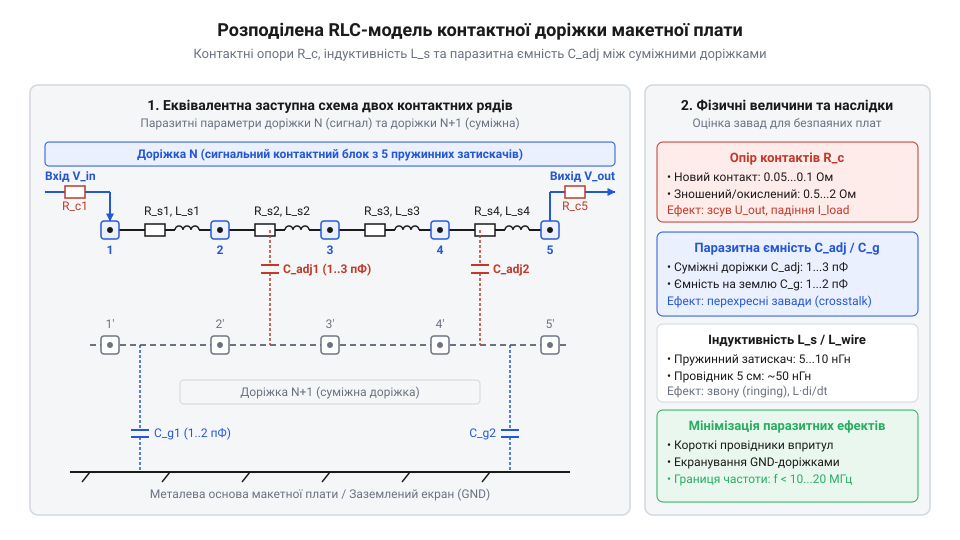
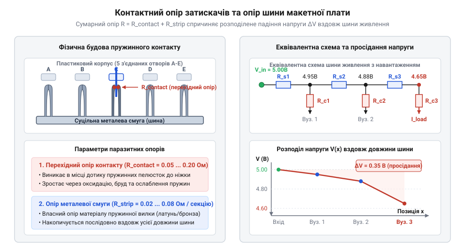
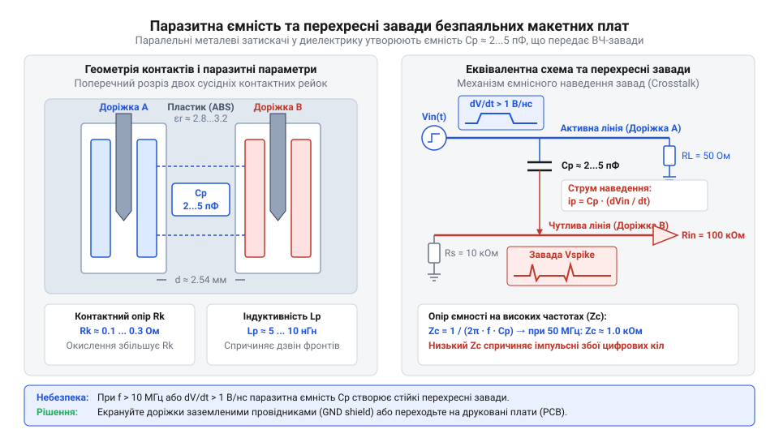
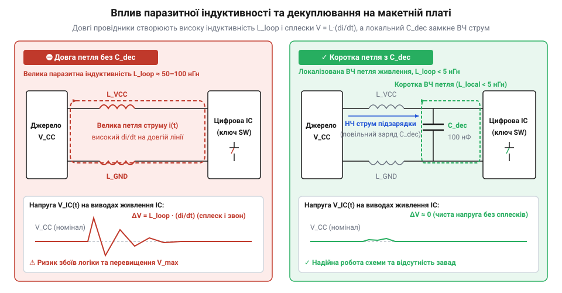
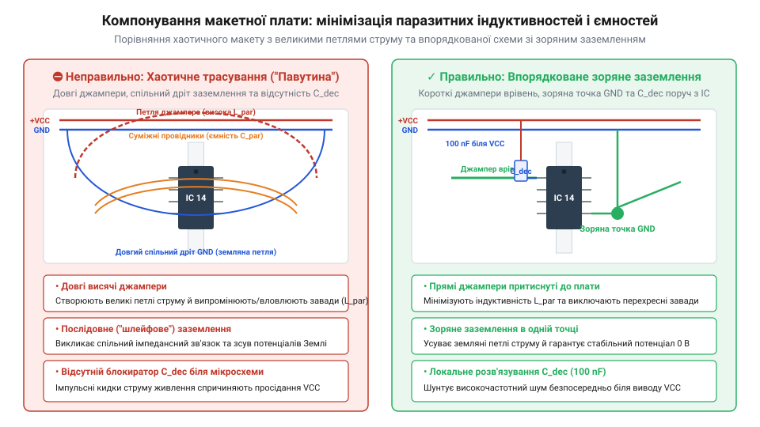

# Паразитна ємність та опір контактів безпаяльних макетних плат

<preknowlist>
- [Безпайкові макетні плати (Breadboard)](root:cat-hw-instruments/solderless-breadboard-prototyping) — базовий принцип внутрішніх з'єднань контактних рейок та призначення шин живлення
- [Макетні плати під пайку (бакеліт, Stripboard)](root:cat-hw-instruments/perfboard-and-stripboard) — конструктивні відмінності паяних макетних плат та відсутність пружинних контактних затискачів
</preknowlist>

## Причини електричних збоїв безпаяльних макетів

Безпаяльна макетна плата (англ. @@en|solderless breadboard@@, від @@en|solderless@@ — без пайки та @@en|breadboard@@ — дошка для хліба) під час [безпаяльного макетування схем](root:cat-hw-instruments/solderless-breadboard-prototyping) утворює розподілену RLC-мережу з опору затискачів, міжконтактної ємності та індуктивності джамперів. Ці паразитичні елементи (від грец. @@el|parasitos@@ — той, що їсть за чужим столом: @@en|parasitic elements@@) на швидких фронтах сигналів спотворюють імпульси й спричиняють збої схеми.

*Еквівалентна схема безпаяльного макету демонструє, що кожна контактна рейка та провідник містять паразитні опори, ємності та індуктивності.*

## Механіка затискачів та контактний опір

Пружинні вилки у гнізді макетної плати створюють перехідний контактний опір (від лат. @@la|contactus@@ — дотик: @@en|contact resistance@@), залежний від сили притискання та зносу металу.

Деформація затискачів виводами понад `0.8 mm` підвищує @@en|contact resistance@@ до `1–2 Ω`. Імпульсний струм `I` створює спад напруги на шині живлення:

ΔV = I × R_contact
   = 0.5 A × 0.2 Ω    [підстановка імпульсного струму та контактного опору]
   = 0.1 V            [обчислення просідання напруги живлення]

Просідання напруги викликає хибне скидання мікроконтролера та зміщує робочі точки аналогових підсилювачів.

*Конструкція пружинної вилки та спад напруги на контактному опорі.*

## Міжконтактна ємність і спотворення сигналів

Паралельні бронзові рейки @@en|solderless breadboard@@ у діелектрику з @@en|ABS plastic@@ утворюють міжконтактну паразитну ємність (англ. @@en|parasitic capacitance@@) `2–5 pF`.

З вихідним опором джерела `R_src` ємність `C_parasitic` формує RC-фільтр, який затягує наростання фронтів сигналів:

t_rise ≈ 2.2 × R_src × C_parasitic
       = 2.2 × 1000 Ω × 5 × 10⁻¹² F    [підстановка параметрів джерела та ємності]
       = 11 ns                          [тривалість фронту наростання]

Затримка `11 ns` спотворює прямокутні імпульси шин даних. Змінне електричне поле викликає перехресні завади (англ. @@en|crosstalk@@) між рейками, а в операційних підсилювачах @@en|parasitic capacitance@@ на інвертуючому вході спричиняє зсув фази та самозбудження.

*Міжконтактна ємність сусідніх рейок макетної плати та затягування фронтів сигналів.*

## Індуктивність провідників та блокування завад

Будь-який провідник зі струмом володіє власною індуктивністю, яка залежить від його довжини та геометрії трасування — паразитна індуктивність (англ. @@en|stray inductance@@). Гнучкий з'єднувальний джампер завдовжки `10 cm` має власну індуктивність близько `100 nH`. Під час швидкої зміни струму споживання `dI/dt` індуктивність створює проти-ЕРС, яка перешкоджає зміні струму.

Якщо логічний елемент перемикається зі крутизною струму `5 A/µs`, індуктивність лінії живлення генерує сплеск напруги: `V_L = L × (dI/dt) = 100 nH × 5 A/µs = 0.5 V`. На шині заземлення цей сплеск викликає стрибок потенціалу землі (англ. @@en|ground bounce@@), через що логічні входи помилково фіксують перемикання рівнів. Водночас @@en|stray inductance@@ утворює з @@en|parasitic capacitance@@ резонансні LC-контури, викликаючи високочастотний «дзвін» (паразитну осциляцію) на фронтах сигналів.

Для нейтралізації цього ефекту застосовують декуплюючий конденсатор (від англ. @@en|decoupling@@, де @@en|de-@@ означає усунення, а @@en|couple@@ — з'єднувати: @@en|decoupling capacitor@@). Керамічний конденсатор ємністю `0.1 µF` із низьким послідовним опором розміщують безпосередньо біля виводів живлення мікросхеми. Конденсатор діє як локальне джерело енергії, віддаючи струм під час швидких перемикань і шунтуючи індуктивну петлю довгого провідника.

*Схема контуру живлення з паразитною індуктивністю джампера та її компенсація за допомогою керамічного декуплюючого конденсатора.*

## Топологічні прийоми та межі застосування

Паразитні параметри мінімізують короткими провідниками упритул до плати та заземленими рейками проти @@en|crosstalk@@, а зіркове заземлення (англ. @@en|star grounding@@) захищає аналогову землю від імпульсних завад.

Застосування @@en|solderless breadboard@@ обмежене частотою `5–10 MHz`, струмом `1 A` та фронтами від `10 ns`. Для ВЧ і силових кіл обирають [паяні макетні плати](root:cat-hw-instruments/perfboard-and-stripboard) (англ. @@en|stripboard@@) або друковані плати. Малі вузли складають на [компактних міні-макетах](root:cat-hw-instruments/breadboard-mini), розгалужені — на [великих безпаяльних макетах](root:cat-hw-instruments/breadboard-large).

*Приклад правильного топологічного впорядкування макетної плати із мінімізацією довжини джамперів та розділенням кіл заземлення.*