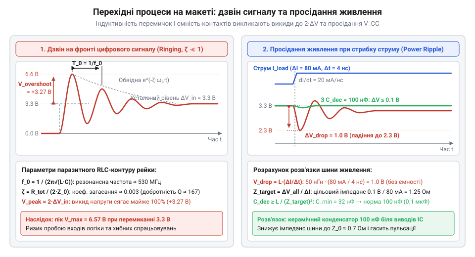
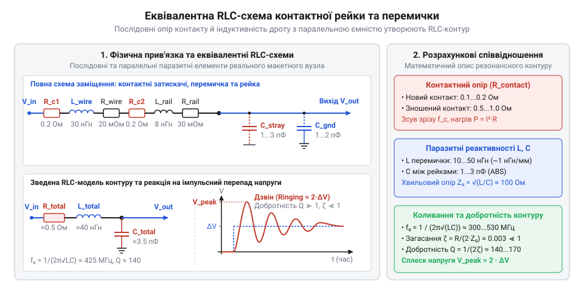

# Еквівалентні RLC-моделі та розрахунок паразитних ефектів макетної плати

<preknowlist>
- [Безпайкові макетні плати (Breadboard)](root:cat-hw-instruments/solderless-breadboard-prototyping) — будова контактних груп, внутрішнє з'єднання рейок та геометричне розміщення площадок макетної плати.
</preknowlist>

## Спотворення сигналу та несподівані осциляції

Складання електронної схеми на [безпайковій макетній платі](root:cat-hw-instruments/solderless-breadboard-prototyping) створює ілюзію точного відтворення принципової схеми: деталі з'єднані провідниками, а струм протікає тими самими вузлами, що й на кресленні. Проте під час підключення осцилографа до відлагодженого низькочастотного фільтра чи цифрового вузла форма реального сигналу часто зазнає суттєвих спотворень. Частота зрізу фільтра зсувається від розрахованого значення, на прямокутних імпульсах виникають високі сплески напруги та тривалий @@en|ringing@@ (англ. @@en|ringing@@, від давн.-англ. @@ang|hringan@@ — «дзвеніти»), а в шині живлення з'являються небажані пульсації напруги при кожному перемиканні логічних елементів.


*Підпис: Осцилограми перехідного процесу в колах макетної плати: виникнення високочастотного дзвону на фронтах сигналу та пульсацій напруги живлення через ненавмисні резонансні контури.*

Причина таких відхилень полягає в тому, що реальна макетна плата складається не з ідеальних невагомих зв'язків, а з фізичних металевих контактних пелюсток та пластикового корпусу. Кожен елемент конструкції має власні приховані @@en|parasitic parameters@@ (від грец. @@grc|параситос@@ — «утриманець, той, що їсть поруч»). Притискні пелюстки створюють послідовний @@en|contact resistance@@, паралельні металеві рейки утворюють @@en|stray capacitance@@ через шар діелектрика, а довгі дрібні дріти-перемички демонструють власну @@en|parasitic inductance@@.


*Підпис: Еквівалентна RLC-схема заміщення контактної групи безпайкової макетної плати та перемички з урахуванням паразитних опорів, ємностей і індуктивностей.*

Для аналізу цих явищ фізичні провідники макету замінюють схемою із зосередженими параметрами — @@en|equivalent circuit@@ (від лат. @@la|aequus@@ — «рівний» та @@la|valere@@ — «мати силу»). Така схема перетворює звичайний контактний вузол на складне RLC-коло, де послідовний опір контакту та індуктивність дріт-перемички утворюють паразитна послідовну ланцюжок, а ємність між рейками замикає високочастотні струми на сусідні кола або спільну шину. Математичне моделювання цих паразитних елементів дозволяє заздалегідь оцінити межі частотного діапазону макету та запобігти самозбудженню розроблюваної схеми.

## Контактний опір та частота зрізу

Притискна контактна група макетної плати виготовляється з пружної фосфористої бронзи або нікельованого латунного сплаву. При вставлянні виводу компонента чи монтажної перемички металеві пелюстки стискають провідник, створюючи фізичну точку дотику. Опір цього з'єднання — @@en|contact resistance@@ (від лат. @@la|contactus@@ — «дотик») — у нових і чистих макетних платах становить від `0.1 Ом` до `0.2 Ом`. З часом унаслідок окиснення металу, потрапляння пилу або ослаблення пружинних пелюсток через вставляння виводів збільшеного діаметра опір одного контакту зростає до `0.5 Ом` і більше.

У реальному макеті струм проходить крізь декілька послідовних з'єднань: вивід компонента, контактну пелюстку, внутрішню шину та перемичку. Сумарний @@en|parasitic resistance@@ `R_contact` додається послідовно до власних опорів схемних елементів. Для високовольтних чи високоомних кіл такий додаток непомітний, але у низькоомних кола пасивного @@en|RC filter@@ (від лат. @@la|filtrum@@ — «повсть для цідження») він викликає розрахунковий зсув частоти зрізу. Ідеальна @@en|cutoff frequency@@ аналогового фільтра першого порядку обчислюється за формулою:

```
f_c = 1 / (2 · π · R_ideal · C_ideal)
```

Враховуючи послідовне включення додаткового контактного опору `R_contact`, фактичний опір резистивного плеча дорівнює `R_total = R_ideal + R_contact`. Тоді реальна частота зрізу `f_c_real` визначається як:

```
f_c_real
= 1 / (2 · π · R_total · C_ideal)               [підстановка сумарного опору]
= 1 / (2 · π · (R_ideal + R_contact) · C_ideal)  [розкриття сумарного опору]
```

Оскільки `R_total > R_ideal`, фактична частота зрізу завжди нижча за розраховану ідеальну величину. Відносна похибка частоти зрізу `δf_c` прямо залежить від співвідношення опору контакту до номінального опору резистора:

```
δf_c
= (f_c_real - f_c) / f_c                         [визначення відносної похибки]
= (R_ideal / (R_ideal + R_contact)) - 1          [спрощення математичного виразу]
= - R_contact / (R_ideal + R_contact)            [зведення до спільного знаменника]
```

При використанні високоомних резисторів (наприклад, `R_ideal = 100 кОм`) контактний опір `0.5 Ом` створює мізерну похибку нижче `0.0005%`. Проте для високочастотних або низькоомних фільтрів у колах з узгодженням імпедансу `50 Ом` на [великих макетних платах](root:cat-hw-instruments/breadboard-large) послідовний опір контактів суттєво викривляє АЧХ.

**Обчислення зсуву частоти зрізу низькочастотного RC-фільтра та падіння напруги**
Нехай у колі аналогового фільтра використовується резистор `R_ideal = 50 Ом` та конденсатор `C_ideal = 1 нФ`. Схема зібрана на макетній платі з чотирма контактними переходами та перемичкою із загальним опором `R_contact = 0.8 Ом`.

```
f_c_ideal
= 1 / (2 · π · 50 · 10⁻⁹)
= 1 / (3.14159 × 10⁻⁷)                          [підстановка ідеальних параметрів]
≈ 3.18309 × 10⁶ Гц                               [ідеальна частота зрізу 3.183 МГц]

R_total
= 50 + 0.8
= 50.8 Ом                                        [додавання контактного опору]

f_c_real
= 1 / (2 · π · 50.8 · 10⁻⁹)
= 1 / (3.19185 × 10⁻⁷)                          [підстановка реального опору кола]
≈ 3.13296 × 10⁶ Гц                               [фактична частота зрізу 3.133 МГц]

Δf_c
= 3.13296 × 10⁶ - 3.18309 × 10⁶
= -5.013 × 10⁴ Гц                                [абсолютний зсув частоти на -50.13 кГц]

δf_c
= (-5.013 × 10⁴) / (3.18309 × 10⁶) × 100%
≈ -1.57%                                         [відносна похибка частоти зрізу]
```

У результаті контактний опір зсунув частоту зрізу фільтра на `50.13 кГц` вбік низьких частот. Окрім частотного зсуву, @@en|contact resistance@@ накладає обмеження на струмовий режим. При проходженні постійного струму `I = 1.5 А` через контакт з опором `0.5 Ом` падіння напруги на ньому становить `ΔV = I · R_contact = 0.75 В`, а виділена теплова потужність `P = I² · R_contact = 1.125 Вт` призводить до локального нагріву пелюсток, прискореного окиснення металу та втрати пружності контакту. На [компактних міні-платах](root:cat-hw-instruments/breadboard-mini) через меншу масу металу цей нагрів є особливо критичним.

## Міжрейкова ємність та перехресні завади

Конструкція безпайкової макетної плати містить масив паралельних металевих контактних рейок, розділених пластиковим ізолятором з пружного ABS-пластику. Два суміжні металеві провідники довжиною близько `45 мм`, розташовані на відстані `2.54 мм` один від одного, утворюють конструктивний плоский конденсатор. Величина цієї паразитної ємності між сусідніми рейками — @@en|stray capacitance@@ (від лат. @@la|capacitas@@ — «місткість») — становить від `1.0 пФ` до `3.0 пФ` залежно від висоти пелюсток та діелектричної проникності пластику `ε_r ≈ 2.8–3.2`. Між рейками, розділеними однією проміжною доріжкою, ємність зменшується до `0.2–0.5 пФ`.

На постійному струмі та низьких частотах така ємність виступає розривом кола. Проте з ростом частоти сигналів ємнісний опір реактивного зв'язку `Z_Cp` стрімко падає за законом `Z_Cp = 1 / (2 · π · f · C_p)`. На частоті `10 кГц` для ємності `2 пФ` реактивний опір становить близько `7.96 МОм`, що практично не впливає на роботу схеми. На частоті `10 МГц` цей опір знижується до `7.96 кОм`, створюючи обхідний шлях для високочастотного струму витоку між сусідніми провідниками.

Цей ємнісний зв'язок є головною причиною виникнення міжканальних завад — @@en|crosstalk@@ (англ. @@en|crosstalk@@). Якщо по одній рейці (лінії-агресору) передається високочастотний або імпульсний сигнал `V_aggressor(t)`, то через міжрейкову ємність `C_p` на сусідню сигнальну рейку (лінію-жертву) протікає струм витоку. Схема взаємодії еквівалентна дільнику напруги високих частот, утвореному паразитною ємністю `C_p` та опором навантаження лінії-жертви `R_victim` відносно спільного провідника. Коефіцієнт передачі паразитної напруги завади `K_xtalk` обчислюється з виразу:

```
K_xtalk
= V_victim / V_aggressor                        [визначення коефіцієнта передачі]
= R_victim / √(R_victim² + Z_Cp²)                 [дільник напруги з реактивним опором]
= (2 · π · f · C_p · R_victim) / √(1 + (2 · π · f · C_p · R_victim)²) [підстановка ємнісного опору]
```

Для випадків, коли опір навантаження лінії-жертви є високим, а частота сигналу досягає кількох мегагерц, амплітуда завади стає порівнянною з амплітудою корисного сигналу.

**Розрахунок амплітуди перехресної завади на високоомному навантаженні**
Нехай по рейці-агресору передається прямокутний тактовий сигнал з амплітудою `V_aggressor = 3.3 В` та першою гармонікою на частоті `f = 5 МГц`. Паразитна ємність між сусідніми рейками дорівнює `C_p = 2.5 пФ`, а лінія-жертва підключена до високоомного входу аналогового підсилювача з опором `R_victim = 10 кОм`.

```
ω
= 2 · π · f
= 2 · 3.14159 · 5 × 10⁶
≈ 3.14159 × 10⁷ рад/с                           [кругова частота агресорного сигналу]

Z_Cp
= 1 / (ω · C_p)
= 1 / (3.14159 × 10⁷ · 2.5 × 10⁻¹²)
= 1 / (7.85398 × 10⁻⁵)
≈ 12732.4 Ом                                    [ємнісний опір зв'язку на частоті 5 МГц]

K_xtalk
= 10000 / √(10000² + 12732.4²)
= 10000 / √(100000000 + 162114000)              [підстановка опорів у дільник]
= 10000 / √262114000
= 10000 / 16190.0
≈ 0.61767                                       [коефіцієнт передачі на лінію-жертву]

V_victim
= K_xtalk · V_aggressor
= 0.61767 · 3.3
≈ 2.0383 В                                      [амплітуда паразитної напруги завади]
```

Розрахунок показує, що понад `61%` амплітуди напруги агресора (`2.04 В`) наводиться на сусідній високоомній лінії у вигляді паразитної завади, що повністю порушує роботу аналогового тракту.

Для зменшення міжрейкового наведення застосовують правильне просторове планування макету:
1. Залишають вільну приземлену рейку (екранний провідник) між високочастотними цифровими лініями та чутливими аналоговими входами. 2. Зменшують опір навантаження лінії-жертви `R_victim` за допомогою низькоомних підтяжок, що шунтують наведену заваду на землю. 3. Для чутливих високочастотних та радіочастотних схем переходять від безпайкового макетування до монтажу на [макетних платах під пайку (Stripboard)](root:cat-hw-instruments/perfboard-and-stripboard) з суцільним екрануючим шаром фольги.

## Індуктивність перемичок та паразитна RLC-модель

Під час збирання схем на [безпайкових макетних платах](root:cat-hw-instruments/solderless-breadboard-prototyping) гнучкі монтажні дріти-перемички сприймаються як ідеальні П-подібні провідники з нульовим опором. Проте при роботі з імпульсними сигналами та високочастотними коловими швидкостями прямолінійний шматок провідника проявляє власну @@en|parasitic inductance@@ (від лат. @@la|inductio@@ — «наведення»). Власна @@en|self-inductance@@ одиночного прямого провідника довжиною `l` та радіусом перерізу `r` визначається магнітним потоком, що охоплює провідник при проходженні струму. Для стандартних перемичок діаметром `0.5 мм` (AWG 24) орієнтовне значення індуктивності становить близько `1 нГн` на один міліметр довжини. Тобто дріт довжиною від `10 мм` до `50 мм` додає в коло паразитну індуктивність `L_wire` у діапазоні від `10 нГн` до `50 нГн`.

Об'єднання всіх паразитних елементів вузла — контактного опору пелюсток `R_contact`, міжрейкової ємності `C_stray` та індуктивності монтажного дроту `L_wire` — утворює повну @@en|equivalent circuit@@ із зосередженими параметрами. Послідовно з'єднані контактні опори та індуктивність перемички разом із паралельною ємністю контактних майданчиків утворюють класичний послідовний RLC-контур. На низьких частотах реактивний опір індуктивності `X_L = 2 · π · f · L` є мізерним, але з ростом частоти або при крутих фронтах сигналів цей контур входить у стан резонансу.

Власна незатухаюча @@en|resonant frequency@@ (від лат. @@la|resonans@@ — «відгукуючий») `f_0` утвореного коливального контуру обчислюється за формулою Томсона:

```
f_0 = 1 / (2 · π · √(L · C))
```

Для оцінки стійкості схеми та швидкості згасання коливань обчислюють @@en|characteristic impedance@@ `Z_0` (від лат. @@la|impedire@@ — «перешкоджати») і безрозмірний @@en|damping factor@@ `ζ` (від нім. @@de|Dämpfung@@ — «згасання»):

```
Z_0 = √(L / C)
```

```
ζ
= R_total / (2 · Z_0)                             [визначення коефіцієнта загасання]
= R_total / (2 · √(L / C))                        [підстановка характеристичного імпедансу]
```

Якщо `ζ < 1`, контур перебуває в коливальному режимі (недозагашений стан). Оскільки сумарний контактний опір `R_total` на макетній платі зазвичай не перевищує `0.5–1.0 Ом`, а характеристичний імпеданс `Z_0` становить понад `100 Ом`, коефіцієнт загасання виявляється надзвичайно малим (`ζ << 1`). Це означає, що @@en|quality factor@@ `Q` (від лат. @@la|qualitas@@ — «якість») утвореного контуру `Q = 1 / (2 · ζ)` сягає сотень одиниць, перетворюючи звичайне з'єднання на гострорезонансний фільтр.

**Розрахунок резонансної частоти та добротності RLC-контуру макетного вузла**
Нехай перемичка довжиною `30 мм` має індуктивність `L = 30 нГн`, міжрейкова паразитна ємність вузла становить `C = 3 пФ`, а сумарний опір двох контактів та провідника дорівнює `R_total = 0.6 Ом`.

```
f_0
= 1 / (2 · π · √(30 × 10⁻⁹ · 3 × 10⁻¹²))
= 1 / (2 · π · √(9 × 10⁻²⁰))                     [добуток індуктивності та ємності]
= 1 / (2 · π · 3 × 10⁻¹⁰)                        [добування квадратного кореня]
= 1 / (1.88496 × 10⁻⁹)
≈ 5.30516 × 10⁸ Гц                               [резонансна частота 530.52 МГц]

Z_0
= √(30 × 10⁻⁹ / 3 × 10⁻¹²)
= √10000
= 100 Ом                                         [характеристичний імпеданс контуру]

ζ
= 0.6 / (2 · 100)
= 0.6 / 200
= 0.003                                          [коефіцієнт загасання контуру]

Q
= 1 / (2 · 0.003)
= 1 / 0.006
≈ 166.67                                         [добротність паразитного контуру]
```

Розрахунок показує, що вузол макетної плати має високу добротність `Q ≈ 167` і резонансну частоту понад `530 МГц`. При підключенні реальних компонентів або вхідної ємності вимірювальних приладів (наприклад, `10–15 пФ`) резонансна частота зміщується в діапазон `100–200 МГц`, де активні високочастотні напівпровідникові елементи можуть легко збуджуватися й втрачати стабільність.

Небезпека таких резонансних піків полягає в тому, що на резонансній частоті реактивний опір індуктивності провідника `X_L` повністю компенсується реактивним опором паразитної ємності `X_C`. У результаті імпеданс RLC-контуру стає суто активним і знижується до величини контактного опору `R_total`, що спричиняє сплеск коефіцієнта підсилення сигналу у `Q` разів. Якщо спектр гармонік прямокутного сигналу або спектральні складові шуму підсилювача збігаються з @@en|resonant frequency@@ утвореного вузла, в системі виникає спонтанне самозбудження — @@en|self-oscillation@@ (від лат. @@la|oscillare@@ — «коливатися»). У високонавантажених аналогових операційних підсилювачах чи швидкісних компараторах це призводить до генерації паразитної високочастотної сітки завад або спотворення передавальної амплітудно-частотної характеристики, роблячи точні вимірювання на [безпайкових макетних платах](root:cat-hw-instruments/solderless-breadboard-prototyping) неможливими без додаткового демпфування.

## Амплітуда звона та пульсацій живлення

Наявність високодобротного RLC-контуру у вузлах макету проявляється під час перехідних процесів. Коли цифрова мікросхема або силовий транзистор перемикає стан, перепади напруги викликають @@en|transient response@@ (від лат. @@la|transiens@@ — «перехідний»). У недозагашеній системі (`ζ << 1`) скачок напруги амплітудою `ΔV_in` збуджує згасаючі високочастотні осциляції — @@en|ringing@@ (англ. @@en|ringing@@). Перший перерегульований пік напруги — @@en|overshoot@@ (англ. @@en|overshoot@@) — визначає максимальне значення сплеску напруги `V_peak`:

```
V_peak
= ΔV_in · (1 + e^(-π · ζ / √(1 - ζ²)))           [амплітуда першого піку дзвону]
```

Оскільки для макетної плати `ζ ≈ 0.003`, величина `e^(-π · ζ) ≈ 0.99`. Це означає, що відносна амплітуда сплеску досягає майже `100%` від величини перепаду напруги, а сумарна напруга на контактній рейці у момент перемикання майже подвоюється (`V_max ≈ 2 · ΔV_in`).

**Обчислення пікової амплітуди дзвону на фронті цифрового сигналу**
Аналогово-цифровий перетворювач живиться від джерела `3.3 В`. При формуванні прямокутного імпульсу з амплітудою `ΔV_in = 3.3 В` у колі з коефіцієнтом загасання `ζ = 0.003` обчислимо максимальну напругу сплеску.

```
V_overshoot
= 3.3 · e^(-3.14159 · 0.003 / √(1 - 0.003²))
= 3.3 · e^(-0.009425 / 0.999995)
= 3.3 · e^(-0.009425)                           [обчислення показника експоненти]
≈ 3.3 · 0.99062
≈ 3.269 В                                       [амплітуда паразитного перерегулювання]

V_max
= 3.3 + 3.269
= 6.569 В                                       [пікове значення напруги на рейці]
```

Сплеск напруги до `6.57 В` перевищує максимально допустиму напругу для багатьох `3.3 В` логічних елементів, викликаючи хибні спрацьовування або відкриття захисних діодів.

Окрім сигнальних ліній, паразитні RLC-параметри критично впливають на шини живлення. При логічному перемиканні мікросхема споживає короткочасний імпульс струму `ΔI` тривалістю `Δt`. Через паразитна індуктивність провідників живлення `L_rail` виникає індуктивне падіння напруги `V_drop = L_rail · (ΔI / Δt)`. На шині живлення утворюється просідання напруги та пульсації — @@en|power supply ripple@@.

Для придушення пульсацій і дзвону безпосередньо біля виводів живлення мікросхеми встановлюють @@en|decoupling capacitor@@ (від лат. @@la|capax@@ — «місткий»). Він виконує дві функції: забезпечує локальний накопичувач заряду для імпульсного струму та зменшує характеристичний імпеданс шини живлення `Z_0`, знижуючи добротність контуру. Мінімальна ємність розв'язувального конденсатора `C_decoupling` розраховується з двох умов: забезпечення заряду під час спалаху струму та обмеження допустимого падіння напруги `ΔV_allowed`:

```
C_decoupling ≥ (ΔI · Δt) / ΔV_allowed
```

Для повного придушення індуктивного сплеску ємність також повинна знижувати характеристичний імпеданс шини до цільового значення `Z_target = ΔV_allowed / ΔI`:

```
C_decoupling ≥ L_rail / (Z_target)² = L_rail · (ΔI / ΔV_allowed)²
```

**Розрахунок мінімальної ємності розв'язувального конденсатора для шини живлення**
Мікросхема на макетній платі підключена через перемичку живлення з індуктивністю `L_rail = 50 нГн`. При перемиканні вона споживає імпульс струму `ΔI = 80 мА` протягом `Δt = 4 нс`. Необхідно втримати пульсації живлення в межах `ΔV_allowed = 0.1 В` для лінії `3.3 В`.

```
V_drop_no_cap
= 50 × 10⁻⁹ · (0.08 / 4 × 10⁻⁹)
= 50 × 10⁻⁹ · (2 × 10⁷)
= 1.0 В                                         [падіння напруги без конденсатора]

C_charge
= (0.08 · 4 × 10⁻⁹) / 0.1
= (3.2 × 10⁻¹⁰) / 0.1
= 3.2 × 10⁻⁹ Ф
= 3.2 нФ                                        [мінімальна ємність за зарядом]

Z_target
= 0.1 / 0.08
= 1.25 Ом                                       [допустимий імпеданс шини живлення]

C_target
= 50 × 10⁻⁹ / (1.25)²
= 50 × 10⁻⁹ / 1.5625
= 3.2 × 10⁻⁸ Ф
= 32 нФ                                         [мінімальна ємність за імпедансом]
```

Без розв'язувального конденсатора падіння напруги становить `1.0 В` (живлення падає з `3.3 В` до `2.3 В`), що викликає збій мікроконтролера. Обчислення за імпедансом вимагає ємності щонайменше `32 нФ`. Вибір стандартного керамічного конденсатора `C_decoupling = 100 нФ` (0.1 мкФ) з низьким @@en|equivalent series resistance@@ (ESR) зменшує імпеданс шини до `Z_0 = √(50·10⁻⁹ / 100·10⁻⁹) ≈ 0.707 Ом` і знижує пульсації до `ΔV ≈ 56.6 мВ`.

Для мінімізації паразитних ефектів при макетуванні дотримуються правил:
1. Використовують найкоротші перемички, притиснуті до поверхні плати для зменшення площі індуктивної петлі. 2. Встановлюють розв'язувальні керамічні конденсатори `100 нФ` безпосередньо біля ніжок живлення кожної мікросхеми на [безпайковій макетній платі](root:cat-hw-instruments/solderless-breadboard-prototyping). 3. При роботі зі швидкісною логікою чи чутливими аналоговими трактами переходять на [макетні плати під пайку](root:cat-hw-instruments/perfboard-and-stripboard) із суцільним шаром заземлення.