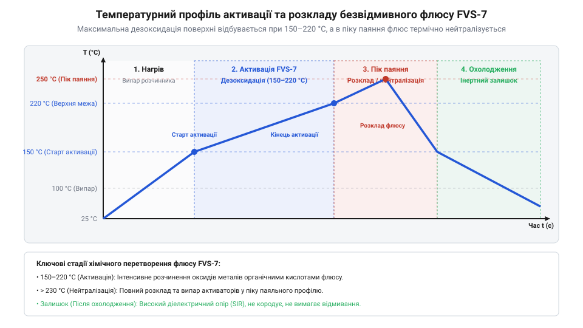
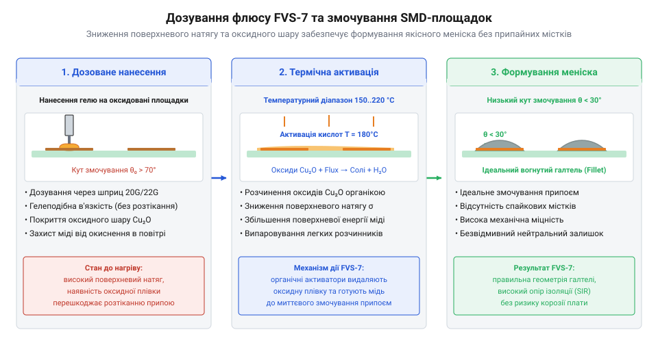
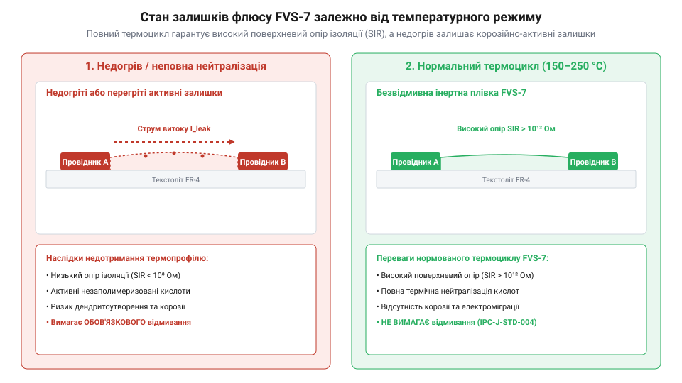

# Флюс FVS-7 (безвідмивний)

<preknowlist>
- [Припій / олово](root:cat-hw-instruments/solder-tin) — склад і температури плавлення припоїв, механізми змочування металевих поверхонь та утворення інтерметалідів
- [Паяльник USB TK-USB-DS (5 В, 260–420 °C)](root:cat-hw-instruments/usb-soldering-iron) — принципи контактного теплопередавання від тисну, регулювання робочої температури та догляд за жалом паяльника
- [Термофен BAKU BK-8033](root:cat-hw-instruments/hot-air-station-baku) — методики безконтактного термоповітряного нагріву та формування температурного профілю при монтажі та реворку
</preknowlist>

## Проблема окиснення та утворення містків

Під час контакту розігрітого металу з атмосферним повітрям відбувається швидка хімічна реакція окиснення. При температурі нагріву 200–250 °C кінетична швидкість утворення оксидного шару міді досягає 2–5 нм/с, через що на поверхні контактних площадок друкованої плати та виводах радіокомпонентів за лічені секунди виростає щільна плівка оксидів міді Cu₂O та CuO, яка перешкоджає прямому розчиненню та змочуванню металу рідким припоєм. Молекули слабоорганічних дикарбонових кислот у складі флюсу при досягненні температури активації дисоціюють із виділенням активних карбоксильних груп -COOH, які вступають у пряму хімічну реакцію з оксидним шаром. Кислотні карбоксили розчиняють оксиди Cu₂O та CuO з утворенням легкоплавких розчинних солей карбоксилатів міді Cu(R-COO)₂ та водяної пари H₂O, оголюючи чисту металеву мідь Cu. Якщо спробувати виконати паяння без спеціального середовища, когезія (від латинського *cohaesus* — «зв'язаний») `@@en|cohesion@@` усередині розплавленого припою переважатиме над адгезією (лат. *adhaesio* — «прилипання») `@@en|adhesion@@` до окисненої міді. У результаті рідка фаза розплаву [припою](root:cat-hw-instruments/solder-tin) згортається у сферичні краплі, утворюючи дефекти незмочування, сухі пайкові з'єднання та хаотичні містки з припою між сусідніми виводами мікросхем.

Перехід електронної промисловості від класичних каніфольних та сильноактивних кислотних складів до безвідмивних рецептур низького вмісту сухого залишку був зумовлений жорсткими екологічними стандартами щодо відмови від фреонових розчинників та стрімким зростанням щільності `@@en|SMD@@`-монтажу. Усунення етапу обов'язкового миття друкованих плат вимагало розробки синтетичних смол та слабоорганічних активаторів, які після проходження термоциклу залишаються повністю діелектрично інертними. Саме у відповідь на цей технологічний виклик було розроблено рецептуру `@@en|FVS-7@@`, яка поєднує високу розчиняльну здатність щодо оксидів із повною корозійною безпекою залишків.

Використання безвідмивного флюсу `@@en|FVS-7@@` (лат. *fluxus* — «потік») `@@en|no-clean flux@@` вирішує проблему окиснення у двох напрямках. Спочатку його активні компоненти вступають у хімічну реакцію з оксидами міді й олова, відновлюючи чистий метал або переводячи оксиди у легкоплавкі розчинні солі. Одночасно рідка фаза флюсу покриває контактну зону суцільною плівкою, ізолюючи гарячий метал від кисню та суттєво знижуючи поверхневий натяг `@@en|surface tension@@` рідкого припою — з 490 дин/см на межі розплаву з повітрям до 200–250 дин/см під покриттям флюсу `@@en|FVS-7@@`. Таке падіння міжфазної енергії різко зменшує крайовий кут змочування `@@en|contact angle@@`, завдяки чому рідкий [припій](root:cat-hw-instruments/solder-tin) рівномірно розтікається по площадці, утворюючи міцну інтерметалеву матрицю та правильний увігнутий меніск без ризику короткого замикання.

## Хімічний склад та температурна активація

Ефективність флюсу `@@en|FVS-7@@` базується на збалансованій багатокомпонентній системі. Його основу складають високоочищені синтетичні смоли з модифікованою температурою плавлення, слабоорганічні дикарбонові кислоти у ролі активаторів та висококиплячі спиртові розчинники. На відміну від агресивних водорозчинних флюсів, за [хімічною класифікацією безвідмивних флюсів](root:cat-hw-instruments/no-clean-fluxes-chemistry-and-classification) дана рецептура відноситься до класу матеріалів із низьким вмістом сухого залишку. Це означає, що при нагріванні більшість летких речовин повністю випаровується, а залишки смоляного матриксу втрачають хімічну активність.

Температурна активація `@@en|FVS-7@@` відбувається строго послідовно під час проходження термопрофілю. При нагріванні до 100–130 °C випаровується легколеткий розчинник, забезпечуючи рівномірний розподіл в'язкої речовини по контактних майданчиках. У діапазоні 150–220 °C відбувається фаза максимальної хімічної активності: слабоорганічні кислоти розплавляються та активно руйнують оксидні плівки. При подальшому підйомі температури до пікових 230–250 °C під час роботи з [паяльником USB](root:cat-hw-instruments/usb-soldering-iron) активатори виснажуються та розкладаються, а модифікована смола утворює інертний герметичний захисний шар.

*Графік температурної активації флюсу FVS-7 у часі з позначенням зон випаровування розчинника, очищення оксидів та термодеструкції активаторів.*

Недотримання часово-температурного бюджету призводить до технологічного браку. Занадто тривалий попередній нагрів виснажує активатори до моменту плавлення припою, викликаючи повторне окиснення. Натомість надмірне перевищення пікової температури призводить до обуглювання смоли та утворення темних струмопровідних включень. Детальний математичний аналіз кінетики активації та розрахунок допустимого часового вікна викладено у розділі про [розрахунок термічного бюджету флюсу](root:cat-hw-instruments/flux-fvs7/math-flux-thermal-budget-and-wetting.md).

Критичним параметром термопрофілю є швидкість підйому температури — термоградієнт `@@en|thermal gradient@@` (dT/dt). Занадто високий градієнт (понад 3–4 °C/с) спричиняє вибухове закипання розчинника та розбризкування флюсу, тоді як занадто повільний нагрів (менше 0.5–1 °C/с) призводить до передчасної термодеструкції та випаровування дикарбонових кислот ще до моменту плавлення припою. Оптимальний термоградієнт у межах 1–2 °C/с забезпечує плавне видалення розчинника й утримує кислотні активатори у стані максимальної хімічної активності безпосередньо в момент формування пайкового контакту.

Після завершення фази активації та випаровування спиртового носія вирішальну роль відіграє підсумковий об'єм речовин, що залишаються на виводах компонентів. Згідно з промисловими стандартами, склад відноситься до категорії низькозалишкових флюсів `@@en|low-residue flux@@`, якщо масова частка сухого залишку `@@en|solids content@@` у ньому не перевищує 2–5% (у рецептурі `@@en|FVS-7@@` вона становить близько 2.5–3%). Для порівняння, традиційні каніфольні флюси залишають від 15% до 35% твердих речовин. Настільки низький вміст сухого залишку гарантує, що після проходження термічного циклу мікроскопічна плівка модифікованої смоли повністю капсулює неактивні залишки дикарбонових кислот, запобігаючи утворенню липкого шару та накопиченню пилу.

У фазі попереднього нагріву при досягненні 100–130 °C відбувається інтенсивне випаровування легколеткої фракції спиртового розчинника, що супроводжується істотною зміною фізичних властивостей рідкої фази. Початковий розчин з питомою густиною `@@en|specific gravity@@` близько 0.80–0.82 г/см³ стрімко втрачає легколеткий носій, унаслідок чого питома густина залишкового рідкого концентрату зростає до 0.95–1.05 г/см³. Це виштовхує мікробульбашки повітря та формує на контактних площадочках суцільний, висококонцентрований шар смоляно-кислотного матриксу безпосередньо перед початком його хімічної активації.

## Практика нанесення та дозування флюсу

Успіх застосування `@@en|FVS-7@@` у монтажно-ремонтних роботах залежить від правильно обраного методу дозування та в'язкості матеріалу. Флюс випускається у формі рідких розчинів для пензлів і флюс-маркерів, а також у вигляді в'язкого гелю в шприцах-картриджах для дозаторів. Для виводних елементів та широких контактних майданчиків застосовують рідку форму, тоді як для паяння дрібнокрокових мікросхем у корпусах `@@en|QFP@@` та `@@en|BGA@@` необхідний тиксатропний гель, який утримується на площадках під дією високої температури.

Під час проведення монтажних робіт із залученням [термофена BAKU](root:cat-hw-instruments/hot-air-station-baku) гелеподібний `@@en|FVS-7@@` наносять тонким шаром безпосередньо на контактні площадки за допомогою дозувальних голок шприца. Для дрібнокрокових виводів із кроком 0.4–0.5 мм застосовують голки з внутрішнім діаметром нозика 0.25–0.41 мм (калібри G25–G27), які дають змогу сформувати точну мікродозу об'ємом 0.05–0.1 мкл на один контактний майданчик без затікання на сусідні елементи. Для стандартних `@@en|SMD@@`-компонентів із кроком від 0.8 мм використовують голки з діаметром нозика 0.51–0.84 мм (калібри G18–G21), що подають дозу 0.2–0.5 мкл на площадочку. Надлишкове нанесення флюсу є поширеною помилкою: при швидкому нагріванні залишкові розчинники закипають, що призводить до інтенсивного розбризкування мікрокрапель припою та зміщення дрібних `@@en|SMD@@`-компонентів. Натомість недостатня кількість флюсу викликає появу перемичок та розривів у пайковому шві.

*Механіка дозованого нанесення гелеподібного флюсу FVS-7 на контактні площадки та подальша динаміка змочування.*

Для складних ремонтних операцій із демонтажу та посадці масивних корпусів розроблено покроковий [технологічний процес реворку BGA та SMD](root:cat-hw-instruments/flux-fvs7/proj-fvs7-bga-smd-rework.md). Крім того, оскільки залишки флюсу взаємодіють із високовольтними та високочастотними коламі, вибір режиму дозування прямо впливає на результати під час проведення [тестування поверхневого опору ізоляції](root:cat-hw-instruments/flux-fvs7/proj-fvs7-sir-testing-and-cleaning.md).

Точність нанесення гелеподібної форми `@@en|FVS-7@@` забезпечується її тиксотропними (від грецького *thixis* — «дотик» та *trope* — «зміна») `@@en|thixotropic@@` властивостями. У стані спокою в шприці-картриджі гель володіє високою в'язкістю (близько 150–250 Па·с), що унеможливлює його самовільне витікання. Під дією зсувного напруження `@@en|shear stress@@`, яке виникає під тиском плунжера під час вискакування крізь тонку дозувальну голку, відбувається зсувне розрідження `@@en|shear thinning@@` — в'язкість гелю динамічно падає до 15–30 Па·с, забезпечуючи плавну та легку екструзію. Одразу після припинення дії зсувного зусилля в'язкість матеріалу миттєво відновлюється до початкових 150–250 Па·с, завдяки чому мікродоза флюсу чітко утримується на контактних площадках без розтікання на сусідні виводи.

## Поведінка залишків та оцінка чистоти

Після завершення пайкового циклу на поверхні друкованої плати утворюється тонка прозора плівка термостабілізованого смоляного матриксу. За умови дотримання рекомендованого температурного профілю активні слабоорганічні дикарбонові кислоти повністю зв'язуються смолою або термічно розкладаються. Сухий залишок флюсу `@@en|FVS-7@@` має високий діелектричний опір (понад 10¹² Ом) та повну корозійну нейтральність. За звичайних умов експлуатації плівка захищає пайковий шов від атмосферної вологи й не потребує видалення.

Проте під дією постійної підвищеної вологості повітря або при експлуатації у високочастотних та високовольтних колах неякісно відпрацьований залишок може виявляти гігроскопічність (від грецького *hygros* — «вологий» та *skopeo* — «спостерігаю») `@@en|hygroscopicity@@`. Якщо активатори не пройшли повну термічну нейтралізацію через недостатній нагрів, у присутності вологи утворюються вільні іони, які спричиняють електрохімічну міграцію металу та зниження поверхневого опору ізоляції `@@en|SIR@@` (Surface Insulation Resistance). Під дією постійної різниці потенціалів мідь на аноді окиснюється до іонів Cu²⁺, які мігрують крізь зволожений залишок до катода. На катоді іони відновлюються до металу, формуючи ниткоподібні кристалічні нарости — дендрити `@@en|dendrites@@` міді, що проростають назустріч аноду і спричиняють коротке замикання між сусідніми провідниками.

Для об'єктивної оцінки діелектричної стабільності залишків проведення випробувань поверхневого опору ізоляції здійснюють за стандартизованою методикою `@@en|IPC-TM-650@@`. Тестовий купон піддають безперервному кліматичному впливу при відносній вологості 85% та температурі 85 °C із постійно прикладеною вимірювальною напругою 50 В. Стандартна тривалість випробування становить 168 годин (7 діб). Протягом усього 168-годинного тесту під напругою 50 В значення опору повинне утримуватися на рівні понад 10⁸ Ом, підтверджуючи повне припинення іонної міграції та відсутність загрози утворення дендритів.

*Порівняння структурного стану залишків флюсу FVS-7 після повноцінного термоциклу та в разі порушення температурного режиму.*

Для визначення межі між безпечним залишенням плівки та необхідністю її промивки застосовують вимірювання струмів витоку та інструментальний [контроль залишків FVS-7](root:cat-hw-instruments/flux-fvs7/proj-fvs7-sir-testing-and-cleaning.md). Кількісним критерієм чистоти виступає порогове значення допустимого іонного забруднення `@@en|ionic contamination@@`: за стандартом `@@en|IPC-J-STD-001@@` воно не повинно перевищувати 1.56 мкг/см² еквівалента NaCl. Якщо концентрація іонних домішок у залишках флюсу перевищує 1.56 мкг/см², або у разі використання плат у медичній, аерокосмічній чи прецизійній вимірювальній техніці, залишки обов'язково видаляють, застосовуючи спеціалізовані [технології промивання та відмивки плат](root:hw-pcb/printed-circuit-boards-post-solder-cleaning-technology) на основі ізопропілового спирту або промивальних рідин.

## Усунення дефектів та безпека роботи

Відхилення від технології використання `@@en|FVS-7@@` призводить до виникнення типових дефектів монтажу. Найпоширенішою проблемою є утворення кульок припою `@@en|solder beads@@` довкола `@@en|SMD@@`-компонентів: унаслідок вибухового закипання вологи з розплаву викидаються дрібні кулясті включення припою діаметром 50–200 мкм, які осідають на захисній масці плати. Цей дефект виникає через занадто товстий шар флюсу або використання матеріалу з простроченим терміном придатності, у якому накопичилась волога. Виправлення цієї проблеми вимагає строгого коригування об'єму нанесення флюсу та використання оптимальних [властивостей і термопрофілів припоїв](root:cat-hw-instruments/solder-paste-and-lead-free-alloys-properties).

Іншим критичним дефектом є утворення темно-коричневих нагарів і шлаків у зоні паяння. Це свідчить про суттєвий перегрів жала паяльника чи термоповітряного струменя вище допустимого порога у 270–300 °C, при якому починається піролітичний розклад смоляного матриксу `@@en|FVS-7@@`. При перевищенні цієї межі вуглеводневі ланцюги смоли деструктують із розривом C-H зв'язків та виділенням вільного аморфного вуглецю, який осідає у вигляді твердого нагару. Смоляна основа обуглюється до струмопровідних вуглецевих містків, знижуючи опір ізоляції з початкових 10¹² Ом до кількох кілоомів. Для усунення нагару контактну зону очищують спиртовим розчинником із механічною обробкою жорсткою кистю, після чого наносять свіжу краплю флюсу та повторюють нагрів при зниженій температурі.

Під час паяння з нагріванням `@@en|FVS-7@@` відбувається інтенсивне випаровування органічних розчинників та термічний розклад дикарбонових кислот. Пар та аерозолі флюсу викликають подразнення слизових оболонок очей та дихальних шляхів. Щоб виключити ризик токсичного впливу, нормативна гранично допустима концентрація (ГДК) `@@en|permissible exposure limit@@` випарів органічних розчинників у повітрі робочої зони не повинна перевищувати 10 мг/м³. Для строгого дотримання цієї норми робоче місце повинне бути обов'язково обладнане локальною витяжною вентиляцією або димоуловлювачем із вугільним фільтром. Шприци-картриджі з гелем слід зберігати у герметично закритій тарі при температурі 5–15 °C подалі від джерел ультрафіолетового випромінювання.
