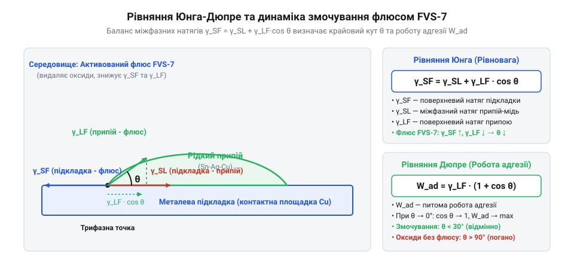

# Розрахунок термічного бюджету флюсу та динаміки змочування

<preknowlist>
- [Припій / олово](root:cat-hw-instruments/solder-tin) — Знання температур плавлення евтектичних та безсвинцевих сплавів і загальних принципів змочування.
</preknowlist>

## Проблема деструкції та виснаження флюсу

Під час оплавлення паяльної пасти або безвідмивного рідкого флюсу FVS-7 на поверхнях мідних контактних майданчиків та виводів компонентів завжди присутній шар природних оксидів. Головне завдання флюсу — хімічно зв'язати й видалити ці оксиди за підвищеної температури, забезпечивши безпосередній металевий контакт для рідкого розплаву. Проте активні компоненти флюсу (органічні кислоти та @@en|activators@@) виснажуються в міру перебігу хімічних реакцій та термічного розкладу. Якщо термопрофіль виходить за межі допустимого технологічного вікна, флюс або втрачає активність до моменту розплавлення припою, або залишає незреаговані агресивні залишки, що викликають подальшу йонну корозію.

Втрата властивостей флюсу відбувається через дві конкуруючі причини: недостатню теплова енергію для розчинення плівки оксидів або передчасну термічну деструкцію органічної основи. Для запобігання дефектам паяння (непровари, кульки припою та високий крайовий кут змочування) необхідно математично розраховувати @@en|thermal budget@@ (термічний бюджет) — інтегральну величину теплового впливу на флюс протягом усього циклу паяння від розігріву до пікової температури. Узгодження термічного бюджету з [температурою плавлення припою](root:cat-hw-instruments/solder-tin) гарантує швидке й повне змочування без утворення корозійнонебезпечних залишків.

Критерій термічної стабільності FVS-7 визначається балансом між каніфольною та силіконовою складовими сполучної матриці: модифіковані каніфольні (@@en|rosin@@) компоненти забезпечують ефективне плівкоутворення та захист від повторної оксидації до 200 °C, проте зазнають швидкої деструкції при вищих температурах, тоді як силіконові (@@en|silicone@@) полімери утримують необхідну в'язкість і захисний бар'єр в інтервалі пікових температур 230–250 °C, запобігаючи передчасному виснаженню активаторів.

Швидкість термічного виснаження флюсу також прямо залежить від товщини нанесеного шару (@@en|layer thickness@@) на контактних майданчиках. Занадто тонкий шар (менше 5–10 мкм) швидко випаровується та виснажується під дією гарячого повітряного потоку, залишаючи мідну поверхню незахищеною до моменту плавлення припою, що призводить до повторного окиснення. Натомість надмірно товстий шар уповільнює прогрів, спричиняє розбризкування припою через інтенсивне кипіння розчинників і залишає значний обсяг непрореагованих компонентів, тому дотримання оптимальної товщини є критичним для збереження розрахованого термічного бюджету.

## Розрахунок інтеграла активації флюсу

Хімічна активність та швидкість деструкції флюсу FVS-7 залежать від температури за експоненційним законом Арреніуса. Швидкість хімічної взаємодії активних компонентів флюсу з оксидами міді описується виразом `k(T) = k₀ · exp(-Eₐ / (R · T))`, де `k₀` — предекспоненційний множник, `Eₐ` — енергія активації хімічної реакції, `R = 8.314` Дж/(моль·К) — універсальна газова стала, а `T` — абсолютна температура в кельвінах.

Повний термічний бюджет `I_act`, накопичений флюсом за час термопрофілювання від початкового моменту `t₁` до завершення фази оплавлення `t₂`, визначається часово-температурним інтегралом:

```
I_act = ∫ exp(-E_a / (R · T(t))) dt
```
[інтеграл термічної активації за часом]

Для лінійного ділянки нагріву зі швидкістю `β = dT/dt` (К/с) від початкової температури `T₁` до пікової температури `T_peak` перейдемо від інтегрування за часом до інтегрування за температурою:

```
I_act = (1 / β) · ∫ exp(-E_a / (R · T)) dT
= (R · T_peak² / (β · E_a)) · exp(-E_a / (R · T_peak))    [асимптотичне наближення інтеграла активації]
```

**Обчислення термічного бюджету для FVS-7:** Для флюсу FVS-7 з енергією активації `E_a = 65.0` кДж/моль (`65000` Дж/моль) та швидкості нагріву `β = 1.5` К/с до пікової температури `T_peak = 503.15` К (`230` °C) обчислимо показниковий аргумент:

```
E_a / (R · T_peak)
= 65000 / (8.314 · 503.15)
= 65000 / 4183.19
= 15.538                                                [безрозмірний енергетичний параметр]
```

Підставляючи отримане значення в наближену формулу термічного бюджету при швидкості нагріву `β = 1.5` К/с, отримуємо значення накопиченого інтеграла активації `I_act ≈ 1.42` с. При збільшенні швидкості нагріву вдвічі — до `β = 3.0` К/с — часовий інтервал перебування в зоні високих температур скорочується, що пропорційно зменшує накопичений термічний бюджет до `I_act ≈ 0.71` с. Таке коригування захищає флюс від передчасного виснаження, адже якщо розрахований термічний бюджет перевищує критичну межу деструкції флюсу `I_max`, органічна матриця виснажується до моменту повного змочування, що призводить до обвуглювання й погіршення розтікання припою.

Додатковий внесок у накопичення термічного бюджету (@@en|thermal budget@@) виникає під час фази ізотермічної витримки (@@en|dwell time@@) при піковій температурі `T_peak`. Упродовж часу витримки `t_peak` температура залишається сталою `T(t) = T_peak`, завдяки чому інтеграл спрощується до лінійного добутку тривалості витримки на сталий коефіцієнт швидкості активації `ΔI_soak = t_peak · exp(-E_a / (R · T_peak))`. Для реального термопрофілю з тривалістю пікової витримки `t_peak = 10` с при температурі `T_peak = 230` °C (503.15 К) цей доданок безпосередньо збільшує сумарний термічний бюджет флюсу ФВС-7. Ігнорування ізотермічного проміжку в розрахунках створює хибне враження безпечності термопрофілю, адже саме при тривалій витримці на піковій температурі вичерпується резерв інертної каніфольної матриці, підвищується в'язкість залишків та прискорюється процес термічної деструкції органічних кислот.

## Динаміка розтікання та поверхневий натяг

Після видалення оксидного шару вирішальним чинником у формуванні паяного з'єднання є кінетика розтікання рідкого припою. Стан рівноваги краплі припою на твердій поверхні контактної площадки під шаром рідкого флюсу описується рівнянням Юнга-Дюпре:

```
γ_SF = γ_SL + γ_LF · cos(θ)
```
[рівняння рівноваги сил поверхневого натягу Юнга-Дюпре]

Виразимо з цього рівняння косинус рівноважного крайового кута змочування `θ`:

```
cos(θ) = (γ_SF - γ_SL) / γ_LF
```
[рівноважний крайовий кут змочування]

Тут `γ_SF` — питома вільна поверхнева енергія на межі тверда підкладка–флюс, `γ_SL` — поверхневий натяг на межі тверда підкладка–рідкий припій, а `γ_LF` — поверхневий натяг на межі рідкий припій–рідкий флюс.


*Баланс векторів поверхневого натягу визначає рівноважний крайовий кут змочування та повноту розтікання краплі припою.*

Результуюча сила змочування `F_w` на одиницю довжини периметра контакту становить:

```
F_w = γ_LF · cos(θ)
= γ_SF - γ_SL                                            [рушійна сила змочування]
```

Очищення поверхні міді флюсом FVS-7 різко збільшує значення `γ_SF` (з `0.2` Дж/м² для оксиду до `1.3` Дж/м² для чистої міді) та зменшує міжфазний натяг `γ_LF`. Це забезпечує умову `cos(θ) → 1`, тобто крайовий кут змочування зменшується з `θ > 90°` (незмочування) до `θ < 15°` (відмінне змочування та розтікання припою). Швидкість досягнення цього рівноважного кута обмежується динамічною в'язкістю (@@en|dynamic viscosity@@) розплавленого флюсу: висока в'язкість створює гідродинамічний опір руху фронту змочування, затримуючи розтікання припою на десятки мілісекунд, тоді як температурне зниження в'язкості FVS-7 при оплавленні забезпечує миттєве встановлення мінімального крайового кута.

Додатковим чинником, що визначає підсумковий коефіцієнт розтікання (@@en|spreading coefficient@@) припою, є мікроскопічна шорсткість металевої підкладки, яка описується моделлю Вентцеля (@@en|Wenzel model@@). У цій моделі реальний крайовий кут змочування `θ_real` пов'язаний із рівноважним кутом на гладкій поверхні `θ` через коефіцієнт шорсткості `r = A_real / A_proj ≥ 1` (відношення дійсної мікроскопічної площі до проекційної): `cos(θ_real) = r · cos(θ)`. Оскільки після очищення мідного майданчика флюсом ФВС-7 вихідний кут змочування є гострим (`θ < 90°` та `cos(θ) > 0`), наявність мікрошорсткості `r > 1` підсилює капілярне втягування розплаву та збільшує ефективну рушійну силу розтікання. Проте надмірна шорсткість при недостатній кількості флюсу може спричинити захоплення мікробульбашок газу у западинах рельєфу, тому механічне шліфування чи мікротравлення контактів має дозуватися відповідно до в'язкості й поверхневого натягу рідкої фази.

## Оптимізація термопрофілю для FVS-7

Практична оптимізація термопрофілю полягає в дотриманні подвійного обмеження на термічний бюджет: `I_min ≤ I_act ≤ I_max`. Нижня межа `I_min` забезпечує повне видалення оксидних плівок та досягнення кута змочування `θ < 15°`. Верхня межа `I_max` гарантує, що флюс FVS-7 не зазнає глибокої термічної деструкції та обвуглювання під час роботи [термоповітряної паяльної станції](root:cat-hw-instruments/hot-air-station-baku).

Для верифікації правильності обраного термічного бюджету та відсутності корозійнонебезпечних залишків застосовують контроль залишкового йонного забруднення (@@en|ionic contamination control@@) методом вимірювання питомого опору екстракту (@@en|Resistivity of Solvent Extract@@, ROSE). Промивка зібраного вузла водно-ізопропіловим розчином із наступним вимірюванням його питомого опору дозволяє визначити концентрацію розчинених йонних солей: значення опору понад `2.0 × 10⁶` Ом·см (що відповідає еквіваленту NaCl менше `1.56` мкг/см²) підтверджує, що термічний бюджет не перевищив `I_max`, а безвідмивний флюс FVS-7 повністю дезактивовано без утворення агресивних йонних продуктів розкладу.

Дотримання розрахованого часово-температурного вікна дає змогу отримати надійні міжметалеві з'єднання з мінімальним рівнем залишків, що не потребують додаткового промивання й не створюють ризиків струмів витоку в експлуатації.
