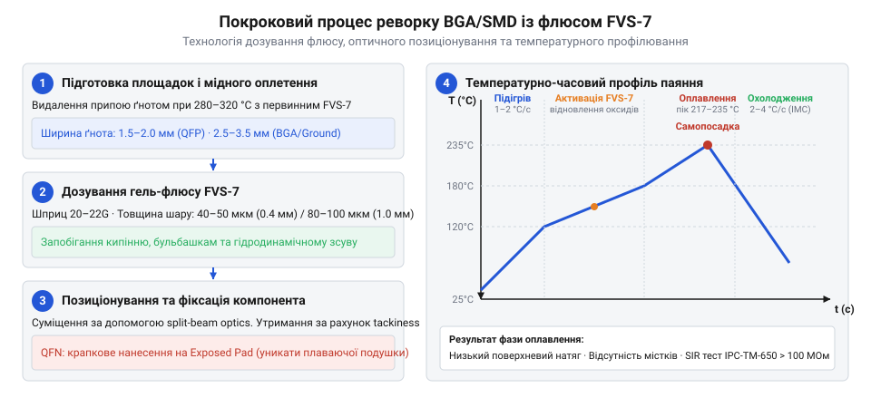

# Практичний технологічний процес паяння та реворку BGA/SMD з флюсом FVS-7

<preknowlist>
- [Припій / олово](root:cat-hw-instruments/solder-tin) — температура плавлення та поведінка припою під час паяння
- [Паяльник USB TK-USB-DS (5 В, 260–420 °C)](root:cat-hw-instruments/usb-soldering-iron) — зачистка контактних площадок і демонтаж оплетенням
- [Термофен BAKU BK-8033](root:cat-hw-instruments/hot-air-station-baku) — робота з гарячим повітряним потоком та налаштування температури й обдуву
</preknowlist>

## Завдання та підготовка робочої зони

Технологічний процес @@en|реворку@@ (від @@en|rework@@ — переробка або відновлення) електронних модулів із компонентами поверхневого монтажу (від @@en|Surface Mount Device@@, @@en|SMD@@) висуває підвищені вимоги до теплового балансу та чистоти контактних площадок. На відміну від штирових елементів, планарні корпусній блоки — зокрема мікросхеми у корпусах із матрицею кулькових виводів (від @@en|Ball Grid Array@@, @@en|BGA@@) та дрібнокрокові деталі QFP чи QFN — мають масивні приховані виводи. Під час знімання або монтажу таких деталей неможливо прогріти всі зони контакту одночасно за допомогою звичайного [паяльника](root:cat-hw-instruments/usb-soldering-iron). Спроба підважити корпус до повного розплавлення всіх кульок припою призводить до відриву мідних площадок від текстоліту та безнадійного пошкодження друкованої плати.

Першим кроком технологічного процесу є ретельна підготовка робочої зони після демонтажу старого компонента. На контактних площадках залишаються залишки [припою](root:cat-hw-instruments/solder-tin) різної висоти та щільний шар темних оксидних плівок, які виникли внаслідок попередніх циклів нагріву. Для створення ідеально плаского посадкового місця залишки припою видаляють за допомогою мідного оплетення (від @@en|solder wick@@ — мідний ґніт для видалення припою) та контактного [паяльника](root:cat-hw-instruments/usb-soldering-iron), налаштованого на температуру 280–320 °C. Мідний дріт оплетення діє як капілярний губчастий масив, що всмоктує рідкий сплав за рахунок сил поверхневого натягу.

Точне значення температури жала обирають відповідно до складу видаляємого сплаву: для класичного свинцевого [припою](root:cat-hw-instruments/solder-tin) Sn63Pb37 з температурою плавлення 183 °C інструмент налаштовують на 280–300 °C, тоді як для безсвинцевих сплавів типу SAC305 з евтектикою при 217–221 °C робочий діапазон піднімають до 320–350 °C. Недостатнє прогрівання призводить до прилипання оплетення до мідних площадок через локальне застигання припою, а надмірний нагрів понад 360 °C викликає швидке обвуглювання активних компонентів флюсу, прискорене окиснення жала та термічне деградування адгезійного шару текстоліту.

Щоб запобігти окисненню мідного оплетення та виключити подряпини захисної паяльної маски, на зону зачистки наносять первинний крапельний шар гелеподібного флюсу (від @@la|fluxus@@ — потік, плавлення) марки FVS-7. Флюс швидко змочує тонкі мідні жили, розчиняє плівку оксиду міді (CuO) та вирівнює передачу тепла від жала інструмента до друкованої плати. Ефективність капілярного всмоктування рідкого сплаву прямо залежить від підбору ширини стрічки: для дрібних площадок QFP з кроком 0.5 мм обирають оплетення завширшки 1.5–2.0 мм, а для масивних BGA-панів та шарів заземлення — 2.5–3.5 мм. Занадто вузька стрічка швидко перенасичується рідким припоєм і втрачає всмоктувальну здатність, тоді як надто широке оплетення працює як високоефективний тепловідвід, охолоджуючи паяльне дзеркало й викликаючи ризик прилипання міді до плати з подальшим відривом площадок. Після вилучення лишків сплаву контактні площадки промивають ізопропіловим спиртом і знежирюють, отримуючи чисту, рівну дзеркальну поверхню без задирок.

## Нанесення FVS-7 та встановлення компонента

Після зачистки й дегазації поверхні на контактні площадки наносять дозовану кількість флюсу FVS-7. На відміну від рідких спирто-каніфольних розчинів, які швидко випаровуються й стікають із похилих площин, гель-флюс FVS-7 володіє високою в'язкістю й термостабільністю. Дозування виконують за допомогою плунжерного шприца-дозатора з конічною пластиковою або металевою голкою калібру 20–22G. Для корпусів із кроком виводів 0.5–0.8 мм флюс наносять тонким суцільним валиком уздовж рядів контактів або сіткою мікрокрапель безпосередньо під матрицю BGA.

Товщина нанесеного шару гель-флюсу не повинна перевищувати 50–80 мкм. Об'єм нанесеного флюсу розраховують строго під крок кулькових виводів: для щільних матриць BGA з кроком 0.4–0.5 мм товщину плівки обмежують межами 40–50 мкм, тоді як для масивних корпусів із кроком 0.8–1.0 мм допустимий шар становить 80–100 мкм. Перевищення цього дозування викликає гідродинамічний зсув (від @@en|hydrodynamic shift@@ — гідродинамічне зміщення), коли випаровування легколетучих компонентів у замкненому просторі під корпусом створює надлишковий тиск рідкої фази, виштовхуючи мікросхему вбік та спричиняючи злипання суміжних припайних кульок. Надлишок флюсу є шкідливим: під час нагрівання об'ємний шар закипає й утворює бульбашки пару, які здатні підняти або змістити легкий SMD-компонент чи викликати перекошування BGA-корпусу. Помірний тонкий шар FVS-7 забезпечує стабільну липкість (від @@en|tackiness@@ — клейка здатність гелю), яка надійно утримує встановлену мікросхему в заданому положенні під час транспортування та початкового продування гарячим повітрям.

Вирівнювання компонента виконують під оптичним мікроскопом або за допомогою системи позиціонування з розщепленням оптичного променя (@@en|split-beam optics@@). BGA-мікросхему або планарний QFP-корпус захоплюють вакуумним пінцетом і суміщають виводи з відповідними мідними площадками на платі. Завдяки прозорій бурштиновій консистенції FVS-7 оператор чітко бачить межі контактних площадок крізь шар гелю, що мінімізує ймовірність помилки позиціонування. Після легкого притискання корпусу до плати шар флюсу фіксує всі виводи, готуючи модуль до фази термічного оплавлення.

Особливо суворі вимоги висувають до позиціонування корпусів QFN (від @@en|Quad Flat No-Leads@@ — плоский корпус без виводів) з масивною центральною тепловідвідною площадкою (від @@en|Exposed Pad@@). На центральний пад флюс FVS-7 наносять крапково або хрестоподібною сіткою, уникаючи суцільного покриття: надлишок рідкої фази під широкою металевою площиною не має шляхів для вільного випаровування та створює ефект гідродинамічної подушки. Така подушка піднімає корпус над платою, перешкоджаючи фізичному контакту периферійних плоских виводів із мідними площадками й викликаючи утворення повітряних каверн або плаваючий зсув мікросхеми під час оплавлення.

## Термопрофіль паяння та візуальний контроль

Процес паяння здійснюють із дотриманням суворого температурно-часового профілю за допомогою [термофена](root:cat-hw-instruments/hot-air-station-baku) та нижнього інфрачервоного підігрівача плати. Нижній підігрів плавно піднімає температуру текстоліту до 100–120 °C зі швидкістю 1–2 °C/с, зменшуючи температурний градієнт між зоною паяння та навколишніми ділянками плати. Далі вмикають верхній струмінь гарячого повітря від [термофена](root:cat-hw-instruments/hot-air-station-baku), спрямовуючи сопло перпендикулярно до поверхні корпусу. Після завершення фази пікового оплавлення вирішальне значення має контрольована швидкість охолодження модуля в межах 2–4 °C/с. Дозований відвід тепла запобігає розростанню грубокристалічних інтерметалевих сполук (від @@en|Intermetallic Compounds@@, @@en|IMC@@), формуючи міцну дрібнокристалічну структуру паяного з'єднання з високою стійкістю до механічної втоми. Занадто повільне охолодження робить припій крихким, тоді як різке охолодження зі швидкістю понад 6 °C/с викликає термічний шок і мікротріщини в керамічних корпусах компонентів.

*Покрокова послідовність підготовки площадок, дозування флюсу FVS-7, встановлення BGA-корпусу та температурного профілю оплавлення.*

Під час фази активації (150–180 °C) органічні кислоти у складі FVS-7 вступають у хімічну реакцію з оксидами олова й свинцю чи міді, відновлюючи чистий метал:

$$\text{MeO} + 2\text{R-COOH} \rightarrow \text{(R-COO)}_2\text{Me} + \text{H}_2\text{O}\uparrow$$

У фазі пікового оплавлення ($217\text{--}235\text{ }^\circ\text{C}$ для безсвинцевих сплавів або $183\text{--}205\text{ }^\circ\text{C}$ для свинцевих) [припій](root:cat-hw-instruments/solder-tin) переходить у рідкий стан. Флюс FVS-7 суттєво знижує поверхневий натяг (від @@en|surface tension@@ — поверхневий натяг) рідкого металу, що викликає ефект самовирівнювання (від @@en|self-alignment@@ — автоматична самопосадка під дією поверхневих сил). Корпус мікросхеми підтягується сил симетрії рідких кульок і стає точно на центри площадок, навіть якщо початкове позиціонування мало невеликий зсув.

Висока антимостікова здатність флюсу запобігає утворенню паяльних містків (від @@en|solder bridge@@ — коротке замикання між сусідніми виводами), відштовхуючи припій від проміжків захисної маски. Завдяки високому поверхневому опору ізоляції (від @@en|Surface Insulation Resistance@@, @@en|SIR@@) залишки FVS-7 є класифікованими як безвідмивні (від @@en|no-clean@@ — не потребує змивання). Надійність залишків підтверджують випробуваннями за стандартом IPC-TM-650 (метод 2.6.3.7): у випробувальній камері при температурі 85 °C, відносній вологості 85% та постійній напрузі зміщення 50 В опір ізоляції SIR перевищує поріг 100 МОм протягом 168 годин тестів. Це гарантує відсутність дендритного росту та витоків струму між мікровиводами навіть у жорстких кліматичних умовах. Сухий прозорий залишок флюсу утворює захисну пасивну плівку, яка не викликає корозії та не вимагає обов'язкової відмивки розчинниками. Візуальний контроль під мікроскопом підтверджує формування правильних галтелей припою зі стабільним кутом змочування θ < 30°.
