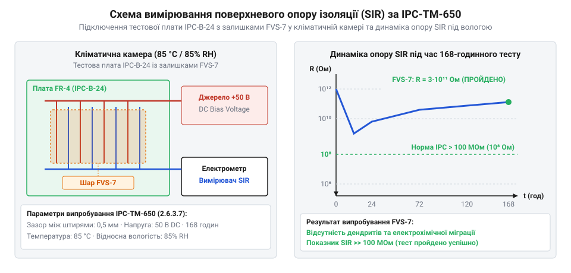

# Контроль залишків FVS-7 та проведення тестування поверхневого опору ізоляції

<preknowlist>
- [Припій / олово](root:cat-hw-instruments/solder-tin) — температура плавлення та утворення інтерметалічних шарів під час монтажу
- [Паяльник USB TK-USB-DS (5 В, 260–420 °C)](root:cat-hw-instruments/usb-soldering-iron) — режими ручного оплавлення та контролю температури тиснучої частини
</preknowlist>

## Ризики витоку та дендритоутворення

Монтаж електронних компонентів із використанням спиртоканіфольних флюсів серії ФВС-7 (від англ. @@en|no-clean flux@@ — флюс без потреби обов'язкового відмивання) припускає, що після термообробки залишки активаторів зв'язуються полімерною матрицею й стають діелектрично інертними. Проте при недогріві під час роботи з [паяльником USB TK-USB-DS](root:cat-hw-instruments/usb-soldering-iron) або при розпаюванні масивних вузлів [термофеном BAKU BK-8033](root:cat-hw-instruments/hot-air-station-baku) температура компонента може не досягти зони повного випаровування органічних кислот. У таких умовах на поверхні плати лишаються нерозкладні активні компоненти.

Під дією підвищеної вологості довкілля та сталої напруги живлення між сусідніми провідниками виникає електрохімічна міграція металів (англ. @@en|electrochemical migration@@). Вільні іони анода розчиняються в рідкій плівці конденсату й під дією високої напруженості електричного поля E = V / d мігрують до катода, де відновлюються до нейтральних атомів. У разі наявності срібного або мідного покриття доріжок сильне поле прискорює дрейф іонів Ag⁺ та Cu²⁺, утворюючи голчасті кристалічні ниті — дендрити (від грец. *dendron* — дерево, англ. @@en|dendritic growth@@ — ниткоподібне проростання металу). Зростання градієнта потенціалу на мікроскопічних нерівностях провідників підсилює локальне поле, прискорюючи проростання дендритного містка та падіння поверхневого опору ізоляції (від англ. @@en|surface insulation resistance@@, @@en|SIR@@ — поверхневий опір ізоляційного прошарку) нижче 100 МОм, що призводить до витоків струму в мікроамперному діапазоні, спотворює аналогові сигнали сенсорів і спричиняє спонтанні збої мікроконтролерів.

Особливо чутливими до залишків непрореагованого флюсу є високоомні кола, квантувальні входи аналого-цифрових перетворювачів та виводи кварцових резонаторів мікроконтролера. Поява вологої органо-іонної плівки на поверхні діелектрика утворює паразитний шунтувальний опір та додаткову ємність між доріжками, що зриває генерацію тактового сигналу, зміщує напругу зміщення операційних підсилювачів та спричиняє хаотичні плаваючі помилки вимірювань, які неможливо відфільтрувати програмним шляхом.

У високочастотних і радіочастотних трактах паразитна провідність і зміна діелектричної проникності залишків флюсу створюють суттєвий тангенс кута діелектричних втрат. Це призводить до розкалібрування узгоджувальних ланцюгів антен, зміщення резонансних частот смугових мікросмужкових фільтрів та зростання коефіцієнта стоячої хвилі по напрузі (англ. @@en|VSWR@@). У результаті виникає загасання корисного високочастотного сигналу та неконтрольоване фазове спотворення, що спричиняє падіння чутливості приймача і збої бездротового зв'язку.

## Підготовка тестових структур IPC-B-24

Для об'єктивної оцінки діелектричних властивостей залишків флюсу ФВС-7 використовують випробувальні плати стандарту IPC-TM-650. Основним елементом такої плати є зустрічно-штирьова тестова структура (від англ. @@en|comb pattern@@ — гребінчаста тестова структура) IPC-B-24, яка містить паралельні зустрічні доріжки з фіксованим зазором 0.4 мм. Нанесення флюсу здійснюють дозовано, після чого проводять запікання припійною пастою з використанням [олова та припою](root:cat-hw-instruments/solder-tin) за стандартним температурним профілем.

Під час підготовки зразків суворо заборонено торкатися випробувальної зони незахищеними руками: жирові відкладення та солі з шкіри створюють паразитні іонні містки, що викривляють результати тестування. До висновків гребінчастої структури припаюють високоомні термостійкі провідники, після чого зразок промивають контрольним спиртовим розчином і наносять досліджуваний флюс ФВС-7. Для запобігання нерівномірному випаровуванню розчинника застосовують конвекційну сушку з регульованим вирівнюванням температурного профілю: плавний підйом температури зі швидкістю 1–2 °C/с усуває локальні термічні градієнти, запобігає розбризкуванню флюсу та забезпечує повне видалення летких компонентів і полімеризацію активаторів по всій площі плати IPC-B-24.

Для забезпечення відтворюваності випробувань нанесення флюсу ФВС-7 здійснюють пнемодозатором або мікроструминним розпилювачем із контролем товщини рідкої плівки. Однорідне покриття без напливів і сухостоїв по всій площі гребінчастих доріжок із зазором 0.4 мм гарантує однакові умови термообробки активаторів, що виключає локальне скупчення нерозкладеної каніфолі та утворення аномально низькоомних ділянок.

## Вимірювання SIR та іонної чистоти

Підготовлену плату розміщують у кліматичній камері при температурі 85 °C та відносній вологості 85% під постійною випробувальною напругою 100 В DC.

*Схема підключення електрометра до тестової структури IPC-B-24 та графік зміни опору SIR під дією підвищеної вологості.*

Автоматизоване зчитування вимірювань опору з електрометра через послідовний порт, обчислення динаміки SIR та перевірка критерію відповідності стандарту IPC виконується програмним комплексом:

:::code proj-fvs7-sir-testing-and-cleaning/py/sir_meter.py
:::code proj-fvs7-sir-testing-and-cleaning/py/ipc_evaluator.py
:::code proj-fvs7-sir-testing-and-cleaning/py/main.py

Для вбудованих контролерів вимірювальних стендів зчитування високоомного АЦП та сигналізація про небезпечні витоки струму реалізуються низькорівневим драйвером:

:::code proj-fvs7-sir-testing-and-cleaning/c/sir_adc.h
:::code proj-fvs7-sir-testing-and-cleaning/c/sir_adc.c
:::code proj-fvs7-sir-testing-and-cleaning/c/main.c

Окрім прямого вимірювання SIR, для оцінки прихованих залишків під BGA-корпусами застосовують експрес-метод ROSE (від англ. @@en|ROSE test@@ — @@en|Resistivity of Solvent Extract@@, вимірювання питомого опору екстракту розчинника). За цим методом плату занурюють у зважений ізопропіловий розчин та оцінюють іонне забруднення (від англ. @@en|ionic contamination@@ — наявність вільних іонів), яке для безпечних залишків ФВС-7 не повинно перевищувати 1.56 мкг NaCl-екв/см². На точність вилучення солей суттєво впливає температура випробувального розчину: підігрів вимірювальної ванни до 45–50 °C зменшує в'язкість розчинника й прискорює дифузію іонів із вузьких зазорів під компонентами, тоді як холодна рідина призводить до неповної екстракції та хибнооптимістичних оцінок чистоти.

Математична кінетика вилучення іонних солей описується експоненційним законом дифузії, за яким концентрація розчинених іонів C(t) наближається до насичення за залежністю C(t) = C_max × (1 - e⁻ᵏᵗ). Для завершення повного масообміну та виходу похідної dC/dt на стаціонарне плато випробувальний цикл екстракції методом ROSE повинен тривати не менше 10–15 хвилин при динамічній циркуляції розчинника, оскільки передчасне зупинення вимірювання фіксує занижені значення забруднення через незавершений дифузійний перенос солей з-під BGA-корпусів.

## Вибір рідин та відмивання залишків

Якщо за результатами SIR-тестування виявлено просідання опору нижче 100 МОм або перевищення іонного забруднення, залишки ФВС-7 підлягають обов'язковому відмиванню. Оскільки каніфольна основа флюсу піддається термополімеризації, для відмивання використовують двокомпонентні промивальні розчини на основі модифікованих спиртових ефірів або водно-лужні розчини з сапоніфікаторами.

Обробку часових рядів SIR-тестування з автоматичною вибіркою локальних мінімумів і генерацією підсумкового звіту чистоти реалізовано у C++ модулі аналізу:

:::code proj-fvs7-sir-testing-and-cleaning/cpp/include/sir_analyzer.hpp
:::code proj-fvs7-sir-testing-and-cleaning/cpp/src/sir_analyzer.cpp
:::code proj-fvs7-sir-testing-and-cleaning/cpp/main.cpp

Для видалення залишків під низькопрофільними SMD-компонентами застосовують струминну промивку під тиском або ультразвукові ванни з нагрівом миючого розчину до 45–50 °C. Застосування ультразвукового випромінювання створює ефект кавітації, коли ударні хвилі від схлопування мікробульбашок ефективно вимивають тверді полімеризовані частки флюсу з-під корпусів. Проте неконтрольована інтенсивність ультразвуку загрожує кавітаційною ерозією: локальні мікроударні імпульси спричиняють мікротріщини в крихкій кераміці чип-конденсаторів, пошкоджують виводи внутрішніх розварювальних нитей та руйнують чутливі структури MEMS-сенсорів, що вимагає точного дозування акустичної потужності та вибору частоти вище 40 кГц.

## Верифікація чистоти після відмивання

Після завершення циклу відмивання плату піддають делікатній сушці гарячим повітрям при температурі 60–70 °C протягом 30 хвилин для повного видалення залишків вологи з-під корпусів компонентів. Повторне тестування SIR на верифікованих зразках має показати стабільний опір ізоляції понад 10¹² Ом (1 ТОм) без аномальних просідань. Окрему увагу приділяють усуненню ризиків вторинної конденсації вологи: при різкому вилученні нагрітої плати в цехове середовище температура її поверхні швидко падає нижче точки роси, спричиняючи осадження атмосферного конденсату під низькопрофільними деталями, що тимчасово знижує опір ізоляції й призводить до хибних бракувальних висновків, тому охолодження вимагає плавного зниження температури у сухому середовищі.

При дотриманні норматива IPC-TM-650 2.6.3.7 та відсутності локальних мінімумів опору понад 15% випробувальний вузол вважається повністю очищеним і допускається до герметизації компаундами чи експлуатації у жорстких кліматичних умовах.
