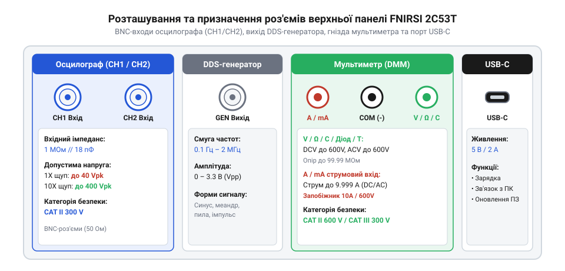
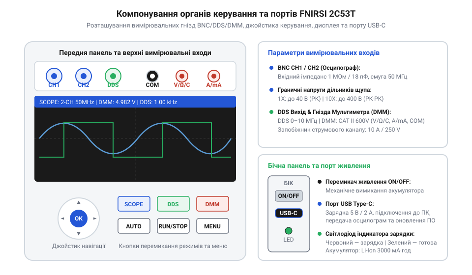

# Залізний інтерфейс, роз'єми та граничні параметри FNIRSI 2C53T

<preknowlist>
- [Режим самописця Roll Mode у цифрових осцилографах](root:cat-hw-instruments/oscilloscope-roll-mode) — загальні принципи відображення сигналів на дисплеї осцилографа
</preknowlist>

## Ризики підключення й електробезпека

Підключення портативного комбінованого приладу FNIRSI 2C53T до діючих електричних кіл вимагає чіткого розуміння межевих електричних режимів апаратного інтерфейсу (від англійського @@en|hardware interface@@ — апаратний інтерфейс). Осцилографічний вход пристрою побудовано на чутливих аналогових підсилювачах та електронних комутаторах, розрахованих на обробку малого сигналу. Якщо оператор помилково подасть на роз'єм типу BNC (від англійського @@en|BNC connector@@ — роз'єм BNC) напругу, що перевищує максимально припустимий поріг, внутрішні захисні діоди виходять із ладу, що призводить до термічного пробою аналогового атенюатора (від латинського @@en|attenuo@@ — зменшую, атенюатор @@en|attenuator@@) та вхідного каскаду.

Основне джерело апаратних аварій полягає в недотриманні режимів ділення вимірювальних щупів. У разі прямого підключення сигналу в режимі дільника 1X внутрішній аналоговий тракт приладу сприймає напругу без попереднього згасання. Гранично припустима амплітуда (від латинського @@en|amplitudo@@ — величина, амплітуда @@en|amplitude@@) у цьому режимі становить 40 В пікового значення (40 Vpk, або 80 В від піку до піку). Спроба виміряти мережеву напругу 220 В або високовольтні імпульси самоіндукції в режимі 1X миттєво виводить з ладу аналоговий тракт. Використання пасивного щупа в режимі 10X вводить у коло послідовний резистор опором 9 МОм, який знижує амплітуду сигналу на вході BNC у 10 разів і підвищує допустиму пікову напругу до 400 В (400 Vpk).

Окрему небезпеку становить заземлення вимірювальних каналів. Земляні затискачі типу «крокодил» (від англійського @@en|ground clip@@ — затискач заземлення) обох аналогових каналів осцилографа електрично з'єднані між собою та зі спільною шиною приладу. Хоча під час автономної роботи від акумулятора корпус FNIRSI 2C53T гальванічно ізольований від зовнішньої мережі, підключення кабелю USB-C до мережевого зарядного пристрою або стаціонарного комп'ютера прив'язує опорний потенціал осцилографа до шини захисного заземлення. Підключення земляного затискача щупа до вузла схеми з потенціалом, відмінним від нуля, створює коротке замикання через друковану плату приладу. Усвідомлення цих ризиків визначає порядок підключення щупів та вибір конфігурації роз'ємів.

Додаткова пастка двох каналів полягає у спільному опорному заземленні (від англійського @@en|common ground plane@@ — спільна площина заземлення) роз'ємів `CH1` та `CH2`. Якщо підключити затискач першого каналу до нуля схеми, а затискач другого каналу — до вимірювальної точки з іншим потенціалом, виникне пряме замикання між цими точками через екранні оплітки обох щупів. Щоб уникнути пошкодження провідників, під час одночасного використання двох каналів обома затискачами з'єднуються виключно з однією спільною точкою заземлення досліджуваного пристрою або залишають підключеним лише один земляний крокодил.

Особливо гостро ризик ураження та аварії проявляється під час обстеження первинної високовольтної частини імпульсних джерел живлення (від англійського @@en|switched-mode power supply@@ — імпульсний блок живлення). У таких схемах від'ємна шина після випрямляча перебуває під небезпечним потенціалом мережі 220 В щодо землі. Вимірювання будь-яких сигналів у первинних колах без застосування гальванічного розв'язувального трансформатора (від латинського @@en|transformo@@ — перетворюю, розв'язувальний трансформатор @@en|isolation transformer@@) або спеціальних диференціальних щупів створює ризик миттєвого дугового пробою, вибуху друкованих доріжок та електричного травмування оператора.

## Розрозділ BNC-входів та DDS-генератора

Верхня панель приладу FNIRSI 2C53T містить три вимірювальні роз'єми стандарту BNC, які розділено за функціональним призначенням на аналогові входи осцилографа та вихід генератора сигналів. Двоканальна система спостереження формату осцилографа (від латинського @@en|oscillo@@ — гойдаюся та грецького @@en|grapho@@ — пишу, осцилограф @@en|oscilloscope@@) використовує вхідні гнізда `CH1` та `CH2`, тоді як вихід внутрішнього цифрового генератора прямого синтезу (від англійського @@en|DDS generator@@ — генератор DDS) виведено на окремий порт `DDS`.

*Схема розташування BNC-роз'ємів каналів CH1/CH2, виходу DDS-генератора та бананових гнізд мультиметра з позначенням допустимих напруг і категорій CAT II.*

Аналогові входи `CH1` та `CH2` характеризуються активним опором 1 МОм та паралельною вхідною ємністю 18 пФ (1 МОм / 18 пФ, вхідний імпеданс від латинського @@en|impedimentum@@ — перешкода, @@en|input impedance@@). Високий вхідний опір мінімізує струмове навантаження на досліджуване коло під час вимірювання постійної та низькочастотної напруги. Паразитна ємність 18 пФ утворює з вихідним опором джерела сигналу фільтр низьких частот, що вимагає компенсації під час роботи на високих частотах. Канали підтримують режими відкритого (DC) та закритого (AC) входу, що дає змогу виділяти змінну складову на тлі високого постійного зсуву.

Вихід генератора сигналів `DDS` є активним портом, який формує аналогові коливання синусоїдальної, прямокутної та трикутної форми з розмахом напруги від 0 до 3.3 В (від англійського @@en|peak-to-peak voltage@@ — розмах напруги). Головне правило безпеки під час роботи з портом `DDS`: категорично заборонено подавати зовнішню напругу на цей роз'єм. Оскільки внутрішній вихідний каскад генератора побудовано на цифро-аналоговому перетворювачі та операційному підсилювачі, зовнішній струм від досліджуваного кола миттєво випалює вихідний буфер. Вихідний опір генератора узгоджено для роботи з високоомним навантаженням чи стандартними цифрами логічних рівнів, що дає змогу подавати тестові імпульси на пристрої на зразок як [логічний аналізатор WeAct DLA Mini](root:cat-hw-instruments/logic-analyzer-dla-mini).

## Клеми мультиметра та живлення USB-C

Нижня частина корпусу FNIRSI 2C53T обладнана трьома банановими гніздами під стандартні 4-мм штекери внутрішнього цифрового мультиметра (від латинського @@en|multus@@ — багатий та грецького @@en|metron@@ — міра, мультиметр @@en|multimeter@@). Застосування окремих гнізд для осцилографічного тракту та мультиметра забезпечує фізичне розмежування високовольтних силотокових та високочастотних сигнальних кіл.

Гніздо `COM` (від англійського @@en|common ground@@ — спільна земля) слугує спільним мінусовим контактом для всіх типів вимірювань мультиметра. Гніздо `V/Ω/C` призначене для вимірювання постійної та змінної напруги, опору резисторів, ємності конденсаторів, тестування діодів і прозвонки кіл. Вхідний опір цього гнізда в режимі вольтметра становить понад 10 МОм. Третє гніздо `A/mA` використовується виключно для вимірювання струму силою до 10 А. Всередині приладу між гніздами `COM` та `A/mA` увімкнено низькоомний вимірювальний шунт (від англійського @@en|current shunt@@ — струмовий шунт) і швидкий керамічний запобіжник. Помилкове підключення щупа до гнізда `A/mA` під час вимірювання напруги створює коротке замикання джерела живлення через шунт, що призводить до негайного перегорання запобіжника.

*Схема передньої та бічної панелей із розташуванням кнопок керування, дисплея, порту USB-C та світлодіода індикації зарядки.*

На бічній панелі приладу розміщено універсальний порт USB-C та світлодіодний індикатор живлення. Інтерфейс USB-C забезпечує заряджання внутрішнього літієвого акумулятора струмом 5 В / 1.5 А, а також передачу даних на ПК для оновлення прошивки чи зчитування збережених осцилограм. Під час тривалого спостереження повільних процесів із живленням від USB-C вимірювальний тракт перемикають у [режим самописця Roll Mode](root:cat-hw-instruments/oscilloscope-roll-mode), що забезпечує безперервний вивід графіку на дисплей без очікування умов запуску синхронізації.

## Категорії безпеки й дільники щупів

Безпечна та точна робота з осцилографом FNIRSI 2C53T спирається на грамотне використання вхідних дільників напруги та дотримання норм стандарту електробезпеки. Стандартні пасивні щупи приладу обладнано механічним перемикачем коефіцієнта ділення 1X / 10X, який кардинально змінює електричні характеристики вимірювального тракту.

У положенні перемикача 1X щуп працює як прямий коаксіальний кабель. У цьому режимі смуга пропускання (від англійського @@en|bandwidth@@ — смуга пропускання) обмежена частотою близько 6 МГц через високу сумарну ємність кабелю (понад 100 пФ), а допустима вхідна напруга не повинна перевищувати 40 В пікового значення. Перемикання щупа в положення 10X підключає послідовний резистор 9 МОм, який разом із внутрішнім опором осцилографа 1 МОм утворює дільник 10:1. Це дає три ключові переваги:
1. Вхідний опір системи зростає з 1 МОм до 10 МОм, мінімізуючи шунтування досліджуваного кола.
2. Вхідна ємність знижується до 15–18 пФ, розширюючи смугу пропускання осцилографа до повних 50 МГц.
3. Гранично припустима напруга зростає до 400 В (400 Vpk) відповідно до категорії безпеки CAT II.

Важливе правило налаштування: вибір режиму 10X на корпусі щупа вимагає обов'язкового встановлення відповідного коефіцієнта (10X) у цифровому меню каналу FNIRSI 2C53T. Якщо перемикач встановлено в 10X, а в меню залишити 1X, прилад помножить виміряне значення на 1 і покаже напругу, занижену в 10 разів.

Категорія безпеки CAT II (400 В) визначає придатність приладу для вимірювань у розеточних мережах змінного струму та побутових електроприладах, підключених до низьковольтної розподільчої мережі. Категорично заборонено використовувати FNIRSI 2C53T для роботи в колах категорій CAT III та CAT IV (промислові силові щити, ввідні розподільчі шафи), де високовольтні імпульсні стрибки під час перемикання потужних навантажень можуть перевищити пробійну міцність плати та спричинити дуговий пробій.
