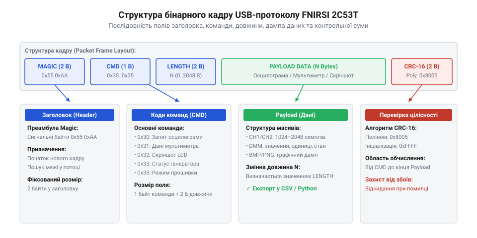
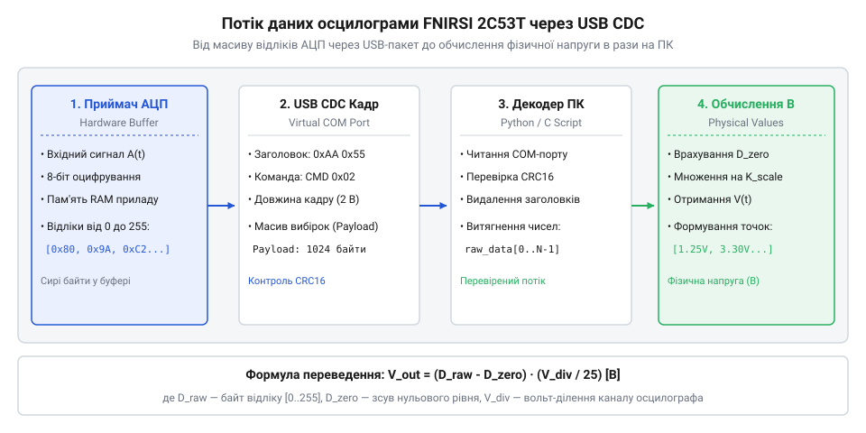

# Програмний інтерфейс USB та протокол зв'язку FNIRSI 2C53T з ПК

<preknowlist>
- [Режим самописця Roll Mode у цифрових осцилографах](root:cat-hw-instruments/oscilloscope-roll-mode) — розуміння принципів зчитування потокових вимірювань низької частоти без переривання кадру розгортки.
</preknowlist>

## Обмеження ручного зчитування та USB-зв'язок

Під час серійного налаштування вимірювальних кіл або тривалих випробувань імпульсних блоків живлення ручне занотовування показань із дисплея приладу стає вузьким місцем. Спроба зафіксувати амплітуду або частоту імпульсів вручну призводить до помилок запису й не дає змоги простежити швидкі перехідні процеси. Для дослідження повільних температурних дрейфів або контролю живлення стає у пригоді [режим самописця Roll Mode](root:cat-hw-instruments/oscilloscope-roll-mode), але для збереження великих масивів вимірювань потрібен прямий програмний доступ до апаратного буфера з боку комп'ютера. Якщо ж паралельно необхідно аналізувати багатоканальні цифрові шини керування, додатково застосовують [логічний аналізатор DLA Mini](root:cat-hw-instruments/logic-analyzer-dla-mini).

Комбайн FNIRSI 2C53T оснащено інтерфейсом USB Type-C, який працює у двох фізичних режимах: віртуального послідовного порту (англ. @@en|Virtual COM Port@@, від @@en|port@@ — гавань, засіб зв'язку) під управлінням специфікації @@en|USB-CDC@@ та масового накопичувача (англ. @@en|USB Mass Storage@@). У режимі накопичувача внутрішня пам'ять осцилографа монтується на ПК як звичайний диск, дозволяючи копіювати збережені знімки екрана. Проте для керування вимірюваннями в реальному часі та зчитування оцифрованих сигналів використовується віртуальний послідовний порт CDC зі швидкістю передачі даних до 12 Мбіт/с.

Підключення пристрою до комп'ютера створює системний пристрій `COM` (у операційних системах Windows) або `/dev/ttyACM` (у Linux). Програмний інтерфейс обміну побудований за принципом «запит-відповідь», де керуючий скрипт надсилає бінарні кадри команд, а осцилограф повертає підтвердження або запаковані масиви оцифрованих точок.

Для відкриття віртуального послідовного порту у власному ПЗ операційна система ініціалізує параметр швидкості обміну (англ. @@en|baud rate@@) на рівні 115200 бод з конфігурацією кадру 8N1: 8 бітів даних, без перевірки паритету (англ. @@en|parity@@) та з одним стоповим бітом. Попри те, що фізична шина @@en|USB Full-Speed@@ передає байти на значно вищій швидкості безпосередньо через пакети @@en|USB-CDC@@, налаштування формату 8N1 і вимкнення апаратного контролю потоку (@@en|RTS/CTS@@) є обов'язковою умовою для коректного відкриття дескриптора порту у системних бібліотеках.

На практичному рівні конфігурування дескриптора віртуального порту має виражені системні відмінності між операційними середовищами. У системі Windows розробник взаємодіє з системним API через виклик `CreateFile` для символьного пристрою `\\\\.\\COMx` та налаштовує структуру `DCB` (англ. @@en|Device Control Block@@), де явно вимикає прапорці апаратного управління потоком `fRtsControl` та `fDtrControl`. У середовищі Linux та системах стандарту POSIX відкриття пристрою `/dev/ttyACM0` виконується функцією `open()`, після чого конфігурація `termios` переводиться в необроблений бінарний режим функцією `cfmakeraw()`, а прапорці `CLOCAL` та `CREAD` вмикаються для ігнорування ліній контролю модему та активації приймача.

Після успішної ініціалізації порту програмне забезпечення отримує доступ до двонапрямного потоку байтів (англ. @@en|byte stream@@). На відміну від лабораторного обладнання з текстовими командами специфікації @@en|SCPI@@ (англ. @@en|Standard Commands for Programmable Instruments@@), прилад FNIRSI 2C53T використовує бінарний протокол обміну. Це усуває накладні витрати на кодування тексту й дозволяє передавати масиви осцилограм та графіку в реальному часі, проте вимагає від керівного скрипта суворого дотримання байтового вирівнювання та надійного визначення меж кожного кадру.

## Структура бінарного пакета та фреймінг

Гарантована передача вимірювальних даних по послідовному каналу потребує суворого фреймінгу (англ. @@en|framing@@, від @@en|frame@@ — рамка кадру). Кожен пакет обміну починається з двобайтового заголовка сигнатури, який дозволяє приймачу визначити початок кадру в безперервному байтовому потоці й відновити синхронізацію після можливих збоїв.

*Структура бінарного пакета протоколу обміну даних FNIRSI 2C53T.*

Бінарний кадр протоколу складається з п'яти послідовних полів. Перші два байти містять маркер сигнатури `0x5A 0xA5`. Далі йде однобайтовий код команди та двобайтове поле довжини корисного навантаження, записане в порядку байтів @@en|Little-Endian@@, де молодший байт (LSB) передує старшому (MSB) для спрощення прямого мапування в пам'ять ARM-контролера. Після поля довжини передається безпосередньо блок даних, а завершує кадр двобайтова контрольна сума (англ. @@en|checksum@@) @@en|CRC-16@@. Обчислення контрольної суми здійснюється за побітовим алгоритмом Modbus із використанням константи відображеного полінома `0xA001`, що забезпечує високу імовірність виявлення одиночних та групових бітових спотворень під час обміну.

Співвідношення зміщень полів у байтовому масиві пакета розраховується за позиціями:

Offset_Header   = 0     [2 байти: 0x5A 0xA5]
Offset_Command  = 2     [1 байт: код функції]
Offset_Length   = 3     [2 байти: LSB, MSB]
Offset_Payload  = 5     [N байтів даних]
Offset_CRC      = 5 + N [2 байти: LSB, MSB]

Нижче наведено приклад обчислення контрольної суми @@en|CRC-16@@ для формування та перевірки пакетів протоколу.

:::tabs
@c
:::code api-fnirsi-2c53t-pc-software-protocol/c/calculate-crc16.c
@cpp
:::code api-fnirsi-2c53t-pc-software-protocol/cpp/framecrccalculator.cpp
:::

## Зчитування масивів точок та параметрів

Для вивантаження оцифрованої осцилограми (грец. @@en|oscillogram@@) комп'ютер надсилає команду запиту кадру `0x02`. У відповідь FNIRSI 2C53T повертає пакет, корисне навантаження якого містить службові параметри розгортки та сирий масив байтів АЦП для каналів CH1 та CH2.

*Потік декодування масиву вимірювань з апаратного буфера в інтерфейс ПК.*

Значення кожного відліку в буфері вибірок представлене однобайтовим числом від 0 до 255. Перерахунок сирого значення АЦП у фізичну напругу здійснюється за рівнем нульової лінії та масштабом чутливості каналу:

Перед масивом байтів вибірок АЦП корисне навантаження відповіді команди `0x02` містить заголовочний блок (англ. @@en|header block@@) із параметрами часової розгортки та обчисленою апаратно частотою сигналу. У цьому блоці передається 32-бітна виміряна частота входів у герцах, поточна частота дискретизації (англ. @@en|sampling rate@@) у вибірках за секунду (`Sa/s`) та загальна кількість оцифрованих точок у буфері. Знання частоти дискретизації `f_sample` дозволяє розрахувати часовий крок між сусідніми точками осцилограми як `dt = 1 ÷ f_sample`, що необхідно для точної побудови часової осі графіків на ПК.

V_phys = (D_raw - D_zero) · V_scale - V_offset

де `D_raw` — байти вибірки з пакета, `D_zero` — опорний код нульового рівня (зазвичай 128), `V_scale` — ціна поділки АЦП у вольтах на молодший розряд, `V_offset` — встановлене вертикальне зміщення променя.

:::tabs
@c
:::code api-fnirsi-2c53t-pc-software-protocol/c/parse-waveform-bytes.c
@cpp
:::code api-fnirsi-2c53t-pc-software-protocol/cpp/channelconfig.cpp
:::

## Вивантаження скріншотів та оновлення прошивки

Окрім сирих числових даних, протокол зв'язку надає сервісні функції для вивантаження графічних знімків екрана (англ. @@en|screenshot@@) та обслуговування приладу. При надсиланні команди `0x04` осцилограф формує бінарний масив растрового зображення у форматі RGB565 з роздільною здатністю 480×272 пікселі.

Код сервісної команди `0x05` ініціює збереження табличного файлу CSV у внутрішній буфер (англ. @@en|buffer@@), що дозволяє завантажувати готову таблицю вимірювань напряму в програмне забезпечення для обробки даних на ПК. При цьому передача растрового зображення екрана за допомогою команди `0x04` потребує пересилання масиву розмірністю 480×272 пікселі, де кожен піксель кодується 16-бітним значенням RGB565 (2 байти), що дає сумарний розмір кадру у 261 120 байтів (480 × 272 × 2 = 261 120 байтів). Такий обсяг растрових даних передається окремими фрагментованими блоками, запобігаючи переповненню буфера послідовного порту при зчитуванні графічних звітів.

Для оновлення системного програмного забезпечення (англ. @@en|firmware@@) використовується команда `0x0F`. Після отримання цього коду прилад повертає підтвердження `0x06` (ACK), завершує вимірювальний цикл та перезавантажується в режим бутлодера. У режимі бутлодера осцилограф визначається комп'ютером як накопичувач @@en|USB MSC@@, на який записується файл нової прошивки з розширенням `.bin`.

## Обробка таймаутів, обривів та завад

Робота з бінарним USB-протоколом у реальних лабораторних умовах супроводжується завадами від силового обладнання та можливими затримками обробки. Якщо програма на ПК чекає на відповідь довше за встановлений таймаут (англ. @@en|timeout@@), касету обміну вважають втраченою.

При виникненні помилок перевірочної суми CRC або невідповідності сигнатури `0x5A 0xA5` керуючий скрипт повинен очистити буфер прийому портів та надіслати команду скидання стану `0x00`. Якщо USB-кабель від'єднано під час передачі масиву точок, драйвер послідовного порту генерує виняткову ситуацію таймауту або помилку введення-виведення.

Приймальна сторона повинна реалізувати покроковий автомат станів розбору кадру: очікування першого байта сигнатури `0x5A`, перевірка другого байта `0xA5`, зчитування заголовка, накопичення корисного навантаження відповідно до поля довжини та фінальна перевірка CRC. Такий підхід забезпечує стійкість програмного забезпечення до випадкових втрат байтів і дозволяє автоматично відновлювати обмін даними без перезапуску керуючого ПЗ.

Для передачі великих масивів даних (наприклад, растрових скріншотів розміром понад 260 Кбайт) стандартне статичне очікування стає неефективним і призводить до хибних спрацьовувань. Програмне забезпечення ПК реалізує розрахунок динамічного таймауту (англ. @@en|dynamic timeout@@), додаючи до базової затримки `T_base` час передачі обсягу `N` байтів із урахуванням реальної ефективної пропускної здатності (англ. @@en|throughput@@) послідовного порту: `T_timeout = T_base + N ÷ V_bytes`. Таке підлаштування гарантує повне приймання містких блоків даних без передчасного розриву сесії й водночас зберігає високу швидкість реагування при виявленні втрати коротких командних відповідей.
