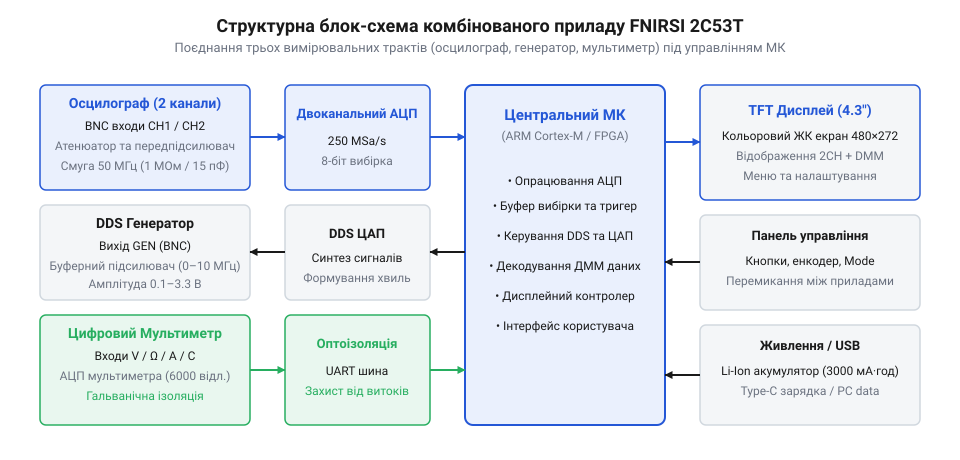
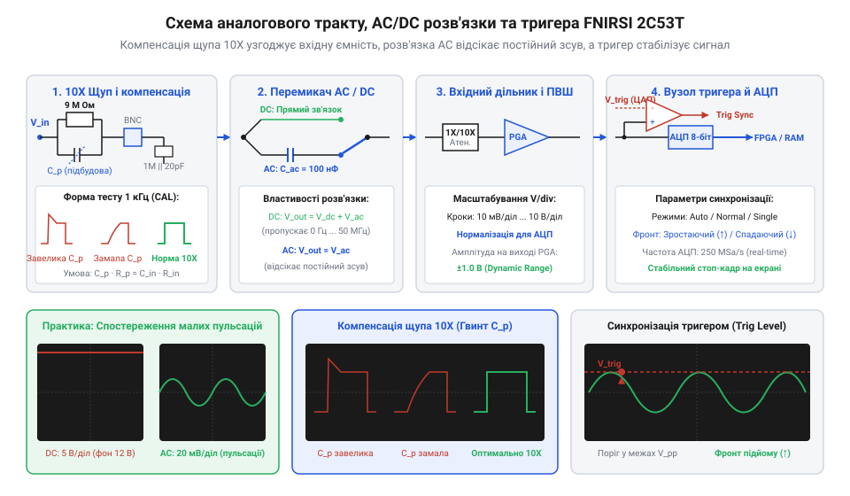
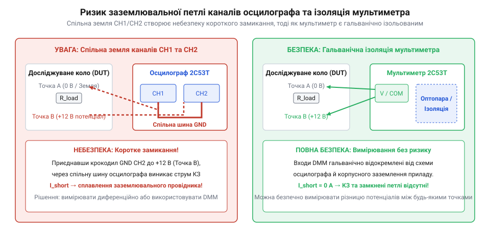

# FNIRSI 2C53T — осцилограф, генератор і мультиметр в одному

<preknowlist>
- [Режим самописця Roll Mode у цифрових осцилографах](root:cat-hw-instruments/oscilloscope-roll-mode) — Розуміння принципу безперервного відображення повільних сигналів без тригера для аналізу повільнозмінних процесів.
</preknowlist>

## Проблема мобільної діагностики складних схем

Пошук несправностей у сучасній електронній апаратурі за межами обладнаної лабораторії швидко перетворюється на складне випробування. Коли інженер вирушає на об'єкт для діагностики промислової автоматики, автомобільної електроніки чи віддаленого вузла зв'язку, класичний набір інструментів вимагає громіздкого обладнання. Щоб перевірити аналоговий тракт або підсилювальний каскад, потрібно одночасно створити тестовий вплив генератором сигналів, проконтролювати постійну напругу живлення й струм споживання цифровим мультиметром (від англ. @@en|digital multimeter@@, @@en|DMM@@), а також оцінити форму й амплітуду вихідного сигналу осцилографом (від лат. @@la|oscillum@@ — коливання та грец. @@el|γράφω@@ — пишу). Настільні пристрої потребують підключення до електромережі, займають весь робочий простір і перетворюють діагностику на плутанину з мережевих шнурів та щупів.

Ззвичайний портативний мультиметр показує лише середнє або діюче значення напруги, приховуючи високочастотні пульсації, короткі сплески й спотворення форми хвилі. З іншого боку, базовий одноканальний портативний осцилограф (від англ. @@en|oscilloscope@@) дозволяє побачити сигнал, але не дає змоги порівняти вхідну й вихідну форми хвилі в реальному часі або одночасно виміряти струм споживання. Спроба взяти на виїзд три окремі автономні прилади створює проблему узгодження земель, вимагає постійного переключення щупів та виснажує батареї пристроїв у найвідповідальніший момент.

Спроба виміряти напругу несинусоїдального сигналу базовим мультиметром без функції True RMS призводить до системних помилок у діагностиці. Звичайний вимірювач усереднює випрямлене значення та просто множить його на коефіцієнт `1.11`, розрахований виключно для чистої синусоїди. При роботі з імпульсними перетворювачами, ШІМ-сигналами (від англ. @@en|PWM@@, @@en|Pulse-Width Modulation@@) або ланцюгами зі складним гармонійним спектром помилка вимірювання діючого значення може сягати `30–50%`. Інженер отримує хибні показання про нібито просідання живлення чи несправність каскаду, тоді як насправді прилад просто не здатний обчислити реальне енергетичне значення сигналу несинусоїдальної форми.

Історично портативна вимірювальна техніка проходила тривалий шлях еволюційного розвитку. Перші спроби створити комбіновані пристрої в одному корпусі опиралися на аналогові електронно-променеві трубки або прості цифрові схеми з низькою частотою дискретизації, що робило їх важкими, енергоємними та повільними. Ситуація докорінно змінилася із появою компактних енергоефективних систем на кристалі, пліс (програмованих логічних інтегральних схем, від англ. @@en|FPGA@@) та швидкісних аналого-цифрових перетворювачів. Це дозволило об'єднати двоканальний цифровий осцилограф, синтезатор сигналів прямого цифрового синтезу (від англ. @@en|DDS@@, @@en|Direct Digital Synthesis@@) та прецизійний мультиметр в одному компактному корпусі з акумуляторним живленням. Сучасна серія приладів FNIRSI пройшла шлях від базових одноканальних пробників до багатофункціональної платформи 2C53T, де всі три інструменти працюють паралельно, забезпечуючи повноцінний мобільний вимірювальний комплекс.

Для фахівця, який працює з розробкою та ремонтом електронних схем, [портативними комбінованими приладами](root:cat-hw-instruments/overview-fnirsi-handheld-combo-scopes) вирішується головна суперечність: поєднання високої мобільності з можливістю бачити повну картину електричних процесів у колі без громіздких настільних стендів.

Математична причина такої похибки полягає у розбіжності між фіксованим калібрувальним коефіцієнтом та реальним коефіцієнтом форми (від англ. @@en|form factor@@) хвилі. Для чистої синусоїди відношення діючого значення до середньовипрямленого становить `K_f = 1.11`, а пік-фактор (від англ. @@en|crest factor@@), що описує відношення амплітуди до діючого значення, дорівнює `K_p = 1.414`. Проте для імпульсних сигналів чи ШІМ з малою тривалістю імпульсу середня випрямлена напруга спадає пропорційно коефіцієнту заповнення `D`, тоді як реальна енергія сигналу і його діюче значення зменшуються значно повільніше — пропорційно `√D`. Через це реальний коефіцієнт форми зростає пропорційно `1 / √D` із ростом пік-фактора `K_p`, а відносне відхилення показань приладу без @@en|True RMS@@ описується виразом `δ = (1.11 / K_f) - 1`. Оскільки стандартний вимірювач упереджено множить випрямлену напругу на стале `1.11`, високий пік-фактор призводить до сильного заниження показань діючого значення. Навіть у вимірювачах із True RMS точність обчислення обмежена смугою пропускання вимірювального тракту: якщо вищі гармоніки прямокутного сигналу `f_k = k · f_0` виходять за граничну частоту мультиметра, їхній внесок у загальну енергію `V_rms² = ∑ V_k²` втрачається, що викликає відносне спадання виміряного діючого значення на високих частотах.

## Архітектурне поєднання трьох приладів в одному

Конструкція комбінованого вимірювача FNIRSI 2C53T опирається на модульну архітектуру, де кожен із трьох вимірювальних інструментів реалізовано на власному спеціалізованому аналогово-цифровому тракті. Замість послідовного переключення між режимами, пристрій містить паралельні підсистеми, що керуються спільним обчислювальним ядром на основі мікроконтролера та керованої логічної матриці.

Осцилографічна частина складається з двох незалежних аналогових каналів. Кожен канал містить вхідний атенюатор (від англ. @@en|attenuator@@), перемикач типу розв'язки за напругою та високочастотний підсилювач. При зміні вертикальної розгортки Вольт/поділка (від англ. @@en|Volts per division@@) електронні ключі атенюатора перемикають прецизійні резистивні дільники, послаблюючи високовольтні сигнали (наприклад, у `10` чи `100` разів) перед подачею на підсилювач для захисту входу від перевантаження. На малих шкалах напруги дільник відключається, а сигнал посилюється програмованим підсилювачем (від англ. @@en|PGA@@, @@en|Programmable Gain Amplifier@@), що узгоджує амплітуду із динамічним діапазоном перетворювача. Співвідношення опорів прецизійного дільника разом з вхідною ємністю підсилювача утворює паразитну RC-ланку, де зсув еквівалентного опору `R_eq` змінює граничну частоту смуги пропускання `f_c = 1 / (2π · R_eq · C_in)`. Зростання опору атенюатора без належної компенсації збільшує постійну часу `τ = R_eq · C_in`, що спадає на високочастотні гармоніки; тому резистивні дільники паралельно шунтують підбудовними конденсаторами для стабілізації коефіцієнта передачі. Сигнали з аналогових входів надходять на швидкісний аналого-цифровий перетворювач (від англ. @@en|ADC@@, @@en|Analog-to-Digital Converter@@), який оцифровує обидва канали з максимальною частотою дискретизації `250 MSa/s` (мільйонів вибірок за секунду). Цифрові потоки даних з АЦП обробляються логічним блоком у реальному часі для виявлення подій тригера та формування масиву точок осцилограми в оперативній пам'яті.

*Блокова схема FNIRSI 2C53T з розділенням осцилографічного, генераторного та мультиметричного тракту.*

Генератор сигналів побудований за принципом прямого цифрового синтезу (DDS). Центральний процесор передає крок фазового приросту, а цифрова таблиця значень форм хвиль (від англ. @@en|Look-Up Table@@, `LUT`) ємністю `1024` відліки видає цифровий код амплітуди на швидкодіючий `10`-розрядний цифро-аналоговий перетворювач (від англ. @@en|DAC@@, @@en|Digital-to-Analog Converter@@). `10`-розрядна дискретизація ЦАП забезпечує `1024` дискретні рівні напруги, після чого синтезований сигнал проходить через аналоговий фільтр нижніх частот та вихідний буферний підсилювач. Це дозволяє генерувати синусоїдальні, прямокутні, трикутні та пилоподібні сигнали зі стабільною частотою та регульованою амплітудою.

Мультиметричний модуль реалізовано у вигляді окремого ізольованого блоку з власним прецизійним АЦП високої розрядності. Він містить набір вимірювальних шунтів для струму, високовольтні резистивні дільники напруги та схеми захисту на базі самовідновлюваних запобіжників й позисторів (від англ. @@en|PTC thermistor@@). Така побудова гарантує високу точність вимірювання статичних величин та ізоляцію вимірювань мультиметра від спільної землі каналів осцилографа.

Усі три модулі виводять інформацію на спільний кольоровий дисплей. Докладно розташування BNC-роз'ємів, бананових гнізд мультиметра та характеристики живлення описує [довідник залізного інтерфейсу](root:cat-hw-instruments/fnirsi-2c53t/api-fnirsi-2c53t-hardware-interface.md), де наведено межі вхідних напруг та розкладку органів керування.

## Осцилографічний тракт та захоплення сигналів

Основним інструментом аналізу динамічних процесів у FNIRSI 2C53T є двоканальний осцилограф із заявленою аналоговою смугою пропускання `50 МГц`. Якість відображення сигналу залежить від співвідношення між смугою пропускання аналогового тракту та частотою дискретизації АЦП, яка при роботі одного каналу становить `250 MSa/s`, а при одночасному задіяні двох каналів ділиться навпіл до `125 MSa/s` на канал.

Аналоговий вхід кожного каналу оснащено перемикачем типу розв'язки (від англ. @@en|coupling@@). У режимі `DC` (постійний струм, від англ. @@en|Direct Current@@) сигнал проходить на підсилювач без змін, дозволяючи бачити як постійну складову напруги, так і змінну. У режимі `AC` (змінний струм, від англ. @@en|Alternating Current@@) послідовно із входом вмикається розділовий конденсатор, який відсікає постійне зміщення. Це необхідно для спостереження малих пульсацій напруги живлення амплітудою в десятки мілівольт на тлі постійної напруги у кілька вольт.

*Аналоговий вхідний тракт осцилографа з регулюванням розв'язки та тригером.*

Для стабілізації періодичних осцилограм та захоплення поодиноких імпульсів використовується система синхронізації — тригер (від англ. @@en|trigger@@). Щоб зашумлений сигнал або брязкіт контактів не викликав хибних повторних спрацьовувань, схема тригера застосовує цифровий гістерезис (від англ. @@en|trigger hysteresis@@). У цифровому тракті приладу логіка порівнює оцифровані відліки `x[n]` із коридором навколо центрального порогу `V_th`: при фіксації зростаючого фронту автомат станів спочатку очікує спадання сигналу нижче порогу зведення `V_lower = V_th - ΔV / 2`, і лише після цього фіксує подію тригера при перетині верхнього порогу `V_upper = V_th + ΔV / 2`. Необхідність виходу сигналу за межі вікна `ΔV` усуває хибні запуски розгортки від дрібних шумових пульсацій. Осцилограф підтримує три базові режими тригера:
- `Auto` — прилад безперервно оновлює екран навіть за відсутності умов синхронізації, що зручно для швидкого пошуку сигналу;
- `Normal` — розгортка запускається лише тоді, коли вхідний сигнал перетинає встановлений поріг напруги у заданому напрямку (по зростаючому або спадному фронту);
- `Single` — прилад очікує першого виконання умови тригера, захоплює один кадр осцилограми у пам'ять і зупиняє дискретизацію.

Важливим етапом налаштування є узгодження пасивного щупа з вхідним імпедансом приладу. При переключенні щупа в режим дільника `10X` вхідний опір зростає з `1 МОм` до `10 МОм`, а вхідна ємність зменшується, що зменшує шунтувальний вплив щупа на високочастотні кола. Для запобігання амплітудним спотворенням прямокутних фронтів необхідно калібрувати підбудовний конденсатор щупа за допомогою вбудованого тестового генератора прямокутних імпульсів.

Під час аналізу повільнозмінних процесів (з частотою нижче 1 Гц) зручно використовувати [режим самописця](root:cat-hw-instruments/oscilloscope-roll-mode), який графічно зсуває осцилограму справа наліво без очікування умов тригера. Для оцінки граничної точності відтворення високочастотних фронтів і розрахунку часу наростання використовують [зокрема параметри дискретизації](root:cat-hw-instruments/fnirsi-2c53t/math-oscilloscope-sampling-and-bandwidth.md), де деталізовано теорему Котельникова-Шеннона та формули інтерполяції.

## Генерація тестових впливів та вимірювання мультиметром

Можливість одночасного синтезу впливів та вимірювання параметрів кола робить FNIRSI 2C53T повноцінним вимірювальним стендом. Вбудований DDS-генератор сигналів створює вихідний аналоговий сигнал із регульованою частотою (до `5 МГц` для прямокутного сигналу та до `10 МГц` для синусоїдального) і вихідною амплітудою до `4.5 Vpp` (від англ. @@en|peak-to-peak voltage@@).

Генератор дозволяє вибрати базові форми сигналів: синусоїдальну для аналізу АЧХ аналогових фільтрів, прямокутну для оцінки перехідних процесів та частотного відгуку, трикутну або пилоподібну для перевірки лінійності схем. Синтезований сигнал подається на вхід досліджуваного пристрою, а канали осцилографа контролюють його проходження через підсилювальні або фільтрувальні каскади. Покрокову методику налаштування аналогового тракту детально розкрито у [комплексному відлагодженні аудіопідсилювача](root:cat-hw-instruments/fnirsi-2c53t/proj-audio-amplifier-testing-and-debugging.md), де продемонстровано сумісну роботу генератора й осцилографа.

Паралельно з осцилографом працює цифровий мультиметр на `20 000` відліків із підтримкою True RMS (діючого значення, від англ. @@en|True Root Mean Square@@). Мультиметр дозволяє вимірювати постійну й змінну напругу, струм (через окремі гнізда `A` та `mA`), опір, ємність конденсаторів, перевіряти діоди та звуково продзвонювати кола на наявність короткого замикання. При вимірюванні змінних напруг складної прямокутної чи ШІМ-форми True RMS алгоритм обчислює діюче значення без спотворень, спричинених високим пік-фактором (від англ. @@en|crest factor@@). Математичні співвідношення фазового акумулятора генератора та алгоритми вимірювань деталізує [математика прямого цифрового синтезу](root:cat-hw-instruments/fnirsi-2c53t/math-dds-synthesis-and-true-rms.md), де наведено ключові розрахункові формули.

Під час вимірювання малих опорів або низьких ємностей (у діапазоні пікофарад) на показання мультиметра суттєво впливає паразитна ємність та власний опір вимірювальних дротів. Опір тестових бананових щупів може додавати до `0.1–0.3 Ом` до вимірюваного значення, а розташовані поруч довгі провідники створюють паразитну ємність порядка `10–50 пФ`. Для компенсації цього зсуву та отримання точних параметрів компонентів перед вимірюванням використовують режим відносних вимірювань (від англ. @@en|relative measurement@@, `REL`), який обнуляє базове значення відкритого або замкненого кола. Проте режим `REL` реалізує лише статичне математичне віднімання постійного зсуву і не здатний компенсувати динамічні спотворення. Паразитна індуктивність дротів `L_lead` (порядка `0.5–1 мкГн`) разом з ємністю щупів утворює резонансне LC-коло, яке при швидких перепадах напруги `dV / dt` викликає високочастотне затухаюче дзвоніння та завалювання прямокутних фронтів із хвильовим опором `Z_0 = √(L_lead / C_lead)`, що виходить за межі статичної корекції.

Для аналізу силових ключів та імпульсних перетворювачів генератор створює ШІМ-сигнал керування затворами, а мультиметр контролює постійну напругу шини й струм споживання. Практичні прийоми такої перевірки наведено у [діагностиці ШІМ-контролера](root:cat-hw-instruments/fnirsi-2c53t/proj-pwm-motor-driver-diagnostics.md) з описом безпечних меж. Результати тривалих тестів та осцилограми можна передавати на комп'ютер через USB-інтерфейс, який описує [протокол зв'язку з ПК](root:cat-hw-instruments/fnirsi-2c53t/api-fnirsi-2c53t-pc-software-protocol.md) для збереження CSV-масивів точок.

## Межі можливостей, заземлення та безпека

Основна архітектурна пастка при користуванні портативним двоканальним осцилографом FNIRSI 2C53T полягає у спільному заземленні аналогових BNC-входів. Земляні контакти обох BNC-роз'ємів каналів `CH1` та `CH2`, а також виходу DDS-генератора електрично з'єднані між собою всередині приладу й підключені до спільної земляної шини схеми.

Якщо вимірювати напругу в двох різних точках схеми, де земляні крокодили щупів підключаються до вузлів із різними потенціалами постійної або змінної напруги, виникає небезпечна ситуація. Екранувальні обплетення BNC-кабелів мають мізерний опір (частки ома), тому між вузлами з різницею потенціалів потече надзвичайно високий вирівнювальний струм короткого замикання за законом Ома. Наприклад, при підключенні земляного щупа в діагональ мостового випрямляча з різницею потенціалів `ΔV = 30 V` та опором земляного провідника `R_loop = 0.1 Ом` вирівнювальний струм за законом Ома досягає `I = ΔV / R_loop = 30 / 0.1 = 300 A`. Такий імпульсний струм миттєво випалює екранувальну обплітку кабелю та внутрішні доріжки плати. Це створює катастрофічну небезпеку виникнення земляної петлі (від англ. @@en|ground loop@@), що пошкоджує вхідні атенюатори осцилографа. Для безпечного вимірювання напруги між двома не заземленими точками схеми необхідно застосовувати активний диференціальний щуп (від англ. @@en|differential probe@@) або використовувати режим математичного віднімання каналів `CH1 - CH2`, підключаючи обидві землі щупів виключно до єдиної спільної точки заземлення схеми.

*Шлях аварійного струму короткого замикання через спільну земляну шину осцилографа.*

На відміну від вхідних BNC-роз'ємів осцилографа, бананові гнізда мультиметричного модуля мають гальванічну ізоляцію від спільної землі приладу. Це дозволяє безпечно вимірювати напругу або струм мультиметром у плаваючих вузлах схеми без ризику закорочення земляної шини.

Прилад має чітко визначені граничні категорії електричної безпеки:
- При використанні пасивного щупа `1X` максимальна вхідна напруга BNC-входу не повинна перевищувати `40 Vpp` (або `30 V` постійної напруги);
- У режимі дільника `10X` межа зростає до `400 Vpp`, що відповідає категорії `CAT I`;
- Ізольований мультиметр розрахований на вимірювання напруги постійного струму до `1000 V` та змінної напруги до `750 V` у межах категорії `CAT II`.

Категорично забороняється вимірювати мережеву напругу `220 V` BNC-входами осцилографа без спеціальних високовольтних диференціальних щупів, оскільки звичайна земля щупа при підключенні до фазного дроту спричинить миттєве коротке замикання. Докладно проблеми ізоляції та правила захисту аналізує [заземлення та електробезпека](root:hw-sensing/oscilloscope-probe-grounding), де зведено критерії вибору захисного обладнання.
