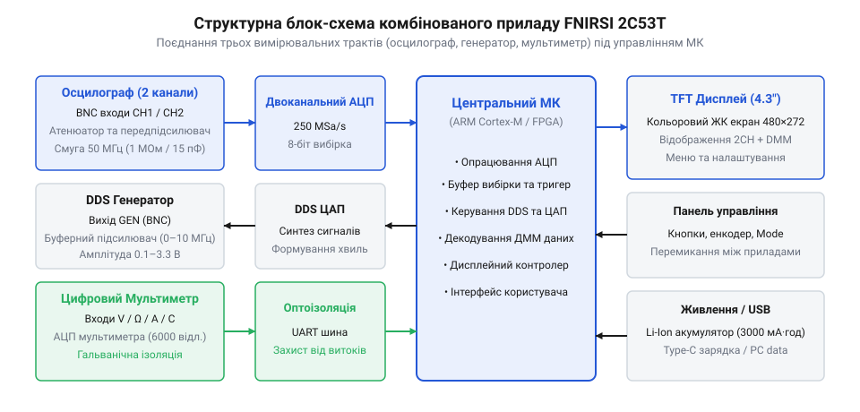
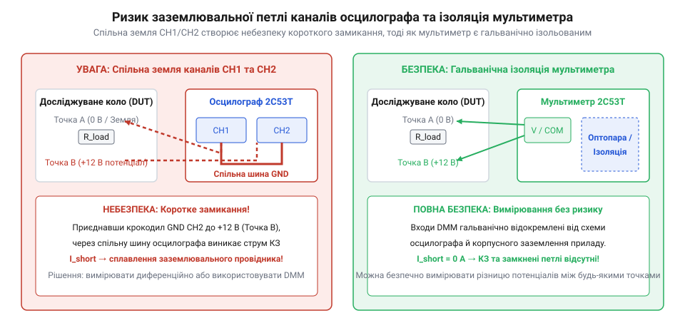

# FNIRSI 2C53T — осцилограф, генератор і мультиметр в одному

<preknowlist>
- [Режим самописця Roll Mode у цифрових осцилографах](root:cat-hw-instruments/oscilloscope-roll-mode) — розуміння принципу безперервного відображення повільних сигналів без тригера для аналізу повільнозмінних процесів
</preknowlist>

## Проблема мобільної діагностики складних схем

Пошук несправностей у вимірювальних та керувальних колах за межами лабораторії вимагає одночасного створення тестового впливу, вимірювання напруг живлення та спостереження форми вихідного сигналу. Використання кількох настільних пристроїв створює плутанину з мережевих дротів і щупів, а звичайний портативний мультиметр (від англ. @@en|digital multimeter@@, @@en|DMM@@) показує лише усереднене значення, приховуючи сплески й пульсації. При роботі з імпульсними перетворювачами чи ШІМ-сигналами (від англ. @@en|PWM@@, @@en|Pulse-Width Modulation@@) прості вимірювачі без функції @@en|True RMS@@ дають похибку до `30–50%`, оскільки розраховані виключно на чисту синусоїду. Базовий портативний осцилограф (від лат. @@la|oscillum@@ — коливання та грец. @@el|γράφω@@ — пишу) дозволяє побачити форму хвилі, але не дає змоги порівняти вхідний і вихідний сигнали чи контролювати струм споживання. Для розв'язання цієї суперечності створено вимірювальну платформу FNIRSI 2C53T, яка об'єднує двоканальний осцилограф (від англ. @@en|oscilloscope@@), синтезатор прямого цифрового синтезу (від англ. @@en|DDS@@, @@en|Direct Digital Synthesis@@) та прецизійний мультиметр в одному мобільному корпусі.

## Архітектурна інтеграція трьох вимірювальних трактів

Пристрій побудовано за модульним принципом, де кожен із трьох вимірювальних інструментів працює на власному аналогово-цифровому тракті під керуванням обчислювального ядра. Двоканальний осцилограф містить вхідні атенюатори (від англ. @@en|attenuator@@) для узгодження амплітуди високовольтного сигналу та оцифровує обидва канали швидкодіючим АЦП (від англ. @@en|ADC@@, @@en|Analog-to-Digital Converter@@) із частотою дискретизації до `250 MSa/s`. Синтезатор генератора формує синусоїдальні, прямокутні та трикутні сигнали за допомогою таблиці значень форм хвиль `LUT` та `10`-розрядного ЦАП (від англ. @@en|DAC@@, @@en|Digital-to-Analog Converter@@). Мультиметричний модуль реалізовано у вигляді окремого ізольованого блоку з прецизійним АЦП, що гарантує точне вимірювання статичних величин незалежно від осцилографа.

*Блокова схема FNIRSI 2C53T з розділенням осцилографічного, генераторного та мультиметричного тракту.*

## Паралельна робота осцилографа, генератора й мультиметра

Сумісне використання інструментів перетворює прилад на мобільний вимірювальний стенд, де DDS-генератор подає тестовий вплив із частотою до `10 МГц`, а канали осцилографа контролюють проходження сигналу через каскади. Перемикач розв'язки входу (від англ. @@en|coupling@@) дозволяє обирати режим `DC` для відображення повного сигналу чи режим `AC` з розділовим конденсатором для виявлення дрібних пульсацій на тлі постійної напруги. Для стабілізації картинки схема тригера (від англ. @@en|trigger@@) застосовує цифровий гістерезис (від англ. @@en|trigger hysteresis@@), запобігаючи хибним спрацьовуванням від шумів. Мультиметр на `20 000` відліків обчислює діюче значення @@en|True RMS@@ несинусоїдальних напруг, а режим відносних вимірювань `REL` компенсує власну ємність та опір тестових щупів. Для тривалого спостереження повільнозмінних процесів застосовують [режим самописця](root:cat-hw-instruments/oscilloscope-roll-mode) без очікування умов тригера.

## Спільне заземлення та межі безпеки

Головна безпекова пастка при користуванні осцилографом полягає у спільному заземленні аналогових вхідних BNC-роз'ємів каналів `CH1`, `CH2` та виходу генератора. Якщо підключити земляні крокодили щупів до вузлів схеми з різними потенціалами, між ними потече вирівнювальний струм за законом Ома, що утворює земляну петлю (від англ. @@en|ground loop@@) та випалює вхідні атенюатори. Бананові гнізда мультиметра мають гальванічну ізоляцію від спільної землі, що дозволяє безпечно вимірювати напругу в плаваючих вузлах. Для BNC-входів максимальна напруга в режимі щупа `1X` становить `40 Vpp`, у режимі `10X` — `400 Vpp` (категорія `CAT I`), а мультиметр розраховано на постійну напругу до `1000 V` (`CAT II`).

*Шлях аварійного струму короткого замикання через спільну земляну шину осцилографа.*
