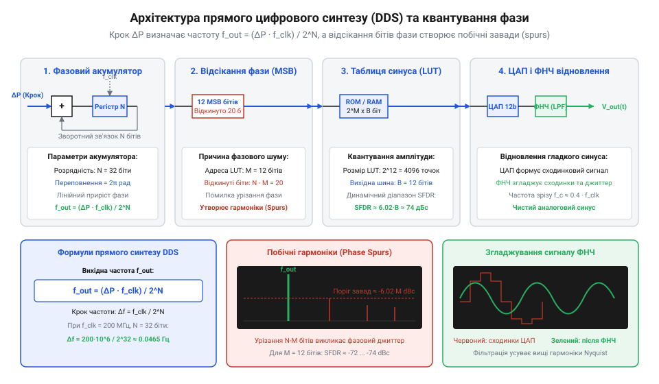

# Математика прямого цифрового синтезу (DDS) та вимірювання True RMS

## Проблема цифрової генерації та діючого значення

Аналогові генератори сигналів та класичні вимірювачі напруги стикаються із фундаментальними обмеженнями, коли виникає потреба сформувати хвилю довільної форми або точного значення її енергії. В аналогових вимірювачах для визначення напруги застосовують випрямлення та усереднення сигналу, розраховуючи середньовипрямлене значення (англ. @@en|Average Rectified Value@@, ARV). Для чистої синусоїди відношення діючого значення до середньовипрямленого є сталим і дорівнює коефіцієнту форми `k_f ≈ 1.11`. Однак при появі гармонік, коротких імпульсів або широтно-імпульсної модуляції це співвідношення ламається, і показники усереднювального приладу дають похибку від 10% до 50%.

З боку генерації традиційні перебудовувані гетеродини чи аналогові генератори керовані напругою (англ. @@en|Voltage-Controlled Oscillator@@, VCO) не здатні забезпечити фазову неперервність при швидкому перемиканні частоти та високу точність фіксації кроку в мікрогерцевому діапазоні. При спостереженні повільних процесів у [режимі самописця Roll Mode](root:cat-hw-instruments/oscilloscope-roll-mode) виразно видно, як звичайні синтезатори втрачають стійкість фази під час перебудови. Кількісно температурний дрейф частоти аналогового @@en|VCO@@ становить близько `200 ppm/°C`, через що при зміні температури на `ΔT = 20 °C` вихідна частота `10 MHz` зміщується на `Δf = 10 · 10⁶ · 200 · 10⁻⁶ · 20 = 40 kHz`, а його часовий джиттер досягає `σ_t ≈ 5 ns`. Натомість опорний генератор цифрового синтезу з кварцовою стабілізацією має дрейф не більше ніж `10 ppm` у всьому робочому діапазоні (зсув лише `100 Hz` для `10 MHz`) та пікосекундний джиттер `σ_t ≈ 5 ps`, що забезпечує у 400 разів вищу стабільність частоти.

Наочним прикладом такої деградації точності є вимірювання параметрів прямокутного імпульсного сигналу з коефіцієнтом заповнення (англ. @@en|Duty Cycle@@) `D = 10%` та амплітудою `V_p = 10 V`. Справжнє діюче значення напруги обчислюється через енергію імпульсу і становить `V_rms = V_p · √D = 10 · √0.1 ≈ 3.16 V`, тоді як середньовипрямлене значення становить лише `V_arv = D · V_p = 1.00 V`. Прилад зі звичайним усередненням, помножуючи отриманий результат на стандартний коефіцієнт синусоїди `k_f ≈ 1.11`, покаже на дисплеї значення `V_meas ≈ 1.11 V`. Внаслідок цього відносна похибка вимірювання сягатиме `(1.11 - 3.16) ÷ 3.16 ≈ -64.9%`, тобто аналоговий усереднювальний вольтметр занизить реальну енергетичну потужність сигналу майже утричі.

Для подолання цих обмежень у сучасних приладах застосовують обчислювальний підхід: неперервні сигнали формують та вимірюють через дискретні масиви відліків. Генерацію будують на основі точного підрахунку фази в дискретному часі, а вимірювання енергії — шляхом числового піднесення кожного відліку до квадрата з наступним добуванням кореня.

## Математичний апарат прямого цифрового синтезу

Прямий цифровий синтез (англ. @@en|Direct Digital Synthesis@@, DDS) базується на послідовному накопиченні фазового зсуву в цифровому регістраторі — фазовому акумуляторі (англ. @@en|Phase Accumulator@@). Акумулятор має розрядність `N` бітів і на кожному такті опорного генератора частотою `f_clk` додає до свого поточного стану сталу величину — приріст фази `ΔP` (англ. @@en|Phase Tuning Word@@, PTW).


*Схема фазового акумулятора DDS, відображення фази в таблицю синуса та формування дискретного сигналу з завадами квантування.*

Переповнення `N`-бітного акумулятора відповідає завершенню одного повного періоду синусоїдального сигналу в `2π` радіан. Математичний зв'язок між вихідною частотою `f_out`, тактовою частотою `f_clk` та приростом фази `ΔP` описується виразом:

```
f_out
= (ΔP · f_clk) / 2ⁿ      [формула вихідної частоти DDS]
```

Мінімально можливий крок зміни частоти — дискретна розроздільна здатність `Δf_min` — визначається випадком, коли приріст фази дорівнює одиниці:

```
Δf_min
= f_clk / 2ⁿ             [частотна роздільна здатність DDS]
```

Оскільки збереження повного масиву `2ⁿ` відліків у пам'яті таблиці хвилі (англ. @@en|Lookup Table@@, LUT) вимагає надмірного обсягу, старші `M` бітів фазового акумулятора використовуються для адресації таблиці синуса, тоді як молодші `N - M` бітів відсікаються. Відсікання бітів фази викликає фазове квантування, що призводить до появи в спектрі вихідного сигналу негармонійних побічних спектральних ліній (англ. @@en|spurs@@) та фазового джиттера (англ. @@en|phase jitter@@). Кількісно піковий рівень завад фазового відсікання відносно основної несучої частоти обмежується співвідношенням близько `-6.02 · M dBc`. Тобто кожен додатковий біт `M`, збережений для адресації таблиці синуса, знижує амплітуду побічних гармонік приблизно на `6 dBc` незалежно від загальної розрядності акумулятора `N`. Наприклад, при адресації @@en|LUT@@ за допомогою `M = 12` бітів найбільший спектральний сплеск від усічення фази не перевищуватиме `-72.2 dBc`, визначаючи межу динамічного діапазону синтезатора, вільного від завад.

Якщо задана вихідна частота `f_out` не є кратною базовій дискретній роздільній здатності `Δf_min = f_clk / 2ⁿ`, точне теоретичне значення приросту фази `ΔP_exact = (f_out · 2ⁿ) / f_clk` стає дробовим числом. Оскільки цифровий акумулятор накопичує лише цілочисельний приріст `ΔP = ⌊ΔP_exact⌉`, округлення створює абсолютну похибку генерації `δf = f_out - (ΔP · f_clk) / 2ⁿ`. Наприклад, для `N = 32` бітів і тактової частоти `f_clk = 100 MHz` вибір частоти `f_out = 10 MHz` дає розрахований приріст `ΔP_exact = 429496729.6`. Округлення до цілого `ΔP = 429496730` викликає системний частотний зсув `δf = +0.0093 Hz`, при цьому неокруглений дробовий залишок накопичується у фазовому акумуляторі з періодичністю, що визначається найбільшим спільним дільником `НСД(ΔP, 2ⁿ)`, породжуючи низькочастотну модуляцію фази.

## Дискретне вимірювання True RMS і пік-фактор

Справжнє діюче значення напруги (англ. @@en|True Root Mean Square@@, True RMS, від латинського @@la|radix@@ — корінь) визначає тепловий еквівалент змінного сигналу. Математично неперервне значення напруги `U_RMS` на періоді `T` дорівнює:

```
U_RMS
= √( (1 / T) · ∫₀ᵀ u²(t) dt )      [неперервне діюче значення]
```

У цифрових мультиметрах та осцилографах аналого-цифровий перетворювач (АЦП) здійснює дискретизацію сигналу з інтервалом `Δt`. Для масиву з `N` дискретних відліків `uᵢ` формула набуває квадратурного вигляду. При цьому кожен дискретний відлік містить похибку квантування за рівнем `eᵢ`, що рівномірно розподілена в інтервалі `[-Δq / 2, +Δq / 2]`, де `Δq` — крок молодшого розряду (англ. @@en|Least Significant Bit@@, LSB) АЦП. Піднесення відліків до квадрата приводить до появи шумового зсуву `eᵢ²` з дисперсією `σ_e² = Δq² / 12`. Для великих сигналів цей шум є нехтуваним, проте під час вимірювання малих сигналів (менше 5% від повної шкали АЦП) адитивна дисперсія квантування `Δq² / 12` створює систематичний позитивний зсув розрахованого значення `U_RMS = √(U_true² + Δq² / 12)`, що обмежує нижню межу точних вимірювань величиною `U_RMS_min ≈ 0.289 · Δq`.

```
U_RMS
= √( (1 / N) · ∑ᵢ₌₁ᴺ uᵢ² )          [дискретне значення True RMS]
```

Критичним параметром при вимірюванні несинусоїдальних сигналів є пік-фактор (англ. @@en|Crest Factor@@, CF), що визначається як відношення пікового значення напруги `U_peak` до її діючого значення `U_RMS`:

```
CF
= U_peak / U_RMS                    [коефіцієнт пік-фактора]
```

Для чистого синуса `CF = √2 ≈ 1.414`, тоді як для вузьких імпульсних послідовностей зі скважністю `D` пік-фактор зростає до `CF = √((1 - D) / D)`. Якщо пікова амплітуда перевищує динамічний діапазон АЦП, виникає обмеження (англ. @@en|clipping@@), яке занижує розраховане значення `U_RMS`.

Крім амплітудного обмеження, суттєве спотворення вимірювань виникає через скінченну смугу пропускання (англ. @@en|bandwidth@@) аналогового вхідного тракту АЦП. Круті фронти імпульсних сигналів містять широкий спектр високих гармонік, і якщо верхня межа смуги пропускання приладу `f_BW` виявляється заниженою, вхідне коло працює як фільтр низьких частот, згладжуючи фронти та завалюючи перехідні вершини. Оскільки обчислення `U_RMS` базується на квадратурі кожного відліку `uᵢ²`, втрата високочастотних гармонік зменшує значення миттєвих напруг на етапі наростання й спаду імпульсу, що призводить до системного заниження підсумкової суми квадратів. Для збереження похибки вимірювання `U_RMS` у межах 1% смуга пропускання аналогового тракту повинна щонайменше у 3–5 разів перевищувати частоту найвищої значущої гармонічної складової досліджуваного сигналу.

## Спектральний склад та межі точності

Максимальна синтезована частота DDS обмежена теоремою Найквіста-Шеннона: `f_out < f_clk / 2`. На практиці через обмеження аналогового фільтра зрізу вихідного ступеня відновлення гранична частота не перевищує `0.4 · f_clk`. При наближенні `f_out` до межі Найквіста кількість відліків на період зменшується, що вимагає застосування аналогового ФНЧ вищого порядку.

При аналізі часових співвідношень між цифровими сигналами вимірювальних систем, таких як у [логічному аналізаторі WeAct DLA Mini](root:cat-hw-instruments/logic-analyzer-dla-mini), важливо враховувати джиттер тактування. Загальний динамічний діапазон за вільними від гармонік завадами (англ. @@en|Spurious-Free Dynamic Range@@, SFDR) обмежується розрядністю ЦАП `B` і придушенням відсікання фази. Для ефективного придушення високочастотних дзеркальних складових спектра на частотах `f_clk ± f_out` до рівня шуму квантування ЦАП частоту зрізу `f_c` вихідного фільтра відновлення низьких частот порядку `N_f` обирають із умови забезпечення згасання не менше ніж `6.02 · B dB` у смузі затримання. Математично це вимагає дотримання нерівності `f_c ≤ (f_clk - f_out) · 10^(-(6.02 · B) / (20 · N_f))`, що для 8-бітного ЦАП при порядку фільтра `N_f = 5` встановлює верхню межу зрізу на рівні `f_c ≈ 0.4 · f_clk`.

```
SFDR_approx
= 6.02 · B + 1.76                 [теоретичний межа SFDR в дБ]
```

Урахування пік-фактора, розрядності квантування та смуги пропускання дозволяє обґрунтовано вибирати режими вимірювання й синтезу для забезпечення заданої точності приладу.
