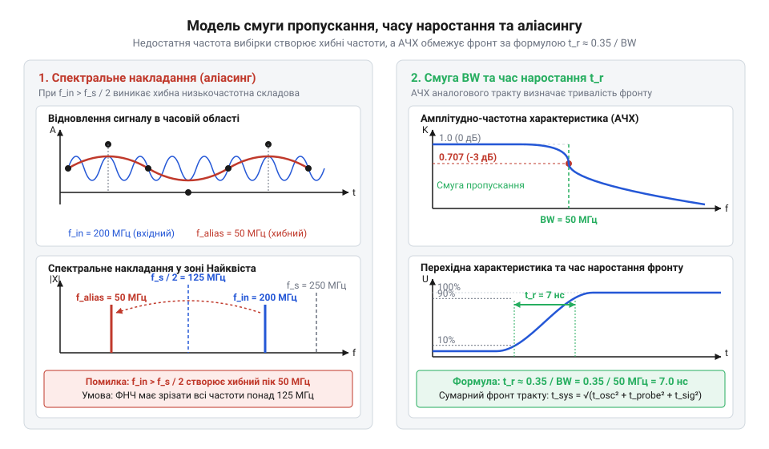

# Математичні основи цифрової дискретизації та розрахунку смуги пропускання

<preknowlist>
- [Режим самописця Roll Mode у цифрових осцилографах](root:cat-hw-instruments/oscilloscope-roll-mode) — принципи безперервної часової вибірки та оновлення буфера пам'яті осцилографа
</preknowlist>

## Дискретизація неперервного сигналу й аліасинг

Перетворення аналогового напругового сигналу `u(t)` у цифрову форму полягає у фіксації його миттєвих значень через рівні проміжки часу `T_s = 1 / f_s`, де `f_s` — частота дискретизації (@@en|sampling rate@@). Для осцилографа з максимальною частотою вибірки `f_s = 250 MSa/s` період вибірки становить `T_s = 4 нс`. У результаті аналогова крива перетворюється на часовий ряд дискретних відліків `u[n] = u(n · T_s)`.

Щоб отримана послідовність чисел повністю зберігала інформацію про початковий сигнал без спотворень, має виконуватися теорема Котельникова-Шеннона (@@en|Nyquist-Shannon sampling theorem@@). Вона стверджує, що частота дискретизації `f_s` повинна щонайменше удвічі перевищувати найвищу частотну компоненту `f_max` у спектрі досліджуваного сигналу:

        f_s > 2 · f_max
        f_N = f_s / 2            [гранична частота Найквіста]

При частоті дискретизації `f_s = 250 MSa/s` гранична частота Найквіста становить `f_N = 125 МГц`. Якщо у вхідному сигналі присутні гармоніки з частотами `f_in > f_N`, виникає ефект аліасингу (@@en|aliasing@@) — спектральне накладання, при якому високі частоти дзеркально відображаються у низькочастотну область `[0, f_N]`. 

Помилкова реконструйована частота `f_alias` обчислюється через дзеркальне відображення вхідної частоти `f_in` відносно кратних гармонік дискретизації `k · f_s` (де `k = 1, 2, 3...` — номер спектральної зони Найквіста):

        f_alias = |f_in - k · f_s|
        = |140 - 1 · 250|        [підстановка f_in = 140 МГц та k = 1]
        = 110 МГц                [помилкова частота першої зони]

При вимірюванні крутих фронтів високочастотного прямокутного сигналу його вищі складові потрапляють у другу (`k = 2`) та третю (`k = 3`) зони Найквіста. Для складових із частотами `f_in = 520` МГц та `f_in = 770` МГц при `f_s = 250` MSa/s дзеркальні завади обчислюються як:

        f_alias(k=2) = |520 - 2 · 250|
        = |520 - 500|            [кратність k = 2 для другої зони]
        = 20 МГц                 [дзеркальна завада другої гармоніки]

        f_alias(k=3) = |770 - 3 · 250|
        = |770 - 750|            [кратність k = 3 для третьої зони]
        = 20 МГц                 [дзеркальна завада третьої гармоніки]

Ці дзеркальні спектральні складові накладаються на основну смугу `[0, f_N]`, спотворюючи форму прямокутних імпульсів і створюючи хибні коливання на екрані осцилографа.

        f_alias = |f_in - k · f_s|
        = |140 - 1 · 250|        [підстановка f_in = 140 МГц та k = 1]
        = 110 МГц                [помилкова частота аліасного сигналу]

Якщо на вхід приладу подати синусоїдальний сигнал частотою 140 МГц без попереднього відфільтровування, аналогово-цифровий перетворювач створить цифрову копію, яка після реконструювання виглядатиме як чистий синус із частотою 110 МГц. Для спостереження повільних процесів без аліасингу використовують [режим самописця Roll Mode](root:cat-hw-instruments/oscilloscope-roll-mode), де відліки відображаються на екрані безперервно у реальному часі.

## Відновлення сигналу інтерполяцією sinc

Отримавши дискретний ряд відліків `u[n]`, цифровий осцилограф має відтворити неперервну форму хвилі `u(t)` на дисплеї. Точне математичне відновлення неперервного сигналу з обмеженої кількості точок базується на формулі інтерполяції Віттакера-Котельникова-Шеннона з використанням нормованої карданальної синусоїдальної функції `sinc(x)`:

        sinc(x) = sin(π · x) / (π · x)

Ідеальне відновлення аналогового сигналу `u(t)` за дискретними відліками описується сумою:

        u(t) = ∑ u[n] · sinc((t - n · T_s) / T_s)

При вимірюванні високочастотних сигналів відмінність між лінійною інтерполяцією (@@en|linear interpolation@@) та інтерполяцією sinc (@@en|sinc interpolation@@) стає критичною. Для синусоїдального сигналу частотою 50 МГц при дискретизації `f_s = 250 MSa/s` кількість відліків `N` на один період становить:

        N = f_s / f_in
        = 250 / 50               [розрахунок точок на період]
        = 5                      [відліків на один період]

Лінійна інтерполяція з'єднує 5 точок прямими відрізками, перетворюючи синусоїду на заламану багатокутну лінію та занижуючи пікову амплітуду. Інтерполяція sinc розраховує внесок кожного відліку через вагові функції `sinc`, що дозволяє відтворити плавну синусоїдальну форму хвилі та точну амплітуду.

Однак при відновленні прямокутних імпульсів (@@en|square wave@@) sinc-інтерполяція спричиняє математичне осцилювання поблизу крутих фронтів — феномен Гіббса (@@en|Gibbs phenomenon@@). Це пояснюється тим, що гармоніки прямокутного сигналу з частотами понад `f_N = 125 МГц` відсікаються, створюючи характерний сплеск і «дзвін» на реконструйованій осцилограмі. Математичний аналіз показує, що при жорсткому зрізі спектра вище частоти Найквіста висота першого осциляційного піку (@@en|overshoot@@) досягає близько 8.95% (приблизно 9%) від амплітуди перепаду. Цей сплеск є суто математичним артефактом відновлення обмеженого спектра, а не реальним фізичним викривленням у вимірювальному колі.

## Зв'язок смуги пропускання і фронту

Аналоговий входний тракт осцилографа з обмеженою смугою пропускання `BW = 50 МГц` (@@en|bandwidth@@) моделюється фільтром низьких частот (@@en|low-pass filter@@) першого порядку. Амплітудно-частотна характеристика `H(f)` такого фільтра описується виразом:

        H(f) = 1 / √(1 + (f / BW)²)

На межі смуги пропускання `f = BW = 50 МГц` коефіцієнт передачі становить:

        H(BW) = 1 / √(1 + 1²)
        = 1 / √2                 [згасання на рівні 3 дБ]
        ≈ 0.707                  [70.7% початкової амплітуди]

При подачі на вхід ідеального ступенчастого сигналу з нульовим часом наростання, вихідна напруга зростає за експоненційним законом `u(t) = U_0 · (1 - e^(-t / τ))`, де часова константа фільтра дорівнює `τ = 1 / (2 · π · BW)`. 

Час наростання фронту `t_r` (@@en|rise time@@) визначається як інтервал між моментами досягнення 10% та 90% від кінцевого рівня `U_0`:

        t_r = t₂ - t₁
        = τ · ln(1 / 0.1) - τ · ln(1 / 0.9)  [різниця моментів 90% та 10%]
        = τ · (2.3026 - 0.1054)              [обчислення логарифмів]
        = 2.1972 · τ                         [тривалість фронту через τ]
        = 2.1972 / (2 · π · BW)              [підстановка τ = 1 / (2 · π · BW)]
        ≈ 0.35 / BW                          [спрощений коефіцієнт для фільтра 1-го порядку]

Для осцилографа зі смугою пропускання `BW = 50 МГц` власний час наростання фронту `t_r` дорівнює:

        t_r = 0.35 / (50 · 10⁶)
        = 7 · 10⁻⁹ с                         [розрахунок у секундах]
        = 7 нс                               [власний час наростання осцилографа]

При вимірюванні прямокутного меандру частотою `f₁ = 10 МГц` його непарні гармоніки зазнають різного згасання відповідно до АЧХ `H(f) = 1 / √(1 + (f / BW)²)`. Для третьої гармоніки `f₃ = 30 МГц` та п'ятої гармоніки `f₅ = 50 МГц` коефіцієнти передачі аналогового тракту обчислюються як:

        H(f₃ = 30 МГц) = 1 / √(1 + (30 / 50)²)
        = 1 / √(1 + 0.36)        [квадрат відношення частот 0.6² = 0.36]
        = 1 / √1.36               [сума під коренем]
        ≈ 0.858                  [збереження 85.8% амплітуди 3-ї гармоніки]

        H(f₅ = 50 МГц) = 1 / √(1 + (50 / 50)²)
        = 1 / √(1 + 1)           [відношення частот 1.0]
        = 1 / √2                 [згасання на граничній частоті смуги]
        ≈ 0.707                  [збереження 70.7% амплітуди 5-ї гармоніки]

Згасання п'ятої гармоніки до 70.7% та вище придушення наступних непарних складових заокруглює вершини меандру, затягуючи реальний час наростання фронту на екрані осцилографа.

        t_r = 0.35 / (50 · 10⁶)
        = 7 · 10⁻⁹ с                         [розрахунок у секундах]
        = 7 нс                               [власний час наростання осцилографа]

*Залежність відновленого сигналу від частоти вибірки f_s та згасання амплітуди фільтра осцилографа на частоті смуги пропускання BW.*

На відміну від аналогового осцилографічного тракту, [логічний аналізатор WeAct DLA Mini](root:cat-hw-instruments/logic-analyzer-dla-mini) фіксує лише дворічне логічне значення сигналу на кожному такті дискретизації, що робить його непридатним для вимірювання аналогового часу наростання фронту.

## Розрахунок похибок вимірювального тракту

Результуючий виміряний час наростання `t_r_measured` вимірювального тракту (@@en|measurement system@@), який складається з джерела сигналу (`t_r_signal`), пасивного пробника (`t_r_probe`) та осцилографа (`t_r_scope`), розраховується як квадратична сума їхніх власних часів наростання:

        t_r_measured = √(t_r_signal² + t_r_probe² + t_r_scope²)

Якщо джерело генерує фронт тривалістю `t_r_signal = 5 нс`, осцилограф має смугу `BW_scope = 50 МГц` (`t_r_scope = 7 нс`), а пробник має смугу `BW_probe = 60 МГц` (`t_r_probe = 0.35 / 60 МГц ≈ 5.83 нс`), підсумкове значення на екрані становитиме:

        t_r_measured = √(5² + 5.83² + 7²)
        = √(25 + 33.99 + 49)     [сума квадратів складових]
        = √107.99                [підкореневе значення]
        ≈ 10.39 нс               [виміряний час наростання]

Відносна похибка вимірювання `ε_t` часу наростання фронту становить:

        ε_t = (t_r_measured - t_r_signal) / t_r_signal × 100%
        = (10.39 - 5) / 5 × 100% [підстановка значень]
        ≈ 107.8%                 [похибка вимірювання фронту]

Щоб похибка вимірювання часу наростання не перевищувала 3%, смуга пропускання осцилографа `BW` повинна щонайменше у 3–5 разів перевищувати максимальну частоту досліджуваного сигналу `f_max`.
