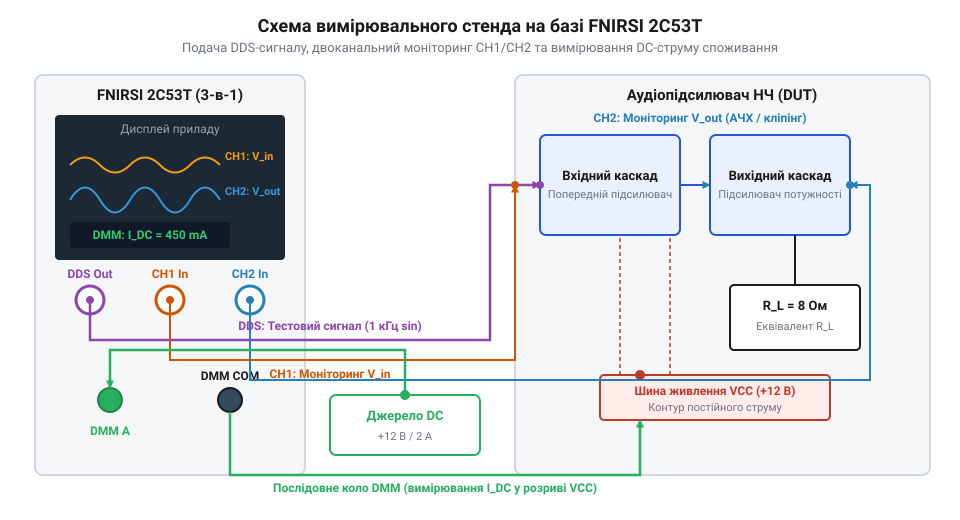

# Практичний проєкт: комплексне відлагодження аудіопідсилювача та фільтра за допомогою FNIRSI 2C53T

## Постановка задачі та підготовка вимірювального стенду

Відлагодження аналогових звукових підсилювачів та активних фільтрів низьких частот вимагає одночасного подавання тестового сигналу, вимірювання струму споживання та моніторингу форми хвилі на вживаних каскадах. Використання кількох окремих приладів ускладнює роботу та створює ризик утворення замкнених контурів заземлення (від англ. @@en|ground loop@@ — земляна петля), які спотворюють дрібні сигнали паразитними наводками мережі 50 Гц. Портативний вимірювальний комбайн 3-в-1 FNIRSI 2C53T об'єднує двоканальний цифровий осцилограф, генератор сигналів прямого цифрового синтезу (від англ. @@en|direct digital synthesis@@, DDS) та цифровий мультиметр у єдиному мобільному корпусі, усуваючи проблему рознесення мас.

*Схема комплексного вимірювального стенду для аналізу аудіотракту за допомогою приладу FNIRSI 2C53T.*

Для побудови тестового стенду вихід генератора `DDS Out` підключають до входу досліджуваного аудіотракту. Перший канал осцилографа `CH1` паралельно з'єднують із входом для контролю еталонної форми й амплітуди сигналу, а другий канал `CH2` підключають до виходу підсилювача або проміжного RC-каскаду. Окрему увагу приділяють вибору коефіцієнта ділення щупів: у режимі `1X` власна паразитна ємність (від англ. @@en|parasitic capacitance@@ — шкідлива ємність кабелю та вхідних кіл) досягає `100 пФ`, що у високоомних каскадах утворює паразитний ФНЧ-фільтр і викривляє АЧХ на високих частотах. Перемикання селектора щупа в режим `10X` вмикає внутрішній прецизійний атенюатор (від англ. @@en|attenuator@@ — послаблювач амплітуди), який підвищує вхідний опір осцилографа до `10 МОм` і зменшує ємнісний вплив до `10–15 пФ`, виключаючи шунтування досліджуваних вузлів. Заземлювальні затискачі щупів `CH1`, `CH2` та генератора об'єднують у єдиній точці спільного провідника (землі) досліджуваної плати. Мультиметр приладу вмикають у режимі вимірювання постійного струму в розрив позитивного провідника живлення `+Vcc`. За необхідності тривалого трасування неперервних процесів зміну параметрів у часі описує [режим самописця Roll Mode](root:cat-hw-instruments/oscilloscope-roll-mode).

Критично важливим етапом збирання вимірювального стенду є правильно організоване зіркоподібне заземлення (англ. @@en|star ground@@) для вирівнювання потенціалів між комбайном та досліджуваним пристроєм. Якщо крокодили заземлення щупів `CH1`, `CH2` та виходу `DDS Out` приєднати до різних точок земляної доріжки друкованої плати, різниця потенціалів на паразитній індуктивності й опорі друкованого провідника створює локальні контури струму. Цей паразитний струм наводить високочастотні завади (англ. @@en|ripple noise@@) та мережевий гул на чутливий вхідний каскад, що спотворює вимірювані осцилограми. Для вирівнювання потенціалів заземлювальні екрани всіх трьох кабелів підключають до єдиної точки спільного провідника (англ. @@en|common ground point@@) безпосередньо біля вхідного роз'єму аудіотракту, що мінімізує довжину контуру та усуває наведення високочастотного шуму на вимірювальний канал.

## Перевірка режимів постійного струму та споживання

Подачі будь-якого змінного тестового звукового сигналу обов'язково передує контроль режимів за постійним струмом (DC-аналіз). Помилка в монтажі, пробій напівпровідникового P-N переходу чи зсув робочої точки транзистора при подачі сигналу спричиняють термічне руйнування активних компонентів або вихід операційного підсилювача у стан насичення.

Перед подачею напруги живлення прилад FNIRSI 2C53T переводять у режим мультиметра для вимірювання постійного струму (`DCmA`). При першому ввімкненні стенду фіксують струм споживання у режимі спокою (англ. @@en|quiescent current@@). Для малопотужного підсилювача або активного фільтра на операційному підсилювачі нормальне споживання у спокої становить від `5 мА` до `30 мА`. Струм понад `100 мА` вказує на наявність короткого замикання або наскрізного струму у вихідному каскаді.

Після перевірки загального споживання мультиметр перемикають у режим вимірювання постійної напруги (`DCV`) та послідовно вимірюють потенціали у ключових вузлах схеми відносно спільної землі. На виході підсилювача із двополярним живленням постійна напруга зсуву нуля (англ. @@en|DC offset voltage@@) повинна не перевищувати `±10 мВ`, а для однополярного живлення — дорівнювати половині напруги живлення `Vcc / 2`. Проте початкового вимірювання у «холодному» стані недостатньо через вплив температурного дрейфу (англ. @@en|thermal drift@@). Напівпровідникові P-N переходи (англ. @@en|P-N junction@@) мають негативний температурний коефіцієнт напруги база-емітер `U_be`, яка зменшується приблизно на `-2.2 мВ` на кожен градус Цельсія зростання температури кристала. Під час розігріву транзисторів каскаду спокою навіть незначне падіння `U_be` у некомпенсованому колі зсуву спричиняє зростання струму колектора, що зсуває робочу точку, збільшує вихідну напругу зсуву та створює ризик саморозігріву (англ. @@en|thermal runaway@@). У диференціальних вхідних каскадах температурний градієнт між транзисторами порушує симетрію плечей, через що напруга на виході може вийти за безпечний діапазон. Довготривалу зміну постійної напруги під час виходу підсилювача на тепловий режим зручно контролювати у [режимі самописця Roll Mode](root:cat-hw-instruments/oscilloscope-roll-mode) приладу. Тільки після підтвердження стабільності розрахункових режимів за постійним струмом як під час увімкнення, так і після прогреву схеми, дозволяється переходити до динамічних випробувань змінним сигналом.

## Подача тестових сигналів та зняття АЧХ

Для вимірювання амплітудно-частотної характеристики (англ. @@en|frequency response@@, АЧХ) прилад перемикають у режим осцилографа з активованим DDS-генератором. З генератора на вхід подають синусоїдальний сигнал частотою `1 кГц` та розмахом `1.0 Vpp`. На осцилографі налаштовують синхронізацію (тригер) по каналу `CH1`, а на каналі `CH2` спостерігають підсилений або відфільтрований вихідний сигнал.

Коефіцієнт підсилення по напрузі `A_v` обчислюють як відношення пікового розмаху вихідної напруги `V_pp_out` (канал `CH2`) до вхідної `V_pp_in` (канал `CH1`), а значення у децибелах `Gain_dB` визначають за формулою:

    A_v = V_pp_out ÷ V_pp_in             [лінійний коефіцієнт підсилення]
    Gain_dB = 20 · log₁₀(A_v)           [коефіцієнт підсилення у децибелах]

Покроково змінюючи частоту DDS-генератора у діапазоні від `100 Гц` до `200 кГц`, фіксують зміну амплітуди на `CH2`. Для рівномірної деталізації АЧХ сітку тестових частот вибирають за логарифмічним принципом (від англ. @@en|logarithmic scale@@ — шкала з рівномірним пропорційним кроком у декадах). Лінійний крок за частотою залишав би низькочастотну область майже без вимірювальних точок, через що легко пропустити вузькосмугові резонансні сплески чи піки підсилення. Вибір логарифмічного розподілу точок (наприклад, по `10`–`20` кроків на декаду) забезпечує однакову відносну роздільну здатність у всьому діапазоні, дозволяючи чітко локалізувати резонансні сплески та крутість зрізу. Граничну частоту зрізу ФНЧ `f_-3dB` визначають як частоту, на якій коефіцієнт підсилення знижується на `3 дБ` від плато смуги пропускання (що відповідає спаду амплітуди до `0.707` від початкового рівня).

Для автоматизованої обробки експортованих з осцилографа FNIRSI 2C53T масивів точок у форматі CSV застосовують консольну утиліти мовою C, яка аналізує траси двох каналів, обчислює розмах `Vpp`, підсилення та знаходить частоту зрізу за рівнем `-3 дБ`:

:::code proj-audio-amplifier-testing-and-debugging/c/include/csv_parser.h
:::code proj-audio-amplifier-testing-and-debugging/c/main.c
:::code proj-audio-amplifier-testing-and-debugging/c/src/csv_parser.c

## Аналіз прямокутного сигналу та кліпінгу

Оцінка реакції аудіотракту на прямокутний сигнал (англ. @@en|square wave test@@) дозволяє швидко виявити приховані проблеми фазової стабільності, схильність каскадів до самозбудження та виміряти швидкість наростання вихідної напруги (англ. @@en|slew rate@@). Перевівши DDS-генератор у режим прямокутної хвилі частотою `1 кГц`, спостерігають форму фронтів вихідного сигналу на каналі `CH2`. Наявність високих викидів (англ. @@en|overshoot@@) або затухаючих коливань (англ. @@en|ringing@@) на вершині прямокутника вказує на недостатній запас стійкості підсилювача чи наявність паразитної індуктивності. Для математичного розрахунку швидкості наростання `SR` вимірюють тривалість фронту — час наростання `t_r` (англ. @@en|rise time@@) між рівнями `10%` та `90%` від повного розмаху вихідної напруги `V_pp`.

    SR = ΔV / Δt
       = (0.8 · V_pp) / t_r      [визначення за амплітудними рівнями 10%–90%]

Отриману величину `SR` вимірюють у вольтах на мікросекунду (`В/мкс`), де зміна напруги `ΔV` дорівнює `0.8 · V_pp`. Високе значення `SR` гарантує відсутність динамічних спотворень у високочастотній ділянці звукового діапазону, тоді як недостатня швидкість наростання спричиняє спотворення форми сигналу та зрізання фронтів.

При плавному збільшенні амплітуди синусоїдального вхідного сигналу вихідна напруга досягає межі напруги живлення каскаду, що викликає верхівкове обмеження сигналу — кліпінг (від англ. @@en|clipping@@ — обрізання вершин синусоїди). Симетричний кліпінг свідчить про вихід у насичення обох плечей вихідного каскаду при максимальній потужності, тоді як несиметричний кліпінг вказує на неправильно виставлену постійну напругу зсуву робочої точки. Окрім того, для відстеження швидких цифрових сигналів у комбінованих системах застосовують [WeAct DLA Mini](root:cat-hw-instruments/logic-analyzer-dla-mini).

Обчислення часової затримки між каналами `CH1` і `CH2`, фазового зсуву та детекцію кліпінгу на цифрових осцилограмах виконує клас-аналізатор мовою C++:

:::code proj-audio-amplifier-testing-and-debugging/cpp/include/waveform_analyzer.hpp
:::code proj-audio-amplifier-testing-and-debugging/cpp/src/main.cpp
:::code proj-audio-amplifier-testing-and-debugging/cpp/src/waveform_analyzer.cpp
