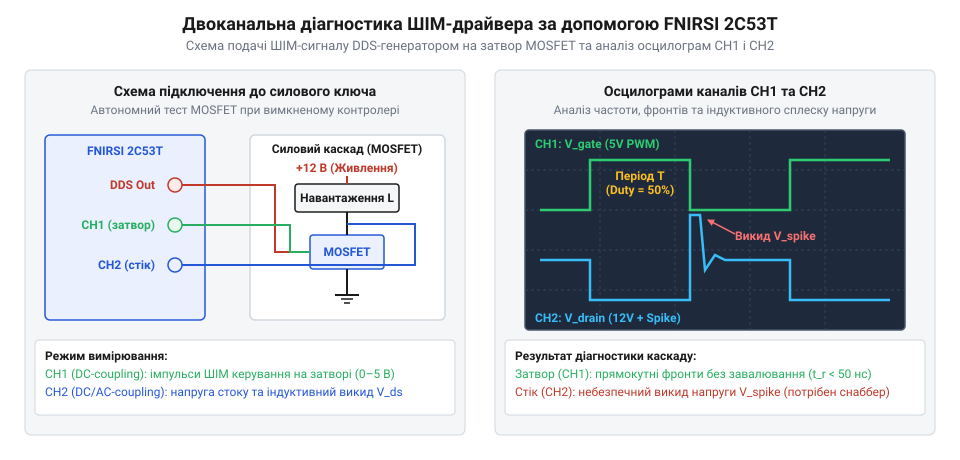

# Практичний проєкт: діагностика ШІМ-контролера двигуна та перетворювача живлення

<preknowlist>
- [Режим самописця Roll Mode у цифрових осцилографах](root:cat-hw-instruments/oscilloscope-roll-mode) — особливості спостереження повільно змінюваних процесів і плавного регулювання коефіцієнта заповнення без розриву розгортки.
</preknowlist>

## Несправність силового каскаду та підготовка стенда

Коли імпульсний регулятор швидкості двигуна постійного струму або силовий перетворювач живлення раптово припиняє обертання вала, а силовий польовий транзистор (від англ. @@en|Metal-Oxide-Semiconductor Field-Effect Transistor@@ або @@en|MOSFET@@) миттєво розігрівається до критичних температур, безінструментальний огляд не дає відповіді про першопричину аварії. Спроба подати живлення "насліп" загрожує остаточним вигорянням друкованих доріжок плати та виходом із ладу керуючого мікроконтролера. Для безпечного локалізації несправності потрібен системний підхід і використання трьох вимірювальних режимів портативного комбайна FNIRSI 2C53T: мультиметра, DDS-генератора сигналів та двоканального осцилографа.

Діагностику починають із підготовки вимірювального стенда та забезпечення гальванічної й електричної безпеки входів приладу. Оскільки напруга на стоку силового ключа під дією індуктивного навантаження може формувати високовольтні амплітуди, перемикачі дільників на щупах осцилографа обов'язково переводять у положення `10X`. Це підвищує вхідний опір каналів приладу з `1 МОм` до `10 МОм` та розширює допустимий діапазон вимірюваної напруги до `400 В` пікового значення, запобігаючи пошкодженню вхідних атенюаторів АЦП. Перед проведенням замірів дільник `10X` піддають емпіричній компенсації (від англ. @@en|probe compensation@@) за допомогою тестового меандру генератора: підстроюванням внутрішньої ємності щупа досягають часової рівності дільника `R_p · C_p = R_in · C_in`, адже недокомпенсація (англ. @@en|undercompensation@@) закругляє прямокутні фронти імпульсів, а перекомпенсація (англ. @@en|overcompensation@@) утворює хибні викиди амплітуди. Для мінімізації паразитної індуктивності контуру заземлення та пригнічення високовольтних дзвінів, викликаних високим `dI/dt` комутаційних струмів ключа, стандартний 12-сантиметровий дріт із затискачем типу «крокодил» замінюють на короткий контактний заземлювальний пружинний адаптер, який підключають безпосередньо до найближчого майданчика силової землі плати (англ. @@en|power ground@@) поруч із витоком MOSFET. Заземлювальні затискачі обох щупів підключають до єдиного потенціалу, щоб уникнути міжканальних земляних петель. При аналізі повільно змінюваних процесів пуску чи термостабілізації корисним є [режим самописця Roll Mode](root:cat-hw-instruments/oscilloscope-roll-mode), який дає змогу безперервно спостерігати тренд без розриву розгортки.

## Перевірка постійних напруг і струмів мультиметром

Першим практичним кроком діагностики є станичні вимірювання за допомогою вбудованого в комбайн цифрового мультиметра (від англ. @@en|Digital Multimeter@@ або @@en|DMM@@). При знятій напрузі живлення прилад переводять у режим прозвонки та вимірювання опору, щоб перевірити цілісність напівпровідникового каналу сток-виток (англ. @@en|drain-source@@) ключа. Опір між стоком і витоком пробитого MOSFET прямує до нуля, створюючи пряме коротке замикання шини живлення на землю. Якщо канал транзистора цілий і не демонструє пробою, перевіряють стан внутрішнього захисного діода (від англ. @@en|body diode@@), вимірюючи спад напруги в прямому ввімкненні (`0.4–0.7 В`).

Після перевірки відсутності коротких замикань на силові шини схеми подають первинну напругу від лабораторного джерела. Режимом вимірювання постійної напруги `DCV` мультиметра перевіряють рівень шини живлення та вихід лінійного або імпульсного стабілізатора `5 В` чи `3.3 В`, що живить схему керування. Просідання первинної напруги під навантаженням понад `10–15%` свідчить про високий власний опір джерела живлення або прихований міжвитковий короткий замикач в обмотці двигуна. Внутрішній опір джерела (від англ. @@en|internal resistance@@) та спад напруги (англ. @@en|voltage drop@@) на силових провідниках шини VCC оцінюють подвійним заміром: вимірюють напругу холостого ходу `V_idle`, а потім під робочим струмом на виході джерела `V_source` та безпосередньо біля силового ключа `V_load`. Обчислення `R_int = (V_idle - V_source) / I_load` виявляє слабке джерело, а просідання `ΔV_trace = V_source - V_load` понад `0.2–0.3 В` вказує на недостатній переріз доріжок або дефект перехідних отворів плати. Для вимірювання значних силових струмів споживання без ризику пошкодження внутрішнього запобіжника мультиметра у розрив силового провідника вмикають прецизійний зовнішній струмовимірювальний шунт (від англ. @@en|current shunt@@) відомого опору (наприклад, `0.01 Ом`), вимірюючи спад напруги в мілівольтах `mV` на його затискачах і розраховуючи струм за законом Ома `I = U_shunt / R_shunt`. При прямому вимірюванні малих струмів холостого ходу у розрив силового провідника вмикають гнізда `COM` та `10A` мультиметра.

## Подача ШІМ-сигналу автономним DDS-генератором

Для швидкого визначення вузла відмови необхідно розділити силову частину від кола формувача імпульсів. Якщо мікроконтролер плати зависає або видає викривлений сигнал широтно-імпульсної модуляції (від англ. @@en|Pulse Width Modulation@@ або @@en|PWM@@), силовий ключ може утримуватися у напіввідкритому стані. Для ізоляції несправності лінію керування затвором (англ. @@en|gate@@) тимчасово відпаюють від виходу мікроконтролера чи драйвера.

Замість штатного контролера джерелом прямокутних імпульсів виступає вбудований у FNIRSI 2C53T DDS-генератор (від англ. @@en|Direct Digital Synthesis@@). Вихід генератора `DDS` підключають через резистор затвора `R_G` (номіналом `100–470 Ом`) до затвора MOSFET, а землю генератора об'єднують із силовою землею плати. Вибір підвищеного номіналу `R_G` є критичним, оскільки вхідна ємність затвора `C_iss` у момент перемикання утворює короткочасне коротке замикання; обмежувальний резистор захищає вихідний буфер DDS-генератора від імпульсного перевантаження за струмом `I = U_out / R_G` та демпфує високочастотний резонансний дзвін кіл затвора. У меню приладу обирають прямокутну форму сигналу (англ. @@en|square wave@@) з частотою `10 кГц`–`20 кГц` та амплітудою `3.3 В` або `5 В`. Регулюючи коефіцієнт заповнення (від англ. @@en|Duty Cycle@@) від `10%` до `90%`, спостерігають за реакцією силового каскаду. Якщо під дією тестового ШІМ-сигналу з DDS-генератора двигун плавно змінює оберти без перегріву ключа, несправність локалізовано в штатному мікроконтролері або його прошивці.

## Двоканальний осцилографічний аналіз комутації ключа

Коли автономний ШІМ-сигнал подано на затвор, прилад переводять у режим двоканального осцилографа для точного аналізу динаміки перемикання силового ключа. Щуп першого каналу `CH1` підключають до затвора MOSFET для контролю форми вхідних імпульсів керування `V_GS`. Щуп другого каналу `CH2` підключають безпосередньо до стоку ключа для фіксації силової напруги `V_DS`.

*Двоканальний моніторинг сигналів затвора (CH1) та стоку (CH2) із позначенням фронтів перемикання і викидів індуктивної самоіндукції.*

Осцилограма каналу `CH1` показує крутість фронтів наростання `t_r` та спаду `t_f`. На спаді сигналу затвора спостерігають характерну горизонтальну ділянку — плато Міллера (від англ. @@en|Miller plateau@@), спричинене перезарядом паразитної ємності затвор-стік `C_gd`. Синхронне зіставлення з каналом `CH2` дає змогу виміряти час активної фази комутації `t_sw`, протягом якого транзистор перебуває у лінійній зоні й одночасно проводить вихідний струм стоку `I_D` та утримує напругу `V_DS`. Динамічні втрати перемикання `P_sw` розраховують як інтеграл добутку напруги й струму за інтервал комутації `P_sw = f_sw · ∫ (V_DS(t) · I_D(t)) dt ≈ 0.5 · V_DS max · I_D max · t_sw · f_sw`; площа цієї зони перекриття визначає кількість джоулевого тепла, що виділяється за один такт. Якщо тривалість плато Міллера та фронту спаду `V_DS` перевищує `1–2 мкс`, ключ зазнає колосальних динамічних втрат, які виникають через затягнутий перехідний процес і спричиняють критичний перегрів кристала.

## Локалізація пульсацій, індуктивних викидів і перегріву

Окрім часових параметрів фронтів, осцилограф `CH2` виявляє амплітуду зворотних індуктивних викидів напруги (від англ. @@en|inductive voltage spike@@), що виникають під час закривання транзистора через самоіндукцію обмоток двигуна `e = -L · (dI/dt)`. Якщо амплітуда цього викиду перевищує гранично допустиму напругу пробою сток-виток `V_DS max` транзистора, в кристалі виникає лавинний пробій. Відсутність або обрив паралельного зворотного шунтуючого діода (від англ. @@en|flyback diode@@) на клемному блоці двигуна є головною причиною миттєвого руйнування ключа.

Для оцінки якості фільтрації напруги живлення канал `CH2` переводять у режим закритого входу (від англ. @@en|AC coupling@@). Зрізаючи постійну складову напруги шини, осцилограф показує лише високочастотні пульсації (англ. @@en|ripple voltage@@). Амплітуда пульсацій понад `0.5–1 В` вказує на деградацію згладжувальних електролітичних конденсаторів та зростання їхнього еквівалентного послідовного опору (від англ. @@en|Equivalent Series Resistance@@ або @@en|ESR@@). Для придушення високочастотного резонансного дзвону паралельно силовому ключу підключають демпферний RC-ланцюг (від англ. @@en|RC snubber circuit@@). Ємність демпферного конденсатора `C_s` обирають у `2–4` рази більшою за вихідну ємність ключа `C_oss`, а безіндуктивний резистор `R_s` розраховують під критичне демпфування хвильового опору паразитного контуру `R_s ≈ √(L_p / C_oss)` з урахуванням розсіюваної потужності `P_R = C_s · V_DS² · f_sw`, обираючи високочастотну кераміку типу C0G або X7R. Для комплексної діагностики паралельних цифрових шин керування поруч із осцилографом застосовують [логічний аналізатор DLA Mini](root:cat-hw-instruments/logic-analyzer-dla-mini).
