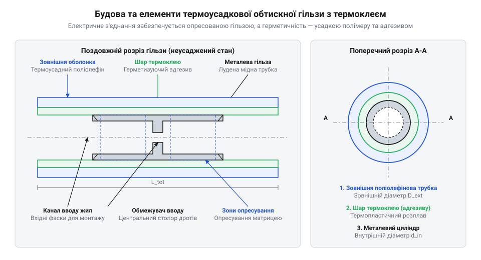
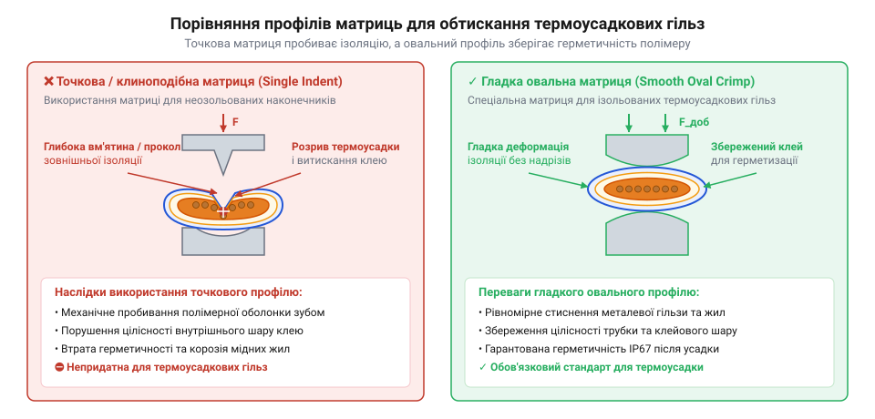
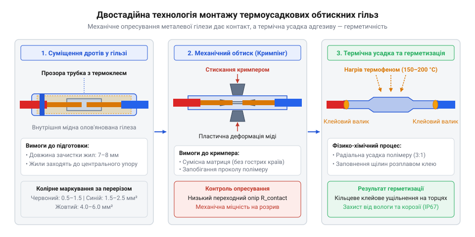

# Термоусадкові обтискні гільзи з термоклеєм

<preknowlist>
- [Знімач ізоляції автоматичний (INTERTOOL HT-7024)](root:cat-hw-instruments/wire-stripper) — підготовка точних довжин зняття ізоляції без підрізання мідних жил провідника
- [Накінечники та клеми для опресування провідників](root:cat-hw-instruments/wire-terminals-and-crimp-connectors) — механіка опресування та принципи пластичної деформації металевих гілез
- [Термофен BAKU BK-8033](root:cat-hw-instruments/hot-air-station-baku) — робота з гарячим повітрям, налаштування температури й потоку для термоусадки
</preknowlist>

## Руйнування відкритих з'єднань під дією вологи

Електрична проводка в моторному відсіку автомобіля, бортовій мережі причепа, сільськогосподарській техніці чи зовнішніх промислових датчиках постійно працює у жорстких умовах. З'єднання дротів, виконане звичайним скручуванням або обтиском без герметизації, у перший день демонструє бездоганну провідність. Проте після кількох місяців впливу дощової води, дорожніх реагентів і температурних коливань у колі починаються збої: тьмяніють фари, зникають сигнали датчиків або повністю виходить з ладу живлення.

Головна причина руйнування відкритих контактів полягає у фізико-хімічних процесах, що виникають на межі розділу міді та зовнішнього середовища:

Капілярний ефект (від лат. @@la|capillaris@@ — волосяний). Багатожильний гнучкий провідник складається з десятків тонких мідних дротиків. Мікроскопічні зазори між окремими жилами утворюють мережу капілярів. Коли на відкритий торець з'єднання потрапляє крапля вологи чи рідкого електроліту (води з розчиненими солями), сили поверхневого натягу затягують рідину глибоко всередину джгута під ізоляцію на десятки сантиметрів від місця зрощування.

Гальванічна та електрохімічна корозія (від англ. @@en|galvanic corrosion@@ — гальванічна корозія). Оголена мідь у присутності води й атмосферного кисню швидко вкривається оксидами. Під дією постійного електричного потенціалу електрохімічна корозія прискорюється в рази. Оксиди міді має незначну провідність порівняно з чистою міддю. У міру наростання оксидного шару ефективна площа контакту між жилами зменшується, що викликає стрімке зростання перехідного опору (від англ. @@en|contact resistance@@ — перехідний опір). За законом Джоуля-Ленца високий опір призводить до локального нагріву контактної зони при проходженні струму. Це ще більше прискорює термічне окиснення і здатне розплавити сусідню ізоляцію або спричинити займання.

Термоциклювання та ефект пневматичного всмоктування. Під час роботи обладнання проводка нагрівається, а після вимкнення охолоджується. Повітря, замкнене під зовнішньою оболонкою джгута, розширюється при нагріванні та витісняється назовні, а при охолодженні стискається. Усередині негерметизованого провідника утворюється розрядження, яке активне всмоктує вологе зовнішнє повітря та конденсат через будь-який негерметичний стик.

Фретінг-корозія (від англ. @@en|fretting corrosion@@ — корозія тертя). Вібрації від двигуна чи механізмів викликають постійні мікрозміщення дротів один відносно одного. Оксидна плівка на поверхні жил стирається, утворюючи дрібнодисперсний чорний оксидний порошок, який працює як диелектрик і розриває електричне коло.

Традиційні способи ізоляції виявляються безсилими у вологому середовищі. Звичайна ПВХ ізолента (від англ. @@en|electrical tape@@ — ізоляційна стрічка), намотана поверх скручування, тримається за рахунок клейового шару. Під дією ультрафіолету, високої температури й випарів мастила клей розкладається, стрічка розмотується, а під її витки легко проникає вода. Одностінна термоусадкова трубка (від англ. @@en|heat shrink tubing@@ — термоусадкова трубка) щільно облягає зовнішній діаметр провідника, але залишає порожнини між окремими жилами на торцях. За відсутності внутрішнього заповнювача волога вільно проходить вздовж жил під полімерною оболонкою за рахунок капілярного всмоктування.

Застосування паяння за допомогою [класичного припою](root:cat-hw-instruments/solder-tin) монолітизує жилу, але залишки флюсу приваблюють вологу, а межа між жорсткою пропаяною ділянкою та гнучким провідником стає точкою концентрації механічних напружень. Під дією вібрації дріт у цій точці швидко ламається від втомного руйнування. Більш детально порівняння фізико-механічних властивостей між [паянням чи опресуванням](root:cat-hw-instruments/soldering-vs-crimping-wire-joints) висвітлено в окремій статті.

Практична потреба в надійному зрощуванні дротів виникла з розвитком авіації та автоелектроніки середини XX століття. Початкові методи — скручування з пайкою та обгортанням смоляною ізолентою — виявилися нежиттєздатними у бортових мережах літаків і важкої техніки через вібраційне втомне руйнування міді та швидке проникання вологи. У 1960-х роках аерокосмічна галузь перейшла на механічне опресування металевих затискачів із додатковим надяганням захисних трубок. Проте лише розробка двостінних полімерів із внутрішнім термоклеєм дозволила об'єднати механічну міцність обтиску та повну гідроізоляцію в єдиний монтажний елемент. Докладно те, як проходила [еволюція методів герметизації](root:cat-hw-instruments/heat-shrink-crimp-connectors/hist-heat-shrink-connectors.md) у промисловості, розкрито в окремому історичному матеріалі.

Для створення довговічного контактного вузла необхідно одночасно вирішити два завдання: забезпечити надміцну механічну фіксацію мідних жил та створити суцільний 360-градусний гідробар'єр довкола всієї зони зрощування.

## Конструкція та двошаровий принцип герметизації

Для вирішення фізичної суперечності між необхідністю жорсткого механічного затискання й м'якого герметичного заповнення порожнин розроблено двошарову термоусадкову обтискну гільзу (від англ. @@en|heat shrink crimp connector@@ — термоусадкова обтискна гільза). Вона являє собою співвісну комбінацію двох матеріалів із радикально різними фізико-механічними властивостями.

Внутрішньою основою гільзи є безшовний металевий циліндр (від англ. @@en|seamless crimp sleeve@@ — безшовна обтискна гільза), виготовлений з електролітичної міді (від англ. @@en|electrolytic copper@@ — електролітична мідь) або латуні. Для захисту від атмосферного окиснення та запобігання гальванічній корозії поверхня металу покривається шаром олова методом оловування (від англ. @@en|tin plating@@ — оловування). Відсутність поздовжнього зварного чи паяного шва критично важлива: під час опресування кліщами циліндр деформується рівномірно і не розривається вздовж твірної під дією високого тиску.

Зовнішньою оболонкою є двошарова трубка. Її зовнішній шар виконано з зшитого поліолефіну (від ґрец. @@el|polys@@ — чисельний та лат. @@la|oleum@@ — олія; англ. @@en|polyolefin@@ — поліолефін). На внутрішню стінку поліолефінової трубки нанесено суцільний рівномірний шар термопластичного клею-розплаву (від англ. @@en|hot-melt adhesive@@ — термоклей) на основі поліаміду або етиленвінілацетату (від англ. @@en|EVA@@ — етиленвінілацетат).


*Поперечний та поздовжній розріз термоусадкової обтискної гільзи: внутрішні мідні стінки сприймають механічний обтиск, а зовнішня поліолефінова трубка з розплавленим термоклеєм утворює монолітну герметичну капсулу.*

Функції між елементами гільзи чітко розподілені за двома послідовними стадіями монтажу:

Перша стадія — холодна пластична деформація (від англ. @@en|plastic deformation@@ — пластична деформація). При стисканні гільзи губками обтискного інструмента мідний циліндр зазнає незворотної пластичної деформації. Його стінки витісняють повітря з внутрішньої порожнини і зминають багатожильний провідник у монолітний мідний брусок. У зоні контактного обтиску виникає фізичне зчеплення жил за принципом холодної зварки, що забезпечує мінімальний електричний опір та високу механічну міцність на розрив (від англ. @@en|tensile strength@@ — міцність на розрив). Металевий циліндр бере на себе 100% механічних осьових навантажень.

Друга стадія — термічна усадка та рідка герметизація. При нагріванні з'єднання гарячим повітрям від [термофена BAKU](root:cat-hw-instruments/hot-air-station-baku) одночасно розгортаються два термічні процеси:

1. Ефект пам'яті форми поліолефіну (від англ. @@en|shape memory effect@@ — ефект пам'яті форми). У процесі виробництва молекули поліолефіну піддаються радіаційному зшиванню (від англ. @@en|cross-linking@@ — зшивання молекулярних ланцюгів) та розтягуються в гарячому стані. При повторному нагріванні вище температури кристалізації (~120 °C) внутрішні напруження повертають трубку до її початкового малого діаметра. Коефіцієнт усадки досягає 3:1.

2. Перехід термоклею у рідкий стан. Термоклей розплавляється, перетворюючись на плинну масу з низькою в'язкістю. Зшита поліолефінова оболонка, стискаючись із високим радіальним зусиллям, діє як поршень: вона витісняє рідкий клей в усі мікроскопічні зазори між жилами дротів та між металевим циліндром і зовнішньою ізоляцією провідника.

У міру завершення усадки надлишок розплавленого клею видавлюється з торців поліолефінової трубки, утворюючи суцільне кільце (від англ. @@en|adhesive ring@@ — клейовий валик). При охолодженні клей твердне, перетворюючись на пружний герметичний затвор.

Сформований клейовий валик виконує три критичні функції: він забезпечує абсолютну гідроізоляцію контактної зони за стандартом IP67/IP68, створює розвантаження від натягу (від англ. @@en|strain relief@@ — демпфування натягу) на межі виходу дроту з гільзи та гасить високочастотні вібрації. Детальні характеристики та порівняння клейових составів наведено у довіднику з [клейовим шаром](root:cat-hw-parts/heat-shrink-tubing-adhesive-types).

## Підбір розміру та матриці обтискного інструмента

Надійність герметичного обтискного з'єднання на 90% залежить від правильного геометричного підбору калібру гільзи та використання належного профілю обтискної матриці.

Для швидкого орієнтування термоусадкові гільзи мають стандартне колірне маркування (від англ. @@en|color coding@@ — колірне маркування) відповідно до діапазону перерізів провідників:

Червона гільза (від англ. @@en|Red sleeve@@ — червона гільза): призначена для дротів перерізом від `0.5 мм²` до `1.5 мм²` (відповідає американському калібру @@en|AWG 22@@ – @@en|AWG 16@@).

Синя гільза (від англ. @@en|Blue sleeve@@ — синя гільза): призначена для дротів перерізом від `1.5 мм²` до `2.5 мм²` (відповідає калібру @@en|AWG 16@@ – @@en|AWG 14@@).

Жовта гільза (від англ. @@en|Yellow sleeve@@ — жовта гільза): призначена для дротів перерізом від `4.0 мм²` до `6.0 мм²` (відповідає калібру @@en|AWG 12@@ – @@en|AWG 10@@).

При з'єднанні кількох провідників в один торець (наприклад, при паралельному відгалуженні) розрахунок ведуть за сумарною площею поперечного перерізу:

```
S_total
= S_1 + S_2 + ... + S_n                      [сума перерізів усіх провідників у гільзі]
```

Для переведення американського калібру дроту AWG у площу перерізу в мм² застосовують формулу:

```
S
= (π ÷ 4) × d²                                 [площа круга за діаметром]
= (π ÷ 4) × (0.127 × 92^((36 - AWG) ÷ 39))²    [формула переведення AWG у мм²]
```

**Обчислення площі перерізу провідника калібру AWG 16**
```
AWG = 16
d = 0.127 × 92^((36 - 16) ÷ 39)
  = 0.127 × 92^(20 ÷ 39)
  ≈ 1.291 мм                                    [розрахований діаметр жили]
S = (3.14159 ÷ 4) × 1.291²
  ≈ 1.309 мм²                                   [підсумковий переріз провідника]
```

Отримане значення `1.309 мм²` потрапляє в діапазон від `0.5 мм²` до `1.5 мм²`, що вимагає вибору червоної гільзи. Якщо в один торець вставляються два дріти `AWG 16`, їхня сумарна площа становить `1.309 × 2 = 2.618 мм²`, що виходить за межі червоної гільзи й вимагає переходу на синю або жовту гільзу.

Під час підбору гільзи важливо враховувати не лише сумарну площу мідних жил, а й коефіцієнт заповнення металевого циліндра `K_fill`. Якщо переріз дротів занадто малий для даного калібру гільзи (наприклад, дріт `0.2 мм²` у червоній гільзі), опресування не створить необхідного тиску для пластичної деформації міді, залишаючи внутрішні пустоти. І навпаки, перевищення допустимого перерізу розпірає металеву трубку, перешкоджаючи повному закриттю матриці. Повний математичний алгоритм проведення [роззрахунку сумарного перерізу](root:cat-hw-instruments/heat-shrink-crimp-connectors/math-crimp-fill-ratio-calculation.md) провідників та розрахунку коефіцієнта усадки полімерної оболонки викладено в окремому довіднику.

Детальні геометричні розміри мідних гілез, товщину клейового шару, допустимі струмові навантаження та діапазони робочих температур для кожного колірного калібру можна перевірити через залізничний [довідник геометричних параметрів](root:cat-hw-instruments/heat-shrink-crimp-connectors/api-crimp-sleeve-specifications.md) термоусадкових клем.

Найпоширенішою помилкою при монтажі є використання неналежного обтискного інструмента. Стандартні кліщі для неізольованих гільз мають точкові або клиноподібні виступи (від англ. @@en|indent crimper@@ — точковий кримпер). Під час стискання гострий клин матриці пробиває тонку поліолефінову оболонку гільзи, утворюючи наскрізний прокол. При подальшому нагріванні клей витікає через пробивний отвір, а поліолефін розривається, повністю знищуючи герметичність з'єднання.

Для термоусадкових гільз слід використовувати кліщі зі спеціальними гладкими овальними губками (від англ. @@en|oval crimp die@@ — овальна обтискна матриця), які входять до оснащення якісних [обтискних кліщів](root:cat-hw-instruments/crimp-tool). Овальна матриця плавно деформує металеву гільзу, рівномірно розподіляючи тиск по окружності без гострих кутів та локальних проколів. Інструмент повинен мати храповий механізм (від англ. @@en|ratchet mechanism@@ — храповий механізм), який не дозволяє розтиснути губки до завершення повного циклу опресування.


*Порівняння профілів матриць обтискних кліщів: клиноподібна матриця пробиває полімерну оболонку, тоді як гладка овальна матриця зберігає суцільність термоусадкової трубки.*

Двостадійна технологія монтажу проводиться у такій послідовності:

1. Підготовка провідників. Ізоляцію з кінців дротів знімають на довжину, що дорівнює половині довжини внутрішнього мідного циліндра, за допомогою [автоматичного знімача ізоляції](root:cat-hw-instruments/wire-stripper). Детальні рекомендації з [підготовки провідників](root:cat-hw-instruments/wire-stripper) наведено у відповідному посібнику. За потреби кінці жили підрівнюють [бокорізами](root:cat-hw-instruments/side-cutters).

2. Опресування. Зачищені жили вставляють у металевий циліндр до упору. Гільзу позиціонують в овальній матриці обтискного інструмента відповідного кольору і стискають губки до спрацювання храпового механізму.

3. Термоусадкування. З'єднання рівномірно прогрівають гарячим повітрям із температурою 120–150 °C від [термофена BAKU](root:cat-hw-instruments/hot-air-station-baku). Прогрів ведуть від центра гільзи до її країв, щоб витіснити залишки повітря. Процес припиняють, коли поліолефінова трубка повністю обляже дріт, а з обох торців виступить рівномірне кільце рідкого клею.


*Покрокова схема двостадійного монтажу: механічне опресування овальною матрицею з подальшим рівномірним прогревом феном до появи клейових валиків.*

Покрокову практику створення складного бортового джгута проводки з перевіркою герметичності під тиском та випробуванням на розрив дивіться в інструкції з [монтажу герметичного джгута](root:cat-hw-instruments/heat-shrink-crimp-connectors/proj-weatherproof-harness-splicing.md) для жорстких умов експлуатації.

## Двостадійна технологія монтажу та термоусадки

Надійність електричного з'єднання в агресивному зовнішньому середовищі залежить не лише від конструкції сполучного елемента, а й від дотримання суворої послідовності його встановлення. Фізична модель герметичної гільзи вимагає послідовного вирішення двох незалежних завдань: спочатку створюється низькоомний механічний контакт між мідними жилами, а потім формується суцільний гідроізоляційний бар'єр. Порушення технологічного порядку — наприклад, спроба прогріти гільзу до опресування або використання випалювального джерела відкритого вогню — зводить нанівець переваги конструкції. Саме тому [історію розвитку технологій](root:cat-hw-instruments/heat-shrink-crimp-connectors/hist-heat-shrink-connectors.md) зрощування провідників у бортовій електроніці супроводжувала еволюція від кустарного скручування з пайкою до жорстко регламентованого двостадійного монтажу.

Перша стадія починається з якісної підготовки провідників. Робочу ділянку жили необхідно зачистити від ізоляційного покриття на довжину, яка точно дорівнює половині довжини внутрішнього мідного циліндра гільзи (зазвичай це 7–8 мм). Для цього застосовують прецизійний [автоматичний знімач ізоляції](root:cat-hw-instruments/wire-stripper), який зрізає зовнішній полімер без засічок і надрізів мідних носіїв (докладніше про підготовчі операції див. у матеріалі про [підготовка провідників до обтиску](root:cat-hw-instruments/wire-stripper)). Оголені жили не варто сильно скручувати між собою в щільний джгут: паралельне розташування мікропровідників полегшує їхнє взаємне зміщення та пластичне ущільнення всередині металевого циліндра. Провідники вводять з обох торців гільзи до упору в центральний обмежувач (`@@en|wire stop@@` — від англійського *wire stop*, внутрішній штампований виступ циліндра).

Опресування виконують спеціальними [обтискними кліщами](root:cat-hw-instruments/crimp-tool), оснащеними матрицями овального профілю. Інструмент позиціонують так, щоб робоче губце охоплювало металеву ділянку гільзи між центральним обмежувачем та зовнішнім зрізом внутрішнього циліндра, не зачіпаючи крайні незахищені зони полімерної трубки. Ручки кліщів стискають до повного спрацьоварння `@@en|ratchet mechanism@@`. Під дією симетричного тиску безшовна мідна гільза зазнає пластичної деформації, стискаючи жили провідника в монолітну систему з мінімальним міжжильним зазором. Зовнішній шар із `@@en|polyolefin@@` при цьому зберігає цілісність завдяки своїй високій радіальній еластичності.


*Послідовний прогрів від центрального металевого циліндра до країв витісняє повітряні бульбашки й формує суцільний герметичний валик клею.*

Друга стадія передбачає термічну активацію захисної оболонки та внутрішнього шару адгезиву. Для прогріву використовують [термофеном BAKU](root:cat-hw-instruments/hot-air-station-baku) із насадкою-рефлектором, яка забезпечує рівномірне охоплення гільзи гарячим повітрям. Температуру фена встановлюють у діапазоні 250–300 °C, що гарантує швидкий нагрів стінок без термічного розкладу матеріалу. Фізика процесу базується на двох температурних порогах: внутрішній `@@en|hot-melt adhesive@@` переходить у рідкоплинний стан при 90–110 °C, тоді як зовнішня поліолефінова оболонка починає активну радіальну усадку (`@@en|shrink temperature@@` — від англійського *shrink temperature*, температура усадки) за досягнення 120–150 °C.

Критично важливим елементом технології є напрямок переміщення повітряного потоку: нагрів обов'язково починають від центра гільзи, поступово зміщуючи сопло фена до її країв (`@@en|center-to-edge heating@@` — від англійського *center-to-edge heating*, нагрівання від центра до країв). Коли поліолефін ущільнюється в центральній частині, розплавлений клей витісняє залишки повітря назовні. Якщо ж спочатку прогріти торці, оболонка герметизує краї раніше за центр, унаслідок чого всередині утворюються замкнені повітряні каверни (`@@en|air pockets@@` — від англійського *air pocket*, повітряна кишеня). Під час подальшої експлуатації в умовах термоциклювання повітря в цих кавернах розширюється й руйнує герметичність контакту.

Візуальним критерієм успішного завершення термоусадки є повне прилягання трубки до ізоляції провідників та витискання рідкого клею на торцях. Гарячий адгезив під дією усадочного тиску полімеру заповнює найменші капіляри й виходить назовні у вигляді прозорого кільцевого валика (`@@en|adhesive ring@@`). Наявність суцільного 360-градусного клейового поясу з обох боків свідчить про те, що з'єднання повністю захищене від проникнення вологи та агресивних хімічних речовин. Такий порядок дій є обов'язковим, коли виконується [монтаж герметичного джгута](root:cat-hw-instruments/heat-shrink-crimp-connectors/proj-weatherproof-harness-splicing.md) у транспортних засобах або промисловому обладнанні.

## Контроль якості з'єднання та діагностика дефектів

Завершення процесів опресування та усадки вимагає обов'язкової оцінки отриманого з'єднання, оскільки приховані дефекти монтажу призводять до відмови обладнання в умовах підвищеної вологості або вібрації. Правильне попереднє визначення розміру гільзи спирається на [розрахунок сумарного перерізу](root:cat-hw-instruments/heat-shrink-crimp-connectors/math-crimp-fill-ratio-calculation.md) дротів, а перевірка відповідності кольору струмоведучим жилам здійснюється за [специфікацією та колірним маркуванням](root:cat-hw-instruments/heat-shrink-crimp-connectors/api-crimp-sleeve-specifications.md). Проте навіть правильно підібрана гільза може бути зіпсована через порушення режиму обтиску або нагріву. Комплексна діагностика з'єднання включає неруйнівний візуальний контроль (`@@en|visual inspection@@` — від англійського *visual inspection*, візуальний огляд) та механічне випробування на міцність.

Еталонне з'єднання характеризується чотирма чіткими візуальними ознаками. По-перше, зовнішня оболонка з `@@en|polyolefin@@` повинна щільно й рівномірно обтягувати як металевий циліндр, так і ізоляційну оболонку дротів без зморшок, бульбашок або локальних стоншень. По-друге, з обох торців гільзи має виступати суцільний кільцевий `@@en|adhesive ring@@`, який повністю перекриває зазор між ізоляцією провідника й термоусадковою трубкою. По-третє, усередині полімеру не повинно бути окремих відокремлених мідних волокон (`@@en|stray strands@@` — від англійського *stray strands*, поодинокі жили, що випали з джгута), які могли б проткнути оболонку під час стискання. По-четверте, стандартне колірне маркування (`@@en|color coding@@`) гільзи має залишатися виразним і пізнаваним, що підтверджує відсутність перегріву.


*Порівняння еталонного герметичного з'єднання з дефектами прорізання оболонки, перегріву полімеру та недостатнього обтиску.*

Найпоширеніші дефекти монтажу поділяються на термічні та механічні. Термічне пошкодження полімеру (`@@en|thermal degradation@@` — від англійського *thermal degradation*, теплова деградація) виникає внаслідок тривалого тримання фена на одному місці або перевищення температури повітря понад 220 °C. Поліолефін при цьому темніє, стає крихким, а на його поверхні утворюються мікроскопічні наскрізні прогари (`@@en|pinhole defect@@` — від англійського *pinhole defect*, точковий отвір). Наслідком є повна втрата герметичності й прискорене проникнення вологи до мідного контакту. Протилежний дефект — недостатній прогрів (`@@en|under-heating@@` — від англійського *under-heating*, недогрів) — залишає трубку зморщеною, а клей недорозплавленим. У результаті вздовж жил провідника зберігаються капілярні канали, крізь які волога всмоктується всередину вузла.

Механічні дефекти виникають переважно на стадії опресування. Недостатнє зусилля стискання (`@@en|under-crimping@@` — від англійського *under-crimping*, недотискання) залишає порожнини між жилами, що призводить до зростання значення `@@en|contact resistance@@` та високого ризику висмикування дроту при механічному натягу. Натомість використання матриць із точковим пробійником (`@@en|indent crimper@@`) замість правильної овальної форми (`@@en|oval crimp die@@`) спричиняє прорізання полімерної трубки (`@@en|die cut defect@@` — від англійського *die cut*, прорізання матрицею). Гострі краї затиснутого мідного циліндра проштовхуються крізь розм'якшений поліолефін, унаслідок чого гільза втрачає діелектричну міцність і герметичність, навіть якщо клей розплавився повністю. Крім того, помилка в довжині зачищення жил (`@@en|stripping error@@` — від англійського *stripping error*, дефект зачищення) призводить або до виходу оголеної міді за межі герметизованої зони, або до неповного захоплення провідника металевим циліндром.

Оперативний контроль механічної міцності у виробничих умовах здійснюють шляхом тактильного випробування на розрив (`@@en|pull test@@` — від англійського *pull test*, ручний тест на висмикування), під час якого до затиснутих дротів прикладають помірне зусилля вздовж осі з'єднання. У відповідальних застосуваннях проводять вимірювання максимального зусилля утримання (`@@en|pull-out force@@` — від англійського *pull-out force*, зусилля висмикування) на розривній машині (`@@en|tensile strength test@@` — від англійського *tensile strength test*, випробування на міцність при розтягу). За регламентами стандартів, описаних у матеріалі про [випробування на розрив](root:cat-hw-instruments/tensile-pull-testing-standards), якісно опресоване з'єднання повинно витримувати навантаження, що перевищує межу міцності самого мідного провідника. Порівнюючи з'єднання між [паянням чи опресуванням](root:cat-hw-instruments/soldering-vs-crimping-wire-joints), обтискні гільзи забезпечують значно вищу стійкість до втомного руйнування при вібраціях. За потреби ретельного аналізу дефектних вузлів розрізають оболонку, використовуючи [бокорізи](root:cat-hw-instruments/side-cutters), оцінюють [властивості клейового шару](root:cat-hw-parts/heat-shrink-tubing-adhesive-types) та перевіряють стан внутрішнього циліндра через стандартні [клеми для опресування](root:cat-hw-instruments/wire-terminals-and-crimp-connectors).