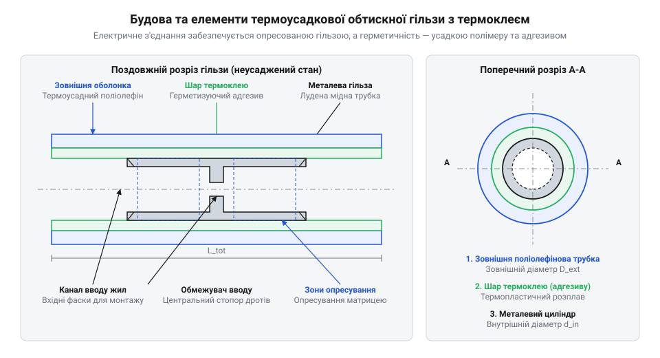
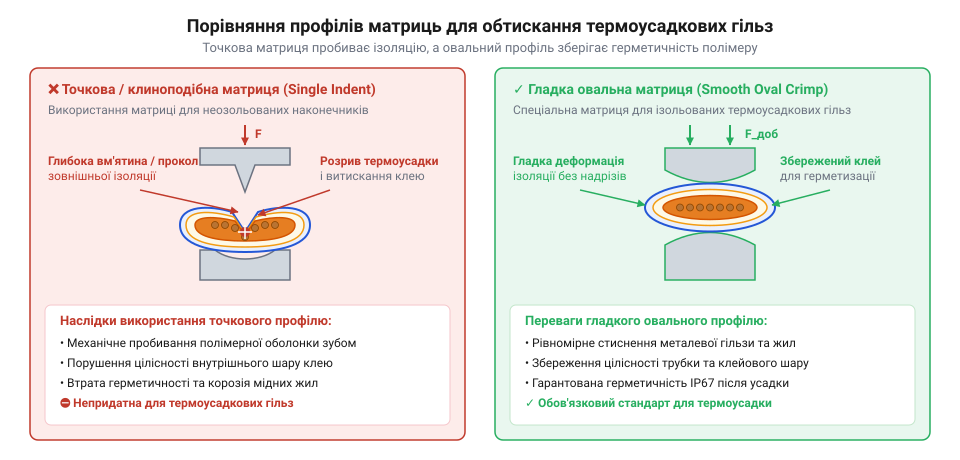

# Термоусадкові обтискні гільзи з термоклеєм

<preknowlist>
- [Знімач ізоляції автоматичний (INTERTOOL HT-7024)](root:cat-hw-instruments/wire-stripper) — підготовка точних довжин зняття ізоляції без підрізання мідних жил провідника
- [Накінечники та клеми для опресування провідників](root:cat-hw-instruments/wire-terminals-and-crimp-connectors) — механіка опресування та принципи пластичної деформації металевих гілез
- [Термофен BAKU BK-8033](root:cat-hw-instruments/hot-air-station-baku) — робота з гарячим повітрям, налаштування температури й потоку для термоусадки
</preknowlist>

## Руйнування негерметичних контактів під вологою

Коли багатожильні провідники з'єднують у [класичних обтискних накінечниках](root:cat-hw-instruments/wire-terminals-and-crimp-connectors), між мідними жилами залишаються мікроскопічні зазори. Під дією поверхневого натягу виникає капілярне (від лат. capillaris — волосяний) всмоктування: волога затягується глибоко під оболонку джгута, де не випаровується.

При проходженні струму крізь мокру мідь за наявності кисню та солей починається електрохімічна корозія (від лат. corrosio — роз'їдання). Оксиди міді мають низьку провідність, тому робоча площа контакту зменшується, а перехідний опір (@@en|contact resistance@@) стрімко зростає.

За законом Джоуля — Ленца цей опір викликає локальний нагрів, який прискорює корозію та призводить до обриву кола або розплавлення ізоляції. Захистити контакт може лише повна герметизація, яку не забезпечує [звичайна термоусадкова трубка](root:cat-hw-instruments/heat-shrink-tubing) без клейового шару.

## Двостінна конструкція та двостадійний захист

Двостінна термоусадкова обтискна гільза поєднує силовий металевий елемент і полімерну гідроізоляційну оболонку.

*Конструкція двостінної гільзи поєднує внутрішню олов'яновану мідну трубу для опресування та зовнішню поліолефінову оболонку з шаром термоклею.*

Внутрішній циліндр із м'якої олов'янованої міді зазнає пластичної деформації (@@en|plastic deformation@@) під тиском, стискаючи жили в суцільний низькоомний блок. Олово захищає мідь від окислення. Зовнішня оболонка зі зшитого поліолефіну (@@en|polyolefin@@) містить внутрішній шар термопластичного адгезиву (@@en|hot-melt adhesive@@).

Монтаж виконують у дві стадії:
1. Механічне опресування: деформація мідної гільзи з жилами формує контакт із мінімальним перехідним опором (@@en|contact resistance@@). 2. Термічна усадка: прогрів [термофеном гарячого повітря](root:cat-hw-instruments/hot-air-station-baku) стискає оболонку з @@en|polyolefin@@, а розплавлений адгезив (@@en|hot-melt adhesive@@) заповнює мікропорожнини між жилами.

Захололий клей утворює кільцевий валик (@@en|adhesive ring@@), який блокує капілярне проникання вологи до рівня @@en|IP67/IP68@@ та забезпечує розвантаження від натягу (@@en|strain relief@@).

## Підбір розміру, матриці та усадка

Гільзу вибирають за сумарним перерізом дротів через колірне маркування (@@en|color coding@@): червоний — 0.5–1.5 мм² (@@en|AWG@@ 22–16), синій — 1.5–2.5 мм² (@@en|AWG@@ 16–14), жовтий — 4.0–6.0 мм² (@@en|AWG@@ 12–10). Ізоляцію оголюють інструментом [автоматичний знімач ізоляції](root:cat-hw-instruments/wire-stripper).

Опресовують овальною матрицею (@@en|oval crimp die@@) у [професійних обтискних кліщах](root:cat-hw-instruments/crimp-tool). Точкові кримпери (@@en|indent crimper@@) пробивають оболонку й руйнують герметичність.

*Овальна матриця обтискає гільзу без пошкодження полімеру.*

Усадку виконують гарячим повітрям (250–300 °C) від центра до країв (@@en|center-to-edge heating@@), щоб адгезив (@@en|hot-melt adhesive@@) витіснив повітря без каверн. Недогрів (@@en|under-heating@@) чи термічний розклад (@@en|thermal degradation@@) псують шар. Вихід клею дає рівень @@en|IP67/IP68@@ та розвантаження від натягу (@@en|strain relief@@).

## Контроль якості та діагностика дефектів

*Правильно змонтована гільза має рівномірний клейовий валик по краях; пробиття жилами, перегрів або недогрів — привід для бракування.*

Огляд охолодженого з'єднання вимагає перевірки трьох ознак:
- **Клейовий валик**: суцільне кільце (@@en|adhesive ring@@) з торців підтверджує герметичність. - **Цілісність**: відсутність виплетених жил (@@en|stray strands@@), що пробивають @@en|polyolefin@@. - **Стан полімеру**: гладка оболонка без ознак термічного розкладу (@@en|thermal degradation@@) чи недогріву (@@en|under-heating@@).

Міцність пластичної деформації (@@en|plastic deformation@@) перевіряють випробуванням на розрив (@@en|pull test@@) — помірним потягуванням, що гарантує низький перехідний опір (@@en|contact resistance@@).