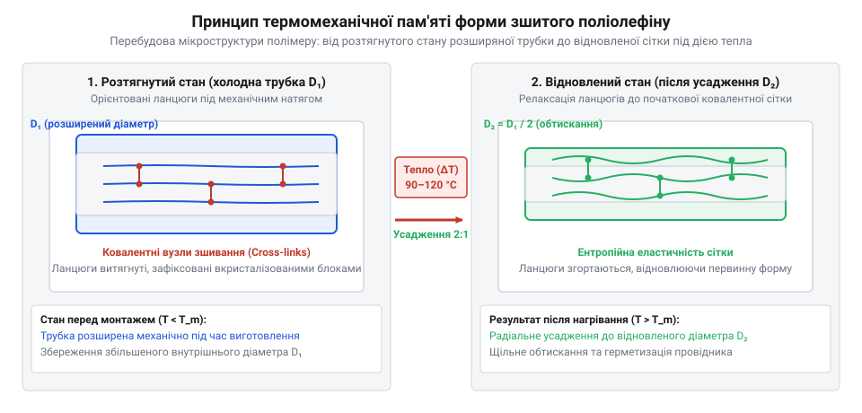
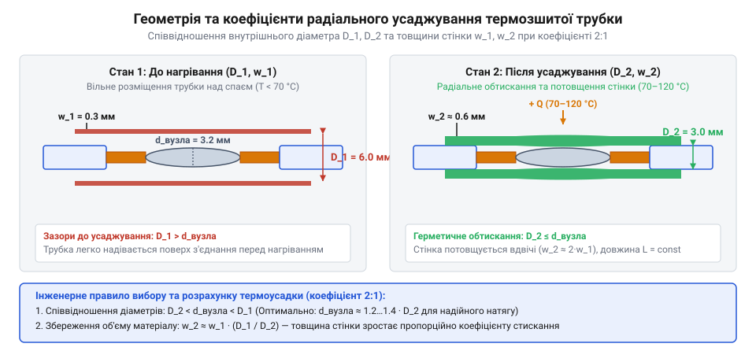
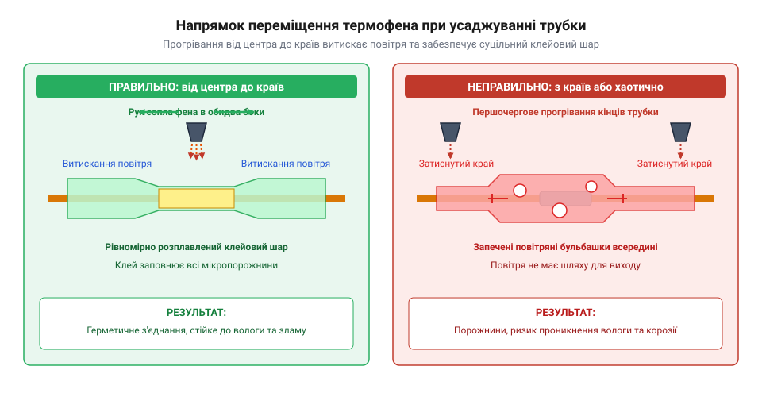

# Термоусадкова трубка (набір)

<preknowlist>
- [Припій / олово](root:cat-hw-instruments/solder-tin) — геометрія та поверхневі особливості спаяного вузла для запобігання пошкодженню трубки
- [Термофен BAKU BK-8033](root:cat-hw-instruments/hot-air-station-baku) — вибір насадок, налаштування температури та повітряного потоку для локального нагріву
- [Обтискні кліщі (Dupont/JST)](root:cat-hw-instruments/crimp-tool) — форма та габарити обтиснутих контактів, що потребують подальшої ізоляції
</preknowlist>

## Небезпека відкритих скруток і коротких замикань

Під час електричного монтажу чи ремонту проводів оголені мідні жили, з'єднані після [використання знімача](root:cat-hw-instruments/wire-stripper) ізоляції, потребують надійного діелектричного захисту. Класичне обгортання місця з'єднання вініловою стрічкою @@en|vinyl tape@@ зазвичай створює тимчасове покриття, яке швидко втрачає свої властивості у реальних умовах експлуатації. Під дією підвищеної температури всередині корпусу приладу, механічної вібрації або випадкового потрапляння мастила липкий шар стрічки розм'якшується, спричиняючи розкручування сувію та оголення струмоведучих жил.

Відкриті з'єднання створюють постійну загрозу міжфазного замикання або контактного стрибка на металеве шасі пристрою. Оголений провідник під напругою при випадковому дотику до сусідніх сигнальних ліній викликає збій у роботі схеми чи пробій матеріалу, детально описаний у матеріалах про [електричну міцність](root:ph-electromagnetism/dielectric-breakdown). Використання нееластичної стрічки також не забезпечує механічного розвантаження вузла, через що тонкі мідні жили швидко ламаються у місці виходу з жорсткої зони з'єднання.

На відміну від липкого шару ізострічки, який швидко розчиняється оліями та розм'якшується при нагріванні вище 50 °C, щільна поліолефінова оболонка володіє високою хімічною інертністю до технічних рідин та моторних мастил. Радіально обтиснута трубка створює рівномірне механічне зусилля вздовж всієї поверхні контакту, стійке до тривалої вібрації в автомобільних джгутах чи рухомих вузлах робототехніки. Твердий полімерний шар запобігає стиранню ізоляції при терті об гострі краї корпусу та утримує цілісність діелектричного бар'єра у важких експлуатаційних умовах.

Окрім хімічного впливу мастил, критичною загрозою для відкритих скруток є проникнення атмосферної вологи та кисню між негерметично прилеглими шарами ізострічки. Волога прискорює окиснення міді, утворюючи шар діелектричного оксиду, який істотно збільшує перехідний опір з'єднання та спричиняє локальний перегрів вузла під робочим струмом. Натомість герметичне полімерне покриття утворює щільний фізичний бар'єр, який повністю ізолює контактну зону від вологого середовища й відвертає корозійне руйнування жил.

Для усунення цих ризиків необхідний суцільний трубчастий рукав, який здатен зменшувати свій внутрішній діаметр під дією температури. Суцільна полімерна трубка щільно обтискає з'єднання по всьому периметру, утворюючи монолітну ізолюючу оболонку, яка не сповзає з часом і витримує тривалі механічні навантаження.

Порівняння основних експлуатаційних параметрів показує суттєву перевагу суцільного поліолефінового рукава над класичною вініловою стрічкою:

| Параметр | Вінілова стрічка @@en|vinyl tape@@ | Поліолефінова трубка @@en|polyolefin@@ |
| :--- | :--- | :--- |
| Діелектрична міцність | 10–15 кВ/мм | 20–25 кВ/мм |
| Термостійкість оболонки | до 60 °C (розм'якшення клею) | до 125 °C (збереження форми) |
| Стійкість до мастил і вологи | Низька (втрата адгезії) | Висока (монолітний бар'єр) |

Вища діелектрична міцність поліолефіну дає змогу зменшити товщину ізоляційного шару без ризику пробою, забезпечуючи компактність та високу надійність монтажу у тісному просторі.

Повна адаптація такої оболонки до складної геометричної форми спаяного або обтиснутого вузла стає можливою завдяки здатності полімеру контрольовано зменшувати свій об'єм під дією термічного нагріву. Сформоване таким чином покриття поєднує високі діелектричні властивості з гнучкістю та механічною стійкістю, задовольняючи вимогам до надійного електромонтажу.

## Фізичний принцип термомеханічної пам'яті поліолефіну

Основою термоусадкових трубок є термопластичний полімер поліолефін (від @@en|polyolefin@@, @@grc|poly@@ — багато та @@lat|oleum@@ — олія), який піддають спеціальній фізико-хімічній обробці для надання йому еластичної пам'яті форми. У вихідному стані довгі вуглеводневі ланцюги полімеру розташовані паралельно й утримуються лише слабкими міжмолекулярними силами. Під час виробництва матеріал опромінюють пучком високоенергетичних електронів, утворюючи міцні ковалентні зв'язкі між сусідніми ланцюгами — так зване просторове зшивання полімеру. Після зшивання трубку нагрівають, радіально розтягують до збільшеного діаметра та охолоджують у розтягнутому стані, «заморожуючи» тимчасову геометрію.

Історія винайдення таких матеріалів сягає 1950-х років, коли американський інженер Пол Кук заснував корпорацію @@en|Raychem@@ та вперше застосував промислове радіаційне зшивання поліетилену бета-випромінюванням. Відкриття здатності радіаційно зшитого поліолефіну відновлювати вихідні розміри при повторному нагріванні без розплавлення стало технологічним проривом. Це дало змогу замінити трудомістке обмотування кабелів суцільними трубчастими рукавами в аерокосмічній галузі, військовій техніці та побутовій електроніці.

При повторному нагріванні трубки до робочої температури усадження (зазвичай 70–120 °C) кристалічні області поліолефіну плавляться, а просторова сітка ковалентних зв'язків скорочується та повертає матеріал до початкового екструдованого діаметра. Фізико-хімічний механічний перехід полягає у тому, що при температурі склування (нижче -40 °C) полімер залишається твердим, а під час нагрівання до точки плавлення кристалітів (100–110 °C) міжмолекулярні кристалічні вузли розпадаються, вивільняючи накопичену енергію пружної деформації зшитої сітки. Зменшення розміру відбувається переважно в радіальному напрямку зі збереженням осьової довжини трубки.


*Схема відновлення первинної просторової сітки зшитого полімеру під час термічного нагрівання.*

Для роботи в агресивних середовищах використовують двошарові термоусадкові трубки, внутрішній шар яких вкритий сополімерним термоклейовим складом @@en|hot-melt adhesive@@. Цей сополімер на основі етиленвінілацетату має аморфну термопластичну структуру із низькою динамічною в'язкістю розплаву. При досягненні температури 80–90 °C внутрішній адгезив плавиться раніше за основну стінку й переходить у високотекучий стан, що забезпечує високу молекулярну адгезію до міді та PVC-ізоляції. Під дією радіального тиску зовнішньої поліолефінової оболонки, яку прогрівають [спеціальним термофеном](root:cat-hw-instruments/hot-air-station-baku), рідкий клей запресовується у найменші мікрощілини й міжжильний простір джгута, витискаючи повітря та утворюючи герметичний водонепроникний бар'єр. Одношарові тонкостінні трубки без клейового підшару застосовують для звичайної діелектричної ізоляції у сухих приміщеннях та кольорового маркування провідних ліній.

## Геометрія усаджування та підбір набору

Основною характеристикою термоусадкової трубки є коефіцієнт усадження @@en|shrink ratio@@, який показує відношення вихідного внутрішнього діаметра D₁ до мінімального діаметра після повного вільного усадження D₂. У стандартних наборах найчастіше зустрічаються трубки з коефіцієнтом 2:1, рідше — 3:1 або 4:1 для обтискання вузлів із різким перепадом товщини.

Під час радіального стискання об'єм полімеру залишається незмінним, тому товщина стінки трубки зростає пропорційно зменшенню її діаметра. Фінальну товщину стінки t₂ після усадження визначають з урахуванням вихідної товщини t₁ та радіусів:

```
t₂ = √((R₁ + t₁)² - R₁² + R₂²) - R₂ - R₂
≈ t₁ × (D₁ ÷ D₂)                      [наближена формула для тонких стінок]
```

Отримана формула показує, що при коефіцієнті 2:1 товщина захисного діелектричного шару після усаджування майже подвоюється, підвищуючи механічну міцність вузла.

Для вибору оптимального розміру трубки з набору дотримуються правила, за яким діаметр ізольованого об'єкта D_obj має перебувати в межах від 20% до 80% від діапазону усадження. При цьому за вихідне значення D_obj беруть максимальний зовнішній габарит з'єднання, виміряний у найтовщій точці вузла з урахуванням асиметричних крапель припою, виступів жил чи скруток. Якщо знехтувати локальними напливами й орієнтуватися лише на гладку частину провідника, трубка не пройде через потовщення у нестіснутому стані або проткнеться гострим шипом під час обтискання. Окрім радіального стискання, важливо враховувати поздовжнє скорочення трубки, яке становить 5–8% від початкової довжини заготовки через залишкове осьове витягування при розтягуванні полімеру. Через це довжину відрізка трубки обирають із технологічним запасом щонайменше 10–15 мм з кожного боку від спаяного вузла, гарантуючи повне перекриття зачищеної зони навіть після поздовжнього усадження.

```
D_min = D₂ + 0.2 × (D₁ - D₂)
D_max = D₁ - 0.2 × (D₁ - D₂)
```

При обтисканні провідників, з'єднаних [якісним припоєм](root:cat-hw-instruments/solder-tin) або закріплених за допомогою [обтискних кліщів](root:cat-hw-instruments/crimp-tool), трубка повинна вільно проходити через потовщення вузла у нестіснутому стані. Окрему складність становить ізоляція розгалужених Y-подібних джгутів з трьома провідниками: у цьому разі вихідний розмір трубки обирають за огинаючим периметром трьох жил, а для герметизації центральної міжжильної порожнини обов'язково застосовують двошарові трубки з клеєм або підвищеним коефіцієнтом усадження 3:1. Для поглибленого математичного моделювання товщини стінок та вибору коефіцієнтів існує окремий матеріальний розрахунок у [математичному описі](root:cat-hw-instruments/heat-shrink-tubing/math-shrinkage-ratio-calc.md) геометрії усадження.


*Геометрія радіального стискання трубки та пропорційне збільшення товщини її стінки навколо провідника.*

У практичних завданнях для створення герметичних з'єднань також використовують спеціалізовані [обтискні гільзи](root:cat-hw-instruments/heat-shrink-crimp-connectors) з вбудованим термоклеєм. Детальний покроковий алгоритм розрахунку та виготовлення захисного шову наведено в [практичному проєкті](root:cat-hw-instruments/heat-shrink-tubing/proj-wire-splice-insulation.md) зрощування жил.

## Технологія нагрівання та техніка монтажу

Якість ізоляційного з'єднання залежить від правильного вибору джерела тепла та дотримання температурного режиму. Оптимальним інструментом для роботи є [станція з термофеном](root:cat-hw-instruments/hot-air-station-baku), яка дає змогу точно налаштувати температуру повітряного потоку в межах 250–300 °C та обрати звужувальне сопло. Ефективність конвективної теплопередачі критично залежить від швидкості потоку та відстані від сопла до трубки, яку підтримують у межах 20–30 мм. Занадто близьке розташування або слабке обдування створюють локальний перегрів матеріалу, тоді як надмірний потік здуває нестіснуту заготовку чи розсіює тепло у навколишній простір. Застосування відкритого полум'я запальнички або торкання жалом [компактного паяльника](root:cat-hw-instruments/usb-soldering-iron) є небажаним, оскільки нерівномірний контактний нагрів залишає кіптяву й спричиняє локальний перегрів полімеру.

Під час монтажу трубок із внутрішнім клейовим шаром або тонкостінних рукавів принципово важливим є напрямок переміщення сопла. Нагрівання завжди розпочинають від середини з'єднання, плавно переміщуючи струмінь гарячого повітря до країв. Такий порядок забезпечує послідовне радіальне обтискання та витискає залишкові бульбашки повітря назовні. Якщо спочатку прогріти краї трубки, повітря виявиться заблокованим у центральній зоні, створюючи порожнини зі зниженою діелектричною міцністю.


*Послідовність рівномірного нагрівання трубки для витискання повітря та розплавлення клейового шару.*

При ізоляції спаяних жил чи провідників, відрізаних [гострими бокорізами](root:cat-hw-instruments/side-cutters), термоусадку позиціонують так, щоб вона перекривала зовнішню ізоляцію кабелю щонайменше на 10–15 мм з кожного боку. Це створює механічний захист від згинання @@en|strain relief@@, розвантажуючи зону пайки від зламу при частих вигинах провідника. Після завершення усаджування вузлу дають охолонути до кімнатної температури перед подальшим укладанням джгута у корпус.

Для підвищення рівномірності нагрівання на сопло термофена надягають вигнуту насадку-відбивач @@en|reflector nozzle@@. Металевий рефлектор огинає трубку із зворотного боку та спрямовує відбитий струмінь гарячого повітря на ті ділянки джгута, які знаходяться поза прямою видимістю майстра. Це позбавляє потреби крутити розпечений вузол під час монтажу й запобігає недогріву тильної поверхні у тісному просторі між сусідніми провідниками.

Такий контрольований термодинамічний підхід гарантує повне усадження полімеру без створення внутрішніх напружень та утворює стабільний захисний шар, готовий до тривалої експлуатації під впливом механічних навантажень.

## Типові дефекти та контроль якості

Порушення технології термічної обробки або неправильний підбір розміру трубки призводять до виникнення дефектів, які знижують надійність монтажу. Найпоширенішою помилкою є локальний перегрів @@en|overheating@@ матеріалу під дією відкритого полум'я чи надмірної температури фена. Перегрітий поліолефін обвуглюється, втрачає еластичність і покривається мікротріщинами, крізь які волога вільно потрапляє до струмоведучих жил.

Не менш небезпечним є недогрів @@en|underheating@@, при якому полімер не досягає температури повного відновлення форми. У цьому разі трубка вільно рухається вздовж провідника, не створюючи щільного діелектричного обтискання та герметизації. Для візуальної діагностики ступеня усадження оцінюють зовнішній вигляд матеріалу: тонкостінні трубки стають матовими й чітко повторюють контури жили, а на торцях двошарових моделей з'являється суцільний валик витиснутого термоклейового складу. Також при використанні неякісно виконаного паяння гострі шипи припою можуть проткнути стінку трубки під час її радіального стискання, що вимагає попереднього загладжування поверхні перед надіванням ізоляції, як описано в матеріалах про роботу з [якісним припоєм](root:cat-hw-instruments/solder-tin).

Контроль якості готового ізольованого вузла включає візуальний огляд, механічну перевірку та вимірювання електричних параметрів. Правильно усаджена трубка повинна мати гладку поверхню без бульбашок повітря та пропалів, а при використанні двошарових моделей з обох торців трубки має виступати рівномірний валик розплавленого термоклею. Для обтиснутих контактів, виконаних за допомогою [обтискних кліщів](root:cat-hw-instruments/crimp-tool), перевіряють відсутність зсуву трубки при прикладанні поздовжнього зусилля. У відповідальних джгутах опір ізоляції перевіряють мегаомметром під напругою 250–500 В для виявлення прихованих мікротріщин чи проколів, а герметичність клейового шва занурювальних вузлів діагностують тестом на відсутність витоку струму у водному середовищі.
