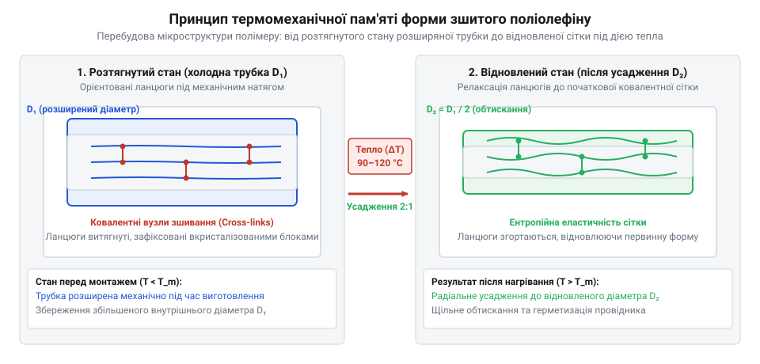
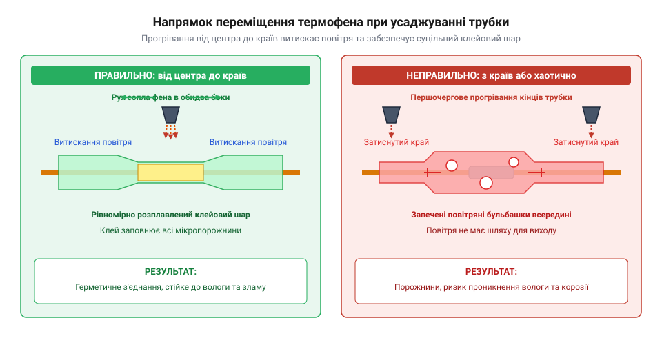

# Термоусадкова трубка (набір)

<preknowlist>
- [Припій / олово](root:cat-hw-instruments/solder-tin) — поверхневі особливості спаяного вузла для запобігання пошкодженню трубки
- [Термофен BAKU BK-8033](root:cat-hw-instruments/hot-air-station-baku) — налаштування температури та повітряного потоку для локального нагріву
- [Обтискні кліщі (Dupont/JST)](root:cat-hw-instruments/crimp-tool) — габарити обтиснутих контактів для подальшої ізоляції
</preknowlist>

## Небезпека ненадійної ізоляції електричних з'єднань

Під час електромонтажу оголені мідні жили після [використання знімача](root:cat-hw-instruments/wire-stripper) ізоляції потребують надійного діелектричного захисту. Обмотування місця з'єднання вініловою стрічкою (від англ. @@en|vinyl tape@@) створює лише тимчасовий шар, липкий склад якого розм'якшується під дією температури вище `50 °C`, вібрації чи мастил. Це призводить до розкручування сувію, оголення провідників під напругою та небезпеки міжфазного короткого замикання. Крім того, проникнення атмосферної вологи викликає окиснення міді, що збільшує перехідний опір контакту та спричиняє його локальний перегрів. Для усунення цих ризиків використовують суцільний поліолефіновий рукав, який під дією тепла зменшує свій діаметр і створює монолітну ізолюючу оболонку із діелектричною міцністю `20–25 кВ/мм`.

На відміну від шаруватих сувіїв, ребра яких розшаровуються під дією постійного вигину чи термічного розширення, суцільний термоусадковий рукав щільно повторює профіль з'єднання після [застосування обтискних кліщів](root:cat-hw-instruments/crimp-tool) або паяння [якісним припоєм](root:cat-hw-instruments/solder-tin). Безшовна поверхня унеможливлює зсув ізоляційного шару вздовж провідника при вібрації, а також перешкоджає тертю оголених жил об гострі краї металевих корпусів. Це створює надійний бар'єр проти механічного зношування й корозії, забезпечуючи довговічну роботу контактних вузлів у складних експлуатаційних умовах.

## Фізичний принцип пам'яті форми поліолефіну

Основою термоусадкових трубок є поліолефін (від англ. @@en|polyolefin@@, грец. @@grc|poly@@ — багато та лат. @@lat|oleum@@ — олія), який піддають електронному опроміненню для створення міцних ковалентних зв'язків між ланцюгами. Зшитий полімер розтягують у гарячому стані й охолоджують, «заморожуючи» збільшений діаметр. При повторному нагріванні до `70–120 °C` міжмолекулярні кристалічні вузли плавляться, а зшита сітка скорочується, відновлюючи первинний діаметр завдяки явищу пам'яті форми. У двошарових трубках внутрішній шар містить термоклей (від англ. @@en|hot-melt adhesive@@), який розплавляється і герметизує мікрощілини, а одношарові тонкостінні моделі застосовують для звичайної ізоляції та маркування.

*Схема відновлення первинної просторової сітки зшитого полімеру під час термічного нагрівання.*

## Підбір внутрішнього діаметра та коефіцієнта

Головною характеристикою трубки є коефіцієнт усаджування (від англ. @@en|shrink ratio@@), який показує відношення вихідного діаметра `D₁` до стиснутого `D₂` (найчастіше `2:1` або `3:1`). При радіальному стисканні товщина стінки майже подвоюється, що підвищує механічний захист. Розмір трубки з набору обирають так, щоб діаметр з'єднання перебував у межах від `20%` до `80%` діапазону усадження з урахуванням найтовшої точки спаяного вузла з [якісним припоєм](root:cat-hw-instruments/solder-tin) або контактів, обтиснутих [спеціальними кліщами](root:cat-hw-instruments/crimp-tool). Оскільки поздовжнє скорочення трубки становить `5–8%`, її довжину беруть із запасом `10–15 мм` з кожного боку від місця з'єднання.

## Технологія рівномірного нагрівання та усаджування

Для якісного монтажу використовують [станцію з термофеном](root:cat-hw-instruments/hot-air-station-baku) із температурою повітря `250–300 °C` на відстані `20–30 мм`. Нагрівання завжди розпочинають від середини з'єднання, плавно переміщуючи струмінь гарячого повітря до країв для витискання повітряних бульбашок. При ізоляції жил, обрізаних [гострими бокорізами](root:cat-hw-instruments/side-cutters), трубка розвантажує пайку від зсуву (від англ. @@en|strain relief@@). Перегрів (від англ. @@en|overheating@@) від відкритого полум'я викликає обвуглювання полімеру, а недогрів (від англ. @@en|underheating@@) залишає трубку рухомою, порушуючи герметичність.

*Послідовність рівномірного нагрівання трубки для витискання повітря та розплавлення клейового шару.*
