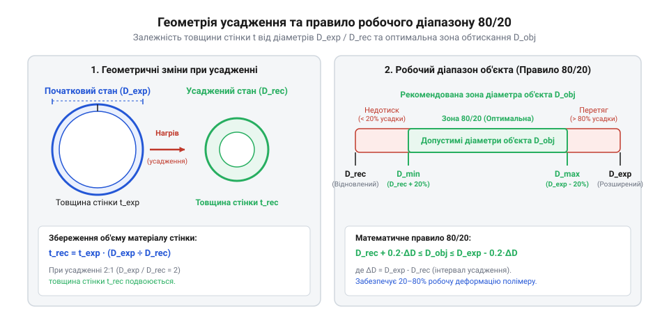

# Розрахунок геометрії усадження та вибір діаметра трубки

<preknowlist>
- [Термофен BAKU BK-8033](root:cat-hw-instruments/hot-air-station-baku) — робочий діапазон температур гарячого повітря для нагрівання й усадження полімерної трубки
- [Обтискні кліщі (Dupont/JST)](root:cat-hw-instruments/crimp-tool) — геометрія й зовнішній діаметр обтиснутої гільзи або контактного з'єднання
</preknowlist>

## Проблема невідповідності діаметрів при монтажі

При складанні джгутів та ізоляції спаяних з'єднань вибір @@en|heat-shrink tubing@@ (термоусадкова трубка, від грецького *therme* — тепло та латинського *contrahere* — стягувати) виключно за маркованим написом на корпусі часто призводить до браку монтажу. Якщо обрати внутрішній діаметр із надмірним запасом, навіть після повного прогреву [термофеном BAKU BK-8033](root:cat-hw-instruments/hot-air-station-baku) полімер не створить належного залишкового радіального тиску на поверхню провідника. Без цього тиску відсутня сила тертя, необхідна для фіксації елемента, через що при механічних вібраціях і вигинах трубка легко сповзає, відкриваючи з'єднання для вологи та створюючи концентратори напружень на мідних жилах. Якщо ж намагатися надягти занадто вузьку трубку на масивне контактне з'єднання, обтиснуте [обтискними кліщами](root:cat-hw-instruments/crimp-tool), полімерний матеріал зазнає надмірного механічного натягу й розривається на гострих кромках при нагріванні.

Головна пастка полягає в сприйнятті термоусадки як звичайного еластичного чохла. Полімери у виробництві піддають радіаційному зшиванню та механічному розтягуванню в розігрітому стані з наступним заморожуванням внутрішніх напружень. При повторному нагріванні заморожені напруження вивільняються, і матеріал прагне повернутися до початкової відформованої геометрії. Однак радіальне стискання має фізичну межу — повний відновлений внутрішній діаметр. Щоб забезпечити надійну електричну ізоляцію та герметичність, вибір термоусадкової трубки вимагає розрахунку геометричного співвідношення вихідного й кінцевого діаметрів та зміни товщини стінки.

## Геометричний зв'язок усадження та збереження об'єму

Геометрія радіального стискання підпорядковується закону збереження об'єму суцільного полімерного тіла. Оскільки молекулярне зшивання блокує поздовжню деформацію уздовж осьової лінії, довжина відрізка трубки при нагріванні практично не змінюється. Відповідно, при зменшенні внутрішнього діаметра від початкового @@en|expanded diameter@@ (`D_expanded`) до кінцевого @@en|recovered diameter@@ (`D_recovered`) площа поперечного перерізу полімерної стінки залишається постійною, що призводить до зростання її товщини (`t_recovered`).

Математичний зв'язок між діаметрами та товщиною стінки виводиться з рівності площ кільцевого перерізу стінки до та після повного відновлення:

        A_wall = π · ((D_expanded / 2 + t_expanded)² - (D_expanded / 2)²)
        = π · t_expanded · (D_expanded + t_expanded)      [площа перерізу стінки у розширеному стані]

Оскільки товщина стінки `t_expanded` значно менша за діаметр `D_expanded`, лінійна апроксимація `A_wall ≈ π · D_expanded · t_expanded` забезпечує високу точність. Прирівнюючи площі стінки до та після усадження:

        π · D_expanded · t_expanded = π · D_recovered · t_recovered    [рівність площ перерізу за законом збереження об'єму]

Поділивши обидві частини на `π · D_recovered`, отримуємо формулу для розрахунку кінцевої товщини стінки:

        t_recovered
        = t_expanded · (D_expanded / D_recovered)                       [залежність товщини стінки від ступеня стискання]
        = t_expanded · K                                                [вираження через коефіцієнт усадження K]

Тут `K = D_expanded / D_recovered` позначає @@en|shrink ratio@@ (коефіцієнт усадження). Для стандартної трубки з `K = 2:1` товщина стінки після повного усадження збільшується вдвічі, а у моделей з коефіцієнтом `3:1` або `4:1` стінка потовщується у три чи чотири рази відповідно. При точному розрахунку площі перерізу стінки слід також враховувати відносне поздовжнє усадження (@@en|longitudinal shrinkage@@), яке у якісних поліолефінових трубок становить від 1% до 5%. Скорочення довжини відрізка на величину `ΔL` означає, що об'єм полімеру перерозподіляється у меншу довжину (`L_recovered = L_expanded · (1 - ΔL)`), через що реальна товщина стінки `t_recovered` виходить на 1–5% більшою за номінальне значення, обчислене за чисто радіальною формулою. Це додаткове потовщення підсилює механічну міцність та пробивну напругу ізоляційного шару, проте зміщує зовнішній габарит вузла, що важливо враховувати при щільному монтажі у вузьких корпусах.

## Розрахунок робочого діапазону за правилом 80/20

Щоб забезпечити притискне зусилля без перенапруження полімеру, діаметр об'єкта монтажу (`D_object`) не повинен дорівнювати граничним значенням трубки. Якщо `D_object` збігається з `D_recovered`, трубка досягає межі стискання й не створює залишкового тиску на провідник, через що з'єднання легко сповзає. Якщо ж `D_object` близький до `D_expanded`, трубка майже не стискається, не забезпечуючи герметизації та розвантаження від натягу.

Оптимальний робочий інтервал визначається правилом 80/20. За цим правилом діаметр об'єкта `D_object` має лежати в середніх 60% діапазону усадження, залишаючи по 20% технологічного запасу з обох боків:

        D_min = D_recovered + 0.20 · (D_expanded - D_recovered)         [нижня межа робочого діапазону для гарантованого обтиску]
        D_max = D_expanded - 0.20 · (D_expanded - D_recovered)          [верхня межа робочого діапазону для запобігання перенапруженню]

*Співвідношення геометричних параметрів термоусадкової трубки та визначення робочого діапазону за правилом 80/20.*

**Розрахунок робочого діапазону для трубки 6.0/2.0 мм (K = 3:1)**
Розглянемо термоусадкову трубку з початковим діаметром `D_expanded = 6.0 мм` та відновленим діаметром `D_recovered = 2.0 мм`. Обчислимо допустимий інтервал діаметрів обтискуваного вузла:

        D_min
        = 2.0 + 0.20 · (6.0 - 2.0)
        = 2.0 + 0.20 · 4.0
        = 2.8 мм                                                       [нижній поріг надійного притискання]

        D_max
        = 6.0 - 0.20 · (6.0 - 2.0)
        = 6.0 - 0.20 · 4.0
        = 5.2 мм                                                       [верхній поріг безпечного натягування]

Отже, обраний типорозмір гарантує довговічне обтискання лише для об'єктів із зовнішнім діаметром від 2.8 мм до 5.2 мм.

При роботі на верхній межі робочого діапазону `D_object = D_max = 5.2 мм` важливо перевіряти залишковий відсоток радіального стискання (`ε_radial`), який визначає ступінь використання потенціалу усадження полімеру:

        ε_radial
        = (D_expanded - D_max) / (D_expanded - D_recovered) · 100%      [відносна частка здійсненого усадження]
        = (6.0 - 5.2) / (6.0 - 2.0) · 100%
        = 0.8 / 4.0 · 100%
        = 20%                                                          [найменший безпечний ступінь стискання]

Значення `ε_radial = 20%` підтверджує, що навіть при обтисканні максимального припустимого діаметра трубка встигає виконати п'яту частину від свого повного радіального ходу. Цього достатньо для створення стійкого залишкового притискного зусилля, що блокує сповзання ізолятора, але водночас не створює небезпечних розтягувальних напружень у стінках при надяганні.

## Оцінка ступенчастих переходів та перепаду діаметрів

Монтажні вузли часто мають ступенчастий профіль, наприклад при ізоляції переходу від тонкої жили провідника діаметром `D_wire` до масивної обтискної гільзи чи корпусу роз'єму діаметром `D_step`. У таких умовах трубка повинна вільно проходити через виступ `D_step` і водночас щільно обтискати ділянку `D_wire`.

Геометрична умова вибору типорозміру для ступенчастого вузла вимагає одночасного виконання двох нерівностей:

        D_expanded > D_step                                             [умова вільного надягання поверх виступу]
        D_recovered < D_wire                                            [умова щільного обтискання тонкого провідника]

Об'єднуючи ці вимоги, мінімально необхідний коефіцієнт усадження `K_required` визначається відношенням діаметра виступу до діаметра провідника:

        K_required
        = D_step / D_wire                                                [найменший необхідний коефіцієнт усадження]

Якщо відношення `D_step / D_wire` перевищує 2.0, стандартна трубка з `K = 2:1` фізично не зможе забезпечити герметичність на тонкому провіднику. У таких випадках застосовують трубки з коефіцієнтом усадження `3:1` або `4:1`.

Для герметизації ступенчастих переходів використовують @@en|dual-wall tubing@@ (двошарова трубка з термоплавким клеєм). Внутрішній клейовий шар при нагріванні розплавляється й заповнює повітряні зазори у кутах перепаду діаметрів, блокуючи проникнення вологи та капілярне всмоктування рідини. Для надійної герметизації необхідний об'єм розплавленого клею `V_adhesive` повинен повністю перекривати геометричний об'єм порожнини `V_gap`, утвореної на кільцевому переході між ступенем діаметром `D_step` та провідником `D_wire` на довжині переходу `L_step`. Об'єм цього зазору розраховують через різницю площ кругових перерізів:

        V_gap
        = (π / 4) · (D_step² - D_wire²) · L_step                         [об'єм кільцевого зазору на ступенчатому переході]

Щоб запобігти утворенню залишкових мікропорожнин при остиганні, товщину клейового шару добирають з умовою `V_adhesive ≥ V_gap`, враховуючи радіальне витіснення клею зовнішньою стінкою трубки. Якщо витісненого клею недостатньо, у кутку ступеня залишаються повітряні зазори, які при температурних коливаннях всмоктують вологу й руйнують герметичність ізоляції.
