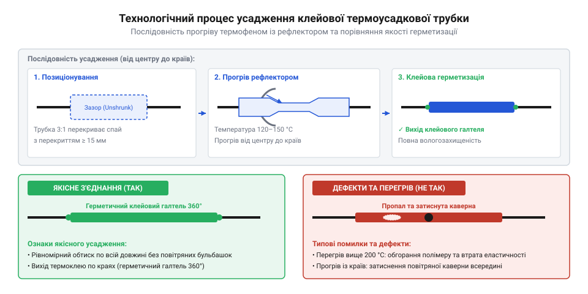

# Практичне виготовлення герметичного та ізольованого зрощування проводів

<preknowlist>
- [Знімач ізоляції автоматичний (INTERTOOL HT-7024)](root:cat-hw-instruments/wire-stripper) — правильне зачищення багатожильного провідника без підрізання мідних жилок
- [Паяльник USB TK-USB-DS (5 В, 260–420 °C)](root:cat-hw-instruments/usb-soldering-iron) — створення механічно й електрично надійного спаяного зрощування перед ізоляцією
- [Термофен BAKU BK-8033](root:cat-hw-instruments/hot-air-station-baku) — вибір насадки та налаштування температури повітряного потоку для усадження трубок
</preknowlist>

## Ризики оголених та неізольованих зрощень

Оголене спаяне з'єднання мідних проводів без захисного покриття піддається швидкій деградації. Атмосферна волога та кисень викликають електрохімічну корозію міді, що збільшує перехідний опір контакта і призводить до нагрівання провідника під навантаженням. Особливо руйнівний характер це має при термоциклюванні: під час струмового нагрівання повітря у мікроскопічних міжжильних зазорах розширюється й витісняється, а при подальшому остиганні всередині виникає вакуумне розрядження. Цей перепад тиску діє як мікропомпа, затягуючи атмосферну вологу глибоко у міжжильний простір за рахунок капілярного ефекту (англ. @@en|capillary wicking@@, від латинського *capillaris* — волосяний, та англійського @@en|wicking@@ — ґнотове всмоктування). Без герметичного перекриття волога поширюється вздовж жили під ізоляцією, викликаючи приховану внутрішню корозію мідних ниток. Крім того, паяння створює жорсткий перехід між гнучкою багатожильною жилою та монолітним припаєм, де накопичуються механічні напруження. При вібрації чи періодичних вигинах дрібні мідні нитки вмить втомлюються і ламаються саме на межі паяного шва.

Звичайна ліпка ізоляційна стрічка не здатна забезпечити довговічний захист електричного вузла. При підвищенні температури понад 60 °C її липкий клейовий шар розм'якшується, стрічка сповзає під дією механічного натягу, оголюючи струмопровідні частини й створюючи ризик короткого замикання. Для створення стійкого захисту застосовують @@en|Heat Shrink Tubing@@ (термоусаджувану трубку) на основі зшитого поліолефіну (@@en|Polyolefin@@), який при нагріванні стискається у радіальному напрямку, створюючи щільне 360-градусне обтискання та високу електричну міцність понад 20 кВ/мм. Висока температурна стійкість матеріалу досягається завдяки радіаційному зшиванню (англ. @@en|cross-linking@@, від @@en|cross@@ — перехресний, та @@en|link@@ — зв'язок): при бомбардуванні екструдованої трубки пучком високоенергетичних електронів між лінійними молекулами полімеру утворюються міцні ковалентні хімічні зв'язки, що формують тривимірну просторову сітку. У результаті зшитий поліолефін втрачає здатність до плинності при розплавленні й набуває термомеханічної пам'яті форми — при нагріванні понад 120 °C він не стікає, а пружно стискається до початкових розмірів екструзії, зберігаючи цілісність ізоляції навіть при тривалому нагріванні робочої зони до 125–135 °C.

## Підбір термотрубки та підготовка проводів

Головним параметром термотрубки є коефіцієнт усадки (@@en|Shrinkage Ratio@@), який визначає відношення вихідного внутрішнього діаметра до мінімального усадженого. Стандартні одношарові трубки мають коефіцієнт 2:1, тоді як двошарові клейові трубки забезпечують усадку 3:1 або 4:1. Для надійного охоплення зрощування вибір діаметра здійснюється за двома нерівностями: вихідний внутрішній діаметр розправленої трубки `D₀` має бути більшим за максимальний товщинний розмір спаяного вузла `D_вузла`, а повністю усаджений внутрішній діаметр `d_min = D₀ / K` (де `K` — коефіцієнт усадки) повинен бути меншим за зовнішній діаметр ізоляції провідника `D_дроту`. Математично умова безпомилкового вибору трубки записується подвійною нерівністю з урахуванням 15–20% технологічного запасу на обтиск: `1.2 · D_вузла ≤ D₀ ≤ 0.85 · K · D_дроту`. Якщо вихідний діаметр `D₀` виявиться меншим за `1.2 · D_вузла`, трубку буде неможливо надіти на потовщення паяного шва, а при `D₀ > 0.85 · K · D_дроту` усаджений матеріал не створить необхідного радіального тиску на ізоляцію провідника, що призведе до герметичного провалу та сповзання трубки.

Перед початком робіт провідники зачищають на довжину 8–10 мм, використовуючи [автоматичний знімач ізоляції](root:cat-hw-instruments/wire-stripper), який знімає зовнішню оболонку без надрізання окремих мідних жилок. При відновленні багатожильних кабелів застосовують техніку ступенчатого зміщення зрощень (англ. @@en|staggered splicing@@, від @@en|staggered@@ — ступенчастий, та @@en|splicing@@ — зрощування): місця спаювання окремих жил зміщують уздовж осі кабелю на 20–30 мм відносно одне одного. Якщо з'єднати всі провідники на одному рівні, термотрубки накладуться одна на одну, утворюючи масивне локальне потовщення джгута, що унеможливить його протягування у захисні гофри чи гермовводи. Ступінчасте рознесення розподіляє ізольовані вузли по довжині лінії, зберігаючи рівномірний зовнішній габарит. Критично важливо відрізати шматки термотрубки необхідної довжини та заздалегідь надіти їх на кожний провідник до початку паяння. Якщо спаяти жили, застосувавши [USB-паяльник](root:cat-hw-instruments/usb-soldering-iron) та [безвідмивний флюс FVS-7](root:cat-hw-instruments/flux-fvs7), надіти трубку без розпаювання вузла буде неможливо. Після охоплення й спаювання жил трубку зсувають по проводу так, щоб вона перекривала краї рідної ізоляції щонайменше на 10–15 мм з кожного боку.

## Технологія прогріву та герметизації термофеном

Для усадження трубки використовують спеціалізоване теплове обладнання, таке як [термофен BAKU BK-8033](root:cat-hw-instruments/hot-air-station-baku). На сопло фена встановлюють рефлекторну насадку із вигнутим дзеркальним екраном, яка охоплює трубку з усіх боків і спрямовує гарячий потік по колу без необхідності постійного обертання самого проводу. Для поліолефінових трубок із внутрішнім термоплавким клеєм (@@en|EVA@@) встановлюють температуру повітряного потоку в межах 120–150 °C.

Прогрів починають суворо від центра з'єднання, плавно переміщуючи сопло до країв. Такий напрямок теплового фронту витісняє залишки повітря з внутрішнього об'єму, запобігаючи утворенню замкнених повітряних каверн і пухирів. При досягненні температури усадки стінки трубки рівномірно зменшуються в діаметрі, а внутрішній клей розплавляється і заповнює мікрощілини між жилами. Процес вважається завершеним, коли по обидва торці трубки виступає суцільний прозорий валик витиснутого клею (клейовий галтель). Перегрів понад 250 °C призводить до обвуглювання зовнішньої стінки, втрати еластичності та пропалювання ізоляції.

Для запобігання термічному пошкодженню сусідніх проводів у щільних джгутах швидкість повітряного потоку на станції регулюють на рівні 30–40% від максимуму. Занадто потужний потік відхиляє тепловий факел убік і розплавляє ізоляцію поруч розташованих провідників, тоді як помірна швидкість дозволяє рефлекторній насадці концентрувати тепло виключно на зоні усадки. Рефлектор позиціонують під кутом 45–60° до осі з'єднання, створюючи захисний тепловий екран (англ. @@en|heat shield@@, від @@en|shield@@ — щит), який відводить залишковий гарячий потік від чутливих пластикових елементів джгута.

*Послідовність усадження двошарової клейової термотрубки від центра до країв та сформований герметичний клейовий валик (галтель).*

## Контроль якості та випробування зрощування

Якість виготовленого ізольованого зрощування оцінюють за візуальними та механічними критеріями. При візуальному огляді поверхня термотрубки повинна бути гладкою, без зморшок, бульбашок та слідів припалу. Повний контур клейового галтеля по обидва торці підтверджує 100-відсоткову герметичність з'єднання за стандартом IP67, що унеможливлює проникнення вологи до мідних жил навіть при зануренні у воду.

Механічні випробування включають перевірку на згин і розривний натяг. Завдяки високій жорсткості зовнішнього поліолефінового шару та застиглому клейовому моноліту, термотрубка розвантажує місце пайки, переносячи деформації зсуву на гнучку ізоляцію провідника. Для оперативних робіт без паяння іноді застосовують [обтискні кліщі](root:cat-hw-instruments/crimp-tool) та підрізку жилок через [бокорізи](root:cat-hw-instruments/side-cutters), проте герметизоване спайне зрощування з клейовою термоусадкою залишається найстійкішим рішенням для важких умов експлуатації.

Для інструментального підтвердження водонепроникності готове зрощування занурюють у ємність із 5-відсотковим сольовим розчином на 24 години, лишаючи вільні кінці провідників над поверхнею води. Перевірку проводять за допомогою мегомметра (англ. @@en|megohmmeter@@, від @@en|mega@@ — мільйон, та @@en|ohm@@ — Ом, одиниця опору): один вимірювальний щуп приєднують до спаяної жили, а другий занурюють у сольову ванну. Вимірювальну напругу приладу встановлюють на рівні 500 В; при якісній герметизації опір ізоляції має становити не менше 100 МОм. Падіння опору до кілоомних значень вказує на наявність мікропор у клейовому шві або неповне витискання повітря, що вимагає забракування вузла.
