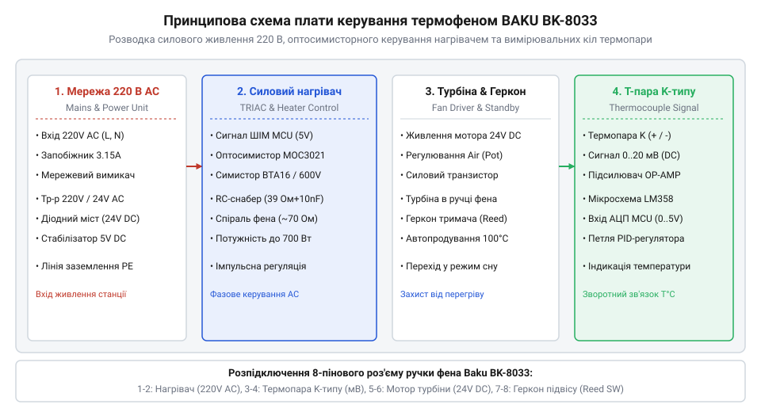

# Апаратний інтерфейс, принципова схема та підключення BAKU BK-8033

<preknowlist>
- [Припій / олово](root:cat-hw-instruments/solder-tin) — правила безпечного виконання паяних з'єднань силових і сигнальних провідників
- [Паяльник USB TK-USB-DS (5 В, 260–420 °C)](root:cat-hw-instruments/usb-soldering-iron) — робота з контактним паяльним обладнанням для монтажу замінних елементів
</preknowlist>

## Призначення та архітектура плати BAKU BK-8033

Під час обслуговування паяльної станції або ремонту пошкодженої рукоятки помилка в підключенні провідників загрожує виходом з ладу мікроконтролера чи подачею високої напруги мережі `220 В` на вимірювальні датчики. Апаратна плата керування термофена BAKU BK-8033 розділена на два гальванічно розмежовані блоки: високовольтний силовий вузол живлення та низьковольтну вимірювально-керуючу частину. Силовий блок відповідає за формування постійної напруги `24 В` для живлення безколекторної турбіни обдуву та імпульсну комутацію нагрівальної спіралі потужністю `500 Вт`. Низьковольтна частина отримує стабілізовану напругу `5 В` від лінійного регулятора, обробляє аналоговий сигнал температури та контролює стан підставки.

Розподіл функцій між блоками гарантує захист низьковольтних мікросхем від мережевих перепадів напруги за допомогою оптопари (від англ. @@en|optocoupler@@). Вимірювальні кола сприймають мілівольтний сигнал від термопари та логічний рівень від герконова датчика (від англ. @@en|reed switch@@), який сигналізує про встановлення рукоятки на металевий тримач. Для безпечного монтажу замінних компонентів із використанням [паяльника USB](root:cat-hw-instruments/usb-soldering-iron) майстер має чітко розрізняти силові лінії змінного струму та чутливі сигнальні траси.

Первинне живлення плати будується на понижувальному трансформаторі, який знижує змінну напругу мережі до робочого рівня силового вузла. Знижений струм надходить на діодний міст (від англ. @@en|diode bridge@@), що виконує двоперіодне випрямлення. Для згладжування високочастотних пульсацій на виході містка встановлено електролітичні фільтруючі конденсатори місткістю `470–1000 мкФ`, які формують стабільну шину постійного струму `24 В` для безколекторної турбіни та живлення лінійного стабілізатора `5 В` вимірювальних кіл.

Для захисту плати від імпульсних сплесків напруги у живильній мережі `220 В` паралельно первинній обмотці трансформатора підключено оксидно-металевий варистор (від англ. @@en|varistor@@). У нормальному режимі опір варистора перевищує `10 МОм`, не впливаючи на роботу схеми. При виникненні мережевого перепаду напруги понад `275 В` опір варистора лавиноподібно зменшується до часток ома, спричиняючи проходження короткочасного струмового імпульсу, який перепалює вхідний плавкий запобіжник і відключає станцію до пошкодження випрямляча й мікросхем.

## Розпіновка роз'єму та сигнальні кола рукоятки

З'єднання рукоятки з корпусом станції здійснюється через 8-піновий авіаційний роз'єм (від англ. @@en|aviation connector@@) типу GX16, кабель якого об'єднує провідники з різним перерізом залежно від струмового навантаження. Кожен контакт роз'єму має суворе призначення та відповідає за конкретний фізичний канал:
- Контакти `1` та `2`: силова лінія живлення керамічного нагрівача змінного струму `220 В` (використовують мідні провідники перерізом `0.5–0.75 мм²` для струму до `2.5 А`, опір холодної спіралі становить `70–80 Ом`).
- Контакти `3` та `4`: лінія живлення вентилятора турбіни постійного струму `24 В` (дроти перерізом `0.2–0.35 мм²`, опір обмотки двигуна дорівнює `30–45 Ом`).
- Контакт `5`: позитивний вивід термопари K-типу (від англ. @@en|thermocouple@@, сигнальний плюсовий провідник перерізом `0.12–0.2 мм²`).
- Контакт `6`: негативний спільний вивід термопари та геркона (мінусова вимірювальна шина перерізом `0.12–0.2 мм²`).
- Контакт `7`: сигнальний вивід герконова датчика (переріз `0.12–0.2 мм²`, у нормальному стані розімкнений, при наближенні магніту тримача замикається на контакт `6`).
- Контакт `8`: заземлення металевого кожуха сопла для зняття статичного заряду (захисний заземлювальний дріт перерізом `0.5 мм²`).

Для перевірки справності кабелю без розбирання рукоятки використовують мультиметр у режимі вимірювання опору. Відсутність замикання між контактами `1–2` та металевим корпусом сопла (контакт `8`) є критичною вимогою електробезпеки перед відновленням ізоляції за допомогою [набору термоусадкових трубок](root:cat-hw-instruments/heat-shrink-tubing).

## Принципова електрична схема та силові ключі

Керування потужністю нагрівача реалізовано на симисторі (від англ. @@en|triac@@) BTA16, який комутує фазний провідник мережі `220 В`. Гальванічну розв'язку керуючого електрода симистора від мікроконтролера забезпечує симисторна оптопара MOC3041 зі вбудованим детектором переходу напруги через нуль (від англ. @@en|zero-crossing detector@@). Така схема виключає виникнення високочастотних мережевих завад під час відмикання силового ключа.

Сигнал термопари K-типу амплітудою близько `4.1 мВ` при `100 °C` надходить на прецизійний операційний підсилювач (від англ. @@en|operational amplifier@@) OP07, який підсилює напругу до рівня `0–5 В` для аналого-цифрового перетворювача. Схема автосну відстежує стан геркона: при укладанні рукоятки на тримач контакт `7` замикається на землю, мікроконтролер вимикає нагрів і продовжує продувку турбіною до охолодження сопла до `100 °C`.

*Схема комутації симисторного ключа MOC3041/BTA16 та підсилення термопари на OP07.*

Під час діагностики плати напругу живлення OP07 вимірюють на виводах `7` (`+12 В`) та `4` (`-12 В` або `0 В`), а вихідний підсилений сигнал температури перевіряють на виводі `6`. У разі виходу з ладу нагрівача перевіряють цілісність запобіжника та керуючий імпульс на світлодіоді оптопари MOC3041 (виводи `1` і `2`). Якщо оптопара справна, але нагрівач працює беззупинно або не вмикається, перевіряють симистор BTA16 мультиметром у режимі прозвонки на наявність короткого замикання між основними анодами `A1` та `A2`. Пробитий силовий ключ показує опір близько `0 Ом` в обох напрямках при вимкненому живленні, що викликає некероване розжарення спіралі, тоді як у справному напівпровідникові опір між анодами прямує до нескінченності.
