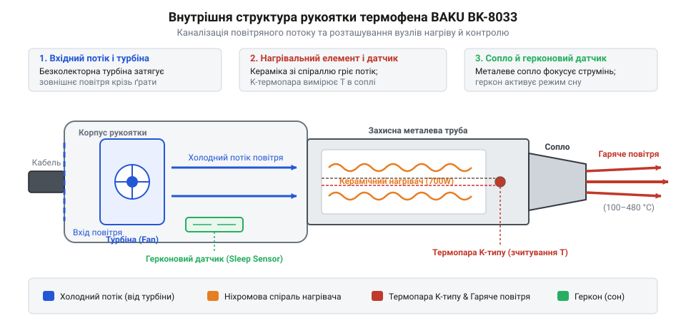
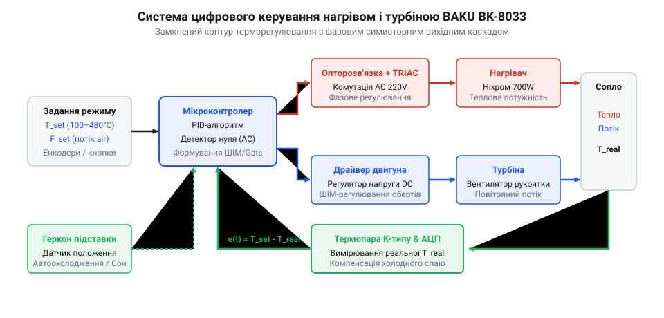
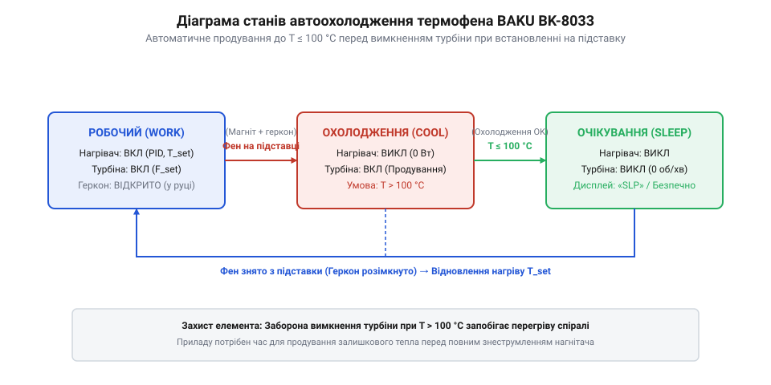

# Термофен BAKU BK-8033

<preknowlist>
- [Припій / олово](root:cat-hw-instruments/solder-tin) — Температури плавлення та фазовий перехід припою під час нагрівання.
- [Флюс FVS-7 (безвідмивний)](root:cat-hw-instruments/flux-fvs7) — Роль флюсу в покращенні теплопередачі та виведенні оксидів під час безконтактного паяння.
- [Паяльник USB TK-USB-DS (5 В, 260–420 °C)](root:cat-hw-instruments/usb-soldering-iron) — Базові уявлення про контактне паяння та температурні режими паяльних інструментів.
- [Термоусадкова трубка (набір)](root:cat-hw-instruments/heat-shrink-tubing) — Принцип усадження полімерних трубок під дією потоку гарячого повітря.
</preknowlist>

## Проблема локального демонтажу багатовивідних компонентів

Спроба зняти багатовивідну мікросхему поверхневого монтажу (від @@en|Surface Mount Technology@@, @@en|SMT@@ — технологія монтажу на поверхню) або планарний роз'єм за допомогою класичного @@en|паяльника@@ ([класичного контактного інструмента](root:cat-hw-instruments/usb-soldering-iron)) швидко призводить до технічного купика. Контактне жало здатне передати тепло лише в одну або дві точки одночасно. Коли плата містить планарний корпус із десятками виводів, розплавлений [припій](root:cat-hw-instruments/solder-tin) на першій ніжці вистигає й твердне за частки секунди, поки паяльник переноситься до наступної. Складність суттєво зростає на сучасних платах із @@en|безсвинцевим припоєм@@ (від @@en|lead-free solder@@), температура плавлення якого становить 217–227 °C проти 183 °C у класичного свинцево-олов'яного сплаву. Вища температура вимагає інтенсивнішого нагріву, під час якого контактний паяльник швидко окиснюється й втрачає тепловіддачу, а спроба примусово підважити корпус до повного плавлення всіх контактних площадок неминуче відриває мідні доріжки від текстоліту та безнадійно псує плату.

Історично цю проблему розв'язували за допомогою громіздких компресорних паяльних станцій, у яких потужна діафрагмова помпа встановлювалася в масивному базовому блоці й подавала стиснене повітря до виносного фена через товстий гнучкий шланг. Проте такі системи мали високу інерційність, видавали відчутний шум і пульсації потоку. Перехід до портативних турбінних фенів, яскравим представником яких є @@en|BAKU BK-8033@@ з [родини інструментів BAKU](root:cat-hw-instruments/baku-hot-air-stations-family), став можливим завдяки мініатюрним безколекторним вентиляторам та точним цифровим схемам терморегулювання. Інтеграція нагнітача безпосередньо у рукоятку фена дозволила замінити жорсткий повітряний рукав легким електричним кабелем і забезпечити стабільне обдування без пульсацій.

Замість контактного передавання тепла термофен використовує рухомий струмінь нагрітого повітря як проміжний носій енергії. Повітряний потік охоплює весь периметр корпусу, рівномірно нагріває всі виводи та розплавляє [паяльну пасту або припій](root:cat-hw-instruments/smd-soldering-fluxes-and-pastes) одночасно. Швидкість підвищення температури контактних площадок суттєво залежить від теплопровідності матеріалу плати та товщини внутрішніх мідних полігонів: масивні шари заземлення та живлення працюють як високоефективні тепловідводи, що розсіюють енергію вглиб текстоліту. Через це для плат із товстою міддю вимагається більша об'ємна витрата повітря та триваліший прогрів, тоді як на тонких двошарових платах тепло концентрується локально. Різкий локальний нагрів холодної плати створює критичний температурний градієнт між зоною паяння та навколишнім текстолітом, що призводить до викривлення матеріалу й @@en|термошоку@@ (від @@en|thermal shock@@ — термічний удар) кришталю мікросхеми. Для запобігання термічному шоку застосовують попередній @@en|інфрачервоний підігрів@@ (від @@en|infrared preheating@@), який рівномірно прогріває всю плату знизу до проміжної температури, зменшуючи необхідний перепад температур гарячого струменя та вирівнюючи внутрішнє розширення шарів. Щоб захистити флюс ([безвідмивний склад](root:cat-hw-instruments/flux-fvs7)) від передчасного вигорання, а саму мікросхему від кришталевого руйнування внаслідок нерівномірного розширення, температура й об'ємна витрата гарячого повітря мають суворо контролюватися в заданому коридорі.

Саме вимоги до суворого контролю теплового поля та швидкості обдування визначають архітектурні рішення, покладені в основу портативного термофена. Для досягнення стабільної температури струменя інструмент має поєднувати збалансований повітряний тракт, швидкодіючий нагрівач та чутливий термодатчик у єдиному компактному вузлі.

## Будова та внутрішня архітектура BAKU BK-8033

Портативний термофен @@en|BAKU BK-8033@@ об'єднує силовий нагрівальний вузол та нагнітач повітря всередині термостійкого пластикового корпусу рукоятки. На відміну від компресорних станцій, повітря забирається безпосередньо з приміщення через торцеві ґрати ручки за допомогою відцентрової безколекторної @@en|турбіни@@ (від @@la|turbo-@@ — вихор). Для створення стабільного струменя крильчатка турбіни має оптимізований @@en|аеродинамічний профіль@@ із загнутими назад лопатками: така геометрія плавного захоплення повітря мінімізує турбулентні вихори й перетворює обертальну енергію на рівномірний @@en|ламінарний потік@@ (від @@en|laminar flow@@ — шаруватий потік) без пульсацій тиску. Безколекторний двигун постійного струму працює від напруги 24 В, що забезпечує низький рівень шуму, високу надійність і відсутність іскріння вугільних щіток.

Нагнітане турбіною повітря проходить крізь керамічний циліндр, всередині якого намотана спіраль із ніхрому (від @@en|nickel-chromium@@ — сплав нікелю й хрому). Керамічний ізолятор захищає повітряний канал від короткого замикання та акумулює тепло, згладжуючи дрібні коливання температури. Щоб запобігти передаванню виділеного тепла на зовнішній пластиковий корпус рукоятки й уникнути його деформації, керамічний циліндр зафіксовано всередині тонкостінними металевими кронштейнами з мінімальною площею контактного дотику. Між гарячим циліндром та зовнішньою оболонкою сформовано проміжний @@en|повітряний прошарок@@ (від @@en|air gap layer@@) разом із дзеркальним металевим @@en|тепловим екраном@@ (від @@en|heat shield@@), що діє як ефективний @@en|термобар'єр@@ (від @@en|thermal barrier@@ — термічна перепона), виключаючи перегрів ручки в долоні оператора. У центрі нагрівальної спіралі розташована @@en|термопара@@ (від @@gr|therme@@ — тепло та @@la|par@@ — пара) — датчик температури на основі спаю двох різнорідних металів, який генерує мікровольтний сигнал, пропорційний нагріву. Також у рукоятку вбудовано @@en|геркон@@ (від @@en|reed switch@@ — герметизований контакт) — магнітокерований контакт, який розмикається або замикається при наближенні до магніту на підставці.

*Внутрішня конструкція рукоятки термофена BAKU BK-8033 із каналізацією повітряного потоку від турбіни через керамічний нагрівач до вихідного сопла.*

Усі електричні з'єднання між рукояткою та базовим блоком керування проведені через гнучкий багатожильний кабель із термостійкою силіконовою ізоляцією. Таке покриття кабелю стійке до вигинів та витримує короткочасне випадкове торкання розжареного жала паяльника з температурою понад 300 °C без плавлення чи пробою провідників, а корпус самої рукоятки виготовлено з вогнетривкого інженерного полімеру, стійкого до високого теплового випромінювання. Детальний опис електричної схеми, з'єднань кіл живлення та розпіновки роз'єму міститься в [апаратному інтерфейсі BAKU BK-8033](root:cat-hw-instruments/hot-air-station-baku/api-baku-bk-8033-hardware.md). Завдяки відсутності внутрішнього компресора базовий блок має мінімальні габарити та містить лише силікон-тиристорний силовий ключ, понижувальний трансформатор і мікроконтролерну плату індикації та управління.

## Цифрове керування температурою та повітряним потоком

Стабільність температури вихідного струменя є ключовою умовою безпечного паяння. Якщо швидкість обдування змінюється користувачем за допомогою потенціометра, температура повітря без автоматичного регулювання мала б сильно коливатися: при зменшенні потоку спіраль перегрівалася б, а при збільшенні — вихолоджувалася. На роботу тиристорного силового ключа додатково впливають мережеві завади та імпульсні сплески напруги 220 В: висока швидкість наростання напруги (`dv/dt`) здатна викликати хибне відкриття @@en|симистора@@ та хаотичні стрибки струму в спіралі. Для придушення цих завад у силовий ланцюг вбудовано @@en|RC-демпферне коло@@ (від @@en|RC snubber circuit@@ — захисне згладжувальне коло), яке шунтує високочастотні піки й гарантує чітке тиристорне перемикання. У термофені @@en|BAKU BK-8033@@ цю проблему розв'язано побудовою замкненої системи терморегулювання із зворотним зв'язком.

*Замкнений контур регулювання температури та потоку повітря у термоповітряній станції BAKU BK-8033.*

Мікроконтролер станції постійно зчитує термо-електрорушійну силу з термопари, розташованої безпосередньо у соплі нагрівача, та порівнює це значення із заданим користувачем параметром. На основі розсогласування алгоритм @@en|PID-контролера@@ (від @@en|Proportional-Integral-Derivative@@ — пропорційно-інтегрально-диференціальний) формує управляючі імпульси для @@en|симистора@@ (від @@en|triac@@ — триодний симетричний тиристор). Симистор змінює фазовий кут відкриття або кількість пропущених напівперіодів мережевої напруги 220 В, регулюючи середню потужність, що віддається керамічній спіралі. Фізичний розрахунок масової витрати повітря й передачі теплової енергії детально висвітлено у [фізико-математичній моделі термоповітряного нагріву](root:cat-hw-instruments/hot-air-station-baku/math-thermal-air-flow-heat-transfer.md).

Завдяки швидкому зчитуванню даних із термопари станція компенсує відбір тепла холодним повітрям за частки секунди. Це дозволяє підтримувати задану температуру (у діапазоні від 100 °C до 480 °C) незалежно від обраної швидкості обдування. Швидкість вентилятора регулюється окремим каналом широтно-імпульсної модуляції (від @@en|Pulse-Width Modulation@@, @@en|PWM@@), що дає змогу точно дозувати механічний тиск струменя, запобігаючи здуванню дрібних @@en|SMD@@-компонентів чи [термоусадкових трубок](root:cat-hw-instruments/heat-shrink-tubing) із робочої зони. Проте мінімальна допустима швидкість обдуву суворо обмежена встановленою температурою: при високих робочих режимах (понад 400 °C) надто малий потік повітря не встигає відводити теплову енергію від ніхромової спіралі, що викликає критичне теплоаккумулювання в керамічному циліндрі та перегоряння нагрівача. Через це зростання заданої температури вимагає пропорційного підняття нижньої межі об'ємної витрати повітря для збереження ресурсного балансу спіралі. Повний покроковий порядок налаштування параметрів для демонтажу планарних елементів наведено у [практикумі з термоповітряного паяння](root:cat-hw-instruments/hot-air-station-baku/proj-smd-component-desoldering-and-mounting.md).

Проте у процесі тривалої експлуатації керамічний нагрівальний елемент зазнає фізичного зносу: мікроскопічні деформації ніхромової спіралі підвищують її електричний опір та змінюють динаміку тепловіддачі. Це призводить до зростання часового лагу та фазового зсуву в контурі зворотного зв'язку @@en|PID-контролера@@, оскільки теплова відповідь на симисторний імпульс запізнюється. Для компенсації цього зсуву мікроконтролер коригує інтегральну складову алгоритму, відновлюючи стабільність нагріву й запобігаючи низькочастотним температурним автоколиванням.

## Режими роботи, автоохолодження та герконовий датчик

Найпоширенішою причиною передчасного перегоряння нагрівальної спіралі у паяльних фенах є раптове знеструмлення гарячого елемента без попереднього продування. Коли електричний струм вимикається, а повітряний потік миттєво зупиняється, накопичене керамічним циліндром тепло не розсіюється, а локально перегріває ніхромовий дріт та внутрішній пластиковий корпус рукоятки. У портативній станції @@en|BAKU BK-8033@@ цей ризик усунуто за допомогою автоматичного алгоритму охолодження, що керується @@en|герконом@@.

*Послідовність зміни станів системи автоматичного продування та очікування у термофені BAKU BK-8033.*

Коли користувач кладе рукоятку на комплектну підставку, вбудований у тримач магніт замикає контакти геркона всередині ручки. Мікроконтролер миттєво розпізнає сигнал очікування, закриває силовий @@en|симистор@@ нагрівача, але залишає @@en|турбіну@@ увімкненою на максимальних обертах. Тривалість активної фази продування напряму залежить від початкового теплового стану спіралі: після тривалої роботи при 450 °C охолодження до безпечної позначки за датчиком @@en|термопари@@ триває близько 30–45 секунд, тоді як після помірного нагріву до 200 °C цикл завершується за 10–15 секунд. Вентилятор продовжує прокачувати холодне повітря через керамічний циліндр доти, доки температура не опуститься до 100 °C. Лише після цього контролер повністю вимикає живлення турбіни й переводить станцію в глибокий режим сну. Як тільки рукоятку знімають із тримача, розмикання герконових контактів запускає алгоритм форсованого розгону: мікроконтролер подає на симистор максимальну імпульсну потужність для розігріву спіралі, а при наближенні до заданої позначки плавно переходить під PID-регулювання, відновлюючи робочу температуру струменя всього за 3–5 секунд.

Такий захисний цикл не лише запобігає термічній деградації спіралі та деформації пластикових деталей рукоятки, але й забезпечує безпеку оператора на робочому місці, виключаючи випадкове займання сторонніх предметів від викладеного гарячого фена.

## Техніка термоповітряного паяння та діагностика несправностей

Ефективність і безпека паяльних робіт термофеном залежать від правильно підібраного сопла, робочої відстані та вибору флюсу. Змінні металеві насадки з різним діаметром отвору дають змогу фокусувати струмінь гарячого повітря під конкретний розмір деталі. Для дрібних чип-компонентів використовують вузькі насадки, а для розпаювання великих @@en|SMD@@-мікросхем чи обробки [термоусадкових трубок](root:cat-hw-instruments/heat-shrink-tubing) обирають сопла великого перерізу. Під час роботи струмінь спрямовують суворо перпендикулярно до плати, утримуючи сопло на відстані 5–10 мм та здійснюючи плавними круговими рухами прогрів по периметру виводів. Обов'язковим елементом є нанесення [безвідмивного флюсу](root:cat-hw-instruments/flux-fvs7) або спеціальних [паяльних паст](root:cat-hw-instruments/smd-soldering-fluxes-and-pastes), які прискорюють розплавлення [припою](root:cat-hw-instruments/solder-tin) і запобігають окисненню.

Попри високу надійність безколекторного нагнітача, тривала експлуатація станції може супроводжуватися апаратними відмовами. Типовими несправностями приладу @@en|BAKU BK-8033@@ є обрив ніхромової спіралі, вихід з ладу термопари або відмова симисторного ключа. Коли коло термопари розмикається, мікроконтролер блокує нагрів і виводить на цифровий дисплей помилку розсогласування, запобігаючи некерованому перегріву. При несправності геркона станція перестає виходити з режиму очікування або не вимикає турбіну на підставці. Для проведення діагностичних вимірювань і заміни зношених елементів рукоятки слід звертатися до [апаратного керівництва та принципової схеми BAKU BK-8033](root:cat-hw-instruments/hot-air-station-baku/api-baku-bk-8033-hardware.md).

Первинну діагностику кіл рукоятки виконують за допомогою цифрового мультиметра в режимі вимірювання опору при повністю відключеному від мережі приладі. Для цього від'єднують роз'єм фена та вимірюють опір між відповідними контактами: справна ніхромова спіраль нагрівача на 220 В показує активний опір у межах 60–80 Ом, тоді як коло холодного спаю @@en|термопари@@ має цілісність із опором близько 1–3 Ом. Якщо прилад показує нескінченний опір (обрив), це свідчить про фізичне руйнування спіралі або внутрішній прогар дроту, що вимагає заміни керамічного картриджа рукоятки. Для перевірки динамічної справності термопари мультиметр переводять у режим вимірювання постійної напруги (@@en|мілівольтметр DC@@): при локальному нагріванні сопла термопара має генерувати зростаючу @@en|термо-ЕРС@@ (від @@en|thermo-electromotive force@@ — термо-електрорушійна сила) у діапазоні від 0 до кількох мілівольт. Відсутність генерування напруги або її хаотичні стрибки при нагріванні вказують на деградацію контактного спаю двох металів.
