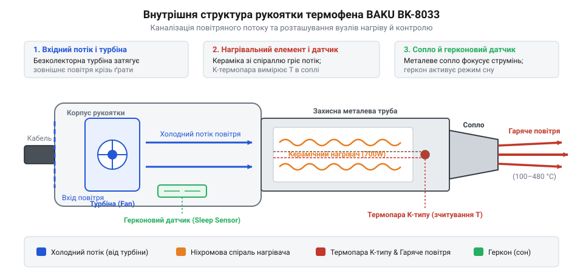
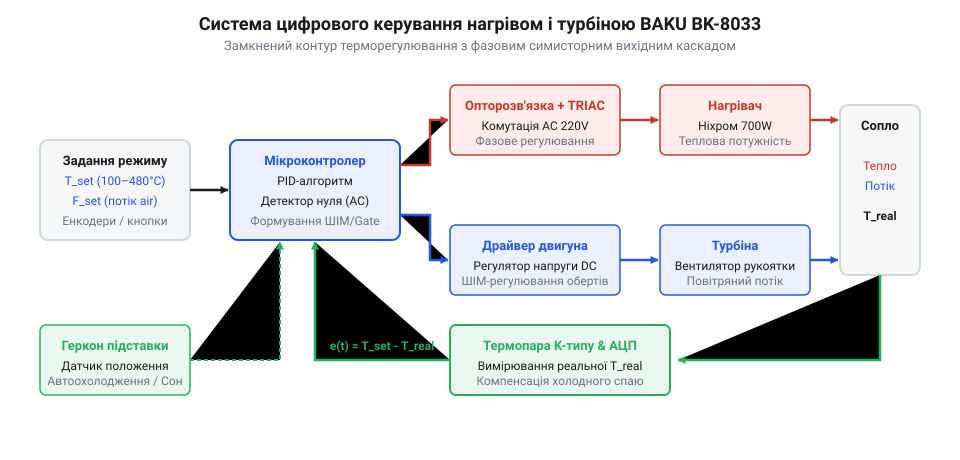
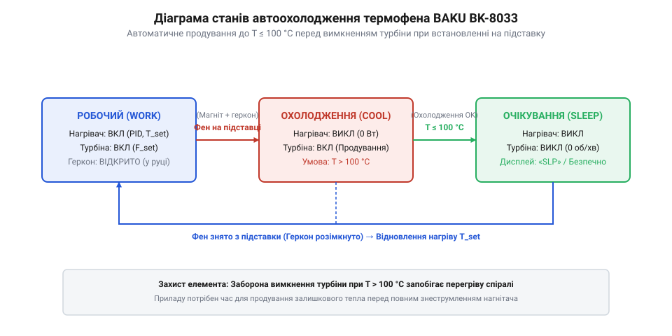

# Термофен BAKU BK-8033

<preknowlist>
- [Припій / олово](root:cat-hw-instruments/solder-tin) — Температури плавлення припою та необхідність одночасного розплавлення всіх контактних площадок.
- [Паяльник USB TK-USB-DS (5 В, 260–420 °C)](root:cat-hw-instruments/usb-soldering-iron) — Принципи контактного паяння та обмеження локального нагріву багатовивідних SMD-корпусів.
- [Флюс FVS-7 (безвідмивний)](root:cat-hw-instruments/flux-fvs7) — Роль флюсу в прискоренні теплопередачі та запобіганні окисленню припаю.
- [Термоусадкова трубка (набір)](root:cat-hw-instruments/heat-shrink-tubing) — Принцип усадження полімерних трубок гарячим повітряним потоком.
</preknowlist>

## Проблема демонтажу багатовивідних SMD-компонентів

Демонтаж мікросхем поверхневого монтажу (від @@en|SMD@@ — @@en|Surface Mount Device@@) із планарними виводами у корпусах @@en|SOIC@@ або @@en|QFP@@ створює складну технічну проблему при використанні класичного паяльника. Традиційний [контактний паяльник](root:cat-hw-instruments/usb-soldering-iron) зі стандартним точковим жалом передає тепло лише в одну або дві точки одночасно через мінімальну площу контактного дотику. Оскільки масивні мідні доріжки та внутрішні шари плати активно відводять тепло, розплавлений [припій](root:cat-hw-instruments/solder-tin) на першій ніжці вистигає за частки секунди до того, як інструмент торкнеться протилежного ряду виводів корпусу SOIC. Вузька геометрія точкового жала фізично не здатна охопити всі контакти одночасно, а спроба примусово витягти компонент із нерозплавленими ніжками призводить до незворотного відриву мідних доріжок та розшарування текстоліту.

Для безпечного демонтажу потрібне одночасне та безконтактне прогрівання всіх контактних площадок по периметру корпусу. Це завдання вирішує термофен (від @@en|hot air station@@ — паяльна станція гарячого повітря), який подає керований потік нагрітого гарячого повітря. Повітряний струмінь рівномірно віддає тепло всім виводам, розплавляючи припій без механічного тиску на плату.

## Будова та турбінний нагнітач BAKU BK-8033

У портативній станції @@en|BAKU BK-8033@@ нагнітач повітря інтегровано безпосередньо в рукоятку фена. На відміну від застарілих компресорних станцій із товстим повітряним шлангом, тут використовується компактна відцентрова безколекторна @@en|турбіна@@ (від @@la|turbo-@@ — вихор). Вона формує рівномірний ламінарний потік повітря без пульсацій тиску та шуму.

*Внутрішня конструкція рукоятки термофена BAKU BK-8033 із каналізацією повітряного потоку від турбіни через керамічний нагрівач до вихідного сопла.*

Нагнітане повітря проходить крізь керамічний циліндр із намотаною ніхромовою спіраллю. Керамічний ізолятор зафіксовано всередині ручки з повітряним прошарком і металевим екраном, що створює термобар'єр для захисту долоні від перегріву. Всередині нагрівача встановлено @@en|термопару@@ (від @@gr|therme@@ — тепло) для зчитування температури та герконовий магнітний контакт.

## Цифрове PID-регулювання нагріву та повітря

Для стабілізації температури вихідного струменя в діапазоні від 100 °C до 480 °C використовують замкнену систему автоматичного керування. Мікроконтролер отримує сигнал із термопари та регулює потужність спіралі за допомогою імпульсів керування симистором.

*Замкнений контур регулювання температури та потоку повітря у термоповітряній станції BAKU BK-8033.*

Алгоритм @@en|PID-контролера@@ (від @@en|Proportional-Integral-Derivative@@) миттєво компенсує відбір тепла холодним повітрям при зміні швидкості обдування. Швидкість вентилятора регулюється окремим каналом, що дозволяє точно налаштовувати потік під дрібні чип-елементи або [термоусадкові трубки](root:cat-hw-instruments/heat-shrink-tubing). Нанесення [безвідмивного флюсу](root:cat-hw-instruments/flux-fvs7) під час паяння прискорює теплопередачу та захищає контакти від окиснення.

## Автоматичне охолодження та безпека спіралі

Раптове вимкнення живлення розжареного фена викликає критичний перегрів ніхромової спіралі через тепло, накопичене керамічним циліндром. Для запобігання деградації нагрівача в BAKU BK-8033 реалізовано автоматичний режим очікування й охолодження.

*Послідовність зміни станів системи автоматичного продування та очікування у термофені BAKU BK-8033.*

При встановленні рукоятки на підставку вбудований магніт замикає контакти @@en|геркона@@ (від @@en|reed switch@@). Мікроконтролер розмикає коло нагрівальної спіралі, але продовжує обертати турбіну на максимальній швидкості. Продування триває до опускання температури сопла нижче 100 °C, після чого станція переходить у режим сну, продовжуючи термін служби нагрівального елемента.
