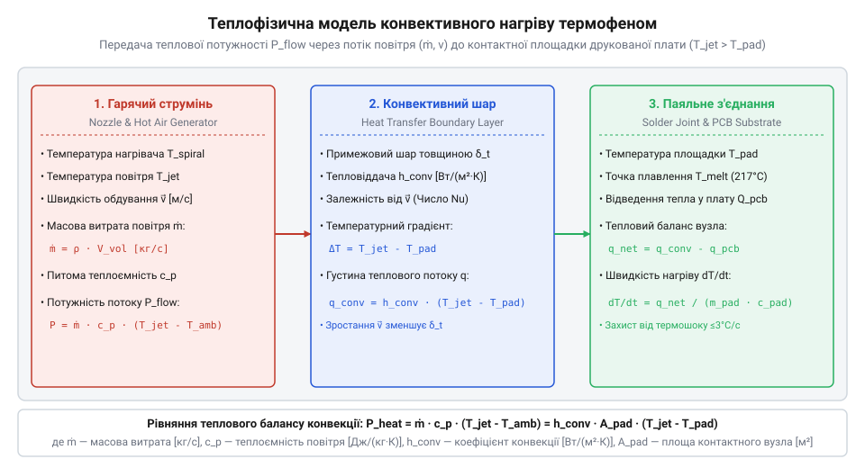

# Теплофізика термоповітряного паяння: розрахунок теплового потоку та температури повітря

<preknowlist>
- [Припій / олово](root:cat-hw-instruments/solder-tin) — температура плавлення та фазовий перехід припою
- [Флюс FVS-7 (безвідмивний)](root:cat-hw-instruments/flux-fvs7) — температурне вікно активації флюсу
</preknowlist>

## Проблема нерівномірного прогріву та термошоку

Паяння електронних компонентів гарячим повітрям за допомогою термоповітряної паяльної станції натрапляє на проблему нелінійного розподілу температури в зоні монтажу. Просте встановлення цільової температури на контролері станції (наприклад, 350 °C) не гарантує швидкого й безпечного розплавлення припою. Великі мідні полігони заземлення та багатошарові друковані провідники мають високу теплоємність і теплопровідність, унаслідок чого інтенсивно відводять тепло від контактної площадки. Якщо тепловий потік від струменя повітря менший за швидкість тепловідведення в глибину плати, температура в точці контакту не досягає точки плавлення, що описує [Припій / олово](root:cat-hw-instruments/solder-tin), утворюючи непропаяне з'єднання або холодну пайку.

Спроба компенсувати недостатнє прогрівання надмірним підвищенням температури повітряного струменя (до 450–500 °C) створює протилежну загрозу — виникає термошок (від грецького @@en|therme@@ — тепло та англ. @@en|shock@@ — удар, англ. @@en|thermal shock@@). Локальний градієнт (від латинського @@en|gradiens@@ — той, що крокує, англ. @@en|gradient@@) температури між нагрітими виводами та холодним корпусом SMD-елемента викликає нерівномірне термічне розширення матеріалів. Гранично допустимий термічний градієнт `∇T_max` вздовж мідного провідника обчислюють із співвідношення допустимого механічного напруження зсуву `τ_max ≈ 15 МПа` на межі міді й адгезиву та коефіцієнтів лінійного теплового розширення: `∇T_max = τ_max / (E_Cu · (α_Cu - α_FR4) · L)`, де `E_Cu ≈ 110 ГПа` — модуль Юнга міді, `α_Cu ≈ 16.5 · 10⁻⁶ К⁻¹`, `α_FR4 ≈ 14 · 10⁻⁶ К⁻¹`. Для площадки довжиною `L = 1 мм` це дає критичний перепад температур `ΔT_max ≈ 55 °C`, перевищення якого спричиняє незворотне відшарування мідного провідника від адгезивного шару плати. Це призводить до мікротріщин у керамічних корпусах чи розшарування склотекстолітового субстрату FR-4. Для безпечного й ефективного монтажу необхідно математично описувати конвекцію (від латинського @@en|convectio@@ — перенесення, англ. @@en|convection@@) та керувати не лише температурою, а й об'ємним потоком теплової енергії.

## Розрахунок теплового потоку та масової витрати

Основним механізмом передачі теплової енергії від нагрівального елемента термофена до друкованої плати є вимушена конвекція (англ. @@en|forced convection@@). Нагріте ніхромовою спіраллю повітря проганяється через сопло зі швидкістю `v` під дією компресора або вентилятора. Об'ємна витрата повітря перераховується у масову витрату (англ. @@en|mass flow rate@@) `m_dot` через площу перерізу сопла `S` та густину повітря `ρ` при даній температурі.

Масову витрату повітря `m_dot` (у кг/с) обчислюють за формулою:

m_dot = ρ · v · S      [масова витрата повітря через переріз сопла]

Теплова потужність `P_stream` (або тепловий потік, англ. @@en|heat flux@@), що переноситься струменем повітря з температурою `T_stream` до поверхні плати з температурою `T_board`, пропорційна масовій витраті та питомій ізобарній теплоємності повітря `c_p ≈ 1005 Дж/(кг·К)`:

P_stream = m_dot · c_p · (T_stream - T_board)
= ρ · v · S · c_p · (T_stream - T_board)      [передана теплова потужність струменя]

Для аналізу теплопередачі розрахуємо параметри реального струменя.

**Розрахунок теплового потоку для сопла діаметром 6 мм**

Для сопла радіусом `r = 3 мм` (`S = π · r² ≈ 2.83 · 10⁻⁵ м²`), при швидкості потоку `v = 5 м/с`, густині гарячого повітря `ρ ≈ 0.6 кг/м³` (при 300 °C) та ізобарній теплоємності `c_p = 1005 Дж/(кг·К)`:

m_dot = 0.6 · 5 · 2.83 · 10⁻⁵
= 8.49 · 10⁻⁵ кг/с      [масова витрата повітря]

P_stream = 8.49 · 10⁻⁵ · 1005 · (350 - 25)
= 27.7 Вт      [тепловий потік гарячого струменя при різниці 325 °C]

Під час розрахунку теплового потоку важливо враховувати, що густина повітря `ρ` розраховується за законом Ідеального газу як `ρ(T) = p / (R_spec · T)`, де `p ≈ 101325 Па` — атмосферний тиск, `R_spec ≈ 287 Дж/(кг·К)` — питома газова стала повітря, а `T` — абсолютна температура в кельвінах (`T = T_C + 273.15`). Через це при нагріві від `T_0 = 25 °C` (298.15 К, `ρ₀ ≈ 1.184 кг/м³`) до `T_stream = 300 °C` (573.15 К) густина повітря знижується вдвічі — до `ρ ≈ 0.615 кг/м³`. Отже, при розігріві спіралі паяльної станції масова витрата повітря `m_dot` за незмінної об'ємної швидкості витискання вентилятора зменшується пропорційно зростанню абсолютної температури, що вимагає коригування подачі повітря для збереження стабільного теплового потоку.

*Схема вимушеного конвективного теплообміну струменя гарячого повітря з паяльним з'єднанням.*

## Коефіцієнт тепловіддачі й динаміка нагріву

Частина теплової потужності струменя передається безпосередньо контактній площадці та виводам компонента за закладеним законом охолодження-нагріву Ньютона. Конвективний тепловий потік `Q_conv` залежить від площі контакту `A` та коефіцієнта тепловіддачі `h_c` (англ. @@en|heat transfer coefficient@@):

Q_conv = h_c · A · (T_stream - T_pad)      [конвективний тепловий потік на контактну площадку]

Коефіцієнт тепловіддачі `h_c` (англ. @@en|heat transfer coefficient@@) не є фізичною константою матеріалу: він залежить від швидкості обдування `v`, діаметра сопла `d` та гідродинамічного режиму потоку. У класичній термодинаміці розрахунок `h_c` для круглого струменя повітря, що соплом набігає на плоску поверхню плати, виконується через критеріальне рівняння Нуссельта (від нім. @@de|Nusselt-Zahl@@, на честь фізика Ернста Нуссельта, безрозмірне число @@en|Nusselt number@@) `Nu = h_c · d ÷ λ_air`, яке пов'язує конвекцію з теплопровідністю повітря `λ_air`. Значення безрозмірного критерію Нуссельта описується функціональною залежністю через число Рейнольдса `Re = v · d ÷ ν` (англ. @@en|Reynolds number@@) та число Прандтля `Pr` (англ. @@en|Prandtl number@@, для повітря `Pr ≈ 0.71`): `Nu = C · Reⁿ · Pr¹/³`, де `C` — геометричний коефіцієнт сопла, а показник степеня `n ≈ 0.5` відповідає ламінарному обдуванню (англ. @@en|laminar flow@@), тоді як `n ≈ 0.8` описує турбулентний струмінь (англ. @@en|turbulent flow@@). Підставляючи визначення `Re` у безрозмірну формулу `Nu`, розраховуємо підсумковий коефіцієнт тепловіддачі: `h_c = C · λ_air · (v ÷ ν)ⁿ · dⁿ⁻¹ · Pr¹/³`. Із цієї критеріальної формули безпосередньо видно, що зростання швидкості повітряного потоку `v` підвищує `h_c` у степені `n`, що дає змогу інтенсифікувати нагрів і прискорити прогрів контактної площадки без небезпечного підвищення температури самого струменя `T_stream`.

Швидкість зміни температури `dT/dt` контактного вузла масою `m_c` з питомою теплоємністю `c_c` описується диференціальним рівнянням теплового балансу з урахуванням тепловідведення в плату `Q_diss`:

dT/dt = (Q_conv - Q_diss) / (m_c · c_c)      [динаміка зростання температури контактного вузла]

Оскільки тепловідведення `Q_diss` зростає зі збільшенням температури плати, для забезпечення додатної швидкості нагріву `dT/dt > 0` конвективний потік `Q_conv` має перевищувати критичний поріг втрат на усій траєкторії підйому температури.

## Тепловий баланс та оптимізація режиму паяння

Під час нагріву паяльного з'єднання до точки плавлення проходить декілька фаз: попередній підігрів, активація речовини, яку описує [Флюс FVS-7](root:cat-hw-instruments/flux-fvs7) (150–180 °C), та розплавлення припою. Загальна теплова енергія `Q_total`, необхідна для фазового переходу припою масою `m_solder` від початкової температури `T_0` до температури плавлення `T_melt` із питомою теплотою плавлення `L_melt`, становить:

Q_total = m_solder · c_solder · (T_melt - T_0) + m_solder · L_melt      [теплова енергія фазового переходу припою]

Час `t_melt`, необхідний для повного розплавлення паяльного з'єднання при постійному струмені, обчислюють інтегруванням теплового потоку:

t_melt = Q_total / (h_c · A · (T_stream - T_melt) - Q_diss)      [час досягнення рідкої фази припою]

Для запобігання деструктивному впливу високих температур швидкість нагріву `dT/dt` не повинна перевищувати `2–4 °C/с`. Порівняльний розрахунок теплового балансу для безсвинцевого припою (англ. @@en|lead-free solder@@) марки SAC305 (`T_melt = 217 °C`, `L_melt ≈ 65 кДж/кг`) та евтектичного свинцевого сплаву Sn63Pb37 (`T_melt = 183 °C`, `L_melt ≈ 42 кДж/кг`), який описує [Припій / олово](root:cat-hw-instruments/solder-tin), показує зростання необхідної енергії фазового переходу `Q_total`:

Q_total_SAC - Q_total_SnPb = m_solder · [c_solder · (217 - 183) + (L_melt_SAC - L_melt_SnPb)]      [різниця енергії фазового переходу]

Через підвищення `T_melt` на 34 °C та більшу приховану теплоту плавлення `L_melt` сумарна енергія `Q_total` для SAC305 зростає на 25–30 %, а температурний напір `(T_stream - T_melt)` у формулі розрахунку часу `t_melt` зменшується. Спроба компенсувати це підвищенням температури струменя `T_stream` без зміни `T_0` пропорційно збільшує тепловідведення в плату `Q_diss` і створює небезпечний локальний градієнт. Для масивних багатошарових плат застосовують нижній підігрів (англ. @@en|bottom preheater@@), який підвищує початкову температуру плати `T_0` до 100–120 °C для свинцевих сплавів та до 120–150 °C для SAC305. Це зменшує температурний перепад і тепловідведення `Q_diss`, зменшує необхідний конвективний потік від фена й дозволяє вкластися в допустиму швидкість `dT/dt` без ризику термошоку та викривлення субстрату.
