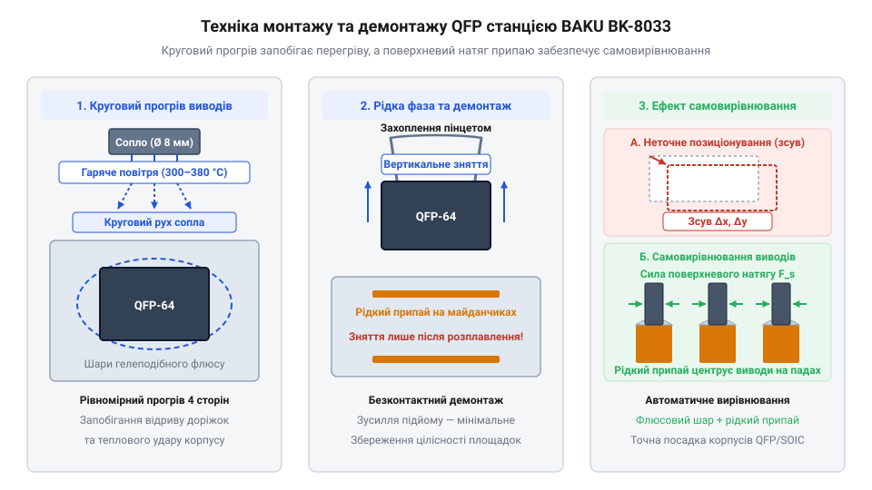

# Практикум з монтажу та демонтажу SMD-компонентів термофеном BAKU BK-8033

<preknowlist>
- [Паяльник USB TK-USB-DS (5 В, 260–420 °C)](root:cat-hw-instruments/usb-soldering-iron) — підготовка контактних площадок та вирівнювання залишкового припаю
- [Флюс FVS-7 (безвідмивний)](root:cat-hw-instruments/flux-fvs7) — теплопередача та запобігання окисленню припаю під час термоповітряної обробки
- [Припій / олово](root:cat-hw-instruments/solder-tin) — лудження контактних площадок перед монтажем нового SMD-елемента
</preknowlist>

## Ризики теплового пошкодження SMD-компонентів

Демонтаж поверхнево-монтованих елементів (від @@en|SMD@@ — @@en|Surface Mount Device@@) контактним способом супроводжується високим ризиком незворотного пошкодження друкованої плати та напівпровідникових структур. Головна проблема полягає в тому, що багатовивідний корпус, як-от @@en|SOIC@@ чи @@en|QFP@@, утримується на платі кількома десятками виводів одночасно. Спроба почергово розплавити @@en|solder@@ на кожній контактній площадці [контактним паяльником](root:cat-hw-instruments/usb-soldering-iron) вимагає прикладання механічного зусилля до корпусних ніжок, що викривляє виводи та призводить до відриву мідного треку разом із контактною площадкою (від @@en|pad@@ — металізований майданчик).

Другим критичним чинником є термічне розшарування (від @@en|delamination@@ — розклеювання шарів) текстоліту @@en|FR-4@@. Локальний перегрів контактного майданчика до температури понад 260–280 °C призводить до деструкції сполучної епоксидної смоли. У результаті мідний фольгований шар втрачає адгезію до скляної тканини, що унеможливлює повторне паяння нового компонента. Одночасно різкий і нерівномірний градієнт температури спричиняє небезпечні термомеханічні напруження всередині напівпровідникового кристала та керамічних чип-конденсаторів. Через істотну різницю коефіцієнтів теплового розширення (від @@en|CTE@@ — @@en|Coefficient of Thermal Expansion@@) між кремнієвим кристалом, металевою рамкою виводів та епоксидною компаундною оболонкою виникають зсувні деформації вздовж границь матеріалів, які призводять до утворення мікротріщин у кремнії, деградації p-n переходів або розколу кристала. Подібний руйнівний механізм діє й у багатошарових керамічних чип-конденсаторах (від @@en|MLCC@@ — @@en|Multilayer Ceramic Capacitor@@): під час стрімкого нагрівання одного металевого торця припаєм виникає високий температурний градієнт між гарячою обкладкою та холодним керамічним сердечником. Оскільки барієво-титанатова кераміка має низьку теплопровідність і низьку міцність на розтяг, нерівномірне об'ємне розширення генерує колосальні внутрішні напруження розтягу під металевим торцевим контактом, утворюючи мікротріщини в діелектрику, що спричиняють короткі замикання та пробій конденсатора.

Використання термоповітряного потоку дозволяє одночасно й безконтактно прогріти всі зони з'єднання компонента до температури плавлення припаю. Безконтактне передавання тепла виключає механічний тиск на виводи та контактні площадки, зберігаючи цілісність топології плати. Саме тому паяльна станція гарячого повітря є основним інструментом для безпечного демонтажу та монтажу SMD-елементів.

## Налаштування термофена та підготовка плати

Ефективний і безпечний демонтаж починається з правильного добору обладнання та підготовки робочої зони. Паяльна станція BAKU BK-8033 оснащена термофеном із можливістю точного регулювання температури та швидкості подачі повітря. Для роботи з дрібними чип-компонентами розмірів 0805 чи 0603 використовують сопла малого діаметра (від @@en|nozzle@@ — насадка-сопло, 3–5 мм), тоді як для корпусів SOIC та QFP добирають насадки діаметром 8–10 мм або спеціальні профільні сопла, які охоплюють увесь периметр виводів.

Температурний режим встановлюють у межах 300–380 °C залежно від складу припаю. Для традиційних свинцевих сплавів (POS-61) достатньо температури 300–320 °C, тоді як безсвинцеві припаї вимагають нагрівання до 350–380 °C. Швидкість повітряного потоку регулюють так, щоб забезпечити швидку теплопередачу, але уникнути здування сусідніх дрібних елементів. При роботі з щільним монтажем потік зменшують до мінімально стабільного рівня.

Перед нагріванням контактні площадки та виводи очищають від забруднень і рясно наносять [безвідмивного гелеподібного флюсу](root:cat-hw-instruments/flux-fvs7). Флюс зменшує поверхневе натягнення рідкого металу, запобігає окисленню міді та рівномірно розподіляє тепло від повітряного потоку по всіх контактних точках. Плату надійно фіксують у тримачі, щоб виключити її зсув під час маніпуляцій.

Для безризикового підйому масивних багатовивідних корпусів @@en|QFP@@ після розплавлення припаю використовують вакуумний пінцет (від лат. @@la|vacuus@@ — порожній, англ. @@en|vacuum tweezers@@ — вакуумна маніпуляційна піпетка). Залежно від ваги та площі пластикового черевця мікросхеми добирають термостійку силіконову присоску відповідного діаметра (від 3 мм для дрібних чипів до 10–12 мм для великих планарних процесорів). Насадку вакуумного маніпулятора встановлюють у геометричному центрі корпусу перед початком термообробки; під час нагрівання вакуумний присмоктувач створює розрядження й забезпечує суворо вертикальне знімання гарячого компонента одразу після плавлення галтелей. Це виключає використання механічних бокових пінцетів, що часто деформують м'які розжарені виводи та зачіпають сусідній щільний SMT-монтаж.

Для захисту пластикових роз'ємів, шлейфів та світлодіодів, розташованих поряд із зоною обдуву, застосовують термостійкий каптоновий скотч (від @@en|Kapton tape@@ — поліімідна плівка із силіконовим адгезивом, стійка до температур до 300–400 °C). Стрічку щільно наклеюють поверх сусідніх чутливих елементів у 2–3 шари без залишення повітряних пухирів, створюючи надійний бар'єр проти прямого впливу гарячого повітряного струменя. У разі тривалого демонтажу масивних корпусів поверх каптону додатково накладають шар алюмінієвої фольги для відбиття інфрачервоного та конвекційного тепла, що гарантує збереження геометрії пластикових деталей і виключає розплавлення їхніх корпусів.

## Техніка демонтажу та позиціонування мікросхем

Для виконання демонтажу сопло термофена утримують перпендикулярно до поверхні плати на відстані 5–10 мм від корпуса мікросхеми. Нагрівання здійснюють коловими або трапецієподібними рухами вздовж периметра виводів, уникаючи тривалої зупинки потоку над центром напівпровідникового кристала. Показником готовності до знімання є дзеркальний блиск розплавленого [припаю](root:cat-hw-instruments/solder-tin) на всіх площадках. Компонент обережно піднімають антистатичним пінцетом строго вертикально вгору без бічних зусиль.

*Схема термоповітряного демонтажу та монтажу QFP: плавний нагрів виводів і самопозиціонування компонента на рідкому припаї.*

Під час монтажу нового елемента контактні майданчики вкривають тонким шаром флюсу та свіжого припаю. Новий корпус позиціонують пінцетом згідно з маркуванням першого виводу (від @@en|pin 1@@ — ключ орієнтації мікросхеми). При відновленні нагрівання гарячим повітрям рідкий припій проявляє ефект поверхневого натягу (від @@en|surface tension@@ — фізичне явище на межі фаз): розплавлені галтелі прагнуть зменшити свою площу, завдяки чому легкий корпус мікросхеми самостійно вирівнюється відносно контактних площадок. Проте дозування флюсу має бути строго виваженим, адже його надмірна кількість під корпусом призводить до виникнення небажаних кульок припаю (англ. @@en|solder balls@@, від @@en|solder@@ — припій, та @@en|ball@@ — куля). При стрімкому нагріванні товстий шар флюсу інтенсивно закипає, а утворені розширювальні гази виштовхують мікрокраплі рідкого металу з майданчиків у вузький зазор під пластмасове черевце компонента, утворюючи приховані струмопровідні містки між сусідніми виводами.

## Видалення залишків та контроль пайків

Після завершення демонтажу або відновлення з'єднань на контактних майданчиках часто залишаються нерівномірні напливи металу. Для їх вирівнювання використовують мідне плетіння (від @@en|solder wick@@ — мідний ґніт для всотування припаю), просочене флюсом, яке притискають паяльником до контактних площадок. Мідне плетіння швидко всотує надлишки рідкого сплаву, залишаючи пласкі та чисті поверхні для подальшого встановлення нових деталей. Для ефективної підготовки площадок застосовують [мідне плетіння для видалення припаю](root:cat-hw-instruments/solder-wick).

Завершальним етапом є ретельний контроль якості з'єднань. Плату очищають від залишків флюсу ізопропіловим спиртом і оглядають під оптоелектронним мікроскопом чи лупою. Якісна галтель припаю повинна мати увігнуту форму, гладку блискучу поверхню та рівномірно охоплювати весь вивід компонента. Контроль міжвивідних зазорів спрощує [оптичний мікроскоп для паяння](root:cat-hw-instruments/optical-microscope-soldering).

Для перевірки відсутності міжвивідних коротких замикань (від @@en|solder bridge@@ — перемичка з припаю між сусідніми виводами) виконують продзвонювання контактів мультиметром у режимі вимірювання опору або прозвонки. Переконавшись у відсутності перемичок та надійності електричного контакту всіх виводів, відновлений вузол друкованої плати вважають готовим до подальшого випробування та експлуатації.

Для видалення запеченого флюсового нагару з-під зазорів багатовивідних корпусів QFP плату занурюють в ультразвукову ванну (англ. @@en|ultrasonic bath@@, від @@en|ultra@@ — понад, та @@en|sonic@@ — звуковий), заповнену абсолютованим ізопропіловим спиртом. Ультразвукові кавітаційні мікробульбашки легко проникають під низькопрофільне черевце мікросхеми, ефективно розщеплюючи та вимиваючи закоксовані залишки каніфолі та активаторів, які неможливо видалити звичайною щіткою. Процес очищення здійснюють при частоті кавітації 35–40 кГц протягом 3–5 хвилин з подальшим висушуванням плати стисненим повітрям або у сушильній шафі при температурі 50–60 °C, що повністю виключає струми витоку через залишкове забруднення.
