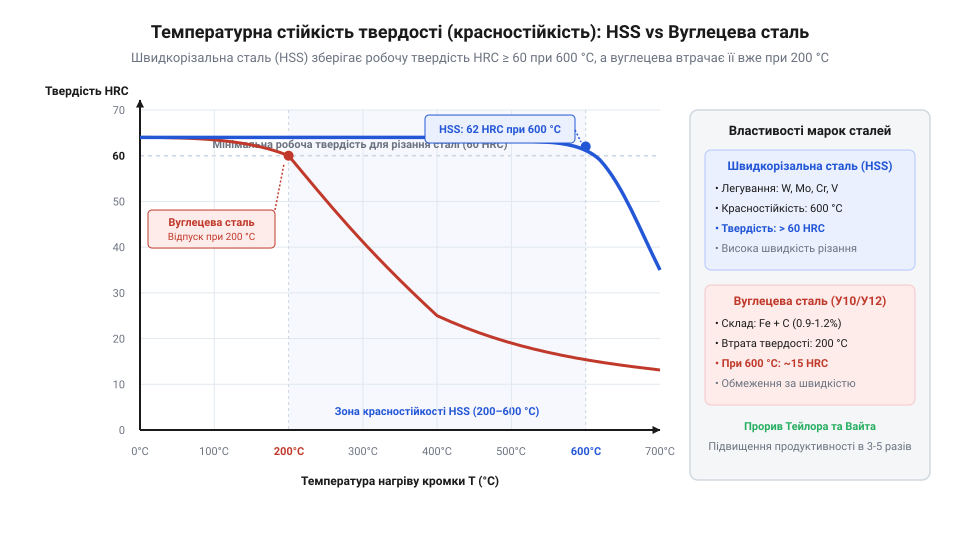

# Історія створення швидкорізальних сталей та еволюція спірального свердла

## Перові свердла та вуглецевий тупик

До середини XIX століття основними інструментами для виготовлення отворів у металі слугували плоскі перові свердла. Їхня конструкція була гранично простою: кутий або точений металевий стрижень із сплощеною лопаткою на кінці, загостреною під кутом. Проте під час обробки ливарного чавуну та литої сталі ця геометрія швидко виявляла свої принципові вади. Через відсутність ґвинтових канавок зрізана металева стружка накопичувалася в робочій зоні, перетиралася й заклинювала інструмент. Майстрам доводилося постійно зупиняти верстат і витягати свердло для очищення отвору, що суттєво уповільнювало роботу. Крім того, пласка форма вимагала величезного осьового зусилля подачі, оскільки різальна крайка скоріше витискала металеву стружку, ніж зрізала її.

Головна ж пастка чекала на металообробку у фізико-хімічних властивостях самого матеріалу інструменту. Перові свердла виготовляли з високовуглецевої інструментальної сталі, яка зберігала високу твердість лише у загартованому стані. Під час тертя об жорсткий метал різальна кромка миттєво нагрівалася. Щойно температура в зоні різання перевищувала 200 °C, у вуглецевій сталі розпочинався процес відпуску: загартована мартенситна структура розпадалася, інструмент критично втрачав твердість («горів») і затуплювався за лічені секунди. Спроби знизити нагрів за допомогою охолодження лише частково відтерміновували руйнування, а підняття швидкості різання понад 5–8 метрів на хвилину залишалося фізично неможливим. Подібні інструментальні сталі й досі чудово працюють у холодних ручних різаках або [скальпелях і змінних лезах](root:cat-hw-instruments/scalpel-set), проте для швидкісного свердлення отворів у металі вуглецевий сплав зайшов у технологічний тупик.

Ця подвійна криза — геометричне заклинювання перової лопатки через накопичення стружки та термічна непридатність вуглецевої сталі — створила важкий бар'єр для промислового машинобудування середини XIX століття. При виготовленні деталей парових машин, котлів і залізничних конструкцій свердління глибоких отворів займало до половини всього часу обробки металу. Стало очевидно, що для нарощування темпів виробництва необхідно докорінно переглянути як геометрію канавок інструменту, так і принцип його закріплення у верстаті.

## Спіральна геометрія Стівена Морзе

Розв'язанням механічної проблеми виведення стружки став винахід американського механіка Стівена Морзе (Stephen Morse). У 1864 році він отримав патент на спіральне свердло (англ. @@en|twist drill@@, від @@en|twist@@ — скручувати), у якому канавки для відведення стружки були закручені по ґвинтовій лінії вздовж осі циліндричного стрижня. Траєкторія канавок докорінно змінила механіку різання: спіральні жолоби діють як безперервний шнековий конвеєр, який під дією обертання самостійно транспортує зрізаний метал вгору й виштовхує його з отвору без зупинки верстата.

Окрім евакуації стружки, двоканавочна спіральна геометрія дала дві ключові технологічні переваги. По-перше, з'явився стабільний задній кут і кут нахилу спіралі, завдяки чому інструмент почав саме різати метал з найменшим опором, а не зішкрібати його. По-друге, циліндричні стрічки на периферії свердла забезпечили точне центрування та напрямок усередині отвору, що усунуло биття та відхилення від осі. Для надійного закріплення нового інструменту Морзе розробив та стандартизував конічний хвостовик — конус Морзе (англ. @@en|Morse taper@@, від прізвища винахідника та @@en|taper@@ — конус, звуження). Завдяки точно розрахованому куту конусності (близько 1:20) хвостовик самозаклинюється у шпинделі верстата під дією осьового зусилля, забезпечуючи високу точність соосності та передачу значного крутного моменту без застосування затискних кулачків.

## Прорив Тейлора-Вайта та поява HSS

Незважаючи на досконалу геометрію свердла Морзе, швидкість металообробки наприкінці XIX століття все ще обмежувалася вуглецевим тупиком інструментальної сталі. Революційний прорив відбувся у 1898–1900 роках під час експериментів інженера Фредерика Тейлора (Frederick Winslow Taylor) та металурга Мюнсела Вайта (Maunsel White) на заводі Bethlehem Steel у США. Шукаючи спосіб збільшити продуктивність токарних та свердлильних верстатів, вони виявили, що термообробка сталей з високим вмістом вольфраму й хрому за темпів нагріву, близьких до точки плавлення (понад 1200 °C), кардинально змінює фазовий склад металу.

_*Порівняльна залежність гарячої твердості швидкорізальної та вуглецевої інструментальної сталі від температури.*_

Отриманий матеріал назвали швидкорізальною сталю (англ. @@en|High-Speed Steel@@, або @@en|HSS@@, від @@en|speed@@ — швидкість). Його головною металургійною особливістю стала висока червоностійкість (англ. @@en|red hardness@@, від @@en|red@@ — червоний, через збереження властивостей при темно-червоному світінні розжареного металу). Легування вольфрамом та хромом сприяє утворенню дрібнодисперсних важкорозчинних карбідів, які блокують зростання зерен і розпад мартенситу під час нагрівання. Як видно з графіку, якщо звичайна вуглецева сталь втрачає свою твердість вже при 200 °C, то швидкорізальна сталь HSS зберігає високі різальні властивості та твердість понад 60 HRC навіть при розігріві різальної кромки до 600 °C. Це дозволило підвищити швидкість різання металу у 3–4 рази, а продуктивність обробки — майже втричі.

## Еволюція марок HSS та міфи

Першим масовим стандартом швидкорізальної сталі стала розроблена у 1910 році класична вольфрамова марка 18-4-1 (що містила 18% вольфраму, 4% хрому та 1% ванадію). Проте під час Першої та Другої світових воєн гострий дефіцит вольфраму змусив металургів шукати альтернативу. У США було створено молібденову сталь марки M2 (аналог P6M5), де половину вольфраму замінили дешевшим молібденом. Сталь M2 виявилася не лише дешевшою, але й пластичнішою та стійкішою до ударних навантажень, що зробило її світовим стандартом для спіральних свердел. Наступним кроком стала поява кобальтових марок, таких як M35 (зі вмістом 5% кобальту) та M42 (8% кобальту). Додавання кобальту підвищило температуру червоностійкості ще на 50–70 °C, що дало змогу свердлити в'язкі та корозійностійкі нержавіючі сталі.

Разом із розвитком інструменту виникло й чимало історичних міфів. Популярні публікації часом стверджують, ніби спіральне свердло або навіть швидкорізальну сталь використовували ще давні єгиптяни чи Леонардо да Вінчі. Утім, збережені артефакти та патентна документація однозначно свідчать: у давнину застосовували лише трипанаційні або перові й ложкові дерев'яні свердла. Спіральна геометрія вимагала точних фрезерних верстатів для нарізання ґвинтових канавок, які з'явилися лише у другій половині XIX століття разом із патентом Морзе. Запиляти дрібний зношений інструмент для перевірки матеріалу майстри могли хіба що ручними [надфілями](root:cat-hw-instruments/needle-files), але створення справжньої HSS стало наслідком глибокого розвитку металознавства на межі XX століття, а не віднайденням забутих секретів минулого.
