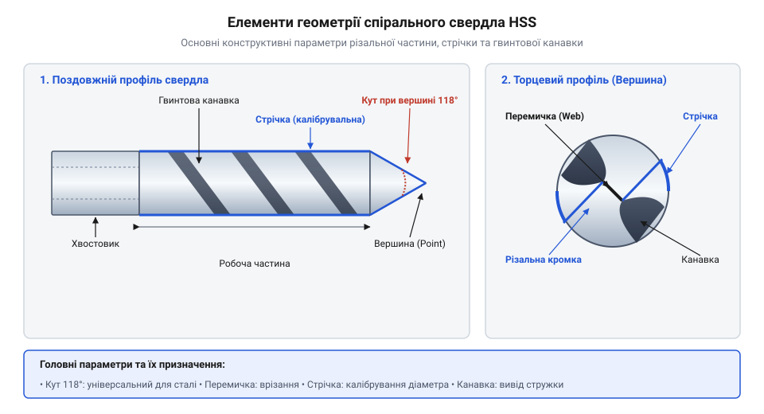
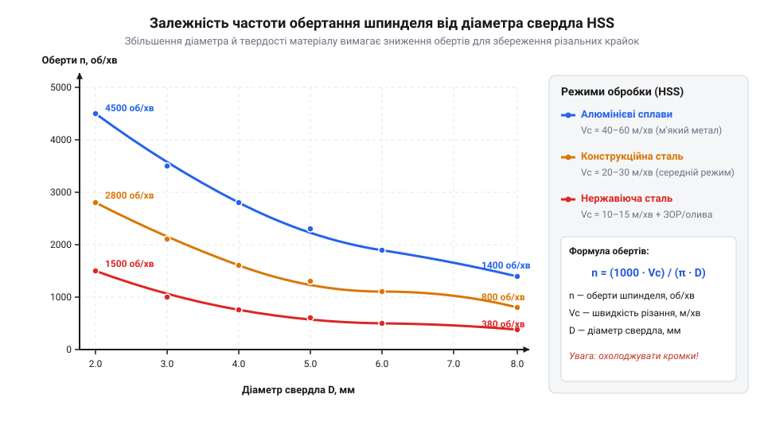
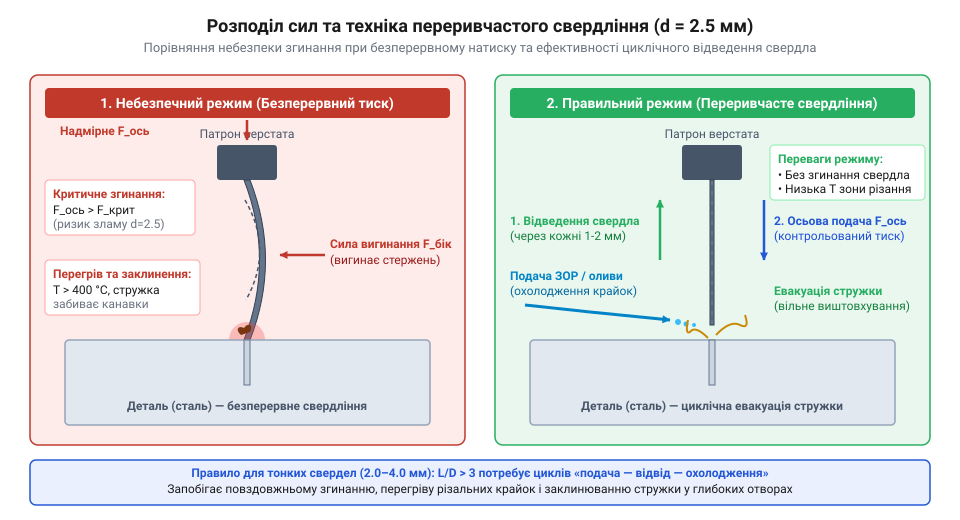

# Свердла по металу HSS (2.0–8.0 мм)

## Проблема обробки металу та властивості HSS

Спроба просвердлити отвір у сталевому кутнику чи алюмінієвій плиті звичайним перовим свердлом або інструментом із вуглецевої сталі швидко закінчується зіпсованим матеріалом. Під час врізання різальної кромки в деталь виникає інтенсивне тертя й пластична деформація зрізуваного шару металу. Температура у вузькій зоні контакту миттєво перевищує +300–400 °C. Звичайна високовуглецева сталь за такого нагріву втрачає загартування, розпускається та стає м'якою, після чого кромка свердла моментально зминається, інструмент починає тертися об метал без різання й остаточно заклинює.

Фізика обробки металів різанням вимагає інструментального матеріалу, який здатний зберігати високу твердість і різальні властивості під час екстремального теплового навантаження. Для розв'язання цієї проблеми розробили @@en|High-Speed Steel@@ (скорочено @@en|HSS@@ — швидкорізальна сталь). Це високолегована інструментальна сталь, основними легувальними елементами якої є вольфрам, молібден, хром і ванадій. Ключову роль в утриманні червоностійкості відіграють важкорозчинні карбіди вольфраму та молібдену (типу `W6C` і `Mo6C`). Порівняльний аналіз кінетики фазового знеміцнення показує, що у звичайній вуглецевій сталі пересичений мартенсит розпадається з утворенням грубого цементиту `Fe3C` вже при +200 °C через високу дифузійну рухливість вуглецю, спричиняючи падіння твердості до менше ніж 40 @@en|HRC@@. Натомість у сталях HSS під час сильного нагрівання до +550–600 °C дрібнодисперсні карбіди важких елементів мають вкрай низьку швидкість дифузії, що кардинально сповільнює кінетику коалесценції карбідних фаз у макроструктурі сталі, блокуючи зростання зерен і розпад мартенситу під час тривалого нагріву. Завдяки такому дисперсійному бар'єрному механізму швидкорізальна сталь зберігає вихідну інструментальну твердість на рівні 62–65 @@en|HRC@@ навіть при розжарюванні різальної кромки до темно-червоного світіння. Для обробки високоміцних та в'язких сплавів (нержавіюча сталь, титан) сталь додатково легують 5–8 % кобальту (марки @@en|HSS-Co@@, M35, M42). Кобальт сам по собі не утворює карбідів, але зміцнює мартенситну матрицю як твердий розчин, підвищує теплопровідність сплаву для ефективного відведення тепла й додатково гальмує дифузійну коалесценцію карбідів при екстремальних температурах. Це підвищує межу червоностійкості інструменту до +630–650 °C та підтримує твердість до 67–68 @@en|HRC@@, що описують [маркування та хімічний склад](root:cat-hw-instruments/hss-steels-overview) кобальтових швидкорізів.

Використання свердел із швидкорізальної сталі дає змогу підвищити швидкість різання у кілька разів порівняно з вуглецевими аналогами. Для глибшого розуміння хімічного складу та маркувань матеріалів варто переглянути [маркування та склад](root:cat-hw-instruments/hss-steels-overview) різних сплавів. Ознайомитися з еволюцією металорізання та створенням перших спіральних конструкцій можна, відкривши [історію розвитку інструменту](root:cat-hw-instruments/hss-drill-set/hist-hss-development.md).

Таким чином, поєднання червоностійкості швидкорізальної сталі HSS та її високої опірності механічному зношуванню створює необхідний інструментальний фундамент для обробки більшості конструкційних металів. Проте сам по собі матеріал не зможе зрізати металеву заготовку без надання йому оптимальної просторової форми з розрахованими різальними кутами та канавками.

## Геометрія спірального свердла 2.0–8.0 мм

Щоб швидкорізальна сталь зрізала метал, інструменту надають спеціальної спіральної форми (@@en|twist drill@@). Основну роботу виконують дві головні різальні кромки, розташовані на вершині свердла під визначеним кутом. Для обробки конструкційних сталей, чавуну та кольорових металів стандартним є кут вершини (@@en|point angle@@) 118°. Для твердих і в'язких матеріалів, таких як нержавіюча сталь, застосовують заточування під кутом 135° із хрестоподібною підточкою перемички, що зменшує осьове зусилля врізання.

Між різальними кромками знаходиться поперечна кромка — перемичка або серцевина (@@en|web thickness@@). Суцільна перемичка не зрізає метал, а пластично видавлює його в боки, створюючи до 50% усього осьового опору зануренню. Для усунення цього ефекту застосовують хрестоподібне підточування перемички (@@en|split point@@) під кутом 135°, яке формує дві додаткові малі різальні кромки біля самого центру. Це вдвічі скорочує довжину нерізальної частини перемички, кардинально знижує осьове зусилля врізання та забезпечує самоцентрування свердла без зсуву на початку обробки. Знята стружка вільно піднімається вгору гвинтовими канавками, кут нахилу яких (25–30°) визначає ефективність відведення відходів із зони різання, а зовнішній діаметр інструмента калібрується вузькими стрічками на канавках (@@en|margin@@), які зменшують тертя об стінки отвору.


*Будова спірального свердла HSS: різальні кромки знімають метал, а гвинтові канавки виводять стружку із зони різання.*

У наборах діаметром від 2.0 до 8.0 мм геометрія інструмента має критичне значення через принципову зміну геометричного співвідношення товщини серцевини до загального діаметра свердла. При переході від 8.0 мм до 2.0 мм відносна товщина серцевини `w / D` змушено зростає від 14–15% (близько 1.1–1.2 мм в абсолютному вимірі) до 18–22% (лише 0.35–0.44 мм), оскільки розробникам доводиться штучно підсилювати центр малого інструмента. Проте навіть таке збільшення частки серцевини не здатне компенсувати падіння моменту інерції перерізу, який пропорційний діаметру в четвертому степені (`D⁴`). Математичний розрахунок напруженого стану для свердла діаметром `D = 2.0` мм показує, що при наявності гвинтових канавок ефективний полярний момент опору становить лише `W_p ≈ 0.09 × D³ = 0.72` мм³. Під дією крутного моменту `M_t` та осьового згинального моменту `M_b` максимальне дотичне напруження `τ_max = M_t / W_p` концентрується на дні канавки, а згинальне нормальне напруження `σ_b = M_b / W_x` додається на зовнішній стрічці. Обчислення еквівалентного напруження за гіпотезою Губера-Мізеса виводить сумарне навантаження на межу плинності:

σ_eq = √(σ_b² + 3 · τ_max²)      [критерій еквівалентного напруження Губера-Мізеса]

Саме тому малі свердла (2.0–4.0 мм) володіють критично низькою жорсткістю на скручування та згин: найменше ексцентричне відхилення від осі збільшує згинальний момент `M_b` і спричиняє миттєве крихке зрізання інструмента по впадині канавки. Натомість у свердлі 8.0 мм полярний момент опору `W_p` є більшим майже у 64 рази (`8.0³ / 2.0³ = 512 / 8 = 64`), що надає високу жорсткість, хоча товща серцевина створює більший осьовий опір врізанню. Детальніше про відновлення кутів крайок описано в матеріалі про [геометрію заточування](root:cat-hw-instruments/drill-sharpening-geometry) спіральних інструментів.

## Режими різання та роль ЗОР

Ефективність і довговічність свердла HSS залежать від правильного співвідношення швидкості різання та сили подачі. Лінійна швидкість різання `Vc` вимірюється в метрах за хвилину й показує шлях, який долає периферійна точка різальної кромки по металу за одиницю часу. Оскільки діаметр свердла `D` фіксований, необхідна частота обертання шпинделя `n` обчислюється за формулою:

n = (1000 · Vc) ÷ (π · D)      [розрахунок частоти обертання шпинделя]

Де `n` — частота обертання шпинделя в обертах за хвилину, `Vc` — рекомендована лінійна швидкість різання в метрах за хвилину, `D` — діаметр свердла в міліметрах, а `π` — математична константа, що дорівнює приблизно 3.14159. Повний математичний апарат з прикладами розрахунків міститься у розділі про [математичні формули режимів](root:cat-hw-instruments/hss-drill-set/math-cutting-modes.md) свердління.

Кожен матеріал має власну допустиму швидкість `Vc`: для звичайної конструкційної сталі вона становить 20–30 м/хв, для алюмінієвих сплавів досягає 60–90 м/хв, а для нержавіючої сталі знижується до 10–15 м/хв. Для малих діаметрів (2.0–3.0 мм) розрахована частота обертання шпинделя перевищує 3000–4000 об/хв.

**Розрахунок обертів шпинделя для свердла 4.0 мм при обробці конструкційної сталі (Vc = 25 м/хв):**

```
n = (1000 · 25) ÷ (3.14159 · 4.0)      [підстановка значень у формулу]
  = 25000 ÷ 12.56636                   [обчислення знаменника]
  ≈ 1989 об/хв                         [підсумкове значення частоти обертання]
```

Таким чином, під час свердління отвору діаметром 4.0 мм у конструкційній сталі свердлильний верстат або дриль слід налаштувати на частоту близько 2000 об/хв, забезпечуючи плавне осьове зусилля подачі без ривків.


*Оптимальні оберти шпинделя для діаметрів 2.0–8.0 мм: малі свердла вимагають високої швидкості обертання, але низької подачі.*

Під час свердління металу обов'язково застосовують змащувально-охолоджувальні речовини (ЗОР). Вони виконують три функції: відводять тепло із зони різання, зменшують тертя стрічки об стінки отвору та запобігають наростоутворенню — налипанню гарячої стружки на різальну кромку. Фізико-хімічний механізм дії ЗОР ґрунтується на поєднанні осадження поверхнево-активних речовин (ПАР) та хемосорбційних реакцій протизадирних добавок (@@en|Extreme Pressure additives@@, або @@en|EP-добавок@@). Поверхнево-активні компоненти за рахунок адсорбційного зниження міцності (ефект Ребіндера) проникають у мікрокапіляри на контактних площах стружки й полегшують пластичний зсув металу. Водночас протизадирні добавки на основі сполук сірки, фосфору чи хлору під дією високого контактного тиску та температури понад +400 °C вступають у хімічну реакцію з ювенільною поверхнею заліза, утворюючи мікроскопічні плівки сульфідів (`FeS`) та хлоридів (`FeCl2`). Ці хімічні плівки мають низьку міцність на зріз, що запобігає молекулярному адгезійному схоплюванню металу заготовки з кромкою HSS і повністю блокує виникнення задирів та наростів. Для сталі використовують мінеральні оливи з EP-добавками або водорозчинні емульсії, для алюмінію — гас або спеціальні мастила, а для нержавіючої сталі — високогелеві спеціалізовані пасти. Спосіб подачі ЗОР залежить від просторової орієнтації отвору: при вертикальному свердлінні рідке мастило закапують маслюнкою чи пензликом безпосередньо в зону врізання, після чого гравітація та гвинтові канавки захоплюють його на дно отвору, тоді як при горизонтальному свердлінні рідка речовина швидко стікає з поверхні, тому застосовують густі консистентні пасти або змащувальні олівці, нанесені на канавки інструмента перед зануренням, або подають рідину примусово шприцом. Ознайомитися з вибором складів можна в статті про [мастильно-охолоджувальні речовини](root:cat-hw-instruments/coolants-cutting-fluids) для металообробки.

## Техніка свердління та захист свердел

Отримання точного отвору металевої деталі починається з підготовки поверхні. Спроба почати свердління прямо по гладкому металу призводить до того, що вершинна перемичка з'їжджає вбік. Для точної фіксації точки наноситься поглиблення за допомогою кернера (@@en|center punch@@). Кернування створює конічну лунку, у яку стає вершина свердла, центруючи інструмент у перші секунди обертання.

Другий обов'язковий крок — жорстке затискання заготовки у верстатних лещатах чи струбцинах. Утримувати деталь руками категорично заборонено: при виході свердла з металу різальні кромки зачіпляються за край, і листовий метал миттєво перетворюється на обертовий ніж, що призводить до важких травм і зрізання свердла. 

Під час роботи з малими діаметрами (2.0–4.0 мм) осьовий тиск повинен бути суворо уздовж осі обертання. Оскільки жорсткість свердла на згин пропорційна четвертому степеню його діаметра, тонкі інструменти мають надзвичайно низьку стійкість до поздовжнього вигину. При перебільшенні осьового тиску або найменшому боковому перекосі дриля виникає критична сила поздовжнього вигину (@@en|buckling force@@). Величина цієї сили описується розрахунком критичної сили Ейлера `F_cr` залежно від вильоту свердла `L` із затискного патрона та модуля пружності сталі `E`:

F_cr = (π² · E · I) ÷ (μ · L)²      [розрахунок критичної сили поздовжнього вигину Ейлера]

Де `F_cr` — критична сила поздовжнього вигину в ньютонах, `E ≈ 2.1 × 10⁵` МПа — модуль пружності HSS, `I ≈ 0.05 · D⁴` — момент інерції перерізу канавки свердла діаметром `D`, `L` — довжина вильоту з патрона в міліметрах, а `μ = 0.7` — коефіцієнт зведення довжини при затисненні. Оскільки сила `F_cr` зворотно пропорційна квадрату вильоту (`1 / L²`), збільшення вильоту свердла 2.0 мм з 20 мм до 40 мм зменшує гранично припустиме осьове навантаження у чотири рази — з 260 N (близько 26 кгс) до критичних 65 N (усього 6.5 кгс), які легко перевищити ручним натиском. Через це свердло миттєво згинається дугою, у зоні затискання хвостовика виникає піковий згинальний момент, і крихка загартована швидкорізальна сталь ламається. Для запобігання вигину затискати свердло слід із мінімально можливим вильотом `L`, а для глибоких отворів (глибиною понад три діаметри) застосовувати переривчасте свердління (@@en|peck drilling@@) — періодичне виведення інструмента з отвору без зупинки шпинделя. Для тонких свердел (2.0–3.0 мм) допустимий крок одного занурення (крок клювання) суворо залежить від в'язкості оброблюваного металу: при свердлінні конструкційної сталі чи алюмінію крок занурення становить `1.0D–1.5D` (2.0–4.5 мм за один підхід), тоді як у в'язкій нержавіючій сталі його скорочують до `0.5D–1.0D` (1.0–3.0 мм), оскільки нероздрібнена в'язка стружка миттєво забиває вузькі гвинтові канавки та заклинює інструмент.


*Переривчасте свердління та баланс сил: періодичний підйом інструмента видаляє стружку й запобігає згинанню тонкого свердла.*

Під час зворотного ходу з гвинтових канавок скидається пресована стружка, а на різальні кромки подається свіжа ЗОР. У момент виходу свердла з протилежного боку деталі опір матеріалу різко падає, і кромка може зачепитися за утворену заудирку (@@en|burr@@). У цей момент слід зменшити натиск. Після наскрізного проходу отвір можна очистити, виконавши [обробку заудирок надфілями](root:cat-hw-instruments/needle-files). Детальніше процес розібрано в матеріалі про [покрокове виконання отворів](root:cat-hw-instruments/hss-drill-set/proj-bench-metal-drilling.md) на верстаку.

Дотримання цієї послідовності — від ретельного кернування та надійної фіксації заготовки до розвантаження свердла на виході — гарантує отримання геометрично точного отвору без деформації деталі. Проте навіть за бездоганної техніки свердління інструмент поступово зношується, тому важливо вміти розпізнавати непрямі симптоми його затуплення та суворо дотримуватися техніки безпеки.

## Діагностика зношування та безпека праці

Працездатність свердла HSS можна контролювати за непрямими ознаками під час різання. Гострий інструмент працює з рівномірним тихим шелестом і формує суцільну або спіральну стружку одинакової товщини. Поява високочастотного свистіння, вібрації (@@en|chatter@@) або утворення пилоподібної дрібної стружки свідчить про затуплення різальних крайок. Якщо мастило починає активно диміти й випаровуватися з темним відтінком, це сигнал небезпечного перегріву зони контакту.

Робота затупленим інструментом або без змащування призводить до критичного підвищення тертя вздовж зрізувального каналу. Затуплена кромка замість чистого зрізання витискає та зішкрібає метал, викликаючи глибокі мікроструктурні зміни в поверхневому шарі отвору. Сильна пластична деформація сплющує кристалічні зерна металу у витягнуті волокна та різко збільшує щільність дислокацій у ґратці заготовки, що зумовлює виражене деформаційне зміцнення (англ. @@en|strain hardening@@, або наклеп). Твердість поверхневої плівки стінок отвору зростає у 1.5–2.5 раза, утворюючи надзвичайно тверду «скоринку», яка додатково прискорює абразивне зношування інструмента та ускладнює подальше нарізання різьби. Одночасно під дією температури понад +500–600 °C виникає явище термічного наварювання й схоплювання (англ. @@en|galling@@, від @@en|gall потертість@@ — терти, здирати) — розігрітий метал заготовки під високим тиском буквально дифузійно зварюється з калібрувальними стрічками свердла, формуючи стійкий наріст (англ. @@en|built-up edge@@). Утворений навар збільшує фактичний діаметр інструмента та геть заклинює його у глибокому отворі. Якщо силою продовжувати тиснути на заклинений інструмент, відбувається відпуск швидкорізальної сталі, вершина свердла розплавляється й округлюється, після чого свердло втрачає геометрію та стає непридатним без виконання процедури [заточування спіральних свердел](root:cat-hw-instruments/drill-sharpening-geometry) на заточувальному верстаті. У разі заклинювання або ламання хвостовика у глибині заготовки його вилучають залежно від глибини занурення: виступаючий край затискають фіксувальними кліщами та обережно викручують проти годинникової стрілки, тоді як глибоко застряглий уламок руйнують твердосплавним пробійником, видаляють екстрактором або хімічно розчиняють у розчині квасців без пошкодження деталей із кольорових сплавів.

Безпека під час свердління металу базується на жорстких правилах. Обов'язковим є використання захисних окулярів чи щитка для захисту очей від гарячої стружки, що відлітає. Працювати біля обертового шпинделя в тканинних рукавицях суворо заборонено: гвинтова канавка свердла або обертова заудирка може зачепити нитку тканинної рукавиці та затягнути руку під інструмент. Прибирання стружки з робочого столу виконують виключно щіткою-зміталкою чи металевим гачком після повної зупинки двигуна.
