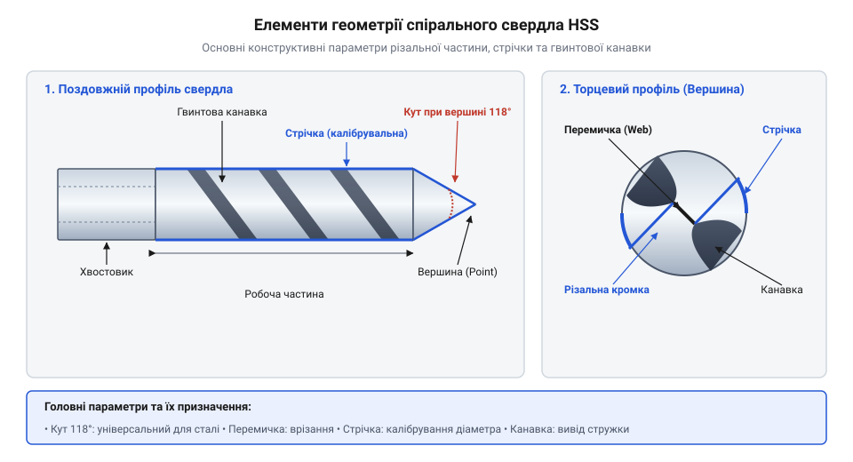
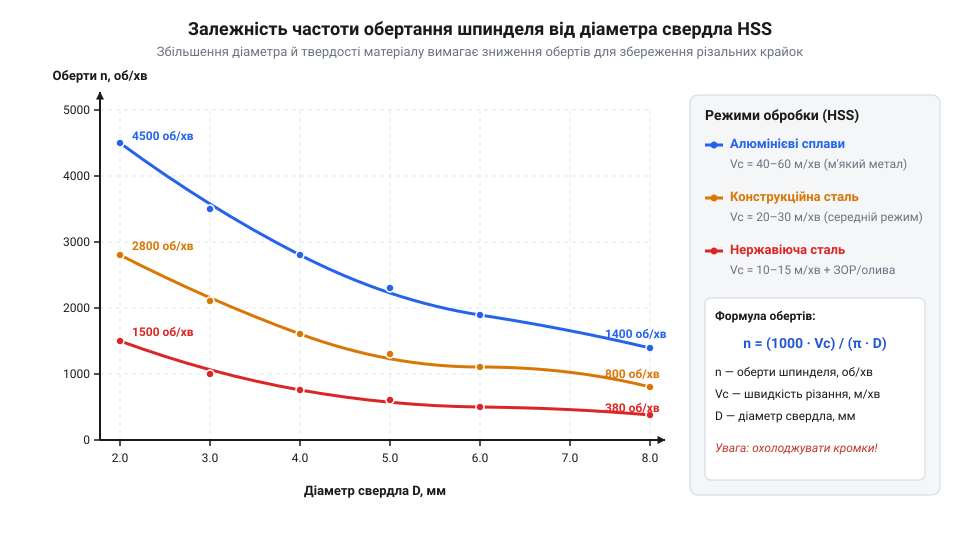
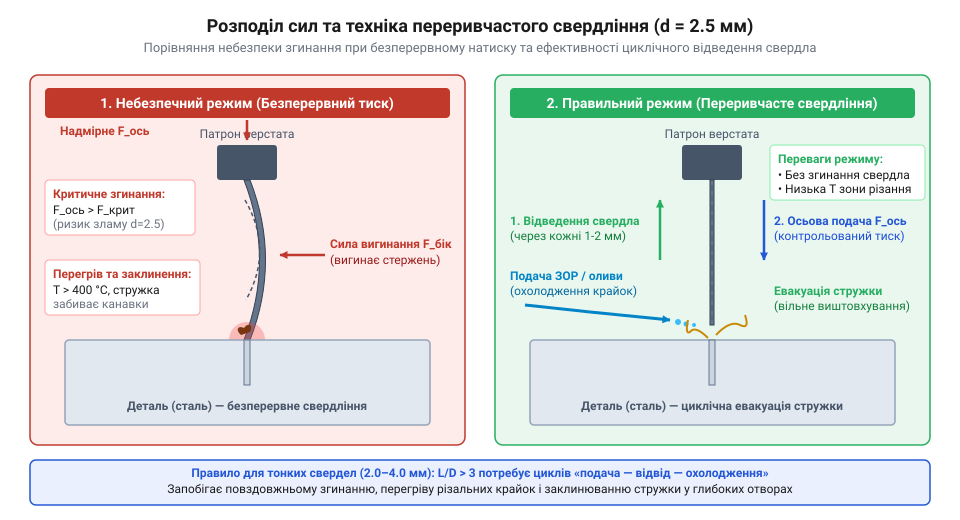

# Свердла по металу HSS (2.0–8.0 мм)

## Термічне навантаження та призначення HSS

Під час свердління металу тертя в зоні різання миттєво розігріває кромку понад +300 °C. За такої температури звичайна вуглецева сталь втрачає загартування, розм'якшується й зминається. Для обробки конструкційних сталей застосовують швидкорізальну сталь @@en|HSS@@ (англ. @@en|High-Speed Steel@@, від *high* — високий, *speed* — швидкість, *steel* — сталь). Завдяки легуванню вольфрамом і молібденом у структурі @@en|HSS@@ формуються стійкі карбіди. Цей дисперсійний механізм забезпечує червоностійкість — здатність утримувати твердість під час нагрівання до +600 °C, що підвищує швидкість різання у кілька разів.

Практичний результат застосування швидкорізальної сталі полягає у можливості обробки поширених конструкційних сталей, латуні та алюмінієвих сплавів без ризику миттєвого затуплення свердла. Червоностійкість інструмента дозволяє підвищити швидкість різання у 3–5 разів порівняно з вуглецевими сталями, що робить @@en|HSS@@ базовим стандартом оснащення для свердління отворів у металевих заготовках та радіаторах електронної майстерні.

## Геометрія та жорсткість спірального свердла

Спіральне свердло зрізає метал двома головними крайками, які зходяться біля центру у перемичку.


*Будова спірального свердла та порівняння стандартного кута 118° із підточеною перемичкою split point 135°.*

Кут вершини 118° є універсальним для м'якої сталі. Кут 135° із хрестоподібним підточуванням перемички @@en|split point@@ (англ. @@en|split point@@ — розщеплена точка) знижує осьовий опір і запобігає ковзанню свердла на початку роботи. Жорсткість інструмента на вигин залежить від моменту інерції перерізу, який пропорційний діаметру в четвертому степені `I ~ d⁴`. Тому свердло діаметром 2.0 мм у 16 разів податливіше до згинання, ніж свердло 4.0 мм, і миттєво ламається від найменшого бічного перекосу.

## Розрахунок режимів різання та ЗОР

Для безаварійного різання частоту обертання шпинделя `n` (об/хв) розраховують за лінійною швидкістю `v` (м/хв) і діаметром свердла `d` (мм). Перед обчисленням обертів вибирають рекомендовану лінійну швидкість для конкретного металу.

```
n = (v × 1000) ÷ (π × d)   [обчислення обертів шпинделя]
```

Зменшення діаметра вимагає пропорційного підвищення обертів для збереження оптимальної швидкості різання.


*Оптимальні оберти шпинделя залежно від діаметра свердла та оброблюваного матеріалу.*

Змащувально-охолоджувальні речовини (ЗОР) виконують три функції: зменшують тертя, відводять тепло та запобігають налипанню стружки на крайки. Для сталі використовують мінеральну оливу або емульсію, а для алюмінію — спирт чи гас.

## Техніка безаварійного свердління та безпека

Свердління починають із нанесення заглиблення лунки кернером, щоб крайка не з'їжджала вбік. Заготовку обов'язково фіксують у лещатах: утримування деталі руками загрожує її вириванням і травмами.


*Принцип переривчастого свердління для виведення стружки та зниження радіальних навантажень.*

Для тонких свердел (2.0–4.0 мм) застосовують @@en|peck drilling@@ (англ. @@en|peck drilling@@ — дятлове свердління) — переривчасту подачу з частим виведенням інструмента для викручування стружки та охолодження. Виліт свердла з патрона роблять мінімальним. Знос крайок розпізнають за визгом, підвищеним нагріванням і появою заусенців. При доводці крайок згодом згодяться [дрібні надфілі](root:cat-hw-instruments/needle-files). Під час роботи біля обертового шпинделя заборонено працювати в рукавичках чи з висячими елементами одягу.
