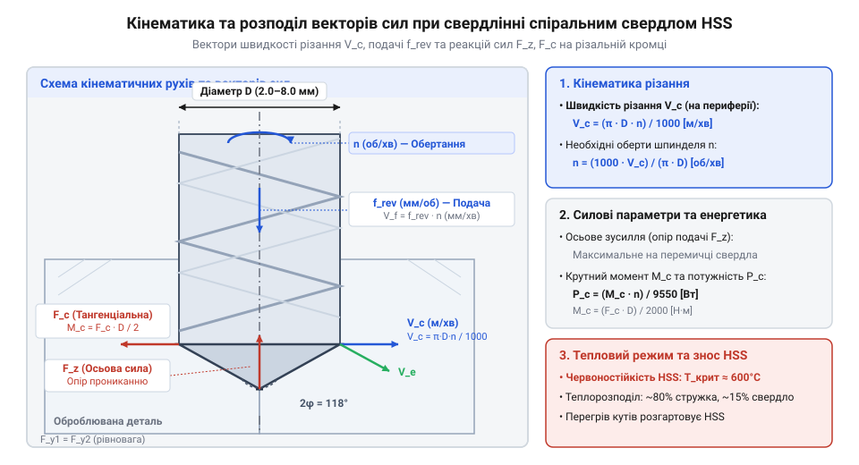

# Розрахунок режимів різання, обертів шпинделя та сили подачі для свердління

<preknowlist>
- [Надфілі (140 мм)](root:cat-hw-instruments/needle-files) — розуміння ручної механічної обробки та знімання припуску
- [Скальпелі й змінні леза](root:cat-hw-instruments/scalpel-set) — базові уявлення про різання матеріалів гострою кромкою
</preknowlist>

## Фізика свердління та швидкість різання

Спроба підібрати частоту обертання шпинделя наосліп часто призводить до миттєвого затуплення різальних кромок свердла або до його заклинювання та поломки. Під час обертання спірального свердла кожна точка його різальної кромки описує коло різного радіуса. Найбільша лінійна швидкість виникає на крайній периферійній точці свердла і називається швидкістю різання (англ. @@en|cutting speed@@) `V_c`.

Колова швидкість різання `V_c` (у метрах за хвилину, м/хв) залежить від частоти обертання шпинделя `n` (об/хв) та зовнішнього діаметра свердла `D` (мм). За один оберт зовнішня кромка долає шлях `π · D`. Для `n` обертів за хвилину загальний пройдений шлях у метрах обчислюють діленням на `1000`. При цьому лінійна швидкість є нерівномірною вздовж різальної кромки й становить функцію від поточного радіуса `r` (від `0` в центрі до `D/2` на периферії):

V(r) = (2 · π · r · n) ÷ 1000 = (2 · r ÷ D) · V_c      [градієнт колової швидкості вздовж радіуса]

У самому центрі свердла на нульовому радіусі `r = 0` колова швидкість падає до нуля (`V(0) = 0 м/хв`). Через відсутність швидкості різання перемичка (англ. @@en|chisel edge@@) не зрізає шар металу, а пластично деформує й видавлює його в радіальному напрямку, що створює до 50–60 % усього осьового опору подачі.

V_c = (π · D · n) ÷ 1000      [лінійна швидкість різання на периферії, м/хв]

Виразивши частоту обертання шпинделя `n` через рекомендовану швидкість різання `V_c` для конкретного оброблюваного матеріалу, отримуємо розрахункову формулу режимів:

n = (1000 · V_c) ÷ (π · D)      [розрахункова частота обертання шпинделя, об/хв]

**Розрахунок обертів шпинделя для свердла діаметром 5.0 мм при обробці сталі**

Для свердління конструкційної сталі спіральним свердлом зі швидкорізальної сталі HSS (англ. @@en|high-speed steel@@) рекомендується швидкість різання `V_c = 25 м/хв`. Для свердла діаметром `D = 5.0 мм` частота обертання шпинделя становить:

n = (1000 · 25) ÷ (3.14159 · 5.0)
= 25000 ÷ 15.708      [підстановка швидкості та діаметра свердла]
≈ 1591.5 об/хв        [обчислення оптимальних обертів]

*Схема кінематики свердління спіральним свердлом та розподілу векторів швидкостей.*

## Розрахунок подачі та продуктивності MRR

Крім частоти обертання шпинделя, ключовим параметром є швидкість поздовжнього занурення свердла в матеріал заготовки — подача. Розрізняють подачу на один оберт `f_rev` (англ. @@en|feed per revolution@@, мм/об) та хвилинну подачу `f_min` (англ. @@en|feed rate per minute@@, мм/хв).

Хвилинна подача `f_min` обчислюється як добуток подачі на один оберт та частоти обертання шпинделя:

f_min = f_rev · n      [хвилинна подача свердла, мм/хв]

Об'ємна швидкість зняття матеріалу (англ. @@en|material removal rate@@) `MRR` характеризує продуктивність обробки й визначає об'єм стружки, вилучений за одиницю часу. Площа поперечного перерізу утвореного отвору дорівнює `A = (π · D²) ÷ 4`. Множення площі на хвилинну подачу з урахуванням переведення кубічних міліметрів у кубічні сантиметри (ділення на 1000) дає підсумковий вираз. При цьому для аналізу фізичного навантаження на кожну з двох різальних кромок спірального свердла (`z = 2`) розраховують подачу на зуб `f_z` (англ. @@en|feed per tooth@@, мм/зуб):

f_z = f_rev ÷ 2      [подача на одну різальну кромку свердла]

Фактична товщина зрізуваного шару стружки `h` (англ. @@en|chip thickness@@, мм), від якої залежить питомий опір різання, визначається геометричним півкутом вершини свердла `ϕ / 2` (для стандартного заточування `ϕ = 118°`, `ϕ / 2 = 59°`):

h = f_z · sin(ϕ ÷ 2) = (f_rev ÷ 2) · sin(ϕ ÷ 2)      [товщина зрізуваної стружки]

Для кута `118°` коефіцієнт `sin(59°) ≈ 0.857`, тому товщина стружки становить `h ≈ 0.428 · f_rev`. Збільшення кута вершини при незмінній подачі `f_rev` потовщує стружку `h`, що підвищує механічне навантаження на кромку й вимагає коригування подачі.

MRR = (π · D² · f_min) ÷ 4000
= (π · D² · f_rev · n) ÷ 4000      [об'ємна швидкість зняття матеріалу, см³/хв]

**Розрахунок продуктивності свердління при D = 6.0 мм**

При свердлінні отвору свердлом діаметром `D = 6.0 мм` з подачею `f_rev = 0.08 мм/об` на частоті `n = 1250 об/хв`:

f_min = 0.08 · 1250
= 100 мм/хв      [обчислення хвилинної подачі]

MRR = (3.14159 · 6.0² · 100) ÷ 4000
= (3.14159 · 36 · 100) ÷ 4000      [обчислення об'єму стружки]
≈ 2.83 см³/хв      [підсумкова продуктивність обробки]

## Сила подачі та крутний момент

Під час свердління різальний інструмент зазнає механічного опору від зсуву шару металу. Головні різальні кромки зрізають стружку, а поперечна кромка (перемичка, англ. @@en|chisel edge@@) деформує й видавлює матеріал у центрі отвору. Опір матеріалу створює осьове зусилля подачі `F_z` (англ. @@en|thrust force@@, Н) та крутний момент різання `M_c` (англ. @@en|cutting torque@@, Н·м).

Для розрахунку осьової сили `F_z` та крутного моменту `M_c` застосовують емпіричні статеві формули термомеханіки різання:

F_z = C_F · D^x_F · f_rev^y_F · K_F      [осьове зусилля подачі, Н]

M_c = C_M · D^x_M · f_rev^y_M · K_M      [крутний момент різання, Н·м]

Де `C_F` та `C_M` — коефіцієнти, що враховують фізико-механічні властивості оброблюваного металу, `x_F, y_F, x_M, y_M` — показники степенів впливу діаметра й подачі, а `K_F, K_M` — поправочні коефіцієнти на фактичний стан інструменту та змащення.

Потужність різання `P_c` (кВт), необхідна для подолання крутного моменту `M_c` при частоті обертання шпинделя `n`, обчислюється за співвідношенням:

P_c = (M_c · n) ÷ 9550      [корисна потужність різання на шпинделі, кВт]

Для вибору верстата та запобігання перевантаженню двигуна враховують коефіцієнт корисної дії приводу шпинделя `η` (англ. @@en|drive efficiency@@, для пасових і зубчастих передач `η ≈ 0.75–0.85`), який визначає повну споживану електричну потужність `P_motor`:

P_motor = P_c ÷ η          [повна споживана потужність приводу шпинделя, кВт]

Якщо обчислена потужність `P_motor` перевищує номінальну потужність приводу `P_rated`, частота обертання шпинделя під навантаженням падає, що призводить до зупинки двигуна та моментального заклинювання або ламання свердла.

P_c = (M_c · n) ÷ 9550      [потужність різання на шпинделі, кВт]

Для дрібних свердел (діаметром 2.0–4.0 мм) надмірне осьове зусилля `F_z` призводить до вигину й поздовжньої втрати стійкості за законом Ейлера (англ. @@en|Euler critical load@@). Тому для малих діаметрів обмежують подачу `f_rev`. У разі потреби остаточного доведення геометрії та усунення заусенців застосовують ручні [Надфілі (140 мм)](root:cat-hw-instruments/needle-files) або для зачистки країв [Скальпелі й змінні леза](root:cat-hw-instruments/scalpel-set).

## Тепловий баланс та оптимізація режимів

Практично вся механічна робота різання `P_c` перетворюється на теплову енергію `Q_total`. Тепловий баланс у зоні свердління описується рівнянням розподілу теплових потоків між стружкою `Q_chip`, заготовкою `Q_workpiece` та свердлом `Q_tool`:

Q_total = Q_chip + Q_workpiece + Q_tool      [тепловий баланс зони різання]

Зі зростанням швидкості різання `V_c` частка тепла, що відводиться стружкою `Q_chip`, зростає до 75–80 %. Проте при сухому свердлінні акумуляція тепла в тілі свердла `Q_tool` викликає розігрів різальних кромок. При перевищенні температури 550–600 °C інструментальна сталь HSS втрачає червоностійкість (англ. @@en|red hardness@@), її мікроструктура відпускається, і кромка швидко зношується.

Залежність періоду стійкості свердла `T` (хвилини до затуплення) від режимів різання описується емпіричним рівнянням Тейлора (англ. @@en|Taylor tool life equation@@):

V_c = C_v ÷ (T^m · D^x_v · f_rev^y_v)      [рівняння стійкості інструменту Тейлора]

Де `C_v` — коефіцієнт стійкості для даної пари матеріалів, `m ≈ 0.125` — показник відносної стійкості швидкорізальної сталі HSS.

Для оптимізації режимів та подовження терміну служби свердел використовують мастильно-охолоджувальні рідини (ЗОР, англ. @@en|cutting fluid@@). Застосування ЗОР знижує коефіцієнт тертя, інтенсифікує відведення тепла `Q_tool` і збільшує період стійкості `T` у 2–3 рази при збереженні високої продуктивності `MRR`.
