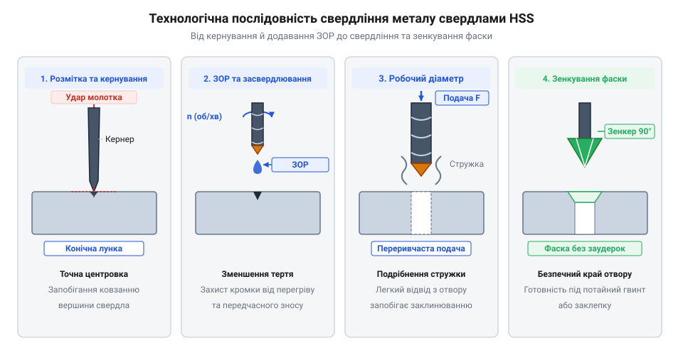

# Практичне свердління та виготовлення монтажних отворів у листовій сталі та алюмінієвому профілі

<preknowlist>
- [Надфілі (140 мм)](root:cat-hw-instruments/needle-files) — Прийоми зачищення й підгонки країв металевих деталей після механічної обробки.
- [Скальпелі й змінні леза](root:cat-hw-instruments/scalpel-set) — Техніка видалення дрібних заудерок із м'яких кольорових металів.
</preknowlist>

## Проблема зміщення та перегріву при свердлінні металу

Механічна обробка металевих заготовок — алюмінієвого профілю чи сталевого кутника — вимагає високої точності позиціонування інструмента. Спроба засвердлитися у плаский лист металу без попередньої підготовки супроводжується ковзанням вершини свердла по гладкій поверхні під дією осьового зусилля. Оскільки спіральне свердло зі швидкорізальної сталі (від @@en|HSS@@ — @@en|High-Speed Steel@@) має поперечну різальну кромку (перемичку), воно позбавлене самоцентрування. Це призводить до бічного зміщення отвору від вихідної розмітки та викривлення міжосьових відстаней між монтажними отворами.

Другим критичним чинником є термічний перегрів різального інструмента та деформування заготовки. Під час високих обертів без охолодження в зоні контуру різання виникає інтенсивне тертя, яке розігріває кромку свердла до температур понад 500–600 °C. Це спричиняє відпускання загартованої сталі, втрату твердості та миттєве затуплення вершини. У випадку в'язкого алюмінію висока температура спричиняє термопластичну деформацію та адгезійне налипання розм'якшеного металу на стінки спіральних канавок (явище адгезійного схоплювання). Забиті стружкою канавки припиняють транспортування матеріалу з отвору, що призводить до миттєвого зростання крутного моменту, стружкового заклинювання інструмента та крихкого полому свердла @@en|HSS@@ у заготовці.

Під час тривалого свердління товстостінного сталевого кутника завтовшки 4 мм без подачі ЗОР виникає додаткова проблема локальної термічної деформації стінок заготовки. Через низьку теплопровідність сталі висока температура накопичується в обмеженій зоні навколо отвору, викликаючи нерівномірне розширення металу. Це спричиняє появу температурних напружень, які призводять до жолоблення й викривлення площини полки кутника, особливо біля його кутового ребра жорсткості. Крім того, перегрітий контур отвору після вистигання на повітрі загартовується, утворюючи тверду поверхневу кірку, що суттєво ускладнює подальше зенкування фаски чи нарізання різьби.

## Підготовка матеріалу та точне кернування

Отримання чистого отвору строго в заданій точці починається з розмітки та фізичного фіксування центра. Лінії майбутніх осей наносять штангенциркулем або креслярським штихелем. На перетині розмічальних ліній встановлюють кернер (від @@en|center punch@@ — слідчий інструмент для нанесення конічних заглиблень) та завдають точного удару молотком. Отримана конічна лунка слугує надійним спрямовувачем для забірного конуса свердла HSS, утримуючи його від відведення на перших обертах.

*Етапи виготовлення монтажного отвору: кернування, проходження матеріалу з подачею ЗОР та кінцеве зенкування.*

Перед початком обробки заготовку із сталевого кутника чи алюмінієвого профілю обов'язково затискають у верстатних лещатах або закріплюють струбцинами до робочого столу. Свердління «з рук» незафіксованої деталі є небезпечним, оскільки при виході свердла на зворотному боці заготовка може захопитися різальними кромками й спричинити травму або поломку інструмента. Для забезпечення суворої перпендикулярності вибірки та нерухомості заготовки використовують [свердлильну стійку та верстатні лещата](root:cat-hw-instruments/drill-press-stand), які виключають бічні перекоси інструмента.

Особливу увагу приділяють збереженню зовнішнього вигляду заготовок із полірованою або анодованою поверхнею. Щоб запобігти появі хаотичних подряпин від гострих ніжок штангенциркуля чи штихеля, на ділянку розмітки наклеюють смужку паперового малярного скотчу (від @@en|masking tape@@ — самоклейна захисна стрічка). Графітні чи чорнильні лінії, нанесені поверх скотчу, мають високу контрастність, а сам паперовий шар додатково запобігає випадковому ковзанню вершини кернера при початковому позиціонуванні інструмента.

Для підвищення точності та швидкості розмітки зручно використовувати автоматичний пружинний кернер (від @@en|automatic center punch@@ — ударний інструмент з автоматичним пружинним механізмом). Він не потребує застосування молотка: при натисканні рукою на корпус внутрішня пружина стискається й у певний момент вивільняє боєць, завдаючи точного ударного імпульсу. Регулювальна гайка у верхній частині корпусу дозволяє плавно змінювати силу удару. Для м'якого алюмінієвого профілю встановлюють мінімальне зусилля, щоб лунка не деформувала тонкі стінки заготовки, тоді як при кернуванні 4-міліметрового сталевого кутника пружину максимально затягують для отримання глибокої конічної засічки.

## Налаштування обертів та застосування ЗОР

Вибір частоти обертання шпинделя дриля чи свердлильної стійки базується на розрахунку оптимальної швидкості різання (від @@en|cutting speed@@ — лінійна швидкість руху різальної кромки відносно металу). Для конструкційної сталі рекомендована швидкість різання становить 20–30 м/хв, тоді як для м'якого алюмінію її збільшують до 50–80 м/хв. Чим більший діаметр свердла, тим меншими мають бути оберти шпинделя: при переході від свердла діаметром 2.0 мм до 8.0 мм частоту знижують у 3–4 рази.

Для стійкого теплового режиму та зменшення тертя в зону різання додають змащувально-охолоджувальну рідину (від @@en|coolant@@ — ЗОР). При обробці сталі використовують машинну або мінеральну оливу, а при свердлінні алюмінію — гас чи мильну емульсію, які запобігають налипанню м'якого стружкового матеріалу на стінки канавок. Охолодження суттєво продовжує ресурс швидкорізальної сталі HSS та забезпечує гладку поверхню стінок отвору. Водночас категорично заборонено застосовувати густі консистентні мастила (від @@en|grease@@ — пластичні мастильні матеріали): замість ефективного відведення тепла та вимивання стружки вони змішуються з дрібною металевою стружкою у канавках, утворюючи в'язку абразивну масу. Це заклинює інструмент у глибокому отворі, перешкоджає охолодженню та спричиняє швидкий термічний відпуск і поломку свердла. Докладніше про вибір складів під різні типи металів читайте у статті про [змащувально-охолоджувальні рідини](root:cat-hw-instruments/coolants-cutting-fluids), де розкрито ефективність спеціальних емульсій.

## Техніка переривчастого свердління та відвід стружки

Під час проходження товщини металу (3 мм алюмінію або 4 мм сталі) подачу свердла здійснюють з помірним і стабільним зусиллям (від @@en|feed rate@@ — швидкість заглиблення). Для запобігання намотуванню довгої звиваної стружки застосовують техніку переривчастого свердління: через кожні 1–2 мм заглиблення свердло короткочасно піднімають угору без зупинки обертання шпинделя. Це розриває стружку на дрібні фрагменти та виводить їх спіральними канавками з каналу отвору.

Особливу увагу приділяють завершальному етапу проходження заготовки. На виході свердла з металу опір різанню різко падає, а забірні кромки прагнуть вклинитися в тонкий залишковий перемичковий шар. Для відсутності заклинювання та розриву матеріалу зусилля на рукоятку подачі наприкінці проходу зменшують удвічі.

При роботі з тонкостінними алюмінієвими профілями, які мають внутрішні замкнені порожнини, виникає додаткова складна умова для відводу стружки. Після проходження першої стінки звивана стружка потрапляє всередину замкненої камери профілю й може накопичуватися навколо стержня інструмента. Під час заглиблення у другу стінку або при зворотному виведенні свердла ця накопичена стружка заклинює між спіральними канавками та внутрішньою перетинкою, що призводить до заминання стінок профілю чи вигинання тонкого інструмента HSS. Щоб уникнути цього, після пробиття першої стінки процес короткочасно зупиняють, виводять свердло та видаляють стружку з внутрішньої порожнини легким витрушуванням або продуванням стисненим повітрям.

## Зенкування та видалення заудерок

Після виходу свердла на зворотному боці деталі та вздовж верхньої кромки утворюються гострі підняті краї — заудерки (від @@en|burr@@ — гострий металевий грат). Для їх зняття та підготовки конічного фасочного заглиблення під потайну головку гвинта виконують зенкування (від @@en|countersink@@ — зняття фаски конічним зенкером або свердлом більшого діаметра). Зенкер діаметром 10–12 мм вручну або на низьких обертах притискають до кромки отвору на 1–2 секунди.

Для остаточної зачистки важкодоступних внутрішніх поверхонь тонкостінних профілів доцільно використовувати [набори надфілів](root:cat-hw-instruments/needle-files), які дозволяють загладити дрібні нерівності. При обробці м'якого алюмінію окремі дрібні задирки на краях можна обережно зрізати [технічним скальпелем](root:cat-hw-instruments/scalpel-set). Якщо ж внутрішні заудерки знаходяться у замкненій порожнині, застосовують конічну шарошку на борфрезі (від @@en|rotary burr@@ — твердосплавна обертова фреза для зачищення металу): її вводять у канал на мінімальних обертах, де дрібнозубі різальні кромки швидко й акуратно зрізають внутрішній грат без викривлення діаметра. Отриманий монтажний отвір має бути чистим, із симетричною фаскою, без тріщин і викривлень геометричної форми.
