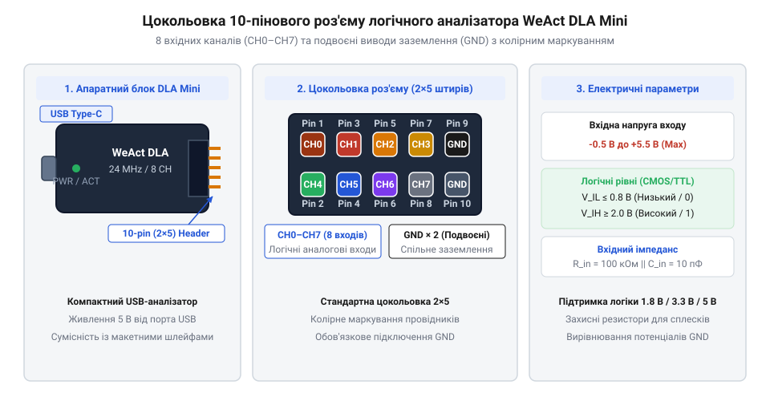
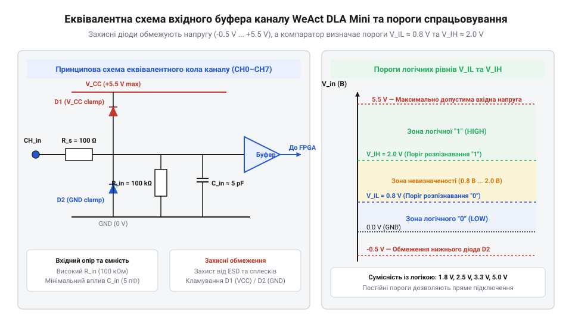

# Апаратний інтерфейс, розводка каналів та електричні характеристики WeAct DLA Mini

## Призначення апаратного інтерфейсу DLA Mini

Під час розробки та налагодження мікроконтролерних систем виникає потреба контролювати одночасний стан кількох цифрових ліній зв'язку — послідовних шин @@en|SPI@@, @@en|I2C@@ або @@en|UART@@. Ззвичайне вимірювання напруги мультиметром показати часову динаміку швидких імпульсів не здатне, а [портативні осцилографи](root:cat-hw-instruments/fnirsi-2c53t) мають обмежену кількість аналогових каналів і не призначені для обробки довгих послідовностей цифрових даних. Логічний аналізатор (від англ. @@en|logic analyzer@@ — прилад для запису та аналізу цифрових сигналів) WeAct DLA Mini розв'язує цю задачу шляхом паралельного зчитування 8 цифрових каналів із частотою дискретизації до 24 МГц.

Апаратний інтерфейс приладу слугує фізичною межею між досліджуваною електронною схемою та персональним комп'ютером. Він приймає логічні рівні напруги з виводів мікроконтролера чи периферійного сенсора, порівнює їх із заданими порогами спрацьовування та передає цифрову послідовність через порт @@en|USB Type-C@@ до керувальної програми. Головним завданням вхідного апаратного тракту є точна фіксація логічного нуля та одиниці без внесення спотворень у роботу досліджуваного кола. При цьому кожен вхідний буфер (від англ. @@en|buffer@@ — проміжний підсилювач) мікроконтролера характеризується власним часом запізнення поширення сигналу (від англ. @@en|propagation delay@@ — часова затримка проходження фронту через тригер), що становить близько 2–5 наносекунд. Ця апаратна латентність (від англ. @@en|latency@@ — часова затримка фіксації стану) створює мінімальне зсунення часових відліків відносно реального моменту зміни напруги на лінії. Якщо вхідний опір приладу буде занадто низьким, він шунтуватиме сигнальні лінії заготовки, викликаючи збої в передачі даних. Якщо ж вхідні кола позбавлені захисту, найменший статичний пробій (від англ. @@en|ESD@@ — @@en|Electrostatic Discharge@@, електростатичний розряд) або вирівнювальний струм через спільне заземлення здатний безповоротно знищити вхідний буфер мікроконтролера аналізатора.

Саме тому апаратна структура DLA Mini поєднує 10-піновий сигнальний роз'єм розводки каналів (від англ. @@en|pinout@@ — схема розташування та призначення контактів) із захисними резисторними збірками та захисними діодами, а також роз'єм @@en|USB Type-C@@ для живлення й обміну даними з хостом.

Така двокомпонентна схема роз'ємів відокремлює вимірювальне коло від інтерфейсу зв'язку з персональним комп'ютером. Через порт @@en|USB Type-C@@ прилад отримує стабільну напругу живлення 5 В та транслює сформований потік цифрових відліків, тоді як 10-пінова колодка забезпечує безпосередній контакт із виводами досліджуваної плати. Чіткий розподіл функцій між живленням та зйомом даних дозволяє мінімізувати вплив аналізатора на часові параметри та амплітуди цифрових сигналів у вимірювальному колі.

## Розводка 10-пінового роз'єму та цокольовка

Підключення логічного аналізатора DLA Mini до вимірювальних точок здійснюється за допомогою 10-контактного однорядного роз'єму типу @@en|Dupont@@ з кроком 2.54 мм. Для зручності макетування до комплекту приладу входить 10-жильний гнучкий плоский шлейф із колірним маркуванням провідників, що відповідає стандартному колірному коду резисторів (від коричневого для каналу `CH0` до сірого для каналу `CH7`).

Розподіл сигналів на 10-піновому виводі приладу має строго визначену конфігурацію: вісім каналів призначені для зчитування логічних станів, а два залишкових виводи виведені на спільну шину заземлення (від англ. @@en|GND@@ — @@en|Ground@@, заземлення та загальний провід).


*Цокольовка вхідного роз'єму DLA Mini: вісім каналів CH0–CH7 та два піддваєні контакти заземлення.*

**Призначення та маркування виводів 10-пінового роз'єму WeAct DLA Mini:**

| Номер піна | Назва сигналу | Колір провідника шлейфу | Функціональне призначення |
| :--- | :--- | :--- | :--- |
| 1 | `CH0` | Коричневий | Вхідний цифровий канал 0 (вхід компаратора) |
| 2 | `CH1` | Червоний | Вхідний цифровий канал 1 (вхід компаратора) |
| 3 | `CH2` | Помаранчевий | Вхідний цифровий канал 2 (вхід компаратора) |
| 4 | `CH3` | Жовтий | Вхідний цифровий канал 3 (вхід компаратора) |
| 5 | `CH4` | Зелений | Вхідний цифровий канал 4 (вхід компаратора) |
| 6 | `CH5` | Синій | Вхідний цифровий канал 5 (вхід компаратора) |
| 7 | `CH6` | Фіолетовий | Вхідний цифровий канал 6 (вхід компаратора) |
| 8 | `CH7` | Сірий | Вхідний цифровий канал 7 (вхід компаратора) |
| 9 | `GND` | Чорний | Спільний дріт заземлення (загальний мінус схеми) |
| 10 | `GND` | Білий / Чорний | Додатковий дріт заземлення для зменшення індуктивності |

Наявність двох піддваєних пінів `GND` є критично важливою для забезпечення високої якості сигналів під час роботи на максимальній частоті дискретизації 24 МГц. При передачі високочастотних імпульсів із коротким фронтом тривалістю в кілька наносекунд паразитна індуктивність `L_gnd` довгого поодинокого заземлювального провідника шлейфу створює реактивний опір, викликаючи ефект «дзвінкого заземлення» (від англ. @@en|ground bounce@@ — зворотний індуктивний сплеск напруги на шині заземлення), через який прилад фіксує хибні логічні переходи. Для аналітичного оцінювання амплітуди цього сплеску напруги `V_bounce` при одночасному перемиканні 8 каналів із сукупною зміною струму `di = 40 мА` за час фронту `dt = 2 нс` та індуктивності поодинокого провідника `L_gnd = 20 нГн` використовують формулу:

V_bounce = L_gnd · (di ÷ dt)      [розрахунок перепаду напруги на індуктивності заземлення]

**Розрахунок індуктивного сплеску напруги заземлення V_bounce:**

```
V_bounce = 20·10⁻⁹ · (0.040 ÷ 2·10⁻⁹) [підстановка параметрів у формулу]
         = 20·10⁻⁹ · 20000000        [обчислення швидкості зміни струму]
         = 0.4 В                    [амплітуда сплеску для поодинокого провідника]
```

Отримане значення `0.4 В` становить половину від допустимого запасу завадостійкості для логіки 3.3 В (`V_IL = 0.8 В`), що може викликати помилкові спрацьовування компараторів. Підключення двох провідників `GND` паралельно зменшує еквівалентну індуктивність удвічі до `L_gnd = 10 нГн`, скорочуючи сплеск до безпечних `0.2 В` і гарантуючи стабільну фіксацію рівнів.

## Електричні характеристики та логічні рівні

Кожен вхідний канал логічного аналізатора DLA Mini побудований за схемою з захисним обмежувальним резистором, шунтувальними діодами та високошвидкісним вхідним буфером-компаратором (від англ. @@en|comparator@@ — пороговий порівнювач напруги) сімейства @@en|CMOS@@.


*Еквівалентна схема вхідного каналу DLA Mini: струмообмежувальний резистор, вхідний компаратор та супресорний захист від перенапруги.*

Вхідні кола каналів мають фіксовані електричні параметри, що визначають сумісність приладу з різними родинами цифрових мікросхем:

*   **Вхідний опір (`R_in`):** дорівнює `100 кОм`, що забезпечує мінімальне струмове навантаження на виходи мікроконтролера та запобігає викривленню високих логічних станів у колах з підтягувальними резисторами.
*   **Паразитна вхідна ємність (`C_in`):** становить близько `10 пФ`. Разом із затискачами та провідниками шлейфу вона утворює низькочастотний фільтр, що обмежує максимальну частоту вхідних сигналів.
*   **Допустимий діапазон вхідних напруг:** становить від `-0.5 В` до `+5.5 В`. Напруги поза цим діапазоном призводять до відкривання захисних діодів і можуть викликати перегрів або пробій вхідних кіл.
*   **Пороги спрацьовування компаратора:** максимальна напруга логічного нуля `V_IL` становить `0.8 В`, а мінімальна напруга логічної одиниці `V_IH` дорівнює `2.0 В`.

Завдяки фіксованим порогам `V_IL = 0.8 В` та `V_IH = 2.0 В` аналізатор WeAct DLA Mini є безпосередньо сумісним із цифровими логічними рівнями `3.3 В` (стандарт @@en|LVTTL@@) та `5.0 В` (стандарт @@en|TTL@@ / @@en|CMOS@@). При роботі з низьковольтними мікросхемами з живленням `1.8 В` слід враховувати, що високий рівень напруги виходу зазвичай становить близько `1.6–1.8 В`. Оскільки цей рівень лежить нижче порога `V_IH = 2.0 В`, аналізатор може не зафіксувати логічну одиницю. Для стабільної роботи з логікою `1.8 В` перед входом приладу встановлюють зовнішній активний конвертор рівнів (від англ. @@en|level shifter@@ — двонапрямний транслятор логічних рівнів).

При вимірюваннях у колах з індуктивним навантаженням або довгими лініями зв'язку на сигналах виникають сплески перенапруги (від англ. @@en|overshoot@@ — імпульсний викид напруги вище шини живлення). Для розрахунку додаткового захисного резистора `R_prot`, який включається послідовно в розрив каналу для обмеження струму через внутрішні діоди до безпечного значення `I_max = 2 мА`, використовують формулу:

R_prot = (V_spike - V_max) ÷ I_max      [розрахунок додаткового захисного опору]

**Розрахунок додаткового захисного резистора при імпульсному сплеску напруги V_spike = 12 В:**

```
R_prot = (12.0 - 5.5) ÷ 0.002      [підстановка параметрів у формулу]
       = 6.5 ÷ 0.002              [обчислення різниці напруг]
       = 3250 Ом                  [мінімальний розрахований опір]
       ≈ 3.3 кОм                  [вибір найближчого номіналу з ряду E24]
```

Таким чином, підключення послідовного резистора номіналом `3.3 кОм` надійно захищає канал DLA Mini від пошкодження під час комутації кіл із сплесками напруги до `12 В`.

## Живлення від USB та земляні петлі

Логічний аналізатор WeAct DLA Mini отримує живлення напругою `5.0 В` безпосередньо від шини порту @@en|USB Type-C@@ персонального комп'ютера або ноутбука. Внутрішній лінійний стабілізатор знижує цю напругу до `3.3 В` для живлення мікроконтролера приладу та вхідних компараторів.

Критичною особливістю конструкції DLA Mini є відсутність гальванічної розв'язки (від англ. @@en|galvanic isolation@@ — відсутність прямого електричного контакту) між сигнальним заземленням `GND` на 10-піновому роз'ємі та шиною заземлення `GND` порту USB. Контакти `GND` обидвох роз'ємів замкнені безпосередньо через мідний шар друкованої плати аналізатора.

Цей гальванічний зв'язок створює ризик виникнення небезпечних замкнених земляних петель (від англ. @@en|ground loop@@ — паразитна замкнена контурна петля заземлення). Якщо персональний комп'ютер підключено до мережевої розетки з заземленням, а досліджувана плата живиться від імпульсного блоку живлення або лабораторного джерела, між їхніми шинами `GND` може існувати різниця потенціалів у кілька десятків вольт через витоки мережевого фільтра.

При підключенні чорного провідника `GND` аналізатора до плати під напругою через друкований трек приладу та кабель USB починає протікати високий вирівнювальний струм. Цей струм здатний випалити заземлювальний трек на платі DLA Mini, пошкодити контролер USB на материнській платі комп'ютера або викликати сильні низькочастотні завади.

**Правила безпечного підключення заземлення та запобігання пошкодженням:**

1.  **Порядок комутації:** спочатку з'єднують дріт `GND` аналізатора з загальним мінусом досліджуваної плати, і лише після цього підключають кабель USB до комп'ютера.
2.  **Живлення від батарей або ноутбука:** під час налагодження плати без гальванічної розв'язки рекомендується живити ПК або досліджуваний пристрій від акумулятора чи автономного джерела.
3.  **Використання USB-ізолятора:** при роботі з високовольтними або мережевими пристроями між ПК і DLA Mini обов'язково встановлюють апаратний гальванічний USB-ізолятор (від англ. @@en|USB isolator@@ — оптичний чи магнітно-розв'язаний повторювач шини USB).

Дотримання цих правил гарантує збереження цілісності вхідних буферів WeAct DLA Mini та запобігає аварійним ситуаціям при вимірюваннях у реальних електронних схемах.
