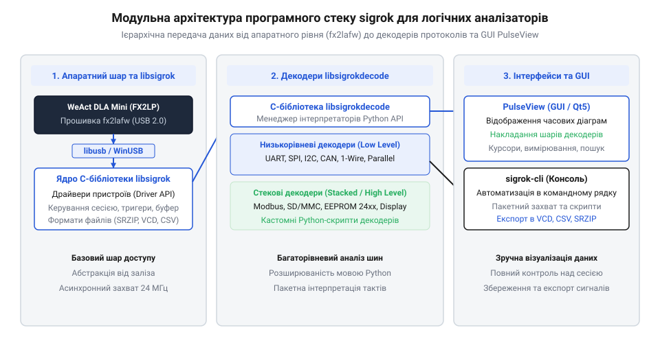
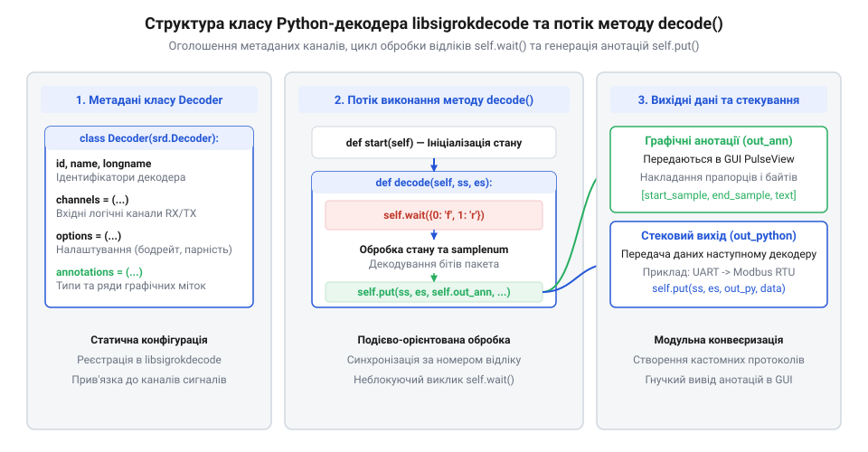

# Програмний інтерфейс libsigrok та конфігурація декодерів у PulseView

<preknowlist>
- [FNIRSI 2C53T — осцилограф, генератор і мультиметр в одному](root:cat-hw-instruments/fnirsi-2c53t) — Принципи спостереження електричних сигналів та обмеження осцилографічного аналізу.
</preknowlist>

## Архітектура програмного стеку бібліотек sigrok

Автоматизований збір і розбір швидких цифрових сигналів вимагають чіткого розмежовування завдань на низькорівневе захоплення даних з апаратури та їх подальшу високорівневу інтерпретацію. Для усунення залежності від пропрієтарного ПЗ конкретних виробників розроблено відкритий програмний стек бібліотек sigrok (від @@en|sigrok@@ — відкритий портативний стек програмного забезпечення для вимірювального обладнання). Стек має модульну будову, де кожен шар відповідає за ізольований рівень обробки часових діаграм.


*Модульна структура програмного стеку sigrok: від апаратного драйвера до графічної оболонки.*

Основу стеку становить бібліотека libsigrok (від @@en|libsigrok@@ — системна C-бібліотека низькорівневого зв'язку з приладами), яка містить апаратні драйвери (від @@en|driver@@ — апаратний адаптер керування) для логічних аналізаторів, осцилографів та мультиметрів. Вона приховує специфіку USB-контролерів та формує уніфікований потік цифрових відліків: для запобігання втратам семплів при високих частотах дискретизації драйвер налаштовує декілька паралельних асинхронних USB-трансферів (англ. @@en|asynchronous transfer@@), що безперервно скидають сирі байти у кільцевий буфер пам'яті (від @@en|ring buffer@@ — кільцевий масив тимчасового збереження). Обробник подій системної бібліотеки по черзі звільняє заповнені блоки буфера та транслює їх у сесійну чергу без затримок на перемикання контексту ОС. Шар декодування забезпечує бібліотека libsigrokdecode (від @@en|libsigrokdecode@@ — C/Python-бібліотека розбору протоколів), яка перетворює часові послідовності у високорівневі події шин. Верхній рівень займають інтерфейси користувача: графічна програма PulseView та консольна утиліта sigrok-cli. При спостереженні повільних процесів чи аналізі рівнів напруги доречним є порівняння параметрів із [приладом FNIRSI 2C53T](root:cat-hw-instruments/fnirsi-2c53t) для первинного оцінювання сигналів.

Для прямої взаємодії з апаратними чипами логічних аналізаторів (зокрема мікроконтролерами серії Cypress FX2LP) бібліотека `libsigrok` спирається на кросплатформовий шар користувацького доступу `libusb` (від @@en|libusb@@ — C-бібліотека доступу до пристроїв USB без написання драйверів ядра). Це дає змогу ініціалізувати пристрій, завантажувати операційну мікропрограму в його RAM та зчитувати масиви відліків через високошвидкісні кінцеві точки (англ. @@en|endpoint@@) потокової передачі даних (англ. @@en|bulk transfer@@). Для запобігання втратам відліків при високому навантаженні шини `libusb` використовує алгоритм попереднього наповнення асинхронної черги запитів: драйвер одночасно відправляє в ядро ОС кільцевий пул із 16–32 трансферних буферів. Щойно один буфер заповнюється даними від аналізатора, спрацьовує швидкий зворотний виклик (від @@en|callback@@ — функція обробки завершення передачі), який передає вибірку до стеку `libsigrok` і миттєво повертає буфер назад у чергу контролера. Таке безперервне кругове перепризначення запобігає переповненню апаратного FIFO чипа при затримках планувальника ОС (від @@en|buffer overrun@@ — переповнення внутрішнього буфера пристрою). У середовищі Linux та macOS обмін відбувається безпосередньо через інтерфейси ядра, тоді як у Windows `libusb` транслює виклики до системного низькорівневого драйвера `WinUSB` (від @@en|WinUSB@@ — універсальний драйвер USB-пристроїв у Windows від Microsoft). Завдяки цій двошаровій абстракції `libsigrok` отримує сирий потік байтів із бінарними станами каналів безпосередньо з USB-буфера й транслює його вищим прошаркам стеку без затримок на пропрієтарне узгодження.

## Консольний інтерфейс утиліти sigrok-cli

Автоматизація тестових стендів, скрипти перевірки та пакетне захоплення даних вимагають виконання операцій без графічного інтерфейсу через командний рядок (від @@en|CLI@@ — @@en|Command Line Interface@@). Для цього застосовують утиліту sigrok-cli (від @@en|sigrok-cli@@ — консольна утиліта керування аналізаторами). Першим кроком є автоматичне виявлення підключених пристроїв командою з прапором сканування (від @@en|scan@@ — пошук сумісного обладнання):

```bash
sigrok-cli --scan
```

Для запуску сесії захоплення задають параметр драйвера, частоту дискретизації, кількість зразків та умови маски тригера. Замість фіксованого ліміту відліків прапор `--continuous` (від @@en|continuous mode@@ — режим безперервного потокового запису) дозволяє вести тривалий моніторинг шини без обмеження за часом, зберігаючи семпли прямо на диск до примусового переривання користувачем. Це позбавляє ризику втрати випадкових збоїв у тривалих сесіях, хоча вимагає від ПК достатньої швидкодії дискового накопичувача для постійного скидання масивів даних. Наприклад, для 8-канального аналізатора на базі чипа FX2 налаштування параметрів та прямого декодування шини SPI реалізують наступним викликом:

```bash
sigrok-cli -d fx2lafw --config samplerate=10MHz --samples 500k \
  --channels D0=SCK,D1=MOSI,D2=MISO,D3=CS \
  --triggers D3=f -P spi -o spi_capture.sr
```

У цьому прикладі прапор `-P` підключає протокольний декодер (від @@en|protocol decoder@@ — аналізатор структури кадру), а прапор `-o` зберігає сесію у стиснутий файл `.sr`. Консольний варіант дозволяє також перенаправляти декодований потік у стандартні текстові формати CSV чи JSON для подальшого автоматизованого аналізу.

Для зупинки буфера та фіксації подій за складними логічними умовами `sigrok-cli` надає гнучкий синтаксис налаштування тригерів (від @@en|trigger@@ — пускова умова захоплення відліків). Прапор `--triggers` (або `-t`) приймає перелік каналів із позначенням очікуваних станів: `0` або `1` для виявлення статичних рівнів (англ. @@en|level trigger@@ — поуровневий селектор), `r` (англ. @@en|rising edge@@ — зростаючий фронт) та `f` (англ. @@en|falling edge@@ — спадний фронт) для відстеження фронтів, а також `e` для будь-якого перепаду напруги. Зазначення декількох ліній через кому (наприклад, `--triggers D0=r,D1=1,D2=0`) перетворює умову на базований на побітовому збігу паралельний селектор: апаратний драйвер конфігурує маску вибірки (англ. @@en|trigger mask@@) та значення порівняння (англ. @@en|trigger value@@), де прилад перевіряє поточний стан усіх каналів щодо попереднього відліку. Синхронізація відбувається виключно тоді, коли в моментно перевіряємому відліку тактова лінія `D0` змінює стан з `0` на `1` (фронт `r`), а канали `D1` та `D2` вже утримують статичні рівні `1` та `0` відповідно. При цьому якщо задіяти фронтові умови на кількох лініях одночасно (наприклад, `D0=r,D1=f`), прості апаратні контролери (зокрема чипи FX2) не здатні апаратно відстежити два фронти за один такт дискретизації й переходять до програмного фільтрування прошарком @@en|libsigrok@@, що вимагає додаткового запасу пропускної здатності шини USB. Такий комбінований механізм уможливлює точну точкову синхронізацію сесії за конкретними адресами шини чи службовими командами без засмічення буфера чеканням.

## Структура та клас декодерів libsigrokdecode

Розробка кастомних аналізаторів протоколів у стеку sigrok виконується мовою Python (від @@en|Python@@ — мова високого рівня для опису декодерів). Двигун libsigrokdecode завантажує декодери як окремі модулі, що містять файл ініціалізації та файл опису розбору. Кожен декодер має успадковувати базовий клас Decoder з модуля srd (від @@en|srd@@ — скорочення від @@en|sigrokdecode@@).


*Схема класів та потік даних методу decode у бібліотеці libsigrokdecode.*

Клас описує декларативні метадані: унікальний ідентифікатор `id`, назву `name`, перелік необхідних сигнальних ліній `channels`, параметри налаштування `options` та таблицю анотацій `annotations` (від @@en|annotation@@ — графічний маркер події на діаграмі). Кожен елемент `annotations` визначає клас текстових плашок у форматі кортежів `('id', 'Опис')`, індекси яких передаються у метод виводу `self.put()`. Для впорядкування візуалізації в PulseView атрибут `annotation_rows` (від @@en|annotation rows@@ — графічні смуги групування анотацій) об'єднує відносні індекси анотацій у окремі горизонтальні доріжки часової діаграми, що запобігає їхньому накладанню та дає змогу вимикати відображення окремих рівнів розбору. Для підготовки каналів виводу перед початком розбору двигун викликає метод `start()`, у якому за допомогою `self.register()` реєструють ідентифікатори вихідних потоків. Виклик `srd.OUTPUT_ANN` створює канал передачі текстових плашок та маркерів у графічну оболонку PulseView, а `srd.OUTPUT_PYTHON` формує канал поширення структурованих Python-об'єктів для передачі розібраних пакетів каскадним стековим декодерам (від @@en|stacked decoder@@ — декодер вищого рівня в стеку). Без збереження цих дескрипторів у змінних `self.out_ann` та `self.out_python` під час ініціалізації подальший виклик методу публікації даних `self.put()` зазнає помилки. Структура базового Python-модуля має наступний вигляд:

:::code api-sigrok-pulseview-command-and-decoder-interface/py/decoder.py

## Алгоритм розбору тактів та стекові декодери

Ключовим виконавчим методом класу є `decode()`. Він працює як нескінченний цикл, що викликає метод `self.wait()` для очікування певного стану сигнальних ліній (наприклад, спадного чи зростаючого фронту). Отримавши збіг за умовою, метод обраховує номери відліків у часі та формує анотацію за допомогою виклику `self.put()`. У випадку примусового перезапуску сесії, перемотування часової діаграми чи апаратного розриву потоку даних двигун обнуляє стан декодера викликом методу `reset()`. Всі внутрішні змінні — скінченні автомати (від @@en|state machine@@ — автомат станів розбору кадру), накопичувальні буфери байтів та лічильники семплів `self.samplenum` — скидаються в початкове значення, що запобігає накладанню залишків попередніх недописаних пакетів на новий масив відліків.

Складні базпровідні або промислові протоколи будують за принципом стекового декодера (від @@en|stacked decoder@@ — декодер вищого рівня у стеку обробки). Стековий декодер отримує як вхідний потік не сирі логічні рівні з ліній, а вже розібрані пакети низькорівневого декодера (наприклад, байтовий потік шин UART або SPI). Нижні декодери передають дані через вихід `OUTPUT_PYTHON`, що дозволяє легко виділяти команди прикладного рівня поверх базового розбору.

Передача даних між рівнями стека відбувається через впорядкований кортеж Python-об'єктів, який базовий декодер надсилає через виклик `self.put(ss, es, self.out_python, (packet_type, payload))`. У цьому кортежі індекси `ss` та `es` задають часові межі семплів, `packet_type` вказує семантичний тип події (наприклад, `'DATA'` чи `'START'`), а `payload` містить зчитаний вміст (від @@en|payload@@ — корисне навантаження кадру у вигляді числа чи байта). Стековий декодер вказує ідентифікатор низькорівневого протоколу у своєму списку `inputs`, після чого його метод `decode()` отримує ці кортежі через виклик `self.wait({'python': ...})`. Зчитуючи вже скомпільовані пакети замість обробки окремих сигнальних перепадів, верхній декодер агрегує послідовність байтів у високорівневі прикладні команди та формує власні підсумкові анотації.

:::code api-sigrok-pulseview-command-and-decoder-interface/py/decode.py
