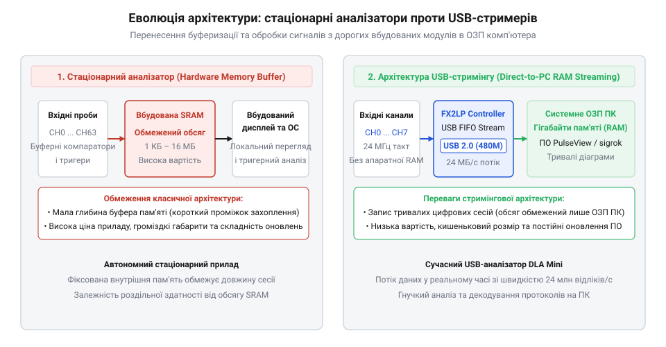

# Еволюція логічних аналізаторів: від громіздких стендів до USB-стримерів

<preknowlist>
- [FNIRSI 2C53T — осцилограф, генератор і мультиметр в одному](root:cat-hw-instruments/fnirsi-2c53t) — Потрібно знати принцип роботи осцилографа для візуалізації напруги в часі та обмеження його 2 каналів.
- [Режим самописця Roll Mode у цифрових осцилографах](root:cat-hw-instruments/oscilloscope-roll-mode) — Потрібно знати відмінність між неперервним збереженням сигналів і стандартним тригерним захопленням.
</preknowlist>

## Криза двох каналів осцилографа

У першій половині 1970-х років електронна індустрія стикнулася з технологічним зсувом: на зміну аналоговим схемам і дискретній логіці прийшли перші 8-бітові мікропроцесори. Масове впровадження чипів, таких як Intel 8080 або Motorola 6800, кардинально змінило характер сигналів на друкованих платах. Замість плавної зміни напруги інженерам довелося відстежувати паралельні цифрові шини — 16 ліній адреси, 8 ліній даних та декілька керувальних сигналів синхронізації.

Основним інструментом розробника на той час слугував класичний електронно-променевий осцилограф (англ. @@en|oscilloscope@@, від латинського @@en|oscillo@@ — гойдатися та грецького @@en|scope@@ — спостерігати). Проте осцилограф виявився непридатним для нового завдання. Його 2 або 4 аналогові канали фізично не могли одночасно показати стан 24 паралельних провідників. Навіть якщо розробник підключав декілька осцилографів поруч, екран показував аналогову форму хвилі напруги, тоді як інженеру потрібно було знайти логічні «0» та «1», зібрані в двійкове слово у конкретний такт процесора. Для діагностики систем, де збій виникав на один такт серед мільйонів операцій, потрібен був інструмент принципово іншого класу.

Додатковою перепоною стала відсутність у класичних осцилографах тактової синхронізації та комбінаторного тригерування по двійкових станах. Вбудована схема синхронізації осцилографа реагувала лише на аналоговий перехід напруги через заданий рівень на одному каналі (від англ. @@en|trigger@@ — пускова схема, від *trigger* — спуск), працюючи асинхронно відносно тактового сигналу процесора. Розробник не мав можливості прив'язати захоплення до системного такту чи налаштувати запуск при виникненні конкретної 16-бітової адреси на шині. Через це пошук поодиноких збоїв, що траплялися на одному конкретному такті серед мільйонів операцій, перетворювався на багатогодинний процес спроб і помилок.

Додатковою перепоною стала система синхронізації класичних осцилографів. Традиційний тригер (англ. @@en|trigger@@ — пусковий механізм) відстежував лише перехід напруги через заданий поріг на одному обраному каналі й працював у несинхронному режимі відносно тактового сигналу процесора. Інженер не мав змоги зупинити розгортку при появі певної комбінації цифрових рівнів — наприклад, при збігу 16-бітового коду адреси та сигналу запису в пам'ять. Без можливості прив'язати захоплення до тактових імпульсів шини та налаштувати комбінаторне тригерування розробники витрачали тижні на спроби вручну зафіксувати поодинокі збої на конкретному кроці виконання програми.

Додатковим вузьким місцем осцилографів була відсутність комбінаторних тригерів та прив'язки до системного тактового сигналу. Вбудована схема синхронізації відстежувала лише перехід напруги через заданий поріг на одному обраному каналі (від англ. @@en|trigger@@ — пускова схема). Інженер не мав змоги зупинити розгортку при виникненні конкретного 16-бітового коду адреси чи при складному збігу керувальних сигналів. Без можливості синхронного зачеплення за такт шини та запусків за комбінаціями логічних рівнів розробники витрачали тижні на спроби вручну впіймати поодинокий збій шини.

## Перші автономні логічні аналізатори

Відповіддю на кризу відлагодження став винахід перших логічних аналізаторів (англ. @@en|logic analyzer@@, від @@en|logic@@ — логіка та @@en|analyzer@@ — розбір, аналіз). У 1973–1975 роках компанія Hewlett-Packard на чолі з інженером Чарльзом Гаусом (Charles House) випустила легендарні моделі HP 1600A та HP 1607A, а компанія Biomation створила модель 810D. Замість неперервної аналогової розгортки прилад оцінював напругу на входах відносно порогового рівня і фіксував лише дискретний логічний стан («0» або «1») за кожним тактовим імпульсом.

Інструменти розішлися на два класи: аналізатори станів (англ. @@en|state analyzer@@, від @@en|state@@ — стан), які показували таблиці двійкових чи шістнадцяткових кодових слів на шині, та часові аналізатори (англ. @@en|timing analyzer@@, від @@en|timing@@ — часові співвідношення), які будували псевдоаналогові прямокутні часові діаграми. Втім, стаціонарні аналізатори 1970–1990-х років мали два жорсткі обмеження. По-перше, зріз сигналів зберігався у вбудовану статичну оперативну пам'ять (SRAM), яка тоді коштувала надзвичайно дорого і вміщувала лише від 16 до 256 відліків на канал. По-друге, наявність власного екрана на електронно-променевій трубці (CRT) та складної плати відеоконтролера робила ці прилади громіздкими, важкими й доступними лише для заможних лабораторій за ціною у десятки тисяч доларів.

## Прорив USB 2.0 та архітектура стримінгу

Ситуація докорінно змінилася у першій половині 2000-х років завдяки масовому впровадженню шинного інтерфейсу USB 2.0 High-Speed із пропускною здатністю до 480 Мбіт/с. Виникла ідея винести з корпусу приладу найдорожчі компоненти — вбудований дисплей, потужний процесор та локальну апаратну пам'ять, поклавши ці задачі на персональний комп'ютер.

_*Порівняльна архітектура стаціонарного логічного аналізатора та сучасного USB-стримера.*_

Ключем до створення нового класу пристроїв став випуск мікроконтролерів серії Cypress EZ-USB FX2LP із хардверним USB-рушієм та прямим доступом до пам'яті (GPIF). Ця схема дозволила реалізувати безперервний стримінг (англ. @@en|streaming@@, від @@en|stream@@ — потік): логічні рівні з 8 або 16 входів безпосередньо такт за тактом опитуються й передаються через USB-кабель у оперативну пам'ять комп'ютера. У такому режимі, схожому на [режим самописця Roll Mode](root:cat-hw-instruments/oscilloscope-roll-mode), глибина захоплення обмежується лише обсягом ОЗП ПК і може досягати мільярдів відліків замість тисяч, а вартість самого аналізатора знизилася у сотні разів.

## Еволюція протоколів та розвінчання міфів

Доступність USB-стримерів спричинила революцію у програмному забезпеченні: замість ручного підрахунку прямокутних імпульсів на екрані з'явилися автоматичні декодери послідовних протоколів. Програми на кшталт Saleae Logic або відкритого пакету Sigrok/PulseView навчилися «на льоту» розбирати сирий логічний потік у людські текстуальні команди I2C, SPI, UART, CAN чи 1-Wire. Маленький сірниковий брусок із USB-роз'ємом перетворився на повноцінний протокольний аналізатор.

Популярність портативних стримерів породила й декілька міфів. Найпоширеніший з них стверджує, що дешевий USB-аналізатор здатен повністю замінити цифровий осцилограф. Це небезпечна омана: логічний аналізатор бачить лише бінарний поріг («0» або «1») і повністю ігнорує аналогові деталі — шуми, завалу фронтів, падіння напруги й дзвін у лінії. Інший міф приписує винахід цифрового аналізу конкретному сучасному стартапу, ігноруючи тридцятилітній шлях стаціонарних систем Hewlett-Packard та розробку шини USB 2.0, без яких сучасне відлагодження було б неможливим.
