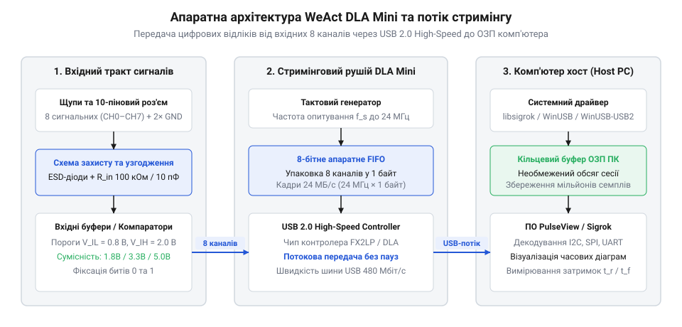
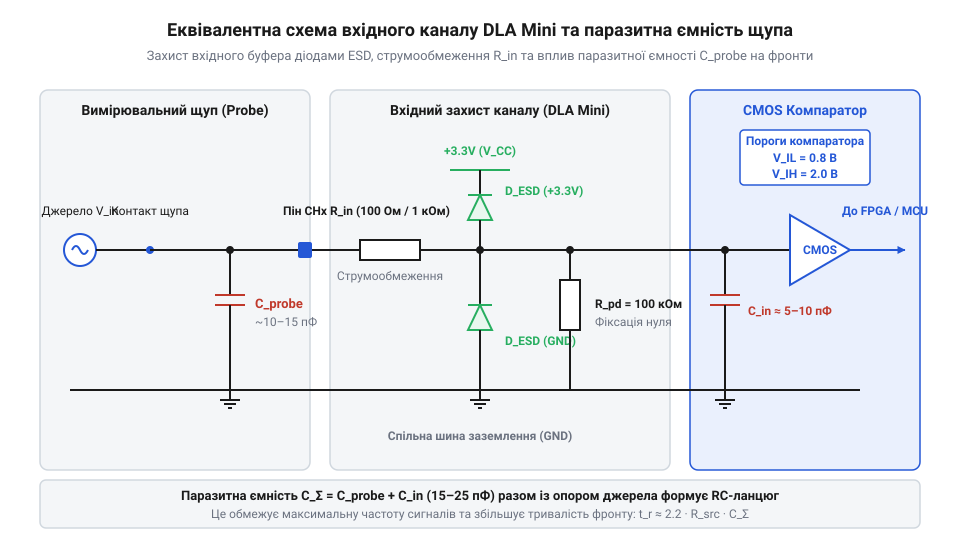
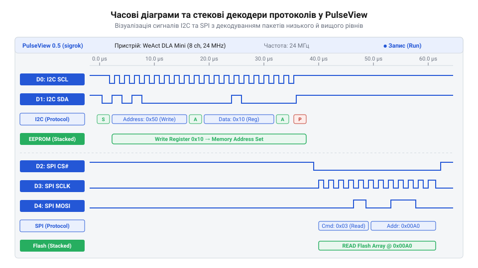

# WeAct DLA Mini — логічний аналізатор (24 МГц, 8 каналів)

<preknowlist>
- [FNIRSI 2C53T — осцилограф, генератор і мультиметр в одному](root:cat-hw-instruments/fnirsi-2c53t) — розуміння відмінності між аналоговим спостереженням форми сигналу осцилографом та логічним вимірюванням цифрових рівнів
- [Режим самописця Roll Mode у цифрових осцилографах](root:cat-hw-instruments/oscilloscope-roll-mode) — принцип безперервного потокового збору та відображення повільних процесів на часовій осі
</preknowlist>

## Проблема невидимих цифрових збоїв та потреба логічного аналізу

Під час розробки вбудованих систем із кількома послідовними шинами обміну часто виникає ситуація, коли цифрова схема раптово припиняє працювати без видимих апаратних пошкоджень. Ззвичайний мультиметр показує наявність напруги живлення, а вольтметр на сигнальних лініях демонструє середній рівень близько 1.6 В, що свідчить лише про факт наявності якійсь імпульсної активності. Навіть двоканальний цифровий [осцилограф FNIRSI 2C53T](root:cat-hw-instruments/fnirsi-2c53t) зазвичай не дає змоги побачити цілісну картину, оскільки для аналізу шини SPI або паралельної шини даних потрібне одночасне спостереження щонайменше чотирьох-восьми сигнальних ліній із прив'язкою до спільного тактового імпульсу. Наприклад, у разі розсинхронізації шини @@en|I2C@@ найменший часовий зсув лінії даних @@en|SDA@@ відносно тактової лінії @@en|SCL@@ призводить до того, що фронт @@en|SDA@@ перемикається під час високого рівня @@en|SCL@@; це хибно сприймається веденими пристроями як умова @@en|START@@ або @@en|STOP@@ замість передачі біта, через що внутрішній автомат станів сенсора блокується, а лінія @@en|SDA@@ залишається наглухо притиснутою до нуля. Спостерігаючи лише окремі канали осцилографом, неможливо одночасно відстежити взаємний зсув фронтів, стан шини у часі та момент виникнення хибної умови на тлі мільйонів послідовних тактових імпульсів.

Спроби відлагодити такий обмін за допомогою періодичного друку діагностичних повідомлень через послідовний порт або крокового виконання коду в налагоджувачі частіше за все лише погіршують ситуацію. Внесення викликів функцій виводу через @@en|UART@@ додає штучні затримки у сотні мікросекунд на очікування передачі кожного байта, що кардинально змінює відносні часові інтервали виконання завдань мікроконтролера. Через цю зміну швидкості невидимі збої — так звані гонки сигналів (англ. @@en|race condition@@) — тимчасово маскуються або зсуваються в часі: завдання, яке у нормальному режимі не встигало підготувати дані до моменту опитування периферії, при відлагоджувальному друку отримує величезний запас часу і працює безпомилково. Окрім того, причиною апаратного збою можуть бути короткі паразитні сплески — ґлітчі (від німецького glitschen — ковзати, англ. @@en|glitch@@), тривалість яких становить одиниці наносекунд, що призводить до хибного спрацьовування переривань чи збою внутрішніх автоматів станів без жодних слідів у програмних логах.

```
V_signal > V_IH  ⇒  Логічна '1'
V_signal < V_IL  ⇒  Логічна '0'
[цифровий аналізатор фіксує дискретні логічні рівні замість аналогової форми]
```

Для вирішення цих проблем застосовують спеціалізовані вимірювальні пристрої — [логічні аналізатори](root:cat-hw-instruments/logic-analyzer) (від грецького λόγος — слово, міркування, англ. @@en|logic analyzer@@). На відміну від аналогових осцилографів, які вимірюють точну форму напруги в часі, логічний аналізатор порівнює вхідну напругу з фіксованими пороговими рівнями у дворівневому компараторі та реєструє виключно двійковий стан (0 або 1) по багатьох каналах одночасно. Схема порівняння зіставляє напругу сигналу з верхнім порогом V_IH (вище якого стан однозначно розпізнається як логічна '1') та нижнім порогом V_IL (нижче якого фіксується логічний '0'); зона між ними утворює полосу гістерезису (від грец. *hysterēsis* — запізнення, англ. @@en|hysteresis@@), яка відсікає імпульсний шум і запобігає тригеруванню від дрібних коливань напруги. Докладний [історичний розвиток приладів](root:cat-hw-instruments/logic-analyzer-dla-mini/hist-logic-analyzers-evolution.md) висвітлює еволюцію від стаціонарних вимірювальних комплексів з вбудованою пам'яттю до компактних USB-стримерів.

## Апаратна архітектура та межі дискретизації DLA Mini

Портативний логічний аналізатор WeAct DLA Mini побудований за схемотехнічною концепцією безперервного USB-стримінгу (англ. @@en|USB streaming analyzer@@). На відміну від громіздких приладів із власною дорогою апаратною пам'яттю (англ. @@en|sample buffer@@), DLA Mini оцифровує вхідні канали та безперервно передає сформовані байти даних через високошвидкісний контролер у системну оперативну пам'яті персонального комп'ютера.

Основою апаратної частини приладу є вхідні компараторні буфери та спеціалізований USB-контролер Cypress FX2LP (англ. @@en|microcontroller@@ з апаратним двигуном High-Speed USB 2.0). Сигнали з 8 вхідних каналів паралельно зчитуються вхідним портом мікросхеми на кожному такті системного генератора 24 МГц, де кожен відлік миттєво упаковується у 8-бітове слово, де один біт відповідає одному каналу (від D0 до D7). Завдяки апаратному інтерфейсу безпосереднього доступу (англ. @@en|Slave FIFO mode@@) сформовані байти передаються в обхід процесорного ядра у внутрішній 4-кілобайтний буфер першим прийшов — першим вийшов (від англ. @@en|FIFO buffer@@) для подальшого вивантаження через шину USB зі швидкістю 24 Мбайт/с. У режимі @@en|Slave FIFO@@ передача вибірок підпорядковується арбітражу шини @@en|USB 2.0 High-Speed@@, де хост-контролер ПК опитує кінцеві точки приладу пакетами @@en|Bulk IN@@ у рамках мікрокадрів тривалістю 125 мкс. Якщо інші пристрої на шині забирають смугу пропускання або операційна система затримує обробку запитів драйвера, вивантаження даних призупиняється, і 4-кілобайтний буфер при напливі 24 Мбайт/с заповнюється всього за 170 мкс. За відсутності чергового запиту @@en|IN token@@ виникає переповнення буфера (англ. @@en|buffer overflow@@) та втрата відліків, що призводить до розриву суцільного часового потоку у PulseView.


*Структурна схема 8-канального логічного аналізатора DLA Mini та конвеєра стримінгу даних через USB 2.0.*

Максимальна частота дискретизації приладу становить 24 МГц при одночасному опитуванні всіх 8 каналів. Для достовірної фіксації цифрового сигналу згідно з теоремою Котельникова (Найквіста-Шеннона) частота дискретизації повинна щонайменше удвічі перевищувати максимальну частоту гармоніки сигналу. Проте для прямокутних цифрових імпульсів, які складаються з непарного спектра високих гармонік, на практиці вимагається співвідношення дискретизації від 4:1 до 10:1 відносно тактової частоти шини. При спробі виміряти сигнал із частотою вище 6 МГц (наприклад, 8 МГц із періодом 125 нс при кроці дискретизації T_sample = 41.67 нс) прилад робить лише 3 відліки на період, що створює часову невизначеність фронту (англ. @@en|sampling jitter@@) до ±41.67 нс; при частотах понад 12 МГц виникає стробоскопічний ефект і аліасинг (від англ. @@en|aliasing@@), через який швидкий сигнал хибно відображається як низькочастотна завада. Глибока [математика цифрової дискретизації](root:cat-hw-instruments/logic-analyzer-dla-mini/math-digital-sampling-and-timing-analysis.md) деталізує розрахунки джиттеру та оцінку невизначеності часових інтервалів.

```
f_max_signal ≤ f_sample / 4
[практична верхня межа частоти шини при дискретизації f_sample = 24 МГц]
```

Через це прилад із частотою 24 МГц дозволяє впевнено аналізувати шини I2C в усіх режимах (до 1 МГц), UART (до 3–5 Мбіт/с) та шину SPI з тактовою частотою до 4–6 МГц. Подальше підвищення частоти досліджуваної шини призводить до пропускання коротких імпульсів та збільшення невизначеності вимірювання часових затримок.

## Вхідні буфери, захист тракту та узгодження сигналів

Електричне підключення аналізатора до досліджуваного пристрою вимагає суворого узгодження логічних рівнів та захисту вхідних кіл. Вхідні канали WeAct DLA Mini розраховані на роботу з транзисторно-транзисторною логікою (англ. @@en|TTL@@, Transistor-Transistor Logic) та КМОН-рівнями (англ. @@en|CMOS@@) із напругою 3.3 В та 5 В. Порогова напруга перемикання вхідного буфера становить близько 1.4 В, що забезпечує надійне розпізнавання логічної одиниці при напругах вище 2.0 В та логічного нуля при напругах нижче 0.8 В.

Детальний довідник [апаратного інтерфейсу та розводки](root:cat-hw-instruments/logic-analyzer-dla-mini/api-dla-mini-hardware-pinout-and-electrical-interface.md) містить розпіновку 10-контактного роз'єму та граничні електричні параметри каналів. Для захисту чутливого кристала контролера від статичної електрики (англ. @@en|ESD protection@@) та короткочасних сплесків напруги на кожному вході встановлено струмообмежувальні резистори й зрізаючі діоди.


*Принципова схема захисного вхідного тракту каналу DLA Mini та паразитна ємність вимірювального щупа.*

Під час підключення щупів аналізатора до високоелементних швидкісних схем необхідно враховувати паразитні параметри вимірювального тракту. Кожен вхідний канал має власну еквівалентну ємність (близько 10–15 пФ) та вхідний опір (близько 100 кОм). При паралельному підключенні щупа до шини з високим вихідним опором джерела (наприклад, лінії @@en|I2C@@ з підтягувальними резисторами 10 кОм) сумарна ємність лінії та щупа досягає 30 пФ, що створює низькочастотний RC-фільтр із сталею часу τ = R · C = 10⁴ Ом · 30·10⁻¹² Ф = 300 нс. У результаті час наростання фронту обчислюється як t_r ≈ 2.2 · τ = 660 нс, що суттєво перевищує допустимий ліміт 300 нс для режиму @@en|Fast-mode I2C@@ (400 кГц). Таке затягування фронту штучно обтирає прямокутні імпульси, збільшуючи час наростання (англ. @@en|rise time@@) та створюючи фазовий зсув моменту перетину порогової напруги V_IH, через що прилад може помилково зафіксувати пропуск біта або збій теми синхронізації.

Критичним фактором безпечної роботи є підключення спільного проводу заземлення (GND). Оскільки земляний контакт DLA Mini гальванічно з'єднаний із землею USB-порту ПК, підключення провідника GND до точки з потенціалом, відмінним від нуля, спричинить коротке замикання через земляну петлю (англ. @@en|ground loop@@). При виникненні різниці потенціалів між землею досліджуваної плати та землею ПК (наприклад, ΔV = 5 В через неізольоване джерело живлення) через низький опір земляного провідника та друкованих доріжок приладу (R_GND ≈ 0.2 Ом) протікає вирівнювальний струм I_рівн = ΔV / R_GND = 5 В / 0.2 Ом = 25 А. Такий надмірний струм миттєво випалює тонкі доріжки заземлення на друкованій платі, руйнує мікроконтролер аналізатора та загрожує апаратним пошкодженням USB-інтерфейсу материнської плати комп'ютера. Окрім того, для передачі безперервного потоку даних у часі прилад застосовує принципи, схожі з тими, що розкриває [режим самописця Roll Mode](root:cat-hw-instruments/oscilloscope-roll-mode).

## Потокова тригеризація та декодування протоколів у PulseView

Отримавши безперервний потік сирих цифрових відліків у системній пам'яті комп'ютера, інженер стикається з викликом: як серед мільйонів точок знайти момент виникнення аномалії чи початок потрібного пакета даних. Для автоматичної зупинки збору або виділення важливого фрагмента застосовують тригер (від англ. @@en|trigger@@ — спусковий гачок) — апаратно-програмну умову, за якої прилад фіксує події у часі. У графічному середовищі тригеризація налаштовується на довільному з 8 каналів: за наростаючим фронтом (від англ. @@en|rising edge@@), спадаючим фронтом (від англ. @@en|falling edge@@), будь-якою зміною стану (від англ. @@en|edge@@) або за маскою логічних рівнів (від англ. @@en|pattern trigger@@). Оскільки захоплення даних відбувається постійно у кільцевий буфер пам'яті комп'ютера, прилад забезпечує гнучкий передтригерний буфер (від англ. @@en|pre-trigger buffer@@), що дає змогу бачити стан усіх 8 ліній безпосередньо до настання тригерної події.

Перетворення масивів логічних нулів і одиниць на зрозумілу послідовність байтів виконує відкрите вимірювальне [середовище PulseView](root:sys-ide/sigrok-pulseview-ecosystem). Для тонкого налаштування параметрів збору даних та виклику автоматичних аналізаторів розроблено відповідний [програмний інтерфейс](root:cat-hw-instruments/logic-analyzer-dla-mini/api-sigrok-pulseview-command-and-decoder-interface.md). Головною перевагою програми є підтримка каскадного декодування протоколів (від лат. *de-* — зняття та *codex* — код, англ. @@en|stacked decoders@@). Базовий декодер (від англ. @@en|decoder@@) нижнього рівня обробляє фізичні інтерфейсні лінії — наприклад, для шини @@en|I2C@@ він синхронізується по наростаючих фронтах тактового сигналу @@en|SCL@@, зчитуючи стан лінії @@en|SDA@@ для збору 8 бітів даних, а на 9-му тактовому імпульсі перевіряє стан логічного рівню: низький рівень розпізнається як підтвердження (англ. @@en|ACK@@, acknowledge), а високий — як відсутність підтвердження (англ. @@en|NACK@@). Аналогічно для шини @@en|SPI@@ розбираються лінії @@en|MOSI@@, @@en|MISO@@, @@en|SCK@@ і @@en|CS@@. Поверх нього накладається декодер верхнього рівня, який інтерпретує ці байти як конкретні команди прикладних пристроїв — наприклад, зчитування температури з датчика або запис регістрів пам'яті. Покрокову методику підключення та конфігурації декодерів наведено у [практичному керівництві](root:cat-hw-instruments/logic-analyzer-dla-mini/proj-logic-analyzer-spi-i2c-decoding-setup.md).


*Відображення часових діаграм у PulseView із каскадним накладанням декодерів фізичного та прикладного рівнів.*

Для точного кількісного аналізу часових співвідношень у PulseView використовують вимірювальні курсори (від лат. *cursor* — бігун, англ. @@en|timing cursors@@). При встановленні пари курсорів на наростаючі фронти суміжних імпульсів програма автоматично обчислює період T та частоту f = 1/T, а при розміщенні другого курсора на спадаючому фронті вимірює тривалість позитивного імпульсу t_high та розраховує коефіцієнт заповнення або скважність (англ. @@en|duty cycle@@) за формулою D = (t_high / T) · 100%. Окрім того, курсори дають змогу перевірити дотримання часових допусків на час встановлення (від англ. @@en|setup time@@) та час утримування (від англ. @@en|hold time@@) сигналів відносно тактового фронту, запобігаючи помилкам зчитування даних периферією.

## Практична діагностика та пошук збоїв у вбудованих системах

Складні апаратні збої та періодичні зависання мікроконтролерів нерідко спричинені прихованими часовими розсинхронізаціями, які неможливо відстежити за допомогою звичайного програмного відлагоджувача (від англ. @@en|debugger@@). Коли програма зупиняється на точці зупину (від англ. @@en|breakpoint@@), периферійні шини та апаратні таймери продовжують функціонувати або блокуються у непередбачуваному стані, спотворюючи реальну картину обміну.

Ефективним методом локалізації таких проблем є використання вільних каналів 8-канального [логічного аналізатора](root:cat-hw-instruments/logic-analyzer) для пасивного трасування прошивки (від англ. @@en|GPIO toggling@@). Інженер виділяє декілька резервних виводів мікроконтролера та додає в код прошивки інструкції перемикання їхнього логічного рівня: високий рівень виставляється під час входу в критичну секцію або обробник переривання (від лат. *interruptio* — переривання, англ. @@en|interrupt service routine@@, @@en|ISR@@), а низький — при виході з нього. Щоб запобігти внесенню штучних затримок, маніпуляції виводами здійснюють через прямий запис у регістри процесора (наприклад, регістр встановлення/скидання @@en|BSRR@@), а не через виклики функцій абстракції апаратного рівня (англ. @@en|Hardware Abstraction Layer@@, @@en|HAL@@). Стандартні виклики @@en|HAL@@ створюють накладні витрати у 20–50 тактів процесора на розгалуження й перевірку параметрів, тоді як прямий запис у регістр є атомарною інструкцією тривалістю 1–2 такти, що зводить спотворення часових інтервалів коду до мінімуму. Знімаючи часову діаграму, у PulseView бачать точний момент і тривалість виконання коду поруч із реальним потоком даних на шинах @@en|UART@@, @@en|I2C@@ чи @@en|SPI@@.

Такий підхід дає змогу діагностувати латентність переривань (від англ. @@en|interrupt latency@@) — затримку між виникненням апаратної події та початком виконання її обробника, а також виявляти випадки, коли тривале переривання блокує обробку інших критичних подій системного таймера. У разі вкладених переривань (англ. @@en|nested interrupts@@) максимальний час блокування низькопріоритетного обробника обчислюється як сума часу перебування в критичних секціях із вимкненими перериваннями t_crit та тривалості виконання всіх активних високопріоритетних обробників: t_block_max = t_crit + ∑ t_ISR_high. Змірявши у PulseView ширину імпульсів трасування для кожного виводу @@en|GPIO@@, інженер точно визначає сумарний час затримки та перевіряє, чи не перевищує він жорсткі часові обмеження системних задач. За необхідності одночасного аналізу цифрових шин та аналогових явищ (наприклад, просідання напруги живлення під час виходу мікроконтролера зі сну) аналізатор застосовують у паралелі з мультифункціональними [приладами FNIRSI 2C53T](root:cat-hw-instruments/fnirsi-2c53t).
